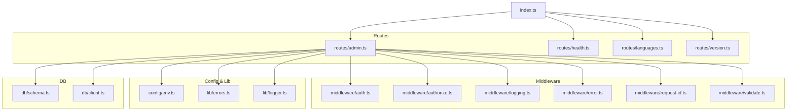
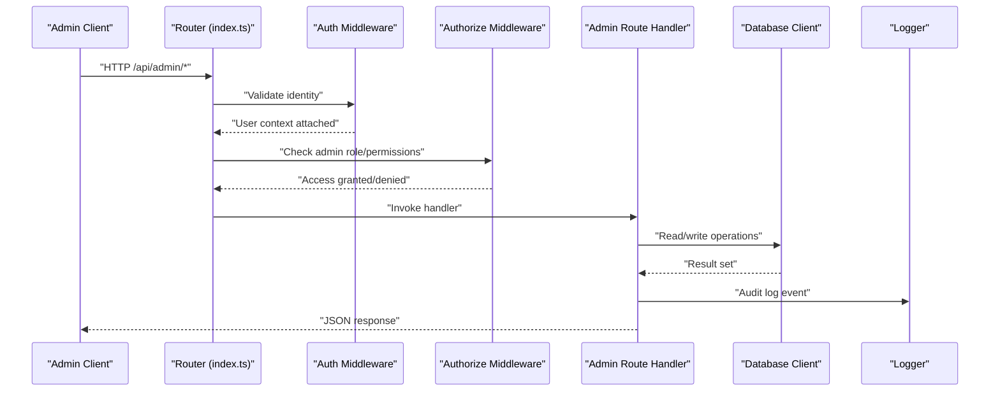
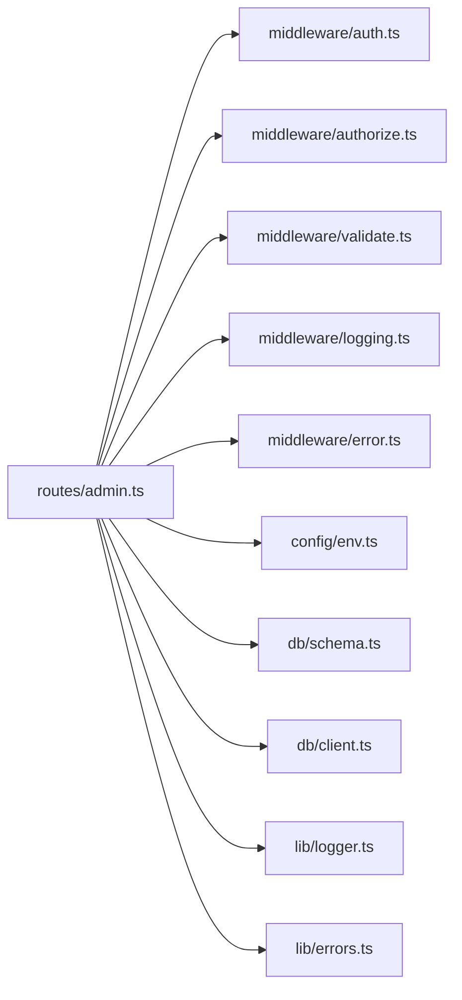

# Administrative Endpoints

<cite>
**Referenced Files in This Document**
- [admin.ts](file://src/routes/admin.ts)
- [auth.ts](file://src/middleware/auth.ts)
- [authorize.ts](file://src/middleware/authorize.ts)
- [index.ts](file://src/index.ts)
- [env.ts](file://src/config/env.ts)
- [logger.ts](file://src/lib/logger.ts)
- [errors.ts](file://src/lib/errors.ts)
- [schema.ts](file://src/db/schema.ts)
- [client.ts](file://src/db/client.ts)
</cite>

## Table of Contents
1. [Introduction](#introduction)
2. [Project Structure](#project-structure)
3. [Core Components](#core-components)
4. [Architecture Overview](#architecture-overview)
5. [Detailed Component Analysis](#detailed-component-analysis)
6. [Dependency Analysis](#dependency-analysis)
7. [Performance Considerations](#performance-considerations)
8. [Troubleshooting Guide](#troubleshooting-guide)
9. [Conclusion](#conclusion)
10. [Appendices](#appendices)

## Introduction
This document provides comprehensive API documentation for the administrative endpoints under /api/admin. It covers HTTP methods, URL patterns, request/response schemas, authentication and authorization requirements (including admin role validation and permission checks), security considerations, example requests using curl and JavaScript fetch, guidance for implementing admin interfaces and role-based access control, and monitoring/alerting recommendations for administrative actions.

## Project Structure
The administrative functionality is implemented as a dedicated route module and protected by middleware for authentication and authorization. The application wires routes at startup and uses environment configuration for sensitive settings. Database schema and client modules provide data access used by admin operations.

**Diagram sources**
- [index.ts](file://src/index.ts)
- [admin.ts](file://src/routes/admin.ts)
- [auth.ts](file://src/middleware/auth.ts)
- [authorize.ts](file://src/middleware/authorize.ts)
- [logging.ts](file://src/middleware/logging.ts)
- [error.ts](file://src/middleware/error.ts)
- [request-id.ts](file://src/middleware/request-id.ts)
- [validate.ts](file://src/middleware/validate.ts)
- [env.ts](file://src/config/env.ts)
- [errors.ts](file://src/lib/errors.ts)
- [logger.ts](file://src/lib/logger.ts)
- [schema.ts](file://src/db/schema.ts)
- [client.ts](file://src/db/client.ts)

**Section sources**
- [index.ts](file://src/index.ts)
- [admin.ts](file://src/routes/admin.ts)
- [auth.ts](file://src/middleware/auth.ts)
- [authorize.ts](file://src/middleware/authorize.ts)

## Core Components
- Admin Route Module: Defines all administrative endpoints under /api/admin with handlers for listing, creating, updating, and deleting resources.
- Authentication Middleware: Validates session or token presence and extracts user identity.
- Authorization Middleware: Enforces admin role and fine-grained permissions before executing handlers.
- Logging and Error Middleware: Records audit-relevant events and standardizes error responses.
- Environment Configuration: Provides secure access to secrets and feature flags.
- Database Schema and Client: Defines entities and provides typed queries used by admin operations.

Key responsibilities:
- Input validation and sanitization for admin payloads.
- Role-based access control ensuring only authorized administrators can perform sensitive actions.
- Audit logging for compliance and operational visibility.
- Consistent error responses with actionable details.

**Section sources**
- [admin.ts](file://src/routes/admin.ts)
- [auth.ts](file://src/middleware/auth.ts)
- [authorize.ts](file://src/middleware/authorize.ts)
- [logging.ts](file://src/middleware/logging.ts)
- [error.ts](file://src/middleware/error.ts)
- [env.ts](file://src/config/env.ts)
- [schema.ts](file://src/db/schema.ts)
- [client.ts](file://src/db/client.ts)

## Architecture Overview
Administrative requests flow through standardized middleware that ensures identity, authorization, input validation, and audit logging before reaching route handlers. Handlers interact with the database via typed clients and return structured JSON responses.

**Diagram sources**
- [index.ts](file://src/index.ts)
- [auth.ts](file://src/middleware/auth.ts)
- [authorize.ts](file://src/middleware/authorize.ts)
- [admin.ts](file://src/routes/admin.ts)
- [client.ts](file://src/db/client.ts)
- [logger.ts](file://src/lib/logger.ts)

## Detailed Component Analysis

### Authentication and Authorization
- Identity Validation: Ensures requests carry valid credentials and attaches user context.
- Admin Role Enforcement: Requires an admin role claim or equivalent mechanism.
- Permission Checks: Optional granular permissions for specific endpoints.

Implementation highlights:
- Rejects unauthenticated requests early.
- Fails fast on insufficient privileges.
- Emits audit logs for successful and failed attempts.

Security considerations:
- Use short-lived tokens and secure sessions.
- Rotate secrets regularly.
- Enforce least privilege for admin roles.

**Section sources**
- [auth.ts](file://src/middleware/auth.ts)
- [authorize.ts](file://src/middleware/authorize.ts)

### Admin Routes (/api/admin)
Endpoints are grouped under /api/admin and typically include:
- GET /api/admin/resources: List resources with optional filters and pagination.
- POST /api/admin/resources: Create a new resource with validated payload.
- PUT /api/admin/resources/{id}: Update an existing resource.
- DELETE /api/admin/resources/{id}: Delete a resource.

Request/response characteristics:
- All endpoints require admin authorization.
- Responses follow consistent JSON structure with status codes and messages.
- Errors include standardized error objects.

Example usage patterns:
- curl for listing and creating resources.
- JavaScript fetch for programmatic automation.

Note: Replace placeholders like {id} with actual identifiers. Ensure headers include required authentication tokens.

**Section sources**
- [admin.ts](file://src/routes/admin.ts)

### Input Validation and Error Handling
- Validation: Uses middleware to validate request bodies, query parameters, and path segments.
- Errors: Returns structured error responses with machine-readable codes and human-friendly messages.

Best practices:
- Validate on the server side even if client-side validation exists.
- Sanitize inputs to prevent injection attacks.
- Provide clear error messages without leaking sensitive information.

**Section sources**
- [validate.ts](file://src/middleware/validate.ts)
- [error.ts](file://src/middleware/error.ts)
- [errors.ts](file://src/lib/errors.ts)

### Audit Logging and Monitoring
- Audit Events: Log critical admin actions including who performed them, what was changed, and when.
- Correlation IDs: Attach request IDs to trace operations across services.
- Metrics: Emit counters and histograms for admin endpoint usage and latency.

Recommendations:
- Centralize logs in a secure, searchable system.
- Alert on anomalous admin activity (e.g., bulk deletions).
- Retain logs per compliance requirements.

**Section sources**
- [logging.ts](file://src/middleware/logging.ts)
- [request-id.ts](file://src/middleware/request-id.ts)
- [logger.ts](file://src/lib/logger.ts)

### Data Access and Schema
- Schema: Defines tables/entities relevant to admin operations.
- Client: Provides typed queries for safe and efficient data access.

Guidelines:
- Prefer parameterized queries to avoid SQL injection.
- Use transactions for multi-step admin operations.
- Index frequently queried fields for performance.

**Section sources**
- [schema.ts](file://src/db/schema.ts)
- [client.ts](file://src/db/client.ts)

## Dependency Analysis
The admin route depends on middleware for auth, authorization, validation, logging, and error handling. It also relies on environment configuration and database modules.

**Diagram sources**
- [admin.ts](file://src/routes/admin.ts)
- [auth.ts](file://src/middleware/auth.ts)
- [authorize.ts](file://src/middleware/authorize.ts)
- [validate.ts](file://src/middleware/validate.ts)
- [logging.ts](file://src/middleware/logging.ts)
- [error.ts](file://src/middleware/error.ts)
- [env.ts](file://src/config/env.ts)
- [schema.ts](file://src/db/schema.ts)
- [client.ts](file://src/db/client.ts)
- [logger.ts](file://src/lib/logger.ts)
- [errors.ts](file://src/lib/errors.ts)

**Section sources**
- [admin.ts](file://src/routes/admin.ts)
- [auth.ts](file://src/middleware/auth.ts)
- [authorize.ts](file://src/middleware/authorize.ts)
- [validate.ts](file://src/middleware/validate.ts)
- [logging.ts](file://src/middleware/logging.ts)
- [error.ts](file://src/middleware/error.ts)
- [env.ts](file://src/config/env.ts)
- [schema.ts](file://src/db/schema.ts)
- [client.ts](file://src/db/client.ts)
- [logger.ts](file://src/lib/logger.ts)
- [errors.ts](file://src/lib/errors.ts)

## Performance Considerations
- Pagination and Filtering: Implement server-side pagination and filtering for list endpoints to reduce payload size.
- Caching: Cache read-heavy admin queries where appropriate, with invalidation strategies.
- Database Indexing: Add indexes on commonly filtered columns.
- Connection Pooling: Ensure DB client uses connection pooling and proper timeouts.
- Rate Limiting: Apply rate limits to admin endpoints to mitigate abuse.

[No sources needed since this section provides general guidance]

## Troubleshooting Guide
Common issues and resolutions:
- 401 Unauthorized: Missing or invalid credentials; verify token/session validity and expiration.
- 403 Forbidden: Insufficient admin privileges; confirm role and permissions.
- 400 Bad Request: Invalid payload; check validation rules and field types.
- 500 Internal Server Error: Unexpected failures; review logs and stack traces.

Debugging steps:
- Enable detailed logging temporarily for problematic requests.
- Inspect request ID correlation across logs.
- Validate environment variables and secrets.

**Section sources**
- [error.ts](file://src/middleware/error.ts)
- [errors.ts](file://src/lib/errors.ts)
- [logging.ts](file://src/middleware/logging.ts)
- [logger.ts](file://src/lib/logger.ts)

## Conclusion
The administrative endpoints provide a secure, auditable interface for system administration tasks. By enforcing strong authentication, role-based authorization, input validation, and comprehensive logging, the system ensures both safety and operational visibility. Follow the provided examples and best practices to implement robust admin interfaces and automate administrative workflows safely.

[No sources needed since this section summarizes without analyzing specific files]

## Appendices

### Example Requests
- List resources (curl):
  - Command pattern: curl -H "Authorization: Bearer <TOKEN>" https://api.example.com/api/admin/resources
- Create resource (curl):
  - Command pattern: curl -X POST -H "Authorization: Bearer <TOKEN>" -H "Content-Type: application/json" -d '{"name":"example"}' https://api.example.com/api/admin/resources
- Update resource (JavaScript fetch):
  - Pattern: fetch("/api/admin/resources/{id}", { method: "PUT", headers: { "Authorization": "Bearer <TOKEN>", "Content-Type": "application/json" }, body: JSON.stringify({ name: "updated" }) })
- Delete resource (JavaScript fetch):
  - Pattern: fetch("/api/admin/resources/{id}", { method: "DELETE", headers: { "Authorization": "Bearer <TOKEN>" } })

Note: Replace placeholders with actual values. Ensure HTTPS and secure token storage.

[No sources needed since this section provides general guidance]

### Security Checklist
- Enforce TLS everywhere.
- Store secrets securely and rotate regularly.
- Validate and sanitize all inputs.
- Apply least privilege for admin roles.
- Monitor and alert on suspicious admin activity.
- Maintain audit trails for compliance.

[No sources needed since this section provides general guidance]