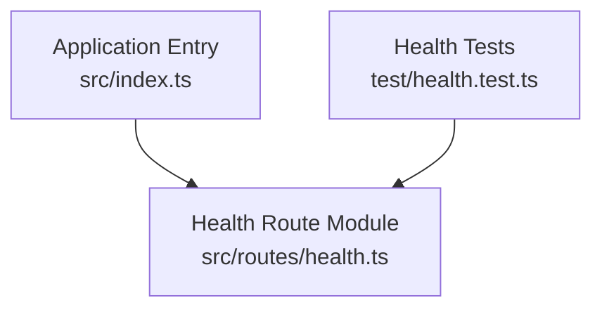
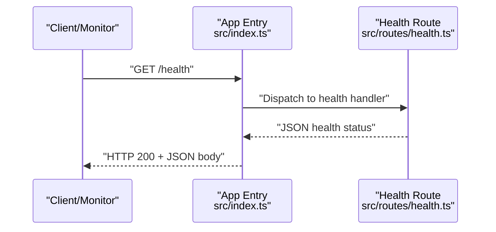
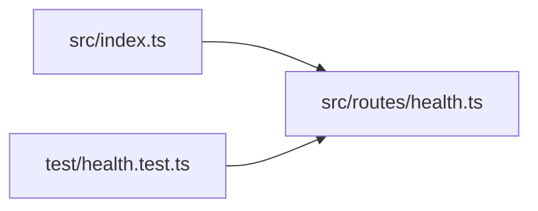

# Health Check Endpoints

<cite>
**Referenced Files in This Document**
- [health.ts](file://src/routes/health.ts)
- [index.ts](file://src/index.ts)
- [health.test.ts](file://test/health.test.ts)
</cite>

## Table of Contents
1. [Introduction](#introduction)
2. [Project Structure](#project-structure)
3. [Core Components](#core-components)
4. [Architecture Overview](#architecture-overview)
5. [Detailed Component Analysis](#detailed-component-analysis)
6. [Dependency Analysis](#dependency-analysis)
7. [Performance Considerations](#performance-considerations)
8. [Troubleshooting Guide](#troubleshooting-guide)
9. [Conclusion](#conclusion)

## Introduction
This document provides API documentation for the health check endpoints that expose service status information. It covers the HTTP GET method, URL patterns (/health), response schemas, and practical examples using curl and JavaScript fetch. It also explains health status codes, monitoring integration patterns, containerized environment considerations, load balancer configuration, and troubleshooting steps when health checks fail.

## Project Structure
The health endpoint is implemented as a route module and wired into the application entry point. Tests validate behavior.

**Diagram sources**
- [index.ts](file://src/index.ts)
- [health.ts](file://src/routes/health.ts)
- [health.test.ts](file://test/health.test.ts)

**Section sources**
- [index.ts](file://src/index.ts)
- [health.ts](file://src/routes/health.ts)
- [health.test.ts](file://test/health.test.ts)

## Core Components
- Health route module: Defines the /health endpoint and returns structured status information.
- Application entry: Mounts the health route so it is reachable at the expected path.
- Tests: Validate the endpoint’s response shape and status codes.

Key responsibilities:
- Expose a lightweight GET /health endpoint.
- Return a consistent JSON structure indicating service health.
- Provide clear status codes to support automated monitoring and orchestration.

**Section sources**
- [health.ts](file://src/routes/health.ts)
- [index.ts](file://src/index.ts)
- [health.test.ts](file://test/health.test.ts)

## Architecture Overview
The health check flow is straightforward: an external caller (monitoring system, orchestrator, or load balancer) sends an HTTP GET request to /health, and the server responds with a JSON payload describing the current health state.

**Diagram sources**
- [index.ts](file://src/index.ts)
- [health.ts](file://src/routes/health.ts)

## Detailed Component Analysis

### Health Endpoint API
- Method: GET
- Path: /health
- Authentication: None
- Content-Type: application/json
- Response Codes:
  - 200 OK: Service is healthy
  - 5xx: Indicates unhealthy or internal error conditions

Response Schema:
- top-level object containing:
  - status: string indicating overall health (for example, "ok")
  - timestamp: string representing the time of the response
  - version: string identifying the service version
  - uptime: number representing seconds since process start
  - dependencies: object with dependency-specific statuses (for example, database connectivity)

Notes:
- The exact fields may vary depending on implementation; the schema above reflects common patterns used by health endpoints.
- Dependencies section can be extended to include additional subsystems such as caches, message queues, or external APIs.

Request Examples:
- curl
  - curl -sS https://your-domain/health
- JavaScript fetch
  - fetch("https://your-domain/health").then(r => r.json()).then(console.log)

Monitoring Integration Patterns:
- Polling interval: Configure your monitor to poll every 10–30 seconds.
- Success criteria: Expect HTTP 200 and a valid JSON body with status "ok".
- Failure criteria: Non-200 responses or missing required fields indicate failure.
- Alerting: Trigger alerts after consecutive failures over a defined threshold.

Containerized Environments:
- Kubernetes: Use livenessProbe and readinessProbe pointing to /health.
- Docker: Integrate with orchestration tools via healthcheck directives or sidecars.
- Cloud Run/Serverless: Ensure cold-start behavior does not cause false negatives; consider warm-up strategies.

Load Balancers:
- Health checks: Point LB health checks to /health.
- Deregistration: Remove instances from rotation when /health fails consistently.
- Sticky sessions: Not required for health checks; keep them stateless.

**Section sources**
- [health.ts](file://src/routes/health.ts)
- [health.test.ts](file://test/health.test.ts)

### Implementation Details
- Route registration: The health route is mounted under /health in the application entry.
- Handler logic: Returns a JSON object with health details and appropriate HTTP status code.
- Testing: Validates response structure and status codes to ensure reliability.

Best Practices:
- Keep the endpoint fast and side-effect free.
- Include timestamps and version info for observability.
- Optionally report dependency health to provide richer context.

**Section sources**
- [index.ts](file://src/index.ts)
- [health.ts](file://src/routes/health.ts)
- [health.test.ts](file://test/health.test.ts)

## Dependency Analysis
The health endpoint has minimal external dependencies to ensure quick and reliable responses. It primarily depends on the application router and standard runtime utilities.

**Diagram sources**
- [index.ts](file://src/index.ts)
- [health.ts](file://src/routes/health.ts)
- [health.test.ts](file://test/health.test.ts)

**Section sources**
- [index.ts](file://src/index.ts)
- [health.ts](file://src/routes/health.ts)
- [health.test.ts](file://test/health.test.ts)

## Performance Considerations
- Keep the endpoint synchronous and lightweight to avoid latency spikes.
- Avoid heavy computations or I/O inside the handler.
- Cache any expensive checks if necessary, but prefer direct checks for accuracy.
- Monitor p95/p99 latencies to detect regressions early.

[No sources needed since this section provides general guidance]

## Troubleshooting Guide
Common issues and resolutions:
- 404 Not Found:
  - Cause: Route not mounted or wrong path.
  - Resolution: Verify the route is registered under /health in the application entry.
- 500 Internal Server Error:
  - Cause: Unexpected exception in the handler.
  - Resolution: Inspect logs, ensure no unhandled errors, and add defensive checks.
- Slow responses:
  - Cause: Heavy operations or blocking calls.
  - Resolution: Simplify the handler, remove unnecessary work, and profile performance.
- Inconsistent health across replicas:
  - Cause: External dependency failures or misconfiguration.
  - Resolution: Check dependency health, network policies, and secrets/config.
- Cold start flakiness:
  - Cause: Initialization delays in serverless/container environments.
  - Resolution: Implement warm-up hooks or adjust probe thresholds.

Operational tips:
- Add structured logging around the health endpoint for diagnostics.
- Include dependency status in the response to pinpoint failing subsystems.
- Use metrics to track success rates and latency distributions.

**Section sources**
- [health.test.ts](file://test/health.test.ts)

## Conclusion
The /health endpoint provides a simple, reliable mechanism for monitoring and orchestration systems to assess service health. By following the documented response schema, integrating with monitoring tools, and applying best practices for containerized and load-balanced deployments, you can achieve robust operational visibility and resilience.

[No sources needed since this section summarizes without analyzing specific files]