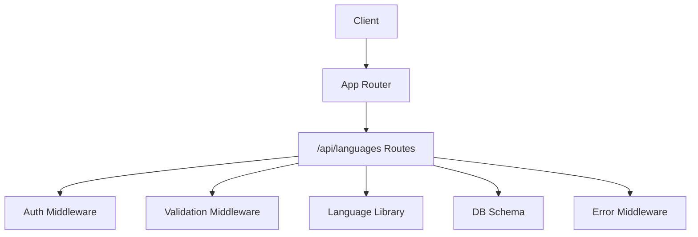
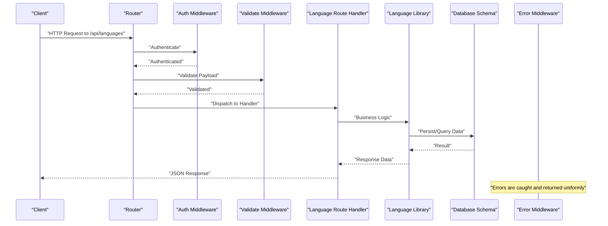
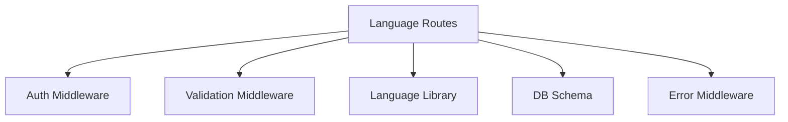

# Language Management Endpoints

<cite>
**Referenced Files in This Document**
- [languages.ts](file://src/routes/languages.ts)
- [languages.ts](file://src/lib/languages.ts)
- [auth.ts](file://src/middleware/auth.ts)
- [authorize.ts](file://src/middleware/authorize.ts)
- [error.ts](file://src/middleware/error.ts)
- [validate.ts](file://src/middleware/validate.ts)
- [schema.ts](file://src/db/schema.ts)
- [index.ts](file://src/index.ts)
</cite>

## Table of Contents
1. [Introduction](#introduction)
2. [Project Structure](#project-structure)
3. [Core Components](#core-components)
4. [Architecture Overview](#architecture-overview)
5. [Detailed Component Analysis](#detailed-component-analysis)
6. [Dependency Analysis](#dependency-analysis)
7. [Performance Considerations](#performance-considerations)
8. [Troubleshooting Guide](#troubleshooting-guide)
9. [Conclusion](#conclusion)
10. [Appendices](#appendices)

## Introduction
This document provides comprehensive API documentation for the language management endpoints that enable CRUD operations on supported languages and their configuration. It covers HTTP methods, URL patterns (/api/languages), request/response schemas, authentication requirements, input validation rules, error handling patterns, and best practices for internationalization, locale validation, and multi-language content management. It also includes caching strategies and performance optimization techniques to ensure efficient delivery of language data.

## Project Structure
The language management feature is implemented as a dedicated route module with supporting middleware and library utilities:
- Route handlers for /api/languages are defined in the routes layer.
- Validation and authorization are enforced via middleware.
- Core language logic and constants are centralized in a library module.
- Database schema definitions provide the structure for language entities.
- The application entry point wires up routes and middleware.

**Diagram sources**
- [index.ts](file://src/index.ts)
- [languages.ts](file://src/routes/languages.ts)
- [auth.ts](file://src/middleware/auth.ts)
- [validate.ts](file://src/middleware/validate.ts)
- [languages.ts](file://src/lib/languages.ts)
- [schema.ts](file://src/db/schema.ts)
- [error.ts](file://src/middleware/error.ts)

**Section sources**
- [index.ts](file://src/index.ts)
- [languages.ts](file://src/routes/languages.ts)
- [languages.ts](file://src/lib/languages.ts)
- [schema.ts](file://src/db/schema.ts)

## Core Components
- Route Handlers: Define endpoints for listing, creating, updating, and deleting language configurations under /api/languages.
- Authorization and Authentication: Enforce access control using middleware to ensure only authorized users can manage languages.
- Validation: Validate request payloads and parameters to ensure correctness and security.
- Language Library: Centralizes supported locales, default settings, and business rules for language management.
- Database Schema: Defines the structure for language records and relationships.
- Error Handling: Standardizes error responses across all endpoints.

**Section sources**
- [languages.ts](file://src/routes/languages.ts)
- [auth.ts](file://src/middleware/auth.ts)
- [authorize.ts](file://src/middleware/authorize.ts)
- [validate.ts](file://src/middleware/validate.ts)
- [languages.ts](file://src/lib/languages.ts)
- [schema.ts](file://src/db/schema.ts)
- [error.ts](file://src/middleware/error.ts)

## Architecture Overview
The language management API follows a layered architecture:
- Client requests enter through the application router.
- Requests are authenticated and authorized by middleware.
- Request payloads are validated before reaching route handlers.
- Route handlers invoke the language library for business logic.
- Data persistence is handled via database schema definitions.
- Errors are caught and standardized by the error middleware.

**Diagram sources**
- [index.ts](file://src/index.ts)
- [languages.ts](file://src/routes/languages.ts)
- [auth.ts](file://src/middleware/auth.ts)
- [validate.ts](file://src/middleware/validate.ts)
- [languages.ts](file://src/lib/languages.ts)
- [schema.ts](file://src/db/schema.ts)
- [error.ts](file://src/middleware/error.ts)

## Detailed Component Analysis

### Endpoint: List Languages (GET /api/languages)
- Purpose: Retrieve the list of supported languages and their configuration.
- Authentication: Required; enforced by auth middleware.
- Authorization: Admin or appropriate role required; enforced by authorize middleware.
- Query Parameters:
  - includeDisabled: boolean flag to include disabled languages (optional).
  - filterByRegion: string code to filter languages by region (optional).
- Response Schema:
  - Array of language objects with fields: id, code, name, displayName, region, isActive, createdAt, updatedAt.
- Example curl:
  - curl -X GET "https://your-domain/api/languages?includeDisabled=false&filterByRegion=US" -H "Authorization: Bearer YOUR_TOKEN"
- Example JavaScript fetch:
  - fetch("/api/languages?includeDisabled=false&filterByRegion=US", { headers: { "Authorization": "Bearer YOUR_TOKEN" } }).then(r => r.json()).then(console.log)

**Section sources**
- [languages.ts](file://src/routes/languages.ts)
- [auth.ts](file://src/middleware/auth.ts)
- [authorize.ts](file://src/middleware/authorize.ts)
- [languages.ts](file://src/lib/languages.ts)

### Endpoint: Create Language (POST /api/languages)
- Purpose: Add a new supported language configuration.
- Authentication: Required; enforced by auth middleware.
- Authorization: Admin or appropriate role required; enforced by authorize middleware.
- Request Body Schema:
  - code: string, ISO 639-1 or BCP-47 compliant, unique.
  - name: string, human-readable name.
  - displayName: string, localized display name.
  - region: string, optional region code.
  - isActive: boolean, defaults to true if omitted.
- Input Validation Rules:
  - code must be present and match locale pattern.
  - name and displayName must be non-empty strings.
  - region must be a valid region code if provided.
  - isActive must be a boolean.
- Response Schema:
  - Created language object with id, code, name, displayName, region, isActive, createdAt, updatedAt.
- Example curl:
  - curl -X POST "https://your-domain/api/languages" -H "Authorization: Bearer YOUR_TOKEN" -H "Content-Type: application/json" -d '{"code":"fr","name":"French","displayName":"Français","region":"FR","isActive":true}'
- Example JavaScript fetch:
  - fetch("/api/languages", { method: "POST", headers: { "Authorization": "Bearer YOUR_TOKEN", "Content-Type": "application/json" }, body: JSON.stringify({ code: "fr", name: "French", displayName: "Français", region: "FR", isActive: true }) }).then(r => r.json()).then(console.log)

**Section sources**
- [languages.ts](file://src/routes/languages.ts)
- [validate.ts](file://src/middleware/validate.ts)
- [languages.ts](file://src/lib/languages.ts)

### Endpoint: Update Language (PUT /api/languages/:id)
- Purpose: Update an existing language configuration.
- Authentication: Required; enforced by auth middleware.
- Authorization: Admin or appropriate role required; enforced by authorize middleware.
- Path Parameters:
  - id: string, unique identifier of the language record.
- Request Body Schema:
  - Fields are optional; only provided fields will be updated.
  - code, name, displayName, region, isActive follow the same validation rules as create.
- Response Schema:
  - Updated language object with id, code, name, displayName, region, isActive, createdAt, updatedAt.
- Example curl:
  - curl -X PUT "https://your-domain/api/languages/abc123" -H "Authorization: Bearer YOUR_TOKEN" -H "Content-Type: application/json" -d '{"isActive":false}'
- Example JavaScript fetch:
  - fetch("/api/languages/abc123", { method: "PUT", headers: { "Authorization": "Bearer YOUR_TOKEN", "Content-Type": "application/json" }, body: JSON.stringify({ isActive: false }) }).then(r => r.json()).then(console.log)

**Section sources**
- [languages.ts](file://src/routes/languages.ts)
- [validate.ts](file://src/middleware/validate.ts)
- [languages.ts](file://src/lib/languages.ts)

### Endpoint: Delete Language (DELETE /api/languages/:id)
- Purpose: Remove a supported language configuration.
- Authentication: Required; enforced by auth middleware.
- Authorization: Admin or appropriate role required; enforced by authorize middleware.
- Path Parameters:
  - id: string, unique identifier of the language record.
- Response Schema:
  - Success response indicating deletion, typically empty body or confirmation message.
- Example curl:
  - curl -X DELETE "https://your-domain/api/languages/abc123" -H "Authorization: Bearer YOUR_TOKEN"
- Example JavaScript fetch:
  - fetch("/api/languages/abc123", { method: "DELETE", headers: { "Authorization": "Bearer YOUR_TOKEN" } }).then(r => r.json()).then(console.log)

**Section sources**
- [languages.ts](file://src/routes/languages.ts)
- [auth.ts](file://src/middleware/auth.ts)
- [authorize.ts](file://src/middleware/authorize.ts)

### Internationalization Best Practices
- Locale Validation:
  - Use strict BCP-47 or ISO 639-1 codes for language identifiers.
  - Reject malformed or unsupported locales early in the pipeline.
- Multi-Language Content Management:
  - Store localized strings separately from business data.
  - Maintain a mapping between resource IDs and language-specific translations.
- Default Fallbacks:
  - Implement fallback mechanisms to a default language when translations are missing.
- Consistency:
  - Ensure consistent naming conventions for locale keys and file structures.

[No sources needed since this section provides general guidance]

### Caching Strategies for Language Data
- In-Memory Cache:
  - Cache language configurations at application startup to reduce database queries.
- CDN Edge Caching:
  - Serve static language assets via CDN for low-latency global access.
- Browser Caching:
  - Set appropriate cache-control headers for language resources.
- Versioning:
  - Version language bundles to avoid stale content issues.

[No sources needed since this section provides general guidance]

## Dependency Analysis
The language management endpoints depend on several modules:
- Route handlers rely on middleware for authentication, authorization, and validation.
- Business logic is encapsulated in the language library.
- Database interactions are guided by schema definitions.
- Error handling is centralized to ensure consistent responses.

**Diagram sources**
- [languages.ts](file://src/routes/languages.ts)
- [auth.ts](file://src/middleware/auth.ts)
- [validate.ts](file://src/middleware/validate.ts)
- [languages.ts](file://src/lib/languages.ts)
- [schema.ts](file://src/db/schema.ts)
- [error.ts](file://src/middleware/error.ts)

**Section sources**
- [languages.ts](file://src/routes/languages.ts)
- [auth.ts](file://src/middleware/auth.ts)
- [validate.ts](file://src/middleware/validate.ts)
- [languages.ts](file://src/lib/languages.ts)
- [schema.ts](file://src/db/schema.ts)
- [error.ts](file://src/middleware/error.ts)

## Performance Considerations
- Minimize Database Queries:
  - Batch operations where possible to reduce round trips.
- Optimize Payloads:
  - Return only necessary fields in responses.
- Leverage Caching:
  - Use in-memory caches for frequently accessed language data.
- Monitor Latency:
  - Track endpoint latency and optimize hot paths.

[No sources needed since this section provides general guidance]

## Troubleshooting Guide
Common issues and resolutions:
- Authentication Failures:
  - Ensure tokens are valid and properly formatted.
- Validation Errors:
  - Check request payload against expected schema.
- Authorization Denials:
  - Verify user roles and permissions.
- Database Errors:
  - Inspect connection status and schema integrity.

**Section sources**
- [error.ts](file://src/middleware/error.ts)
- [validate.ts](file://src/middleware/validate.ts)
- [auth.ts](file://src/middleware/auth.ts)
- [authorize.ts](file://src/middleware/authorize.ts)

## Conclusion
The language management endpoints provide a robust and secure way to manage supported languages and their configurations. By following the documented schemas, validation rules, and best practices, developers can implement reliable internationalization features. Proper caching and performance optimizations ensure efficient delivery of language data across global audiences.

[No sources needed since this section summarizes without analyzing specific files]

## Appendices

### Request/Response Schemas Summary
- List Languages Response:
  - Array of language objects with id, code, name, displayName, region, isActive, createdAt, updatedAt.
- Create Language Request:
  - code, name, displayName, region, isActive fields.
- Update Language Request:
  - Optional fields matching create schema.
- Delete Language Response:
  - Success confirmation or empty body.

[No sources needed since this section provides general guidance]

### Error Handling Patterns
- Unauthorized:
  - 401 status with error message.
- Forbidden:
  - 403 status with error message.
- Validation Error:
  - 422 status with detailed field errors.
- Not Found:
  - 404 status with resource not found message.
- Server Error:
  - 500 status with generic error message.

**Section sources**
- [error.ts](file://src/middleware/error.ts)