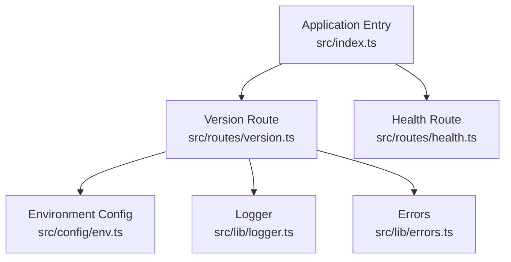
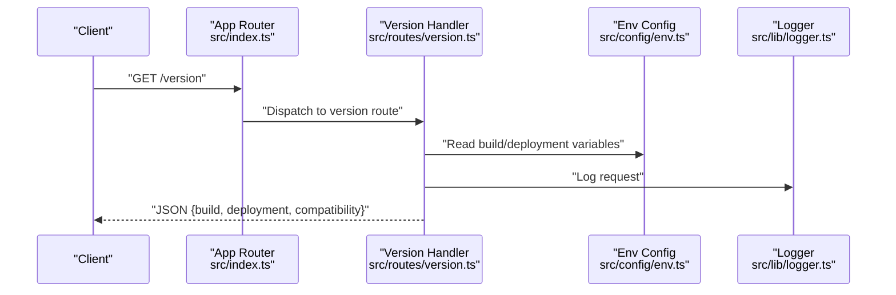
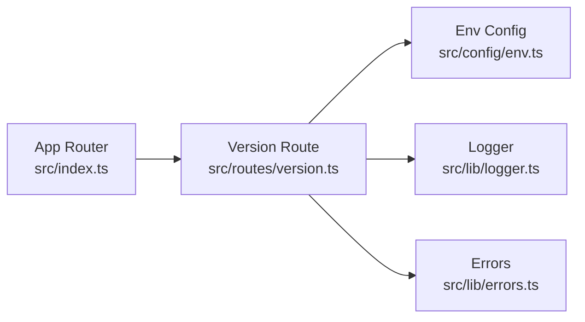

# Version Information Endpoints

<cite>
**Referenced Files in This Document**
- [version.ts](file://src/routes/version.ts)
- [index.ts](file://src/index.ts)
- [env.ts](file://src/config/env.ts)
- [logger.ts](file://src/lib/logger.ts)
- [errors.ts](file://src/lib/errors.ts)
- [health.ts](file://src/routes/health.ts)
</cite>

## Table of Contents
1. [Introduction](#introduction)
2. [Project Structure](#project-structure)
3. [Core Components](#core-components)
4. [Architecture Overview](#architecture-overview)
5. [Detailed Component Analysis](#detailed-component-analysis)
6. [Dependency Analysis](#dependency-analysis)
7. [Performance Considerations](#performance-considerations)
8. [Troubleshooting Guide](#troubleshooting-guide)
9. [Conclusion](#conclusion)
10. [Appendices](#appendices)

## Introduction
This document provides API documentation for the version information endpoints that expose build and deployment metadata, as well as compatibility matrices. It covers the HTTP GET method, URL patterns (/version), response schemas, request/response examples using curl and JavaScript fetch, version negotiation strategies, backwards compatibility handling, client-side version checking patterns, and integration guidance for dashboards and monitoring systems.

## Project Structure
The version endpoint is implemented as a route module and mounted into the application entrypoint. Configuration and logging utilities are used to assemble and log version details. The health route is included for context on how similar lightweight read-only endpoints are structured.

**Diagram sources**
- [index.ts](file://src/index.ts)
- [version.ts](file://src/routes/version.ts)
- [health.ts](file://src/routes/health.ts)
- [env.ts](file://src/config/env.ts)
- [logger.ts](file://src/lib/logger.ts)
- [errors.ts](file://src/lib/errors.ts)

**Section sources**
- [index.ts](file://src/index.ts)
- [version.ts](file://src/routes/version.ts)
- [health.ts](file://src/routes/health.ts)
- [env.ts](file://src/config/env.ts)
- [logger.ts](file://src/lib/logger.ts)
- [errors.ts](file://src/lib/errors.ts)

## Core Components
- Version Route: Implements the /version endpoint returning build and deployment metadata along with a compatibility matrix.
- Environment Config: Supplies runtime variables such as build identifiers and deployment targets.
- Logger: Records requests and responses for observability.
- Errors: Centralized error types and formatting.

Key responsibilities:
- Expose stable JSON schema for version data.
- Provide backward-compatible fields across versions.
- Support optional query parameters for filtering or selecting specific metadata.
- Log access without leaking sensitive information.

**Section sources**
- [version.ts](file://src/routes/version.ts)
- [env.ts](file://src/config/env.ts)
- [logger.ts](file://src/lib/logger.ts)
- [errors.ts](file://src/lib/errors.ts)

## Architecture Overview
The /version endpoint follows a simple, stateless pattern:
- Client sends an HTTP GET request to /version.
- The route handler reads environment configuration and constructs a version object.
- The logger records the request for observability.
- The server returns a JSON response containing build info, deployment metadata, and compatibility matrices.

**Diagram sources**
- [index.ts](file://src/index.ts)
- [version.ts](file://src/routes/version.ts)
- [env.ts](file://src/config/env.ts)
- [logger.ts](file://src/lib/logger.ts)

## Detailed Component Analysis

### Version Endpoint (/version)
- Method: HTTP GET
- Path: /version
- Authentication: None (public read-only)
- Query Parameters:
  - format: Optional string to select output format; defaults to json if not provided.
- Response Schema:
  - build: Object containing build identifier, timestamp, and source commit hash.
  - deployment: Object containing target platform, region, and deployer identity.
  - compatibility: Object mapping supported API versions to feature flags or constraints.
- Status Codes:
  - 200 OK: Successful retrieval of version information.
  - 500 Internal Server Error: Unexpected failure during assembly of version data.

Request example (curl):
- curl https://api.example.com/version
- curl "https://api.example.com/version?format=json"

Response example (JSON):
- {
    "build": {
      "id": "string",
      "timestamp": "ISO-8601 datetime",
      "commit": "string"
    },
    "deployment": {
      "platform": "string",
      "region": "string",
      "deployer": "string"
    },
    "compatibility": {
      "supported_versions": ["string"],
      "features": {
        "feature_flag_name": "boolean"
      }
    }
  }

JavaScript fetch implementation:
- const res = await fetch("/version");
- const data = await res.json();
- console.log(data);

Notes:
- Clients should parse the compatibility field to determine supported features and negotiate behavior accordingly.
- Timestamps are ISO-8601 strings for easy parsing across languages.

**Section sources**
- [version.ts](file://src/routes/version.ts)
- [env.ts](file://src/config/env.ts)
- [logger.ts](file://src/lib/logger.ts)
- [errors.ts](file://src/lib/errors.ts)

### Version Negotiation Strategies
- Feature-based negotiation:
  - Use the compatibility.features map to enable/disable client behaviors based on feature flags.
- Version range negotiation:
  - Compare client’s expected API version against compatibility.supported_versions to decide whether to proceed or fallback.
- Graceful degradation:
  - If a requested feature is unavailable, fall back to a compatible subset of functionality.

Backwards compatibility handling:
- Always include deprecated fields alongside new ones for a transition period.
- Mark deprecated fields explicitly in documentation and plan removal timelines.
- Avoid breaking changes to existing fields; add new fields instead.

Client-side version checking patterns:
- On startup, fetch /version and cache the result for the session.
- Validate that required features are present before invoking dependent APIs.
- Implement retry logic with exponential backoff when version checks fail transiently.

**Section sources**
- [version.ts](file://src/routes/version.ts)
- [env.ts](file://src/config/env.ts)

### Integration with Dashboards and Monitoring
- Metrics collection:
  - Count successful /version calls per minute to monitor availability.
  - Track latency percentiles for the endpoint to detect performance regressions.
- Health checks:
  - Combine /version with /health to provide both operational status and version context.
- Alerting:
  - Alert on increased error rates or latency spikes for /version.
- Logging:
  - Ensure logs capture request IDs and timestamps without sensitive data.

**Section sources**
- [version.ts](file://src/routes/version.ts)
- [health.ts](file://src/routes/health.ts)
- [logger.ts](file://src/lib/logger.ts)

## Dependency Analysis
The version endpoint depends on environment configuration and logging utilities. It is mounted by the application router and does not depend on external services.

**Diagram sources**
- [version.ts](file://src/routes/version.ts)
- [env.ts](file://src/config/env.ts)
- [logger.ts](file://src/lib/logger.ts)
- [errors.ts](file://src/lib/errors.ts)
- [index.ts](file://src/index.ts)

**Section sources**
- [version.ts](file://src/routes/version.ts)
- [env.ts](file://src/config/env.ts)
- [logger.ts](file://src/lib/logger.ts)
- [errors.ts](file://src/lib/errors.ts)
- [index.ts](file://src/index.ts)

## Performance Considerations
- Keep the /response payload minimal to reduce bandwidth usage.
- Cache the version response at the edge or CDN where possible due to its infrequent changes.
- Avoid heavy computations in the handler; rely on pre-built build metadata injected via environment variables.
- Monitor p95/p99 latencies and set SLOs for the endpoint.

[No sources needed since this section provides general guidance]

## Troubleshooting Guide
Common issues and resolutions:
- Missing environment variables:
  - Ensure all required build and deployment variables are set in the runtime environment.
- Inconsistent compatibility data:
  - Verify that the compatibility matrix aligns with deployed features and client expectations.
- Logging gaps:
  - Confirm that request IDs are propagated and logged consistently.
- Error handling:
  - Review centralized error types to ensure meaningful messages without exposing internals.

**Section sources**
- [env.ts](file://src/config/env.ts)
- [logger.ts](file://src/lib/logger.ts)
- [errors.ts](file://src/lib/errors.ts)

## Conclusion
The /version endpoint provides a reliable, lightweight mechanism to expose build and deployment metadata along with a compatibility matrix. By following the documented schemas and negotiation strategies, clients can implement robust version checks and graceful degradation. Integrating the endpoint into dashboards and monitoring systems enhances observability and supports proactive maintenance.

[No sources needed since this section summarizes without analyzing specific files]

## Appendices

### Request/Response Examples
- curl:
  - curl https://api.example.com/version
  - curl "https://api.example.com/version?format=json"
- JavaScript fetch:
  - const res = await fetch("/version");
  - const data = await res.json();
  - console.log(data);

### Compatibility Matrix Fields
- supported_versions: Array of API version strings supported by the current deployment.
- features: Map of feature flag names to boolean values indicating availability.

### Backwards Compatibility Checklist
- Include deprecated fields during transition periods.
- Avoid renaming or removing existing fields without deprecation notices.
- Maintain stable JSON schema across minor releases.

[No sources needed since this section provides general guidance]