# Activation System

<cite>
**Referenced Files in This Document**
- [src/activation/index.ts](file://src/activation/index.ts)
- [src/activation/config.ts](file://src/activation/config.ts)
- [src/activation/schema.ts](file://src/activation/schema.ts)
- [src/activation/types.ts](file://src/activation/types.ts)
- [src/activation/middleware.ts](file://src/activation/middleware.ts)
- [src/activation/routes/activate.ts](file://src/activation/routes/activate.ts)
- [src/activation/routes/deactivate.ts](file://src/activation/routes/deactivate.ts)
- [src/activation/routes/reactivate.ts](file://src/activation/routes/reactivate.ts)
- [src/activation/routes/status.ts](file://src/activation/routes/status.ts)
- [src/activation/routes/admin.ts](file://src/activation/routes/admin.ts)
- [src/activation/lib/authorize.ts](file://src/activation/lib/authorize.ts)
- [src/activation/lib/jwt.ts](file://src/activation/lib/jwt.ts)
- [src/activation/lib/license-key.ts](file://src/activation/lib/license-key.ts)
- [src/activation/lib/license-lookup.ts](file://src/activation/lib/license-lookup.ts)
- [src/activation/lib/respond.ts](file://src/activation/lib/respond.ts)
- [src/activation/lib/seats.ts](file://src/activation/lib/seats.ts)
- [drizzle-activation/0000_activation_init.sql](file://drizzle-activation/0000_activation_init.sql)
- [wrangler.activation.jsonc](file://wrangler.activation.jsonc)
- [wrangler.activation.staging.jsonc](file://wrangler.activation.staging.jsonc)
- [vitest.activation.config.ts](file://vitest.activation.config.ts)
- [test/activation/activate.test.ts](file://test/activation/activate.test.ts)
- [test/activation/deactivate.test.ts](file://test/activation/deactivate.test.ts)
- [test/activation/reactivate.test.ts](file://test/activation/reactivate.test.ts)
- [test/activation/admin.test.ts](file://test/activation/admin.test.ts)
- [test/activation/dev-license.test.ts](file://test/activation/dev-license.test.ts)
- [test/activation/helpers.ts](file://test/activation/helpers.ts)
- [test/activation/test-keys.ts](file://test/activation/test-keys.ts)
</cite>

## Table of Contents
1. [Introduction](#introduction)
2. [Project Structure](#project-structure)
3. [Core Components](#core-components)
4. [Architecture Overview](#architecture-overview)
5. [Detailed Component Analysis](#detailed-component-analysis)
6. [Dependency Analysis](#dependency-analysis)
7. [Performance Considerations](#performance-considerations)
8. [Troubleshooting Guide](#troubleshooting-guide)
9. [Conclusion](#conclusion)
10. [Appendices](#appendices)

## Introduction
This document describes the Activation System for api.trackdub.com, a Cloudflare Worker backend that manages license activation, deactivation, reactivation, and status queries. It is implemented as a Hono-based module with Zod validation, Drizzle ORM migrations for D1 (SQLite), and JWT-based tokens for activation payloads. The system exposes endpoints to activate a license against a seat count, deactivate it, reactivate when needed, and query current activation state. Administrative operations are supported via dedicated routes protected by authorization middleware.

The Activation System is isolated from the main app’s auth flow but integrates with shared middleware for logging, request-id, error handling, and validation. Configuration is validated at first request using environment variables, and secrets are managed through Wrangler secrets or local .dev.vars.

## Project Structure
The Activation System lives under src/activation and includes:
- Entry point and router wiring
- Configuration and schema definitions
- Route handlers for activation lifecycle
- Shared libraries for authorization, JWT, license key management, lookup, response helpers, and seat accounting
- Drizzle migration for activation-specific tables
- Wrangler configuration for separate deployment profiles
- Comprehensive tests covering activation flows and admin operations

```mermaid
graph TB
subgraph "Activation Module"
A_Index["src/activation/index.ts"]
A_Config["src/activation/config.ts"]
A_Schema["src/activation/schema.ts"]
A_Types["src/activation/types.ts"]
A_MW["src/activation/middleware.ts"]
end
subgraph "Routes"
R_Activate["routes/activate.ts"]
R_Deactivate["routes/deactivate.ts"]
R_Reactivate["routes/reactivate.ts"]
R_Status["routes/status.ts"]
R_Admin["routes/admin.ts"]
end
subgraph "Lib"
L_Authorize["lib/authorize.ts"]
L_JWT["lib/jwt.ts"]
L_Key["lib/license-key.ts"]
L_Lookup["lib/license-lookup.ts"]
L_Respond["lib/respond.ts"]
L_Seats["lib/seats.ts"]
end
subgraph "DB"
M_Drizzle["drizzle-activation/0000_activation_init.sql"]
end
subgraph "Config & Tests"
W_Activation["wrangler.activation.jsonc"]
W_Staging["wrangler.activation.staging.jsonc"]
V_TestCfg["vitest.activation.config.ts"]
T_Activate["test/activation/activate.test.ts"]
T_Deactivate["test/activation/deactivate.test.ts"]
T_Reactivate["test/activation/reactivate.test.ts"]
T_Admin["test/activation/admin.test.ts"]
T_DevLicense["test/activation/dev-license.test.ts"]
T_Helpers["test/activation/helpers.ts"]
T_Keys["test/activation/test-keys.ts"]
end
A_Index --> R_Activate
A_Index --> R_Deactivate
A_Index --> R_Reactivate
A_Index --> R_Status
A_Index --> R_Admin
R_Activate --> L_Key
R_Activate --> L_Lookup
R_Activate --> L_Seats
R_Activate --> L_Respond
R_Activate --> L_Authorize
R_Activate --> L_JWT
R_Deactivate --> L_Key
R_Deactivate --> L_Lookup
R_Deactivate --> L_Seats
R_Deactivate --> L_Respond
R_Deactivate --> L_Authorize
R_Reactivate --> L_Key
R_Reactivate --> L_Lookup
R_Reactivate --> L_Seats
R_Reactivate --> L_Respond
R_Reactivate --> L_Authorize
R_Status --> L_Key
R_Status --> L_Lookup
R_Status --> L_Respond
R_Admin --> L_Authorize
R_Admin --> L_Respond
A_Index --> A_Config
A_Index --> A_Schema
A_Index --> A_Types
A_Index --> A_MW
R_Activate --> M_Drizzle
R_Deactivate --> M_Drizzle
R_Reactivate --> M_Drizzle
R_Status --> M_Drizzle
R_Admin --> M_Drizzle
A_Index --> W_Activation
A_Index --> W_Staging
T_Activate --> V_TestCfg
T_Deactivate --> V_TestCfg
T_Reactivate --> V_TestCfg
T_Admin --> V_TestCfg
T_DevLicense --> V_TestCfg
```

**Diagram sources**
- [src/activation/index.ts](file://src/activation/index.ts)
- [src/activation/config.ts](file://src/activation/config.ts)
- [src/activation/schema.ts](file://src/activation/schema.ts)
- [src/activation/types.ts](file://src/activation/types.ts)
- [src/activation/middleware.ts](file://src/activation/middleware.ts)
- [src/activation/routes/activate.ts](file://src/activation/routes/activate.ts)
- [src/activation/routes/deactivate.ts](file://src/activation/routes/deactivate.ts)
- [src/activation/routes/reactivate.ts](file://src/activation/routes/reactivate.ts)
- [src/activation/routes/status.ts](file://src/activation/routes/status.ts)
- [src/activation/routes/admin.ts](file://src/activation/routes/admin.ts)
- [src/activation/lib/authorize.ts](file://src/activation/lib/authorize.ts)
- [src/activation/lib/jwt.ts](file://src/activation/lib/jwt.ts)
- [src/activation/lib/license-key.ts](file://src/activation/lib/license-key.ts)
- [src/activation/lib/license-lookup.ts](file://src/activation/lib/license-lookup.ts)
- [src/activation/lib/respond.ts](file://src/activation/lib/respond.ts)
- [src/activation/lib/seats.ts](file://src/activation/lib/seats.ts)
- [drizzle-activation/0000_activation_init.sql](file://drizzle-activation/0000_activation_init.sql)
- [wrangler.activation.jsonc](file://wrangler.activation.jsonc)
- [wrangler.activation.staging.jsonc](file://wrangler.activation.staging.jsonc)
- [vitest.activation.config.ts](file://vitest.activation.config.ts)

**Section sources**
- [src/activation/index.ts](file://src/activation/index.ts)
- [src/activation/config.ts](file://src/activation/config.ts)
- [src/activation/schema.ts](file://src/activation/schema.ts)
- [src/activation/types.ts](file://src/activation/types.ts)
- [src/activation/middleware.ts](file://src/activation/middleware.ts)
- [drizzle-activation/0000_activation_init.sql](file://drizzle-activation/0000_activation_init.sql)
- [wrangler.activation.jsonc](file://wrangler.activation.jsonc)
- [wrangler.activation.staging.jsonc](file://wrangler.activation.staging.jsonc)
- [vitest.activation.config.ts](file://vitest.activation.config.ts)

## Core Components
- Router and entrypoint: Registers activation routes and applies activation-scoped middleware.
- Configuration: Validates environment variables required for activation endpoints and JWT signing.
- Schema and types: Defines request/response shapes and internal types used across routes and libraries.
- Middleware: Authorization and request-scoped utilities tailored for activation endpoints.
- Routes: Implement activation, deactivation, reactivation, status, and administrative operations.
- Libraries:
  - Authorization: Enforces access control for admin and protected routes.
  - JWT: Issues and verifies tokens used in activation payloads.
  - License Key: Encodes/decodes and validates license keys.
  - License Lookup: Retrieves license metadata and associations.
  - Seats: Tracks and enforces seat limits per activation.
  - Respond: Standardizes success/error responses.

**Section sources**
- [src/activation/index.ts](file://src/activation/index.ts)
- [src/activation/config.ts](file://src/activation/config.ts)
- [src/activation/schema.ts](file://src/activation/schema.ts)
- [src/activation/types.ts](file://src/activation/types.ts)
- [src/activation/middleware.ts](file://src/activation/middleware.ts)
- [src/activation/lib/authorize.ts](file://src/activation/lib/authorize.ts)
- [src/activation/lib/jwt.ts](file://src/activation/lib/jwt.ts)
- [src/activation/lib/license-key.ts](file://src/activation/lib/license-key.ts)
- [src/activation/lib/license-lookup.ts](file://src/activation/lib/license-lookup.ts)
- [src/activation/lib/seats.ts](file://src/activation/lib/seats.ts)
- [src/activation/lib/respond.ts](file://src/activation/lib/respond.ts)

## Architecture Overview
The Activation System follows a layered architecture:
- HTTP layer: Hono routes handle requests and delegate to route handlers.
- Business logic: Route handlers orchestrate license key processing, seat accounting, and persistence.
- Data layer: Drizzle ORM interacts with D1 (SQLite) via migrations defined for activation.
- Security: JWT-based tokens secure activation payloads; authorization middleware protects admin routes.
- Configuration: Environment-driven settings validated on first request ensure fail-fast behavior.

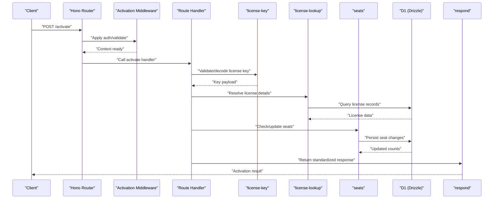

**Diagram sources**
- [src/activation/routes/activate.ts](file://src/activation/routes/activate.ts)
- [src/activation/lib/license-key.ts](file://src/activation/lib/license-key.ts)
- [src/activation/lib/license-lookup.ts](file://src/activation/lib/license-lookup.ts)
- [src/activation/lib/seats.ts](file://src/activation/lib/seats.ts)
- [drizzle-activation/0000_activation_init.sql](file://drizzle-activation/0000_activation_init.sql)
- [src/activation/lib/respond.ts](file://src/activation/lib/respond.ts)

## Detailed Component Analysis

### Activation Router and Entrypoint
The activation module registers all activation-related routes and wires middleware. It ensures configuration is validated early and sets up consistent error handling and logging.

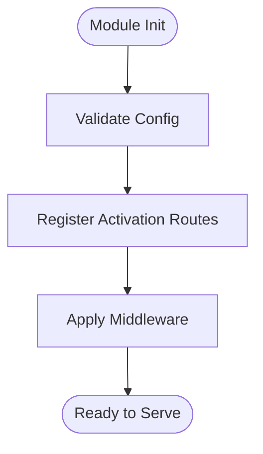

**Diagram sources**
- [src/activation/index.ts](file://src/activation/index.ts)
- [src/activation/config.ts](file://src/activation/config.ts)
- [src/activation/middleware.ts](file://src/activation/middleware.ts)

**Section sources**
- [src/activation/index.ts](file://src/activation/index.ts)
- [src/activation/config.ts](file://src/activation/config.ts)
- [src/activation/middleware.ts](file://src/activation/middleware.ts)

### Activate Endpoint
Handles license activation by validating the provided license key, resolving license details, enforcing seat limits, and persisting activation state.

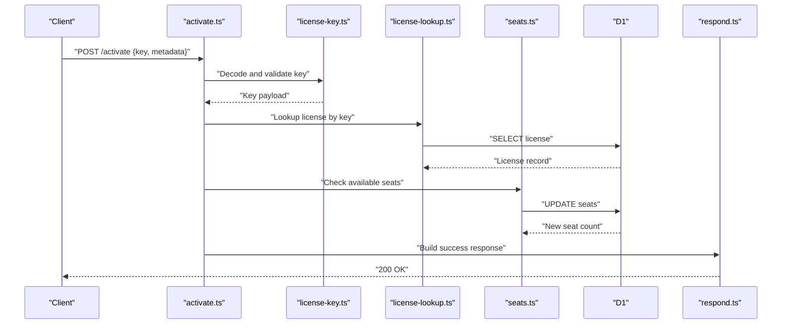

**Diagram sources**
- [src/activation/routes/activate.ts](file://src/activation/routes/activate.ts)
- [src/activation/lib/license-key.ts](file://src/activation/lib/license-key.ts)
- [src/activation/lib/license-lookup.ts](file://src/activation/lib/license-lookup.ts)
- [src/activation/lib/seats.ts](file://src/activation/lib/seats.ts)
- [drizzle-activation/0000_activation_init.sql](file://drizzle-activation/0000_activation_init.sql)
- [src/activation/lib/respond.ts](file://src/activation/lib/respond.ts)

**Section sources**
- [src/activation/routes/activate.ts](file://src/activation/routes/activate.ts)
- [src/activation/lib/license-key.ts](file://src/activation/lib/license-key.ts)
- [src/activation/lib/license-lookup.ts](file://src/activation/lib/license-lookup.ts)
- [src/activation/lib/seats.ts](file://src/activation/lib/seats.ts)
- [src/activation/lib/respond.ts](file://src/activation/lib/respond.ts)

### Deactivate Endpoint
Processes license deactivation by verifying the license key, updating seat counts, and marking the license as deactivated.

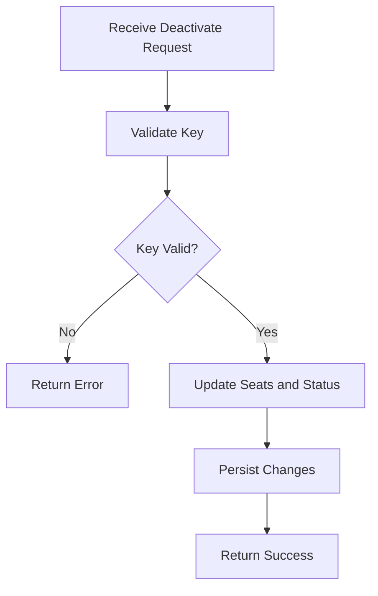

**Diagram sources**
- [src/activation/routes/deactivate.ts](file://src/activation/routes/deactivate.ts)
- [src/activation/lib/license-key.ts](file://src/activation/lib/license-key.ts)
- [src/activation/lib/seats.ts](file://src/activation/lib/seats.ts)
- [src/activation/lib/respond.ts](file://src/activation/lib/respond.ts)

**Section sources**
- [src/activation/routes/deactivate.ts](file://src/activation/routes/deactivate.ts)
- [src/activation/lib/license-key.ts](file://src/activation/lib/license-key.ts)
- [src/activation/lib/seats.ts](file://src/activation/lib/seats.ts)
- [src/activation/lib/respond.ts](file://src/activation/lib/respond.ts)

### Reactivate Endpoint
Allows reactivating a previously deactivated license, ensuring the key is valid and seats are correctly restored.

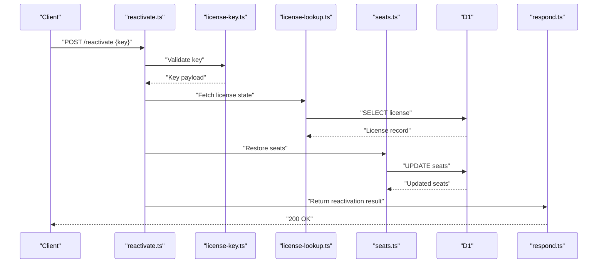

**Diagram sources**
- [src/activation/routes/reactivate.ts](file://src/activation/routes/reactivate.ts)
- [src/activation/lib/license-key.ts](file://src/activation/lib/license-key.ts)
- [src/activation/lib/license-lookup.ts](file://src/activation/lib/license-lookup.ts)
- [src/activation/lib/seats.ts](file://src/activation/lib/seats.ts)
- [drizzle-activation/0000_activation_init.sql](file://drizzle-activation/0000_activation_init.sql)
- [src/activation/lib/respond.ts](file://src/activation/lib/respond.ts)

**Section sources**
- [src/activation/routes/reactivate.ts](file://src/activation/routes/reactivate.ts)
- [src/activation/lib/license-key.ts](file://src/activation/lib/license-key.ts)
- [src/activation/lib/license-lookup.ts](file://src/activation/lib/license-lookup.ts)
- [src/activation/lib/seats.ts](file://src/activation/lib/seats.ts)
- [src/activation/lib/respond.ts](file://src/activation/lib/respond.ts)

### Status Endpoint
Returns the current activation state for a given license key without mutating data.

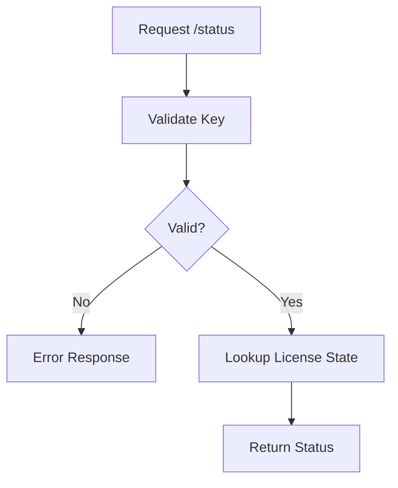

**Diagram sources**
- [src/activation/routes/status.ts](file://src/activation/routes/status.ts)
- [src/activation/lib/license-key.ts](file://src/activation/lib/license-key.ts)
- [src/activation/lib/license-lookup.ts](file://src/activation/lib/license-lookup.ts)
- [src/activation/lib/respond.ts](file://src/activation/lib/respond.ts)

**Section sources**
- [src/activation/routes/status.ts](file://src/activation/routes/status.ts)
- [src/activation/lib/license-key.ts](file://src/activation/lib/license-key.ts)
- [src/activation/lib/license-lookup.ts](file://src/activation/lib/license-lookup.ts)
- [src/activation/lib/respond.ts](file://src/activation/lib/respond.ts)

### Admin Endpoints
Administrative operations are exposed via dedicated routes and protected by authorization middleware. These may include listing activations, forcing reactivation, or managing seat allocations.

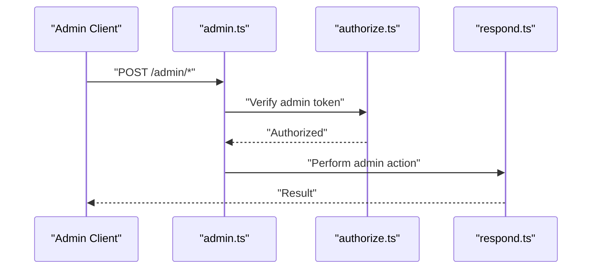

**Diagram sources**
- [src/activation/routes/admin.ts](file://src/activation/routes/admin.ts)
- [src/activation/lib/authorize.ts](file://src/activation/lib/authorize.ts)
- [src/activation/lib/respond.ts](file://src/activation/lib/respond.ts)

**Section sources**
- [src/activation/routes/admin.ts](file://src/activation/routes/admin.ts)
- [src/activation/lib/authorize.ts](file://src/activation/lib/authorize.ts)
- [src/activation/lib/respond.ts](file://src/activation/lib/respond.ts)

### JWT and Authorization
JWTs are used to sign activation payloads and verify authenticity. Authorization middleware enforces admin-only access for protected routes.

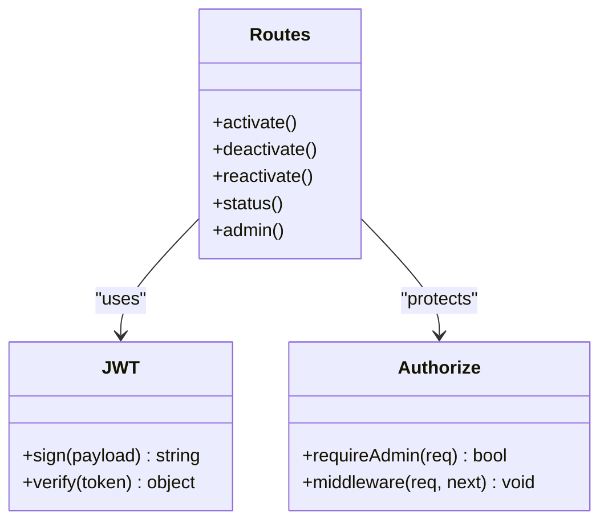

**Diagram sources**
- [src/activation/lib/jwt.ts](file://src/activation/lib/jwt.ts)
- [src/activation/lib/authorize.ts](file://src/activation/lib/authorize.ts)
- [src/activation/routes/activate.ts](file://src/activation/routes/activate.ts)
- [src/activation/routes/deactivate.ts](file://src/activation/routes/deactivate.ts)
- [src/activation/routes/reactivate.ts](file://src/activation/routes/reactivate.ts)
- [src/activation/routes/status.ts](file://src/activation/routes/status.ts)
- [src/activation/routes/admin.ts](file://src/activation/routes/admin.ts)

**Section sources**
- [src/activation/lib/jwt.ts](file://src/activation/lib/jwt.ts)
- [src/activation/lib/authorize.ts](file://src/activation/lib/authorize.ts)
- [src/activation/routes/admin.ts](file://src/activation/routes/admin.ts)

### License Key Management
License keys are encoded, decoded, and validated before any activation operation. This ensures integrity and prevents tampering.

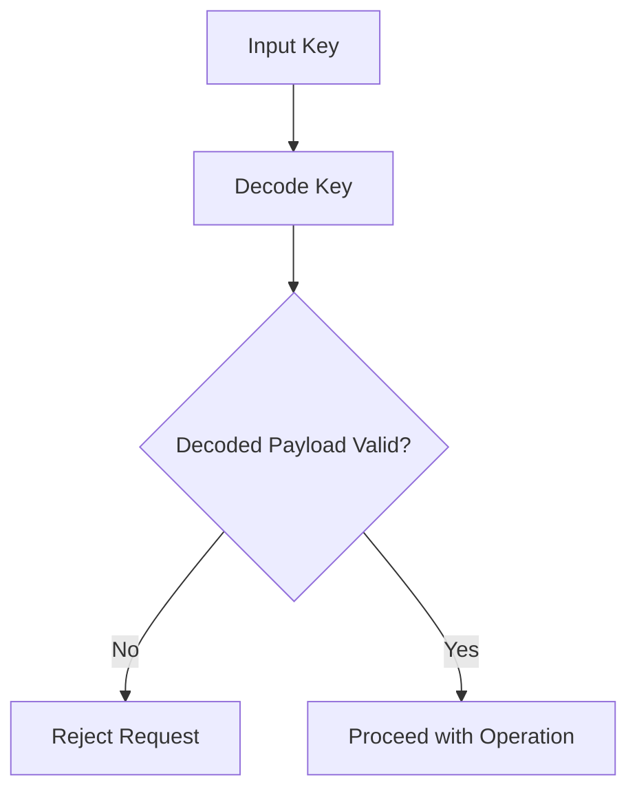

**Diagram sources**
- [src/activation/lib/license-key.ts](file://src/activation/lib/license-key.ts)
- [src/activation/routes/activate.ts](file://src/activation/routes/activate.ts)
- [src/activation/routes/deactivate.ts](file://src/activation/routes/deactivate.ts)
- [src/activation/routes/reactivate.ts](file://src/activation/routes/reactivate.ts)
- [src/activation/routes/status.ts](file://src/activation/routes/status.ts)

**Section sources**
- [src/activation/lib/license-key.ts](file://src/activation/lib/license-key.ts)
- [src/activation/routes/activate.ts](file://src/activation/routes/activate.ts)
- [src/activation/routes/deactivate.ts](file://src/activation/routes/deactivate.ts)
- [src/activation/routes/reactivate.ts](file://src/activation/routes/reactivate.ts)
- [src/activation/routes/status.ts](file://src/activation/routes/status.ts)

### Seat Accounting
Seat accounting tracks how many seats are consumed by an activation and enforces limits during activation and reactivation.

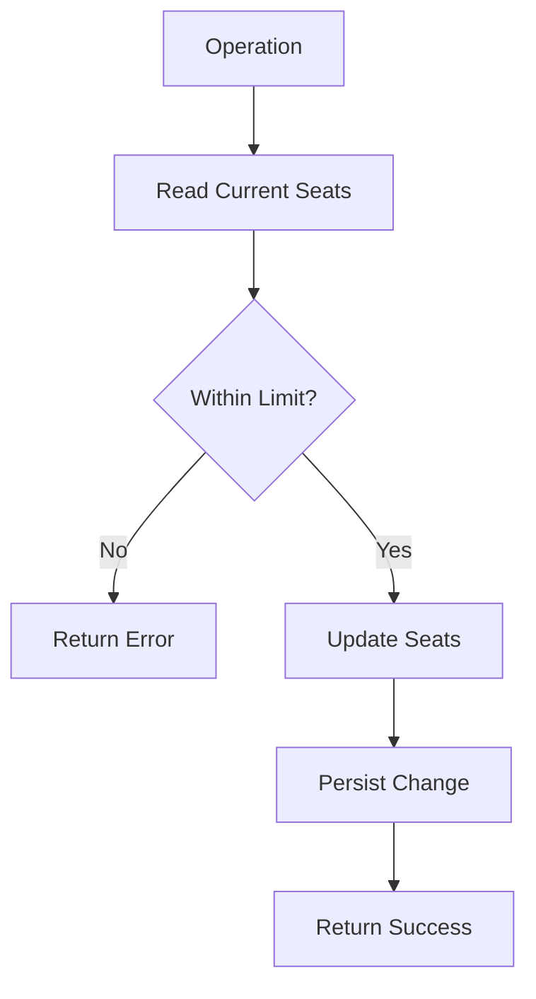

**Diagram sources**
- [src/activation/lib/seats.ts](file://src/activation/lib/seats.ts)
- [src/activation/routes/activate.ts](file://src/activation/routes/activate.ts)
- [src/activation/routes/reactivate.ts](file://src/activation/routes/reactivate.ts)
- [drizzle-activation/0000_activation_init.sql](file://drizzle-activation/0000_activation_init.sql)

**Section sources**
- [src/activation/lib/seats.ts](file://src/activation/lib/seats.ts)
- [src/activation/routes/activate.ts](file://src/activation/routes/activate.ts)
- [src/activation/routes/reactivate.ts](file://src/activation/routes/reactivate.ts)
- [drizzle-activation/0000_activation_init.sql](file://drizzle-activation/0000_activation_init.sql)

### Database Schema and Migrations
Activation data is persisted using Drizzle ORM with SQLite-backed D1. The migration file defines the schema for licenses, seats, and related entities.

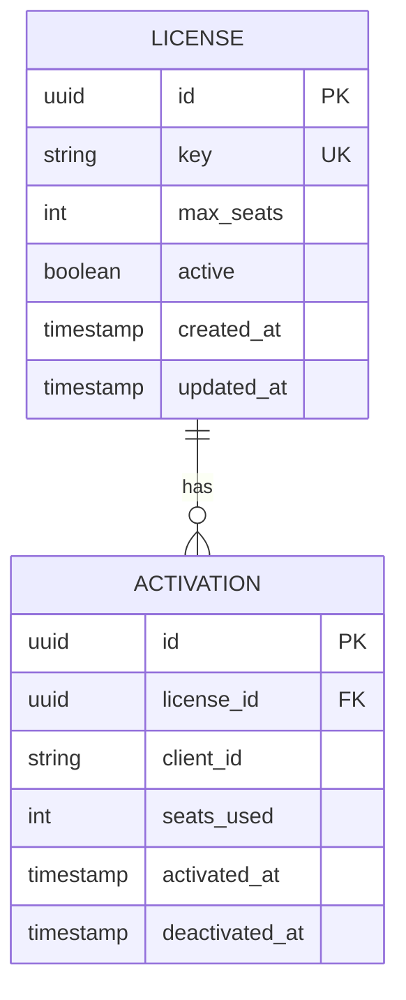

**Diagram sources**
- [drizzle-activation/0000_activation_init.sql](file://drizzle-activation/0000_activation_init.sql)

**Section sources**
- [drizzle-activation/0000_activation_init.sql](file://drizzle-activation/0000_activation_init.sql)

### Configuration and Deployment
Configuration is validated on first request to ensure required environment variables are present. Separate Wrangler profiles support development and staging deployments.

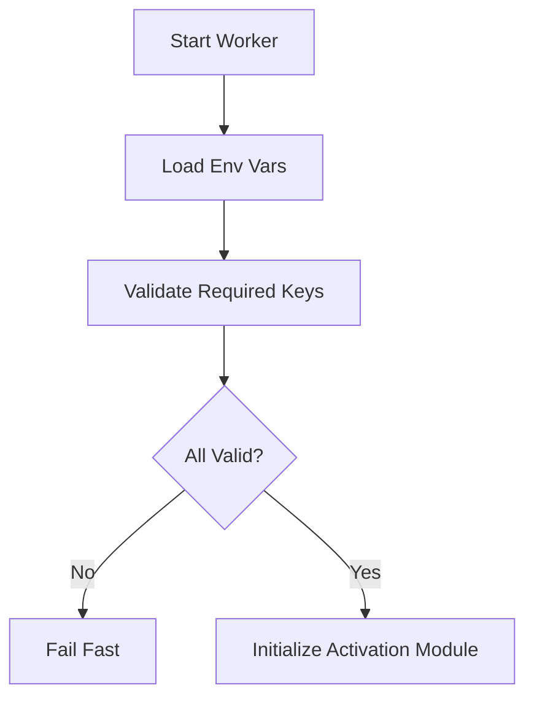

**Diagram sources**
- [src/activation/config.ts](file://src/activation/config.ts)
- [wrangler.activation.jsonc](file://wrangler.activation.jsonc)
- [wrangler.activation.staging.jsonc](file://wrangler.activation.staging.jsonc)

**Section sources**
- [src/activation/config.ts](file://src/activation/config.ts)
- [wrangler.activation.jsonc](file://wrangler.activation.jsonc)
- [wrangler.activation.staging.jsonc](file://wrangler.activation.staging.jsonc)

### Testing Strategy
Tests cover activation, deactivation, reactivation, admin operations, and dev license scenarios. They use Vitest with Cloudflare workerd to simulate real environments.

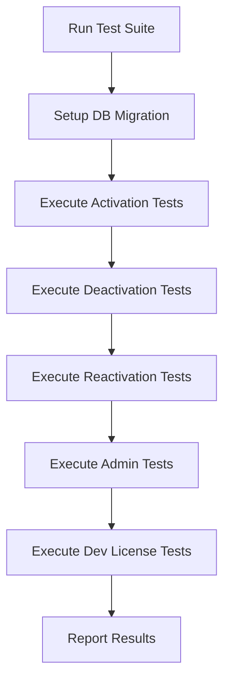

**Diagram sources**
- [vitest.activation.config.ts](file://vitest.activation.config.ts)
- [test/activation/activate.test.ts](file://test/activation/activate.test.ts)
- [test/activation/deactivate.test.ts](file://test/activation/deactivate.test.ts)
- [test/activation/reactivate.test.ts](file://test/activation/reactivate.test.ts)
- [test/activation/admin.test.ts](file://test/activation/admin.test.ts)
- [test/activation/dev-license.test.ts](file://test/activation/dev-license.test.ts)
- [test/activation/helpers.ts](file://test/activation/helpers.ts)
- [test/activation/test-keys.ts](file://test/activation/test-keys.ts)

**Section sources**
- [vitest.activation.config.ts](file://vitest.activation.config.ts)
- [test/activation/activate.test.ts](file://test/activation/activate.test.ts)
- [test/activation/deactivate.test.ts](file://test/activation/deactivate.test.ts)
- [test/activation/reactivate.test.ts](file://test/activation/reactivate.test.ts)
- [test/activation/admin.test.ts](file://test/activation/admin.test.ts)
- [test/activation/dev-license.test.ts](file://test/activation/dev-license.test.ts)
- [test/activation/helpers.ts](file://test/activation/helpers.ts)
- [test/activation/test-keys.ts](file://test/activation/test-keys.ts)

## Dependency Analysis
The Activation System exhibits clear separation of concerns:
- Routes depend on libraries for business logic (license key, lookup, seats).
- Libraries depend on Drizzle ORM for persistence.
- Authorization and JWT modules provide cross-cutting security.
- Configuration is centralized and validated early.

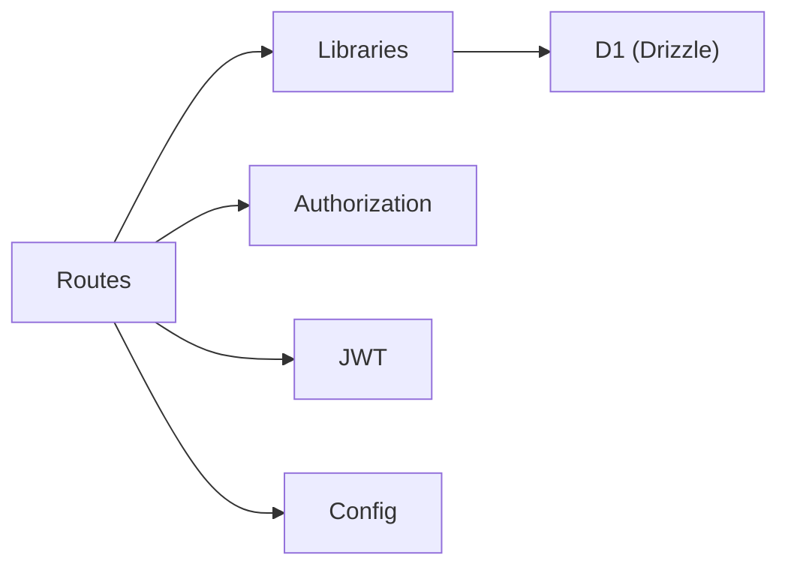

**Diagram sources**
- [src/activation/routes/activate.ts](file://src/activation/routes/activate.ts)
- [src/activation/routes/deactivate.ts](file://src/activation/routes/deactivate.ts)
- [src/activation/routes/reactivate.ts](file://src/activation/routes/reactivate.ts)
- [src/activation/routes/status.ts](file://src/activation/routes/status.ts)
- [src/activation/routes/admin.ts](file://src/activation/routes/admin.ts)
- [src/activation/lib/license-key.ts](file://src/activation/lib/license-key.ts)
- [src/activation/lib/license-lookup.ts](file://src/activation/lib/license-lookup.ts)
- [src/activation/lib/seats.ts](file://src/activation/lib/seats.ts)
- [src/activation/lib/authorize.ts](file://src/activation/lib/authorize.ts)
- [src/activation/lib/jwt.ts](file://src/activation/lib/jwt.ts)
- [src/activation/config.ts](file://src/activation/config.ts)

**Section sources**
- [src/activation/routes/activate.ts](file://src/activation/routes/activate.ts)
- [src/activation/routes/deactivate.ts](file://src/activation/routes/deactivate.ts)
- [src/activation/routes/reactivate.ts](file://src/activation/routes/reactivate.ts)
- [src/activation/routes/status.ts](file://src/activation/routes/status.ts)
- [src/activation/routes/admin.ts](file://src/activation/routes/admin.ts)
- [src/activation/lib/license-key.ts](file://src/activation/lib/license-key.ts)
- [src/activation/lib/license-lookup.ts](file://src/activation/lib/license-lookup.ts)
- [src/activation/lib/seats.ts](file://src/activation/lib/seats.ts)
- [src/activation/lib/authorize.ts](file://src/activation/lib/authorize.ts)
- [src/activation/lib/jwt.ts](file://src/activation/lib/jwt.ts)
- [src/activation/config.ts](file://src/activation/config.ts)

## Performance Considerations
- Minimize database round-trips by batching updates where possible.
- Cache frequently accessed license metadata if appropriate.
- Use efficient indexes on license keys and client identifiers.
- Validate inputs early to avoid unnecessary processing.
- Keep JWT payloads small to reduce overhead.

[No sources needed since this section provides general guidance]

## Troubleshooting Guide
Common issues and resolutions:
- Invalid or expired license key: Ensure keys are properly generated and not tampered with.
- Seat limit exceeded: Review seat allocation and usage; consider increasing limits or freeing seats.
- Missing environment variables: Verify all required config keys are set in deployment profiles.
- Authorization failures: Confirm admin tokens are correct and authorized.
- Database errors: Check migration status and D1 connectivity.

**Section sources**
- [src/activation/lib/license-key.ts](file://src/activation/lib/license-key.ts)
- [src/activation/lib/seats.ts](file://src/activation/lib/seats.ts)
- [src/activation/config.ts](file://src/activation/config.ts)
- [src/activation/lib/authorize.ts](file://src/activation/lib/authorize.ts)
- [drizzle-activation/0000_activation_init.sql](file://drizzle-activation/0000_activation_init.sql)

## Conclusion
The Activation System provides a robust, modular implementation for managing license activations within the Trackdub platform. Its layered design, strict configuration validation, and comprehensive testing ensure reliability and maintainability. Future enhancements can focus on performance optimizations, additional admin capabilities, and expanded licensing models while preserving the current architectural integrity.

[No sources needed since this section summarizes without analyzing specific files]

## Appendices
- API Endpoints:
  - POST /activate: Activates a license with key and metadata.
  - POST /deactivate: Deactivates a license by key.
  - POST /reactivate: Reactivates a previously deactivated license.
  - GET /status: Returns activation status for a key.
  - POST /admin/*: Administrative operations requiring authorization.

[No sources needed since this section lists endpoints conceptually]