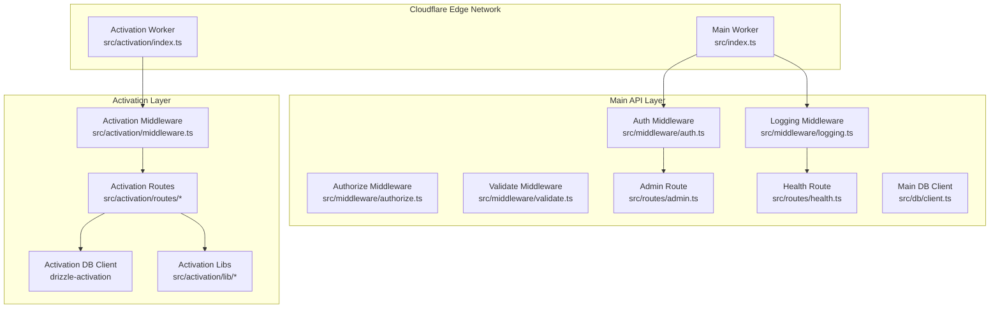
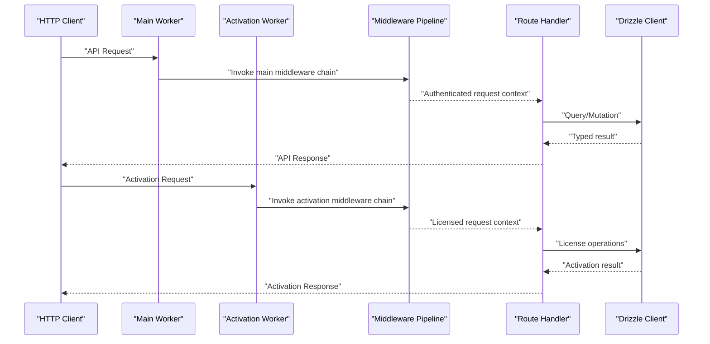
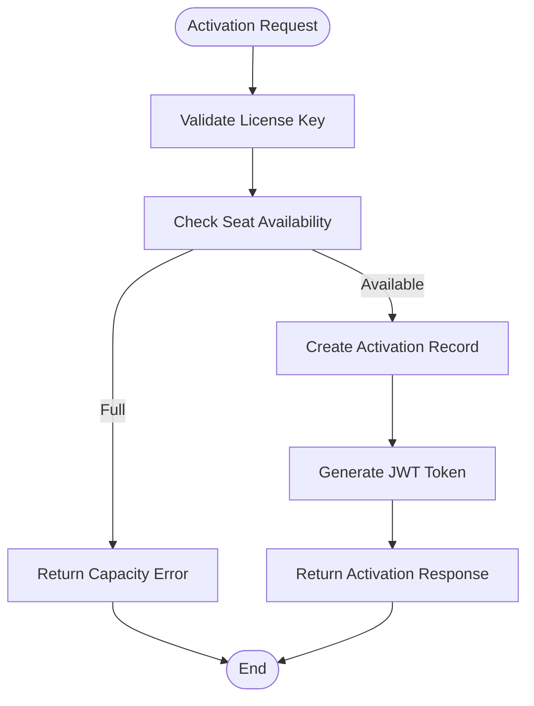
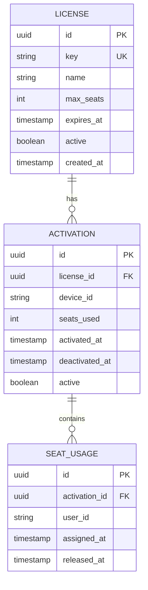
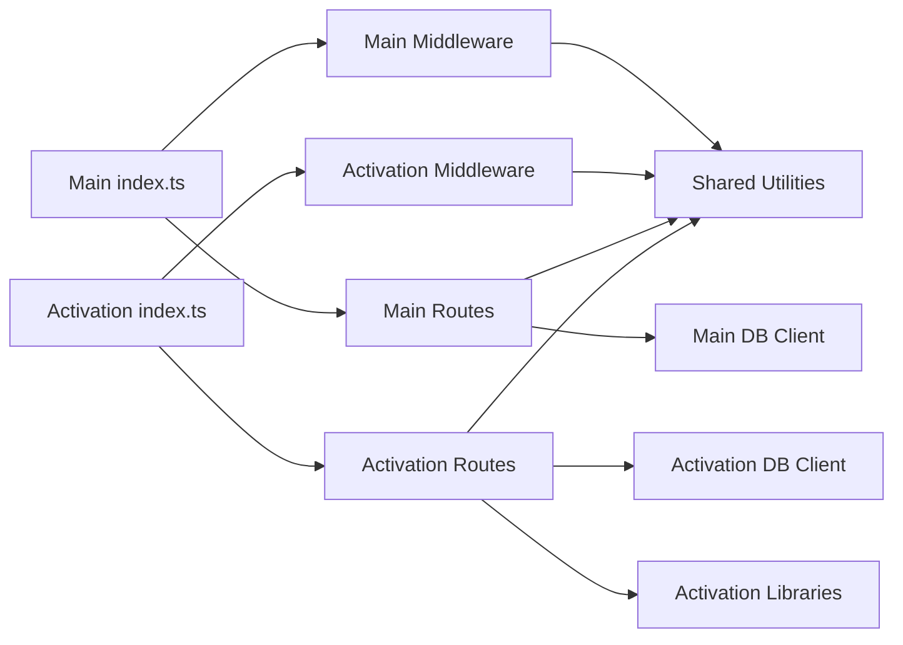
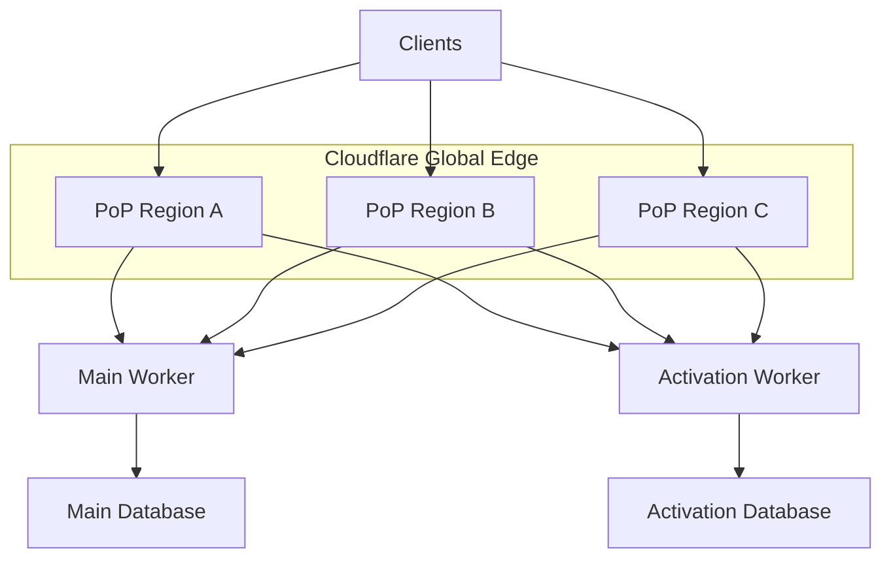

# Architecture Overview

<cite>
**Referenced Files in This Document**
- [index.ts](file://src/index.ts)
- [wrangler.jsonc](file://wrangler.jsonc)
- [package.json](file://package.json)
- [drizzle.config.ts](file://drizzle.config.ts)
- [client.ts](file://src/db/client.ts)
- [schema.ts](file://src/db/schema.ts)
- [env.ts](file://src/config/env.ts)
- [auth.ts](file://src/middleware/auth.ts)
- [authorize.ts](file://src/middleware/authorize.ts)
- [error.ts](file://src/middleware/error.ts)
- [logging.ts](file://src/middleware/logging.ts)
- [request-id.ts](file://src/middleware/request-id.ts)
- [validate.ts](file://src/middleware/validate.ts)
- [admin.ts](file://src/routes/admin.ts)
- [health.ts](file://src/routes/health.ts)
- [languages.ts](file://src/routes/languages.ts)
- [version.ts](file://src/routes/version.ts)
- [crypto.ts](file://src/lib/crypto.ts)
- [errors.ts](file://src/lib/errors.ts)
- [languages.ts](file://src/lib/languages.ts)
- [logger.ts](file://src/lib/logger.ts)
- [0000_better_auth_init.sql](file://drizzle/0000_better_auth_init.sql)
- [activation/index.ts](file://src/activation/index.ts)
- [activation/config.ts](file://src/activation/config.ts)
- [activation/middleware.ts](file://src/activation/middleware.ts)
- [activation/routes/activate.ts](file://src/activation/routes/activate.ts)
- [activation/routes/deactivate.ts](file://src/activation/routes/deactivate.ts)
- [activation/routes/reactivate.ts](file://src/activation/routes/reactivate.ts)
- [activation/routes/status.ts](file://src/activation/routes/status.ts)
- [activation/routes/admin.ts](file://src/activation/routes/admin.ts)
- [activation/lib/jwt.ts](file://src/activation/lib/jwt.ts)
- [activation/lib/license-key.ts](file://src/activation/lib/license-key.ts)
- [activation/lib/license-lookup.ts](file://src/activation/lib/license-lookup.ts)
- [activation/lib/seats.ts](file://src/activation/lib/seats.ts)
- [activation/lib/respond.ts](file://src/activation/lib/respond.ts)
- [activation/lib/authorize.ts](file://src/activation/lib/authorize.ts)
- [activation/schema.ts](file://src/activation/schema.ts)
- [activation/types.ts](file://src/activation/types.ts)
- [drizzle-activation.config.ts](file://drizzle-activation.config.ts)
- [wrangler.activation.jsonc](file://wrangler.activation.jsonc)
- [wrangler.activation.staging.jsonc](file://wrangler.activation.staging.jsonc)
- [0000_activation_init.sql](file://drizzle-activation/0000_activation_init.sql)
</cite>

## Update Summary
**Changes Made**
- Added comprehensive documentation for the new activation system architecture
- Updated project structure to include activation worker service
- Enhanced architecture diagrams to show dual-worker deployment model
- Added detailed analysis of activation routes, middleware, and database layer
- Updated deployment topology to reflect separate activation worker configuration

## Table of Contents
1. [Introduction](#introduction)
2. [Project Structure](#project-structure)
3. [Core Components](#core-components)
4. [Architecture Overview](#architecture-overview)
5. [Activation System Architecture](#activation-system-architecture)
6. [Detailed Component Analysis](#detailed-component-analysis)
7. [Dependency Analysis](#dependency-analysis)
8. [Performance Considerations](#performance-considerations)
9. [Security Architecture](#security-architecture)
10. [Scalability and Deployment Topology](#scalability-and-deployment-topology)
11. [Troubleshooting Guide](#troubleshooting-guide)
12. [Conclusion](#conclusion)

## Introduction
This document describes the TrackDub API system architecture, focusing on a layered design with a middleware pattern for cross-cutting concerns. The system now includes a dedicated activation worker service that handles license management, seat allocation, and activation lifecycle operations. It explains how HTTP requests flow through Cloudflare Workers, traverse the middleware pipeline, reach route handlers, and interact with the database via Drizzle ORM. The architecture supports dual-worker deployment with separate configurations for the main API and activation services.

## Project Structure
The codebase is organized by feature and layer with clear separation between the main API worker and the activation worker:
- **Main Worker**: Entry point and runtime configuration define the primary API Worker lifecycle and environment.
- **Activation Worker**: Dedicated worker service for license activation, deactivation, and management operations.
- **Middleware modules**: Implement cross-cutting concerns (auth, authorization, validation, logging, request ID, error handling).
- **Routes**: Expose REST endpoints grouped by domain (admin, health, languages, version, activation).
- **Database layers**: Separate Drizzle ORM configurations for main API and activation systems.
- **Configuration**: Centralized environment management with separate wrangler configurations for each worker.
- **Utilities**: Shared libraries for cryptography, error abstractions, language helpers, and structured logging.

**Diagram sources**
- [index.ts](file://src/index.ts)
- [activation/index.ts](file://src/activation/index.ts)
- [wrangler.jsonc](file://wrangler.jsonc)
- [wrangler.activation.jsonc](file://wrangler.activation.jsonc)

**Section sources**
- [index.ts](file://src/index.ts)
- [activation/index.ts](file://src/activation/index.ts)
- [wrangler.jsonc](file://wrangler.jsonc)
- [wrangler.activation.jsonc](file://wrangler.activation.jsonc)
- [package.json](file://package.json)

## Core Components
- **Dual Worker Architecture**: Separate workers for main API and activation services with independent deployments.
- **Entry points and routing orchestration**: Each worker initializes its own middleware stack and route handlers.
- **Middleware pipelines**: Standardized processing for request IDs, logging, input validation, authentication, authorization, and error handling.
- **Route handlers**: Domain-specific endpoints for admin operations, health checks, language management, version info, and activation lifecycle.
- **Database layers**: Type-safe schema and clients configured via separate Drizzle ORM instances.
- **Configuration and environment**: Typed environment variables with worker-specific wrangler configurations.
- **Utilities**: Cryptography helpers, error abstractions, language utilities, and structured logging shared across workers.

Key responsibilities:
- Cross-cutting concerns are isolated in middleware to keep route logic focused.
- Data access is abstracted behind Drizzle types to ensure compile-time correctness.
- Environment variables are validated and typed to prevent runtime misconfiguration.
- Activation system maintains complete separation from main API concerns.

**Section sources**
- [index.ts](file://src/index.ts)
- [activation/index.ts](file://src/activation/index.ts)
- [activation/config.ts](file://src/activation/config.ts)
- [activation/middleware.ts](file://src/activation/middleware.ts)

## Architecture Overview
The TrackDub API follows a dual-worker layered architecture with middleware-first approach:
- **Main Worker**: Handles core API functionality with standard middleware pipeline.
- **Activation Worker**: Dedicated service for license management with specialized middleware and routes.
- Each worker configures its own middleware stack independently.
- Requests pass through worker-specific middleware chains before reaching route handlers.
- Database isolation ensures activation data remains separate from main API data.
- Configuration and environment are loaded per-worker with appropriate security boundaries.

**Diagram sources**
- [index.ts](file://src/index.ts)
- [activation/index.ts](file://src/activation/index.ts)
- [activation/middleware.ts](file://src/activation/middleware.ts)

## Activation System Architecture
The activation system provides a complete license management solution with dedicated worker deployment:

### Activation Worker Structure
- **Entry Point**: Independent worker initialization with activation-specific middleware stack.
- **Configuration**: Separate environment configuration for license keys, JWT secrets, and database connections.
- **Middleware Stack**: Specialized middleware for license validation, seat management, and activation authorization.
- **Route Handlers**: Complete CRUD operations for activation lifecycle management.
- **Database Layer**: Isolated Drizzle ORM instance with activation-specific schema and migrations.

### Activation Routes
- **Activate**: Process new license activations with seat allocation and validation.
- **Deactivate**: Handle license deactivation and seat release operations.
- **Reactivate**: Support license reactivation workflows with state validation.
- **Status**: Query current activation status and seat utilization.
- **Admin**: Administrative operations for activation management and monitoring.

### Activation Libraries
- **JWT Management**: Secure token generation and validation for activation sessions.
- **License Key Processing**: Cryptographic validation and parsing of license keys.
- **License Lookup**: Database queries for license verification and status checking.
- **Seat Management**: Seat allocation, tracking, and capacity management.
- **Response Handling**: Standardized activation response formatting.
- **Authorization**: License-based permission checks and validation.

**Diagram sources**
- [activation/routes/activate.ts](file://src/activation/routes/activate.ts)
- [activation/lib/license-key.ts](file://src/activation/lib/license-key.ts)
- [activation/lib/seats.ts](file://src/activation/lib/seats.ts)
- [activation/lib/jwt.ts](file://src/activation/lib/jwt.ts)

**Section sources**
- [activation/index.ts](file://src/activation/index.ts)
- [activation/config.ts](file://src/activation/config.ts)
- [activation/middleware.ts](file://src/activation/middleware.ts)
- [activation/routes/activate.ts](file://src/activation/routes/activate.ts)
- [activation/routes/deactivate.ts](file://src/activation/routes/deactivate.ts)
- [activation/routes/reactivate.ts](file://src/activation/routes/reactivate.ts)
- [activation/routes/status.ts](file://src/activation/routes/status.ts)
- [activation/routes/admin.ts](file://src/activation/routes/admin.ts)

## Detailed Component Analysis

### Dual Worker Deployment
The system deploys two independent Cloudflare Workers:
- **Main Worker**: Configured via `wrangler.jsonc` for core API functionality.
- **Activation Worker**: Configured via `wrangler.activation.jsonc` and `wrangler.activation.staging.jsonc` for license management.
- Each worker has separate build processes, deployment targets, and environment bindings.
- Shared utilities and middleware patterns ensure consistency across workers.

### Activation Middleware Stack
The activation middleware enforces license-based security:
- **License Validation**: Verifies license key format and cryptographic signatures.
- **Seat Checking**: Ensures available seats before allowing activations.
- **JWT Generation**: Creates secure tokens for activation sessions.
- **Authorization**: Enforces role-based permissions for administrative operations.
- **Request Logging**: Tracks activation events with correlation IDs.

### Activation Database Schema
The activation system uses a separate database schema:
- **License Records**: Stores license metadata, validity periods, and usage limits.
- **Activation Records**: Tracks individual activations with timestamps and metadata.
- **Seat Management**: Manages seat allocation and utilization tracking.
- **Audit Trail**: Maintains logs of all activation-related operations.

**Diagram sources**
- [activation/schema.ts](file://src/activation/schema.ts)
- [0000_activation_init.sql](file://drizzle-activation/0000_activation_init.sql)

**Section sources**
- [activation/middleware.ts](file://src/activation/middleware.ts)
- [activation/schema.ts](file://src/activation/schema.ts)
- [drizzle-activation.config.ts](file://drizzle-activation.config.ts)

### Configuration Management
Each worker maintains independent configuration:
- **Environment Variables**: Worker-specific secrets and settings.
- **Wrangler Bindings**: Separate configuration files for development and staging environments.
- **Database Connections**: Isolated database instances for data separation.
- **Shared Utilities**: Common libraries imported across both workers.

**Section sources**
- [activation/config.ts](file://src/activation/config.ts)
- [wrangler.activation.jsonc](file://wrangler.activation.jsonc)
- [wrangler.activation.staging.jsonc](file://wrangler.activation.staging.jsonc)
- [drizzle-activation.config.ts](file://drizzle-activation.config.ts)

## Dependency Analysis
The system exhibits clear separation between main API and activation concerns:
- **Main Worker**: Depends on core middleware, routes, and main database layer.
- **Activation Worker**: Depends on activation-specific middleware, routes, and database layer.
- **Shared Dependencies**: Common utilities, logging, and error handling are shared across workers.
- **Isolation**: No direct dependencies between main API and activation database layers.

**Diagram sources**
- [index.ts](file://src/index.ts)
- [activation/index.ts](file://src/activation/index.ts)
- [activation/middleware.ts](file://src/activation/middleware.ts)

**Section sources**
- [index.ts](file://src/index.ts)
- [activation/index.ts](file://src/activation/index.ts)
- [package.json](file://package.json)

## Performance Considerations
- **Edge Execution**: Both workers run at Cloudflare edge locations for optimal latency.
- **Cold Starts**: Independent workers allow separate optimization strategies.
- **Database Connections**: Separate connection pools for main and activation databases.
- **Memory Usage**: Isolated workers prevent memory sharing issues.
- **Caching**: Utilize Cloudflare Cache for frequently accessed static data.
- **Payload Optimization**: Minimize activation response payloads for faster processing.

## Security Architecture
- **Authentication**: Token verification occurs before reaching route handlers in both workers.
- **Authorization**: Role-based checks enforce least privilege for administrative endpoints.
- **Input Validation**: Strict schemas prevent injection and malformed data.
- **Secrets Management**: Environment variables and Cloudflare Secrets protect sensitive values.
- **Data Isolation**: Separate database instances prevent cross-contamination.
- **License Security**: Cryptographic validation ensures license integrity.
- **Session Management**: JWT-based activation sessions with expiration controls.

**Section sources**
- [activation/middleware.ts](file://src/activation/middleware.ts)
- [activation/lib/jwt.ts](file://src/activation/lib/jwt.ts)
- [activation/lib/license-key.ts](file://src/activation/lib/license-key.ts)

## Scalability and Deployment Topology
- **Serverless Model**: Both workers scale automatically with traffic at Cloudflare edge.
- **Independent Scaling**: Activation worker can scale independently based on demand.
- **Global Distribution**: Requests served from nearest PoP for both workers.
- **Deployment Strategy**: Separate wrangler configurations enable independent deployments.
- **Observability**: Structured logs and request IDs facilitate distributed tracing.
- **Monitoring**: Separate metrics collection for each worker type.

**Section sources**
- [wrangler.jsonc](file://wrangler.jsonc)
- [wrangler.activation.jsonc](file://wrangler.activation.jsonc)
- [wrangler.activation.staging.jsonc](file://wrangler.activation.staging.jsonc)

## Troubleshooting Guide
Common issues and resolutions:
- **Missing environment variables**: Ensure required keys present in both worker configurations.
- **Validation failures**: Inspect request payloads against expected schemas; check middleware logs.
- **Authentication errors**: Verify token format and expiration; confirm secret keys match.
- **Database connectivity**: Confirm connection strings and network access rules for both databases.
- **Activation failures**: Check license key format, seat availability, and activation status.
- **Deployment issues**: Review wrangler configurations and build processes for each worker.
- **Error responses**: Use normalized error structures and correlate via request IDs.

**Section sources**
- [activation/config.ts](file://src/activation/config.ts)
- [activation/middleware.ts](file://src/activation/middleware.ts)
- [wrangler.activation.jsonc](file://wrangler.activation.jsonc)

## Conclusion
The TrackDub API leverages a dual-worker architecture with robust middleware pipelines to deliver secure, scalable, and maintainable services on Cloudflare's edge. The separation of main API and activation concerns enables independent scaling, deployment, and maintenance. Drizzle ORM ensures type-safe data access across both workers, while centralized configuration and utilities promote consistency. This design supports rapid iteration, strong security posture, global scalability, and specialized license management aligned with modern serverless best practices.