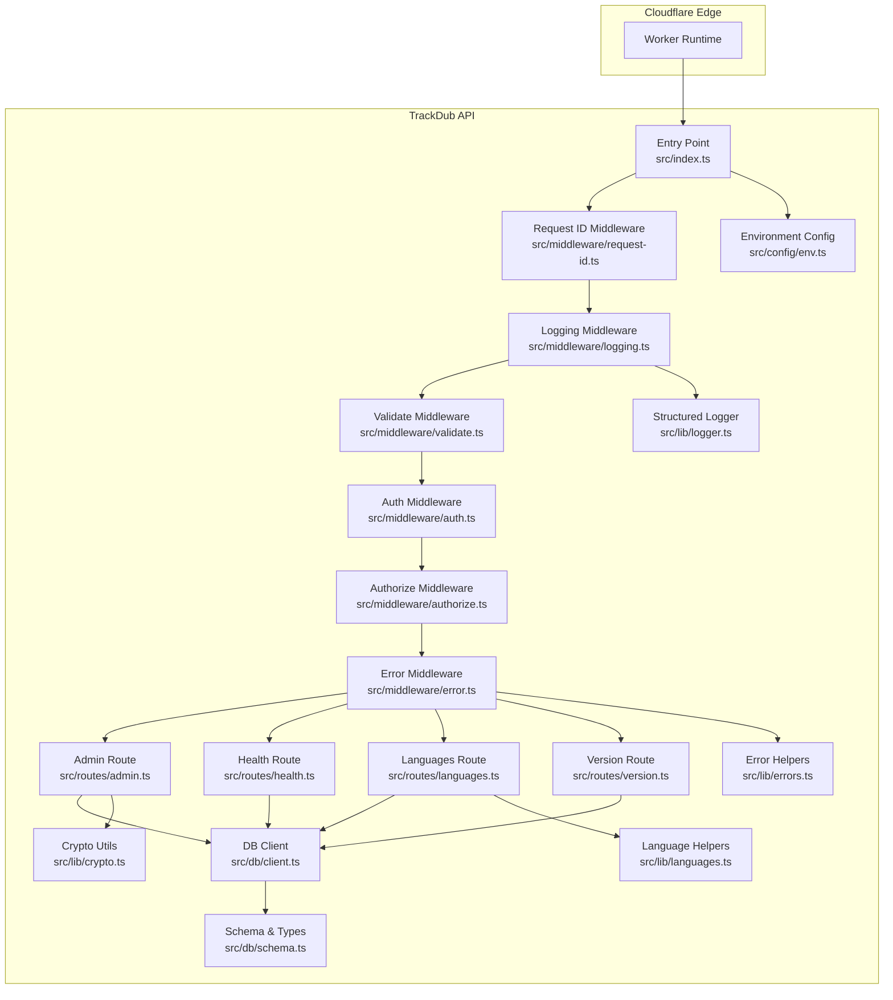
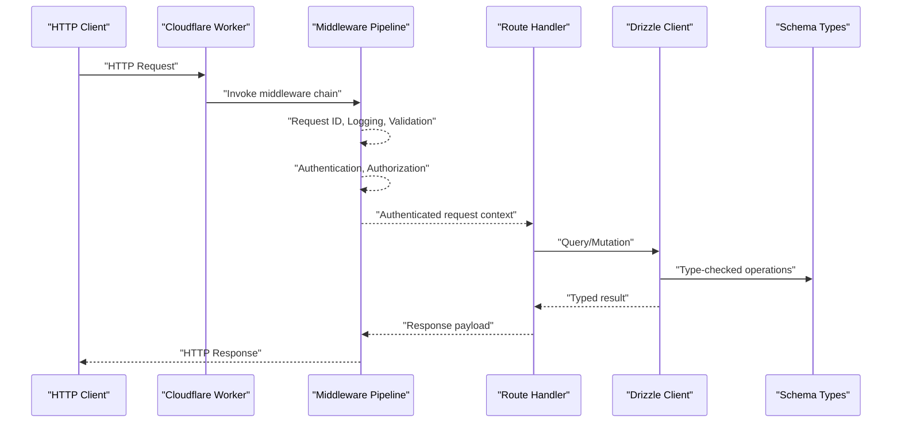
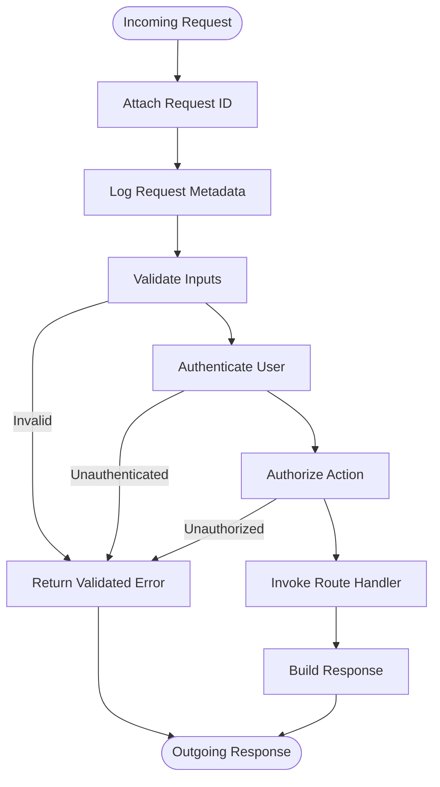
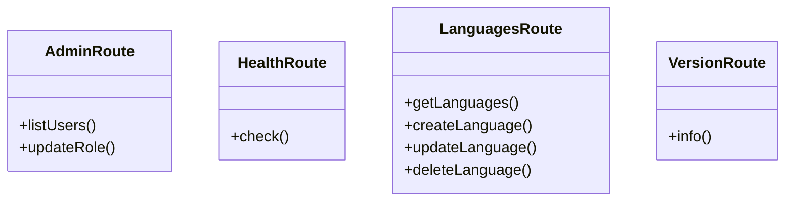
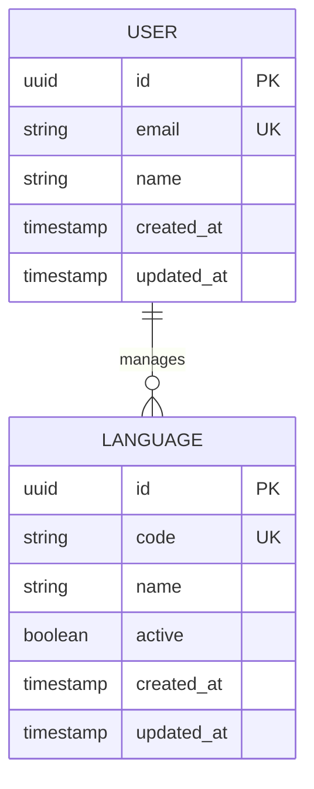
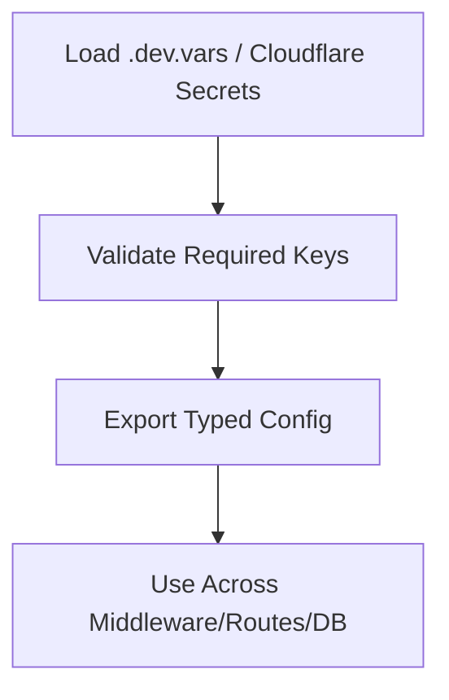
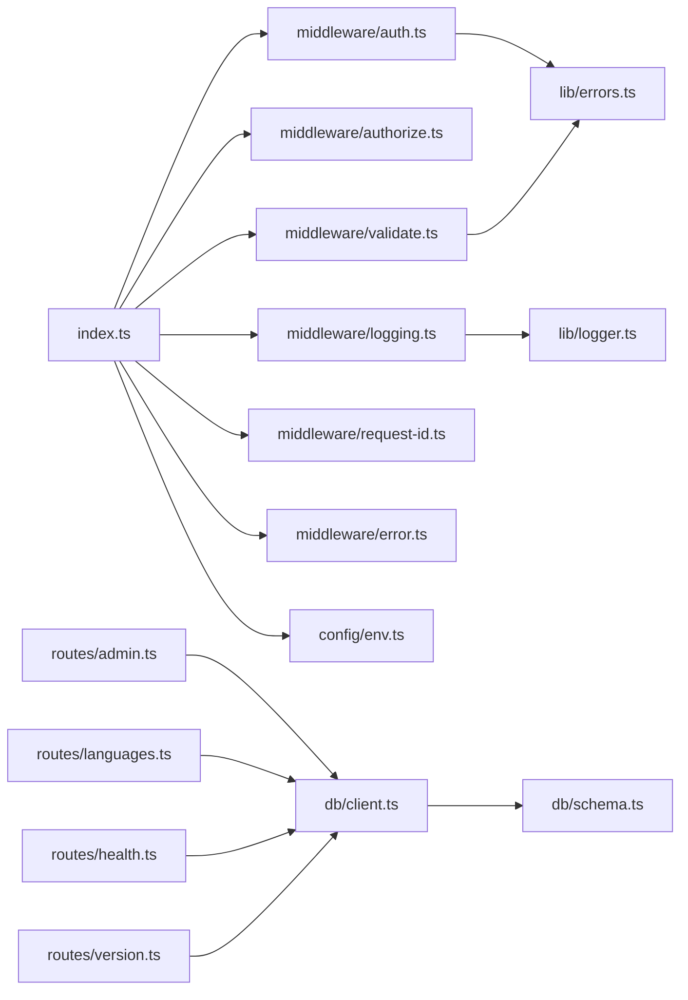
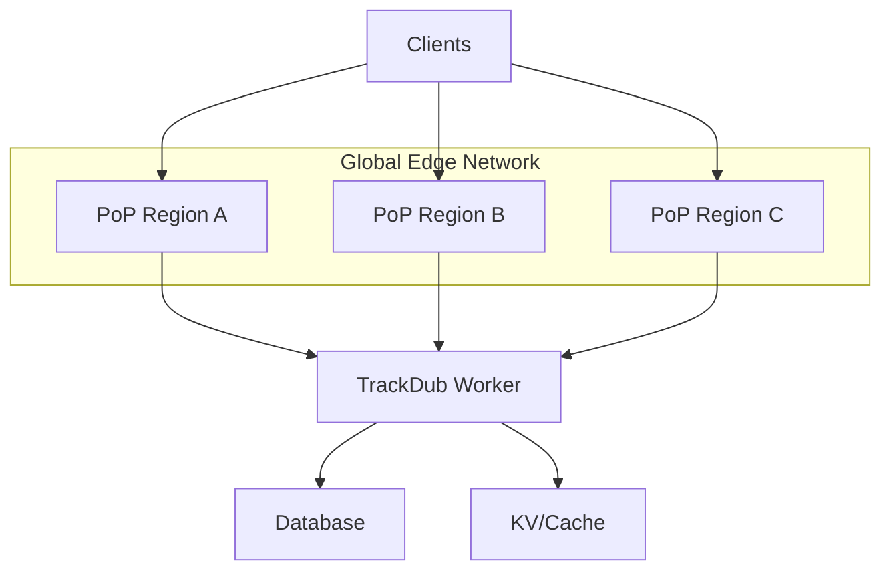

# Architecture Overview

<cite>
**Referenced Files in This Document**
- [index.ts](file://src/index.ts)
- [wrangler.jsonc](file://wrangler.jsonc)
- [package.json](file://package.json)
- [drizzle.config.ts](file://drizzle.config.ts)
- [client.ts](file://src/db/client.ts)
- [schema.ts](file://src/db/schema.ts)
- [env.ts](file://src/config/env.ts)
- [auth.ts](file://src/middleware/auth.ts)
- [authorize.ts](file://src/middleware/authorize.ts)
- [error.ts](file://src/middleware/error.ts)
- [logging.ts](file://src/middleware/logging.ts)
- [request-id.ts](file://src/middleware/request-id.ts)
- [validate.ts](file://src/middleware/validate.ts)
- [admin.ts](file://src/routes/admin.ts)
- [health.ts](file://src/routes/health.ts)
- [languages.ts](file://src/routes/languages.ts)
- [version.ts](file://src/routes/version.ts)
- [crypto.ts](file://src/lib/crypto.ts)
- [errors.ts](file://src/lib/errors.ts)
- [languages.ts](file://src/lib/languages.ts)
- [logger.ts](file://src/lib/logger.ts)
- [0000_better_auth_init.sql](file://drizzle/0000_better_auth_init.sql)
</cite>

## Table of Contents
1. [Introduction](#introduction)
2. [Project Structure](#project-structure)
3. [Core Components](#core-components)
4. [Architecture Overview](#architecture-overview)
5. [Detailed Component Analysis](#detailed-component-analysis)
6. [Dependency Analysis](#dependency-analysis)
7. [Performance Considerations](#performance-considerations)
8. [Security Architecture](#security-architecture)
9. [Scalability and Deployment Topology](#scalability-and-deployment-topology)
10. [Troubleshooting Guide](#troubleshooting-guide)
11. [Conclusion](#conclusion)

## Introduction
This document describes the TrackDub API system architecture, focusing on a layered design with a middleware pattern for cross-cutting concerns. It explains how HTTP requests flow through Cloudflare Workers, traverse the middleware pipeline, reach route handlers, and interact with the database via Drizzle ORM. It also documents technical decisions around serverless deployment at the edge, type-safe data access, and a custom middleware stack that standardizes logging, validation, error handling, authentication, and authorization.

## Project Structure
The codebase is organized by feature and layer:
- Entry point and runtime configuration define the Worker lifecycle and environment.
- Middleware modules implement cross-cutting concerns (auth, authorization, validation, logging, request ID, error handling).
- Routes expose REST endpoints grouped by domain (admin, health, languages, version).
- Database layer uses Drizzle ORM with schema definitions and migrations.
- Configuration and environment are centralized for type safety.
- Utility libraries provide cryptography, error abstractions, language helpers, and structured logging.

**Diagram sources**
- [index.ts](file://src/index.ts)
- [wrangler.jsonc](file://wrangler.jsonc)
- [auth.ts](file://src/middleware/auth.ts)
- [authorize.ts](file://src/middleware/authorize.ts)
- [validate.ts](file://src/middleware/validate.ts)
- [logging.ts](file://src/middleware/logging.ts)
- [request-id.ts](file://src/middleware/request-id.ts)
- [error.ts](file://src/middleware/error.ts)
- [admin.ts](file://src/routes/admin.ts)
- [health.ts](file://src/routes/health.ts)
- [languages.ts](file://src/routes/languages.ts)
- [version.ts](file://src/routes/version.ts)
- [client.ts](file://src/db/client.ts)
- [schema.ts](file://src/db/schema.ts)
- [env.ts](file://src/config/env.ts)
- [crypto.ts](file://src/lib/crypto.ts)
- [errors.ts](file://src/lib/errors.ts)
- [languages.ts](file://src/lib/languages.ts)
- [logger.ts](file://src/lib/logger.ts)

**Section sources**
- [index.ts](file://src/index.ts)
- [wrangler.jsonc](file://wrangler.jsonc)
- [package.json](file://package.json)
- [drizzle.config.ts](file://drizzle.config.ts)

## Core Components
- Entry point and routing orchestration: Initializes the Worker, wires middleware, and registers routes.
- Middleware pipeline: Implements standardized processing for request IDs, logging, input validation, authentication, authorization, and error handling.
- Route handlers: Domain-specific endpoints for admin operations, health checks, language management, and version info.
- Database layer: Type-safe schema and client configured via Drizzle ORM, with migrations defined in SQL.
- Configuration and environment: Typed environment variables and runtime configuration.
- Utilities: Cryptography helpers, error abstractions, language utilities, and structured logging.

Key responsibilities:
- Cross-cutting concerns are isolated in middleware to keep route logic focused.
- Data access is abstracted behind Drizzle types to ensure compile-time correctness.
- Environment variables are validated and typed to prevent runtime misconfiguration.

**Section sources**
- [index.ts](file://src/index.ts)
- [auth.ts](file://src/middleware/auth.ts)
- [authorize.ts](file://src/middleware/authorize.ts)
- [validate.ts](file://src/middleware/validate.ts)
- [logging.ts](file://src/middleware/logging.ts)
- [request-id.ts](file://src/middleware/request-id.ts)
- [error.ts](file://src/middleware/error.ts)
- [admin.ts](file://src/routes/admin.ts)
- [health.ts](file://src/routes/health.ts)
- [languages.ts](file://src/routes/languages.ts)
- [version.ts](file://src/routes/version.ts)
- [client.ts](file://src/db/client.ts)
- [schema.ts](file://src/db/schema.ts)
- [env.ts](file://src/config/env.ts)
- [crypto.ts](file://src/lib/crypto.ts)
- [errors.ts](file://src/lib/errors.ts)
- [languages.ts](file://src/lib/languages.ts)
- [logger.ts](file://src/lib/logger.ts)

## Architecture Overview
The TrackDub API follows a layered architecture with a middleware-first approach:
- The entry point configures the Worker and composes middleware in a deterministic order.
- Each request passes through the middleware stack, which enriches context, validates inputs, authenticates users, authorizes actions, and handles errors.
- Route handlers perform business logic and use the database client to read/write data.
- Drizzle ORM provides type-safe queries based on schema definitions.
- Configuration and environment are loaded once and consumed across layers.

**Diagram sources**
- [index.ts](file://src/index.ts)
- [auth.ts](file://src/middleware/auth.ts)
- [authorize.ts](file://src/middleware/authorize.ts)
- [validate.ts](file://src/middleware/validate.ts)
- [logging.ts](file://src/middleware/logging.ts)
- [request-id.ts](file://src/middleware/request-id.ts)
- [error.ts](file://src/middleware/error.ts)
- [client.ts](file://src/db/client.ts)
- [schema.ts](file://src/db/schema.ts)

## Detailed Component Analysis

### Middleware Stack
The middleware stack enforces consistent behavior across all requests:
- Request ID: Assigns a unique identifier per request for tracing.
- Logging: Emits structured logs with correlation IDs and timing.
- Validation: Validates request bodies, headers, and query parameters using shared schemas.
- Authentication: Verifies identity tokens or session cookies and attaches user context.
- Authorization: Enforces role-based or resource-based permissions.
- Error Handling: Catches exceptions, normalizes error responses, and preserves trace context.

**Diagram sources**
- [request-id.ts](file://src/middleware/request-id.ts)
- [logging.ts](file://src/middleware/logging.ts)
- [validate.ts](file://src/middleware/validate.ts)
- [auth.ts](file://src/middleware/auth.ts)
- [authorize.ts](file://src/middleware/authorize.ts)
- [error.ts](file://src/middleware/error.ts)

**Section sources**
- [request-id.ts](file://src/middleware/request-id.ts)
- [logging.ts](file://src/middleware/logging.ts)
- [validate.ts](file://src/middleware/validate.ts)
- [auth.ts](file://src/middleware/auth.ts)
- [authorize.ts](file://src/middleware/authorize.ts)
- [error.ts](file://src/middleware/error.ts)

### Routes
Routes encapsulate domain functionality:
- Admin: Administrative operations requiring elevated privileges.
- Health: Readiness and liveness probes for platform monitoring.
- Languages: CRUD operations for language entities.
- Version: Static metadata about API versioning.

Each route handler receives an enriched context from middleware and returns typed responses.

**Diagram sources**
- [admin.ts](file://src/routes/admin.ts)
- [health.ts](file://src/routes/health.ts)
- [languages.ts](file://src/routes/languages.ts)
- [version.ts](file://src/routes/version.ts)

**Section sources**
- [admin.ts](file://src/routes/admin.ts)
- [health.ts](file://src/routes/health.ts)
- [languages.ts](file://src/routes/languages.ts)
- [version.ts](file://src/routes/version.ts)

### Database Layer
The database layer uses Drizzle ORM for type-safe operations:
- Schema defines tables and relationships.
- Client initializes connection settings and exposes typed queries.
- Migrations are managed via SQL files and Drizzle tooling.

**Diagram sources**
- [schema.ts](file://src/db/schema.ts)
- [0000_better_auth_init.sql](file://drizzle/0000_better_auth_init.sql)

**Section sources**
- [client.ts](file://src/db/client.ts)
- [schema.ts](file://src/db/schema.ts)
- [drizzle.config.ts](file://drizzle.config.ts)
- [0000_better_auth_init.sql](file://drizzle/0000_better_auth_init.sql)

### Configuration and Environment
Environment variables are typed and validated at startup:
- Centralized configuration module ensures consistent access to secrets and settings.
- Wrangler configuration defines runtime bindings and deployment options.

**Diagram sources**
- [env.ts](file://src/config/env.ts)
- [wrangler.jsonc](file://wrangler.jsonc)

**Section sources**
- [env.ts](file://src/config/env.ts)
- [wrangler.jsonc](file://wrangler.jsonc)

### Utility Libraries
Shared utilities support core functionality:
- Crypto: Secure hashing and encryption helpers.
- Errors: Standardized error types and formatting.
- Languages: Language code normalization and lookup.
- Logger: Structured logging with correlation IDs.

**Section sources**
- [crypto.ts](file://src/lib/crypto.ts)
- [errors.ts](file://src/lib/errors.ts)
- [languages.ts](file://src/lib/languages.ts)
- [logger.ts](file://src/lib/logger.ts)

## Dependency Analysis
The system exhibits clear separation of concerns:
- Entry point depends on middleware and routes.
- Middleware depends on utilities and configuration.
- Routes depend on database client and utilities.
- Database layer depends on schema and configuration.

**Diagram sources**
- [index.ts](file://src/index.ts)
- [auth.ts](file://src/middleware/auth.ts)
- [authorize.ts](file://src/middleware/authorize.ts)
- [validate.ts](file://src/middleware/validate.ts)
- [logging.ts](file://src/middleware/logging.ts)
- [request-id.ts](file://src/middleware/request-id.ts)
- [error.ts](file://src/middleware/error.ts)
- [admin.ts](file://src/routes/admin.ts)
- [health.ts](file://src/routes/health.ts)
- [languages.ts](file://src/routes/languages.ts)
- [version.ts](file://src/routes/version.ts)
- [client.ts](file://src/db/client.ts)
- [schema.ts](file://src/db/schema.ts)
- [env.ts](file://src/config/env.ts)
- [errors.ts](file://src/lib/errors.ts)
- [logger.ts](file://src/lib/logger.ts)

**Section sources**
- [index.ts](file://src/index.ts)
- [package.json](file://package.json)

## Performance Considerations
- Edge execution: Cloudflare Workers run close to users, minimizing latency.
- Cold starts: Keep initialization lightweight; defer heavy work to request time where possible.
- Database connections: Reuse connections and leverage pooling provided by the database driver.
- Middleware efficiency: Avoid synchronous I/O; prefer async operations and early exits on validation failures.
- Caching: Utilize Cloudflare Cache or KV for frequently accessed static data (e.g., language lists).
- Payload sizes: Minimize response payloads and enable compression where appropriate.

[No sources needed since this section provides general guidance]

## Security Architecture
- Authentication: Token verification and session validation occur before reaching route handlers.
- Authorization: Role-based checks enforce least privilege for administrative endpoints.
- Input validation: Strict schemas prevent injection and malformed data.
- Secrets management: Environment variables and Cloudflare Secrets protect sensitive values.
- Error handling: Errors are normalized and do not leak internal details to clients.
- Cryptography: Secure hashing and encryption utilities are used consistently.

**Section sources**
- [auth.ts](file://src/middleware/auth.ts)
- [authorize.ts](file://src/middleware/authorize.ts)
- [validate.ts](file://src/middleware/validate.ts)
- [env.ts](file://src/config/env.ts)
- [error.ts](file://src/middleware/error.ts)
- [crypto.ts](file://src/lib/crypto.ts)

## Scalability and Deployment Topology
- Serverless model: Cloudflare Workers scale automatically with traffic and execute at the edge.
- Stateless design: No in-process state; rely on external stores (database, KV, cache).
- Global distribution: Requests are served from the nearest PoP, reducing latency.
- Deployment: Wrangler manages builds, deployments, and environment bindings.
- Observability: Structured logs and request IDs facilitate distributed tracing.

[No sources needed since this diagram shows conceptual topology]

**Section sources**
- [wrangler.jsonc](file://wrangler.jsonc)
- [package.json](file://package.json)

## Troubleshooting Guide
Common issues and resolutions:
- Missing environment variables: Ensure required keys are present in .dev.vars and Cloudflare Secrets.
- Validation failures: Inspect request payloads against expected schemas; check middleware logs.
- Authentication errors: Verify token format and expiration; confirm secret keys match.
- Database connectivity: Confirm connection strings and network access rules; review migration status.
- Error responses: Use normalized error structures and correlate via request IDs.

**Section sources**
- [env.ts](file://src/config/env.ts)
- [validate.ts](file://src/middleware/validate.ts)
- [auth.ts](file://src/middleware/auth.ts)
- [client.ts](file://src/db/client.ts)
- [error.ts](file://src/middleware/error.ts)

## Conclusion
The TrackDub API leverages a clean layered architecture with a robust middleware pipeline to deliver secure, scalable, and maintainable services on Cloudflare’s edge. Drizzle ORM ensures type-safe data access, while centralized configuration and utilities promote consistency. This design supports rapid iteration, strong security posture, and global scalability aligned with modern serverless best practices.

[No sources needed since this section summarizes without analyzing specific files]