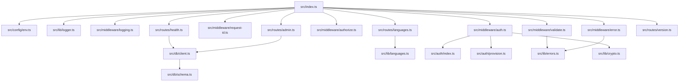
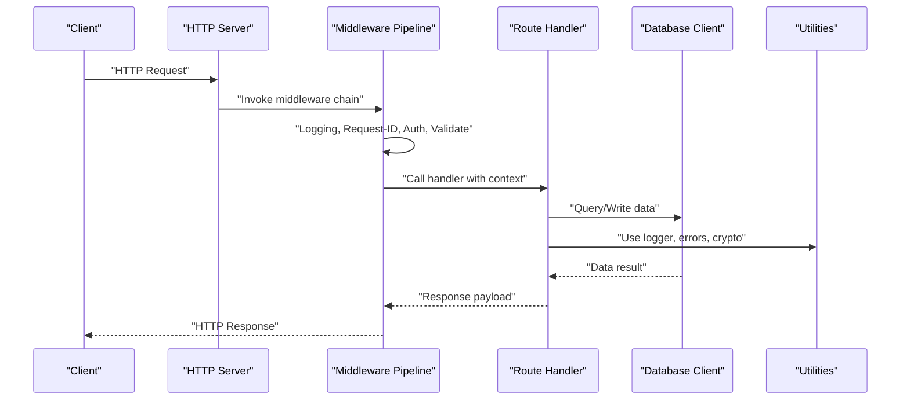
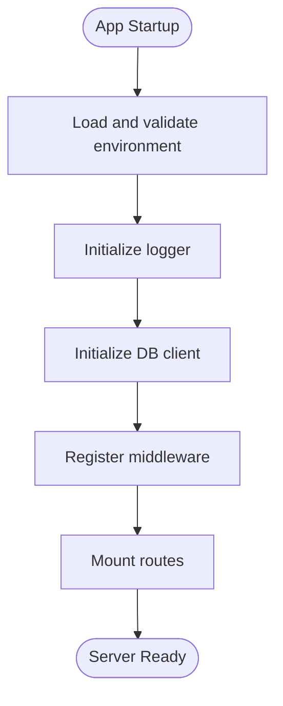
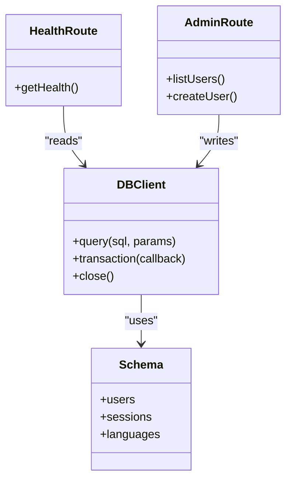
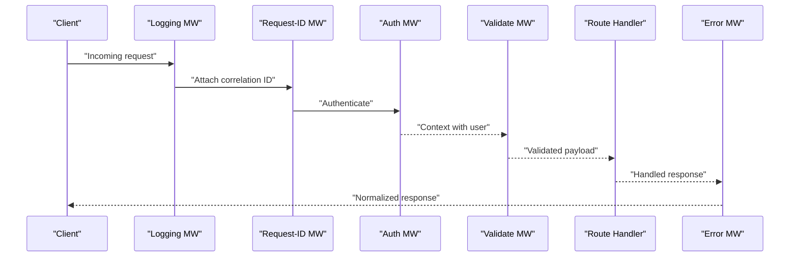
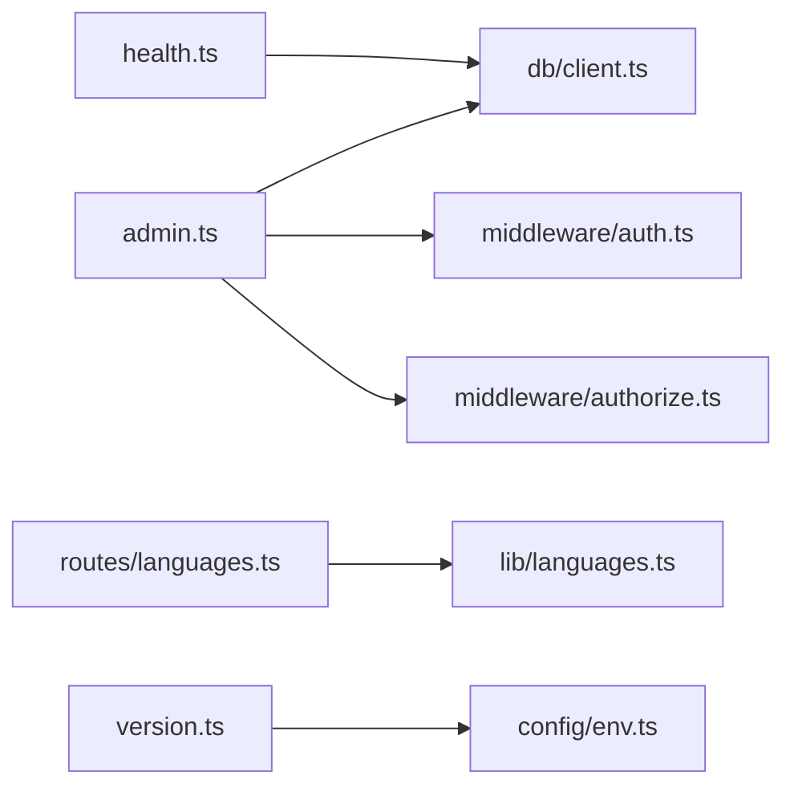
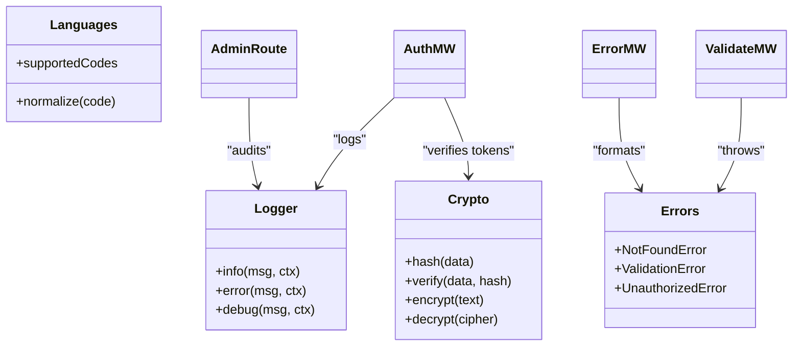
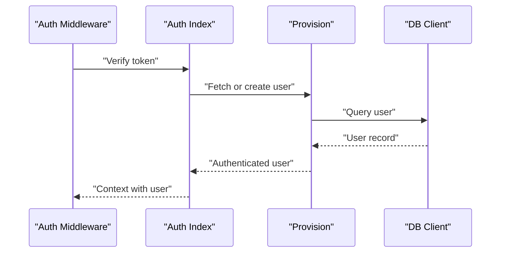
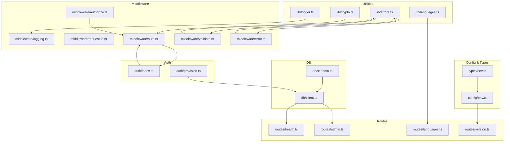

# Component Relationships & Dependencies

<cite>
**Referenced Files in This Document**
- [index.ts](file://src/index.ts)
- [env.ts](file://src/config/env.ts)
- [client.ts](file://src/db/client.ts)
- [schema.ts](file://src/db/schema.ts)
- [auth.ts](file://src/middleware/auth.ts)
- [authorize.ts](file://src/middleware/authorize.ts)
- [error.ts](file://src/middleware/error.ts)
- [logging.ts](file://src/middleware/logging.ts)
- [request-id.ts](file://src/middleware/request-id.ts)
- [validate.ts](file://src/middleware/validate.ts)
- [admin.ts](file://src/routes/admin.ts)
- [health.ts](file://src/routes/health.ts)
- [languages.ts](file://src/routes/languages.ts)
- [version.ts](file://src/routes/version.ts)
- [crypto.ts](file://src/lib/crypto.ts)
- [errors.ts](file://src/lib/errors.ts)
- [languages.ts](file://src/lib/languages.ts)
- [logger.ts](file://src/lib/logger.ts)
- [index.ts](file://src/auth/index.ts)
- [provision.ts](file://src/auth/provision.ts)
- [env.ts](file://src/types/env.ts)
</cite>

## Table of Contents
1. [Introduction](#introduction)
2. [Project Structure](#project-structure)
3. [Core Components](#core-components)
4. [Architecture Overview](#architecture-overview)
5. [Detailed Component Analysis](#detailed-component-analysis)
6. [Dependency Analysis](#dependency-analysis)
7. [Performance Considerations](#performance-considerations)
8. [Troubleshooting Guide](#troubleshooting-guide)
9. [Conclusion](#conclusion)
10. [Appendices](#appendices)

## Introduction
This document explains the component relationships and dependency management in the TrackDub API. It focuses on how modules interact, including routes, middleware, database layer, and utility libraries. It also covers module organization principles, import/export patterns, shared resources (logging, error handling), configuration management, environment variables, and strategies for maintaining loose coupling and preventing circular dependencies. Guidance is provided for adding new components while preserving architectural integrity.

## Project Structure
The codebase follows a feature-oriented layout with clear separation of concerns:
- Entry point initializes configuration, logging, and application lifecycle.
- Configuration and types are centralized under config and types.
- Database client and schema definitions live under db.
- Middleware encapsulates cross-cutting concerns such as authentication, authorization, validation, logging, request ID generation, and error handling.
- Routes define HTTP endpoints grouped by domain or concern.
- Shared utilities reside under lib for reuse across layers.
- Authentication logic is organized under auth.

**Diagram sources**
- [index.ts](file://src/index.ts)
- [env.ts](file://src/config/env.ts)
- [logger.ts](file://src/lib/logger.ts)
- [logging.ts](file://src/middleware/logging.ts)
- [error.ts](file://src/middleware/error.ts)
- [request-id.ts](file://src/middleware/request-id.ts)
- [auth.ts](file://src/middleware/auth.ts)
- [authorize.ts](file://src/middleware/authorize.ts)
- [validate.ts](file://src/middleware/validate.ts)
- [health.ts](file://src/routes/health.ts)
- [admin.ts](file://src/routes/admin.ts)
- [languages.ts](file://src/routes/languages.ts)
- [version.ts](file://src/routes/version.ts)
- [client.ts](file://src/db/client.ts)
- [schema.ts](file://src/db/schema.ts)
- [errors.ts](file://src/lib/errors.ts)
- [crypto.ts](file://src/lib/crypto.ts)
- [index.ts](file://src/auth/index.ts)
- [provision.ts](file://src/auth/provision.ts)
- [languages.ts](file://src/lib/languages.ts)

**Section sources**
- [index.ts](file://src/index.ts)
- [env.ts](file://src/config/env.ts)
- [client.ts](file://src/db/client.ts)
- [schema.ts](file://src/db/schema.ts)
- [auth.ts](file://src/middleware/auth.ts)
- [authorize.ts](file://src/middleware/authorize.ts)
- [error.ts](file://src/middleware/error.ts)
- [logging.ts](file://src/middleware/logging.ts)
- [request-id.ts](file://src/middleware/request-id.ts)
- [validate.ts](file://src/middleware/validate.ts)
- [admin.ts](file://src/routes/admin.ts)
- [health.ts](file://src/routes/health.ts)
- [languages.ts](file://src/routes/languages.ts)
- [version.ts](file://src/routes/version.ts)
- [crypto.ts](file://src/lib/crypto.ts)
- [errors.ts](file://src/lib/errors.ts)
- [languages.ts](file://src/lib/languages.ts)
- [index.ts](file://src/auth/index.ts)
- [provision.ts](file://src/auth/provision.ts)

## Core Components
- Application bootstrap: Initializes environment configuration, sets up logging, registers middleware, mounts routes, and starts the server.
- Configuration: Centralized environment variable loading and type-safe access via typed env modules.
- Database: Typed client initialization and schema definitions used by routes and services.
- Middleware pipeline: Logging, request ID, authentication, authorization, validation, and error handling.
- Routes: Domain-specific endpoint handlers that depend on middleware, DB, and utilities.
- Utilities: Cryptography helpers, error abstractions, language utilities, and logger.
- Auth: Authentication orchestration and provisioning logic.

Key responsibilities and interactions:
- Routes depend on middleware for cross-cutting concerns and on DB client for data operations.
- Middleware depends on utilities (logger, errors, crypto) but not on routes.
- Config and types are consumed by all layers to ensure consistent runtime behavior.
- Auth module provides identity context to middleware and routes without tight coupling.

**Section sources**
- [index.ts](file://src/index.ts)
- [env.ts](file://src/config/env.ts)
- [client.ts](file://src/db/client.ts)
- [schema.ts](file://src/db/schema.ts)
- [auth.ts](file://src/middleware/auth.ts)
- [authorize.ts](file://src/middleware/authorize.ts)
- [error.ts](file://src/middleware/error.ts)
- [logging.ts](file://src/middleware/logging.ts)
- [request-id.ts](file://src/middleware/request-id.ts)
- [validate.ts](file://src/middleware/validate.ts)
- [admin.ts](file://src/routes/admin.ts)
- [health.ts](file://src/routes/health.ts)
- [languages.ts](file://src/routes/languages.ts)
- [version.ts](file://src/routes/version.ts)
- [crypto.ts](file://src/lib/crypto.ts)
- [errors.ts](file://src/lib/errors.ts)
- [languages.ts](file://src/lib/languages.ts)
- [index.ts](file://src/auth/index.ts)
- [provision.ts](file://src/auth/provision.ts)

## Architecture Overview
The API uses a layered architecture with middleware as a pipeline between the HTTP server and route handlers. Configuration and shared utilities are accessed through singletons or well-defined modules. The database layer is abstracted behind a typed client, ensuring schema consistency.

**Diagram sources**
- [index.ts](file://src/index.ts)
- [logging.ts](file://src/middleware/logging.ts)
- [request-id.ts](file://src/middleware/request-id.ts)
- [auth.ts](file://src/middleware/auth.ts)
- [validate.ts](file://src/middleware/validate.ts)
- [error.ts](file://src/middleware/error.ts)
- [health.ts](file://src/routes/health.ts)
- [admin.ts](file://src/routes/admin.ts)
- [languages.ts](file://src/routes/languages.ts)
- [version.ts](file://src/routes/version.ts)
- [client.ts](file://src/db/client.ts)
- [errors.ts](file://src/lib/errors.ts)
- [crypto.ts](file://src/lib/crypto.ts)
- [logger.ts](file://src/lib/logger.ts)

## Detailed Component Analysis

### Configuration and Environment Management
- Centralized environment loading ensures all modules read from a single source of truth.
- Type-safe env access prevents runtime mismatches and improves developer experience.
- Environment variables are validated at startup; failures halt initialization early.

**Diagram sources**
- [env.ts](file://src/config/env.ts)
- [logger.ts](file://src/lib/logger.ts)
- [client.ts](file://src/db/client.ts)
- [index.ts](file://src/index.ts)

**Section sources**
- [env.ts](file://src/config/env.ts)
- [env.ts](file://src/types/env.ts)
- [index.ts](file://src/index.ts)

### Database Layer
- The DB client encapsulates connection setup and exposes typed queries.
- Schema definitions provide a single source of truth for entities and relations.
- Routes interact with the DB client without exposing internals.

**Diagram sources**
- [client.ts](file://src/db/client.ts)
- [schema.ts](file://src/db/schema.ts)
- [health.ts](file://src/routes/health.ts)
- [admin.ts](file://src/routes/admin.ts)

**Section sources**
- [client.ts](file://src/db/client.ts)
- [schema.ts](file://src/db/schema.ts)
- [health.ts](file://src/routes/health.ts)
- [admin.ts](file://src/routes/admin.ts)

### Middleware Pipeline
- Logging middleware records request metadata and response status.
- Request ID middleware injects correlation IDs into logs and responses.
- Authentication middleware validates tokens and attaches user context.
- Authorization middleware enforces role-based access.
- Validation middleware checks request payloads against schemas.
- Error middleware centralizes error formatting and status codes.

**Diagram sources**
- [logging.ts](file://src/middleware/logging.ts)
- [request-id.ts](file://src/middleware/request-id.ts)
- [auth.ts](file://src/middleware/auth.ts)
- [authorize.ts](file://src/middleware/authorize.ts)
- [validate.ts](file://src/middleware/validate.ts)
- [error.ts](file://src/middleware/error.ts)

**Section sources**
- [logging.ts](file://src/middleware/logging.ts)
- [request-id.ts](file://src/middleware/request-id.ts)
- [auth.ts](file://src/middleware/auth.ts)
- [authorize.ts](file://src/middleware/authorize.ts)
- [validate.ts](file://src/middleware/validate.ts)
- [error.ts](file://src/middleware/error.ts)

### Routes and Handlers
- Health route returns service status using DB connectivity checks.
- Admin route manages administrative operations with authorization.
- Languages route exposes language-related endpoints.
- Version route returns API version information.

**Diagram sources**
- [health.ts](file://src/routes/health.ts)
- [admin.ts](file://src/routes/admin.ts)
- [languages.ts](file://src/routes/languages.ts)
- [version.ts](file://src/routes/version.ts)
- [client.ts](file://src/db/client.ts)
- [auth.ts](file://src/middleware/auth.ts)
- [authorize.ts](file://src/middleware/authorize.ts)
- [languages.ts](file://src/lib/languages.ts)
- [env.ts](file://src/config/env.ts)

**Section sources**
- [health.ts](file://src/routes/health.ts)
- [admin.ts](file://src/routes/admin.ts)
- [languages.ts](file://src/routes/languages.ts)
- [version.ts](file://src/routes/version.ts)

### Utilities and Shared Resources
- Logger provides structured logging with levels and contextual fields.
- Errors defines custom error types and standardized error responses.
- Crypto offers hashing and encryption helpers used by auth and sessions.
- Languages contains language constants and transformation utilities.

**Diagram sources**
- [logger.ts](file://src/lib/logger.ts)
- [errors.ts](file://src/lib/errors.ts)
- [crypto.ts](file://src/lib/crypto.ts)
- [languages.ts](file://src/lib/languages.ts)
- [auth.ts](file://src/middleware/auth.ts)
- [validate.ts](file://src/middleware/validate.ts)
- [error.ts](file://src/middleware/error.ts)
- [admin.ts](file://src/routes/admin.ts)

**Section sources**
- [logger.ts](file://src/lib/logger.ts)
- [errors.ts](file://src/lib/errors.ts)
- [crypto.ts](file://src/lib/crypto.ts)
- [languages.ts](file://src/lib/languages.ts)

### Authentication Module
- Orchestrates token verification, session management, and user provisioning.
- Provides reusable functions for middleware and routes to obtain authenticated context.

**Diagram sources**
- [auth.ts](file://src/middleware/auth.ts)
- [index.ts](file://src/auth/index.ts)
- [provision.ts](file://src/auth/provision.ts)
- [client.ts](file://src/db/client.ts)

**Section sources**
- [auth.ts](file://src/middleware/auth.ts)
- [index.ts](file://src/auth/index.ts)
- [provision.ts](file://src/auth/provision.ts)
- [client.ts](file://src/db/client.ts)

## Dependency Analysis
- One-way dependencies: Routes depend on middleware, DB, and utilities; middleware depends on utilities and types; utilities do not depend on routes or middleware.
- Circular dependency prevention: Avoid importing routes inside middleware or utilities. Use interfaces or function parameters to decouple where necessary.
- Shared resources: Logger, errors, and crypto are imported by multiple layers; keep them pure and side-effect free.

**Diagram sources**
- [logger.ts](file://src/lib/logger.ts)
- [errors.ts](file://src/lib/errors.ts)
- [crypto.ts](file://src/lib/crypto.ts)
- [languages.ts](file://src/lib/languages.ts)
- [env.ts](file://src/config/env.ts)
- [env.ts](file://src/types/env.ts)
- [client.ts](file://src/db/client.ts)
- [schema.ts](file://src/db/schema.ts)
- [index.ts](file://src/auth/index.ts)
- [provision.ts](file://src/auth/provision.ts)
- [logging.ts](file://src/middleware/logging.ts)
- [request-id.ts](file://src/middleware/request-id.ts)
- [auth.ts](file://src/middleware/auth.ts)
- [authorize.ts](file://src/middleware/authorize.ts)
- [validate.ts](file://src/middleware/validate.ts)
- [error.ts](file://src/middleware/error.ts)
- [health.ts](file://src/routes/health.ts)
- [admin.ts](file://src/routes/admin.ts)
- [languages.ts](file://src/routes/languages.ts)
- [version.ts](file://src/routes/version.ts)

**Section sources**
- [logger.ts](file://src/lib/logger.ts)
- [errors.ts](file://src/lib/errors.ts)
- [crypto.ts](file://src/lib/crypto.ts)
- [languages.ts](file://src/lib/languages.ts)
- [env.ts](file://src/config/env.ts)
- [env.ts](file://src/types/env.ts)
- [client.ts](file://src/db/client.ts)
- [schema.ts](file://src/db/schema.ts)
- [index.ts](file://src/auth/index.ts)
- [provision.ts](file://src/auth/provision.ts)
- [logging.ts](file://src/middleware/logging.ts)
- [request-id.ts](file://src/middleware/request-id.ts)
- [auth.ts](file://src/middleware/auth.ts)
- [authorize.ts](file://src/middleware/authorize.ts)
- [validate.ts](file://src/middleware/validate.ts)
- [error.ts](file://src/middleware/error.ts)
- [health.ts](file://src/routes/health.ts)
- [admin.ts](file://src/routes/admin.ts)
- [languages.ts](file://src/routes/languages.ts)
- [version.ts](file://src/routes/version.ts)

## Performance Considerations
- Keep middleware lightweight; avoid heavy computations in the request path.
- Cache frequently accessed configuration and static data where appropriate.
- Use connection pooling for DB operations and minimize round trips.
- Log only essential information to reduce I/O overhead.
- Defer non-critical work to background tasks when possible.

[No sources needed since this section provides general guidance]

## Troubleshooting Guide
- Environment misconfiguration: Validate env variables at startup; check for missing keys and invalid formats.
- DB connectivity issues: Inspect client initialization and schema migrations; verify credentials and network settings.
- Authentication failures: Review token verification flow and user provisioning; ensure secrets are correctly configured.
- Validation errors: Confirm schema definitions match expected payloads; inspect error middleware output.
- Logging gaps: Ensure request ID and context are propagated through the middleware chain.

**Section sources**
- [env.ts](file://src/config/env.ts)
- [client.ts](file://src/db/client.ts)
- [auth.ts](file://src/middleware/auth.ts)
- [validate.ts](file://src/middleware/validate.ts)
- [error.ts](file://src/middleware/error.ts)
- [logging.ts](file://src/middleware/logging.ts)

## Conclusion
TrackDub’s architecture emphasizes clear separation of concerns, centralized configuration, and reusable utilities. Middleware forms a robust pipeline that standardizes cross-cutting concerns, while routes remain focused on business logic. By adhering to dependency direction rules and leveraging shared resources, the system maintains loose coupling and scalability. When adding new components, follow established patterns to preserve integrity and maintainability.

[No sources needed since this section summarizes without analyzing specific files]

## Appendices

### Guidelines for Adding New Components
- Place domain-specific logic under routes or features; keep middleware generic and reusable.
- Import utilities and types from lib and config; avoid importing routes or other high-level modules.
- Define clear interfaces for shared functionality; prefer function parameters over global state.
- Add environment variables to config/env and types/env; validate at startup.
- Write tests for middleware and utilities to ensure reliability.

[No sources needed since this section provides general guidance]