# Data Flow & State Management

<cite>
**Referenced Files in This Document**
- [src/index.ts](file://src/index.ts)
- [src/middleware/auth.ts](file://src/middleware/auth.ts)
- [src/middleware/authorize.ts](file://src/middleware/authorize.ts)
- [src/middleware/error.ts](file://src/middleware/error.ts)
- [src/middleware/logging.ts](file://src/middleware/logging.ts)
- [src/middleware/request-id.ts](file://src/middleware/request-id.ts)
- [src/middleware/validate.ts](file://src/middleware/validate.ts)
- [src/routes/admin.ts](file://src/routes/admin.ts)
- [src/routes/health.ts](file://src/routes/health.ts)
- [src/routes/languages.ts](file://src/routes/languages.ts)
- [src/routes/version.ts](file://src/routes/version.ts)
- [src/db/client.ts](file://src/db/client.ts)
- [src/db/schema.ts](file://src/db/schema.ts)
- [src/config/env.ts](file://src/config/env.ts)
- [src/types/env.ts](file://src/types/env.ts)
- [src/lib/crypto.ts](file://src/lib/crypto.ts)
- [src/lib/errors.ts](file://src/lib/errors.ts)
- [src/lib/logger.ts](file://src/lib/logger.ts)
- [drizzle.config.ts](file://drizzle.config.ts)
- [wrangler.jsonc](file://wrangler.jsonc)
</cite>

## Table of Contents
1. [Introduction](#introduction)
2. [Project Structure](#project-structure)
3. [Core Components](#core-components)
4. [Architecture Overview](#architecture-overview)
5. [Detailed Component Analysis](#detailed-component-analysis)
6. [Dependency Analysis](#dependency-analysis)
7. [Performance Considerations](#performance-considerations)
8. [Troubleshooting Guide](#troubleshooting-guide)
9. [Conclusion](#conclusion)
10. [Appendices](#appendices)

## Introduction
This document explains how data flows through the TrackDub API from HTTP requests to database operations and back to responses, with a focus on state management in a serverless context. It covers middleware pipelines, route handlers, database connections, query execution patterns, data transformations, validation points, security boundaries, caching strategies, consistency patterns, and concurrency handling.

## Project Structure
The project is organized by feature and layer:
- Entry point and server setup
- Middleware for auth, authorization, logging, request ID, validation, and error handling
- Route modules for admin, health, languages, and version endpoints
- Database client and schema definitions
- Configuration and environment variables
- Shared libraries for crypto, errors, and logging

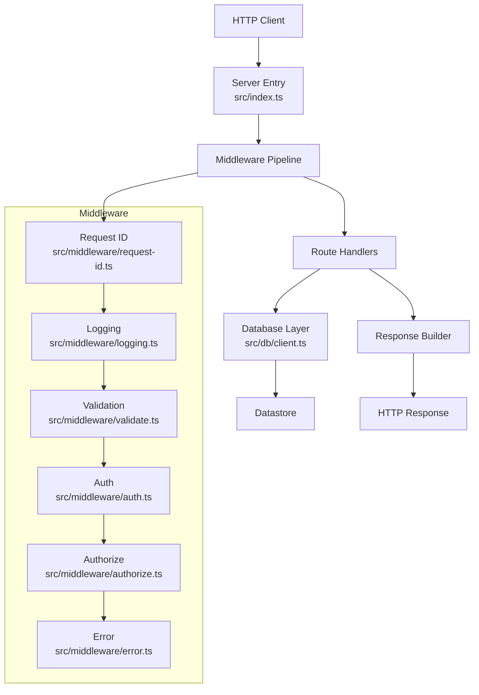

**Diagram sources**
- [src/index.ts](file://src/index.ts)
- [src/middleware/request-id.ts](file://src/middleware/request-id.ts)
- [src/middleware/logging.ts](file://src/middleware/logging.ts)
- [src/middleware/validate.ts](file://src/middleware/validate.ts)
- [src/middleware/auth.ts](file://src/middleware/auth.ts)
- [src/middleware/authorize.ts](file://src/middleware/authorize.ts)
- [src/middleware/error.ts](file://src/middleware/error.ts)
- [src/db/client.ts](file://src/db/client.ts)

**Section sources**
- [src/index.ts](file://src/index.ts)
- [wrangler.jsonc](file://wrangler.jsonc)

## Core Components
- Server entrypoint wires up middleware and routes, ensuring consistent request lifecycle handling.
- Middleware layers enforce cross-cutting concerns: unique request IDs, structured logging, input validation, authentication, authorization, and centralized error handling.
- Route handlers implement business logic, orchestrate data access, and build responses.
- Database layer provides typed schemas and connection management via Drizzle ORM.
- Configuration and environment modules centralize settings and secrets.
- Libraries encapsulate cryptographic utilities, error abstractions, and logging helpers.

Key responsibilities:
- Request lifecycle: parse, validate, authenticate, authorize, handle, respond, log.
- Data access: schema-driven queries, parameterized statements, transaction boundaries where applicable.
- Security: secure headers, secret management, minimal sensitive data exposure.
- Observability: request-scoped IDs, structured logs, error telemetry.

**Section sources**
- [src/index.ts](file://src/index.ts)
- [src/middleware/auth.ts](file://src/middleware/auth.ts)
- [src/middleware/authorize.ts](file://src/middleware/authorize.ts)
- [src/middleware/error.ts](file://src/middleware/error.ts)
- [src/middleware/logging.ts](file://src/middleware/logging.ts)
- [src/middleware/request-id.ts](file://src/middleware/request-id.ts)
- [src/middleware/validate.ts](file://src/middleware/validate.ts)
- [src/db/client.ts](file://src/db/client.ts)
- [src/db/schema.ts](file://src/db/schema.ts)
- [src/config/env.ts](file://src/config/env.ts)
- [src/types/env.ts](file://src/types/env.ts)
- [src/lib/crypto.ts](file://src/lib/crypto.ts)
- [src/lib/errors.ts](file://src/lib/errors.ts)
- [src/lib/logger.ts](file://src/lib/logger.ts)

## Architecture Overview
The API follows a layered, stateless architecture suitable for serverless platforms:
- Stateless design: no in-process mutable global state; per-request objects only.
- Middleware pipeline processes each request independently.
- Route handlers are pure functions of request inputs and external services.
- Database connections are short-lived and scoped to request lifetimes.
- Secrets and configuration are injected at runtime.

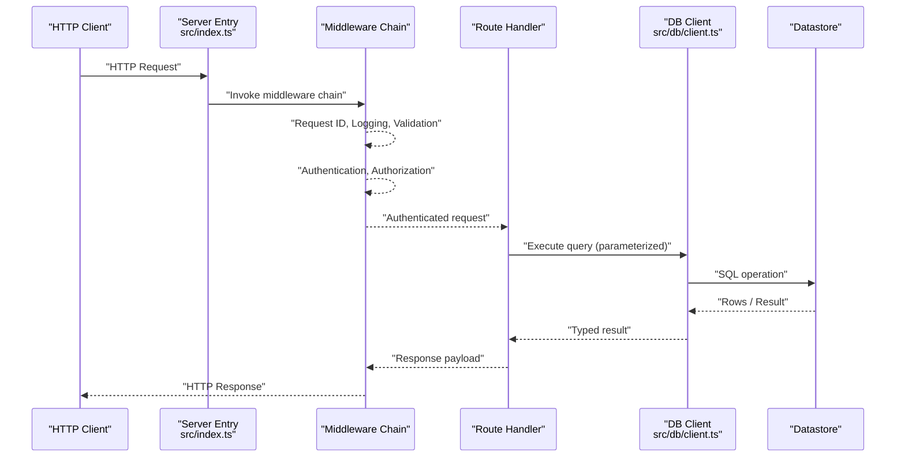

**Diagram sources**
- [src/index.ts](file://src/index.ts)
- [src/middleware/request-id.ts](file://src/middleware/request-id.ts)
- [src/middleware/logging.ts](file://src/middleware/logging.ts)
- [src/middleware/validate.ts](file://src/middleware/validate.ts)
- [src/middleware/auth.ts](file://src/middleware/auth.ts)
- [src/middleware/authorize.ts](file://src/middleware/authorize.ts)
- [src/db/client.ts](file://src/db/client.ts)

## Detailed Component Analysis

### Request Lifecycle and Middleware Pipeline
- Request ID generation ensures traceability across logs and downstream calls.
- Logging captures method, path, timing, status, and correlation IDs.
- Validation enforces schema constraints early to fail fast.
- Authentication verifies identity tokens or session cookies securely.
- Authorization checks permissions against roles or policies.
- Error middleware normalizes errors into safe responses and logs details.

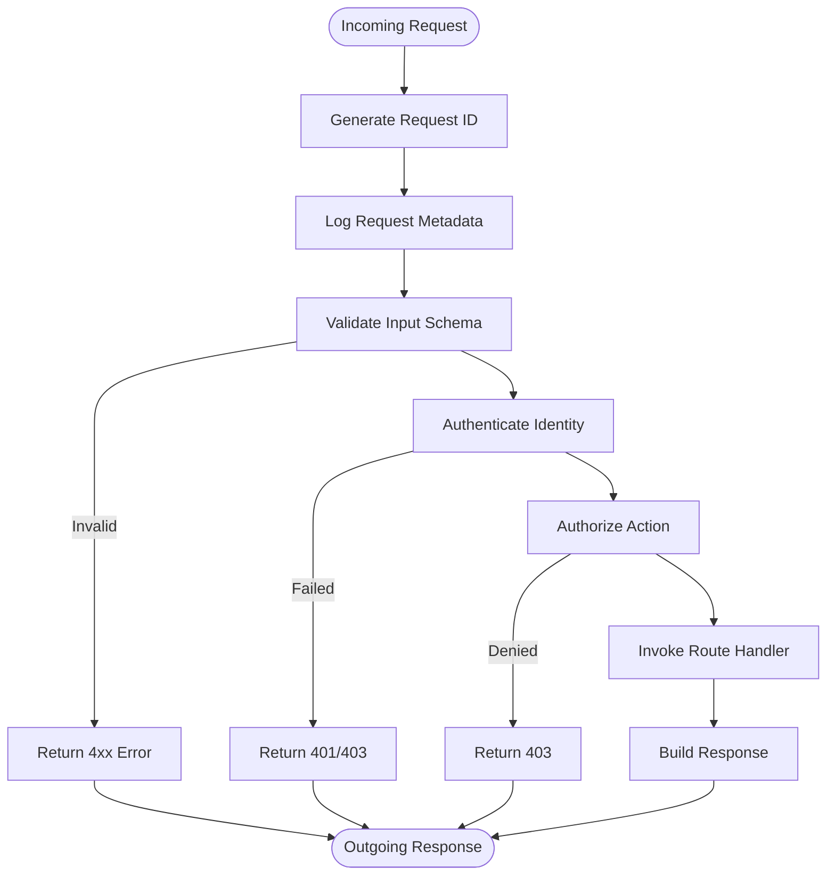

**Diagram sources**
- [src/middleware/request-id.ts](file://src/middleware/request-id.ts)
- [src/middleware/logging.ts](file://src/middleware/logging.ts)
- [src/middleware/validate.ts](file://src/middleware/validate.ts)
- [src/middleware/auth.ts](file://src/middleware/auth.ts)
- [src/middleware/authorize.ts](file://src/middleware/authorize.ts)
- [src/middleware/error.ts](file://src/middleware/error.ts)

**Section sources**
- [src/middleware/request-id.ts](file://src/middleware/request-id.ts)
- [src/middleware/logging.ts](file://src/middleware/logging.ts)
- [src/middleware/validate.ts](file://src/middleware/validate.ts)
- [src/middleware/auth.ts](file://src/middleware/auth.ts)
- [src/middleware/authorize.ts](file://src/middleware/authorize.ts)
- [src/middleware/error.ts](file://src/middleware/error.ts)

### Route Handlers and Data Access
- Each route module defines endpoints that transform validated inputs into domain actions.
- Handlers call the database client with typed parameters derived from schemas.
- Responses are built from normalized results, excluding sensitive fields.

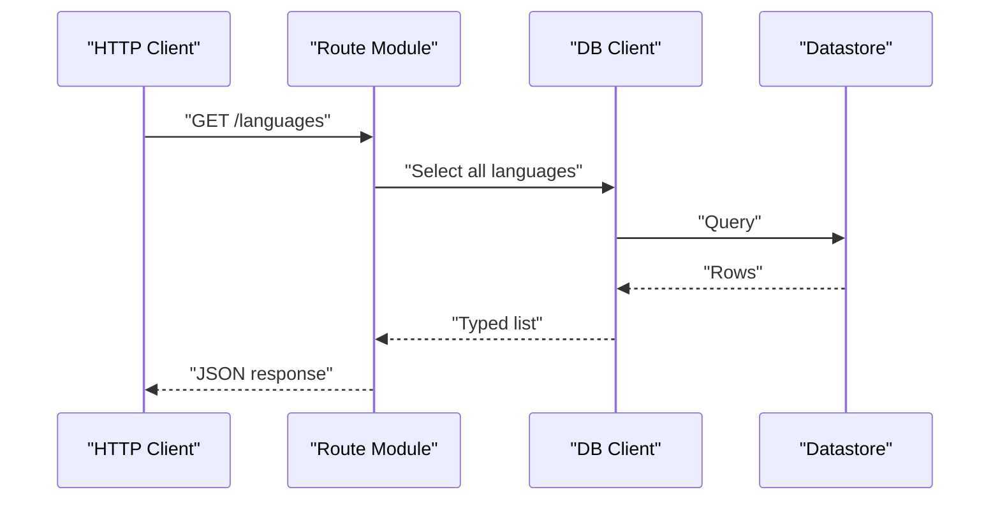

**Diagram sources**
- [src/routes/languages.ts](file://src/routes/languages.ts)
- [src/db/client.ts](file://src/db/client.ts)

**Section sources**
- [src/routes/admin.ts](file://src/routes/admin.ts)
- [src/routes/health.ts](file://src/routes/health.ts)
- [src/routes/languages.ts](file://src/routes/languages.ts)
- [src/routes/version.ts](file://src/routes/version.ts)
- [src/db/client.ts](file://src/db/client.ts)

### Database Connection Management and Query Patterns
- The database client initializes a connection pool appropriate for serverless environments.
- Queries use parameterized statements to prevent injection and ensure type safety.
- Schemas define entities and relationships, enabling consistent data modeling.

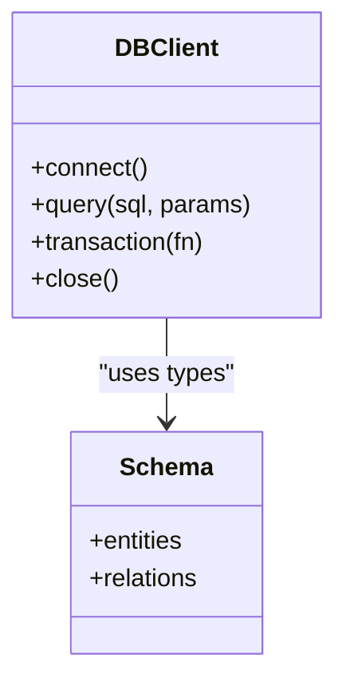

**Diagram sources**
- [src/db/client.ts](file://src/db/client.ts)
- [src/db/schema.ts](file://src/db/schema.ts)

**Section sources**
- [src/db/client.ts](file://src/db/client.ts)
- [src/db/schema.ts](file://src/db/schema.ts)
- [drizzle.config.ts](file://drizzle.config.ts)

### Configuration and Environment
- Centralized environment loading validates required keys and defaults.
- Secrets are read from platform-provided stores and never hardcoded.
- Types enforce shape and availability of configuration values.

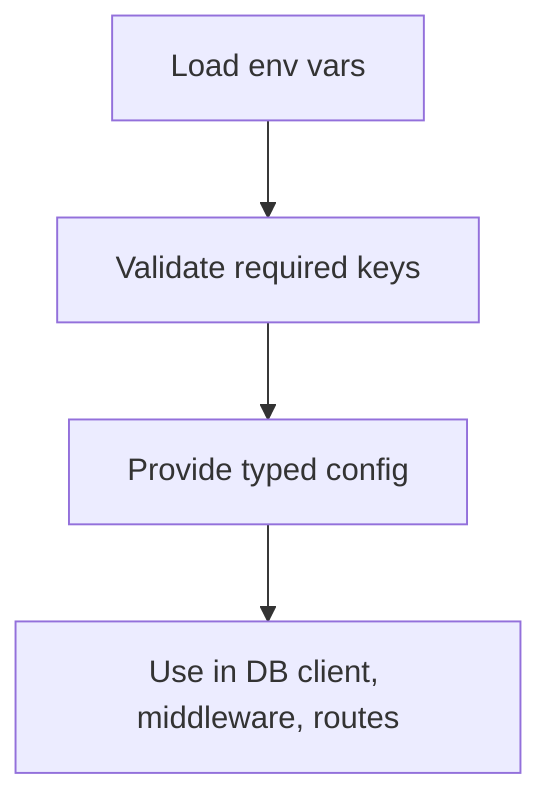

**Diagram sources**
- [src/config/env.ts](file://src/config/env.ts)
- [src/types/env.ts](file://src/types/env.ts)

**Section sources**
- [src/config/env.ts](file://src/config/env.ts)
- [src/types/env.ts](file://src/types/env.ts)

### Security and Sensitive Data Handling
- Cryptographic utilities provide hashing and encryption helpers used by auth and data protection.
- Errors are sanitized before being sent to clients; stack traces remain internal.
- Logging excludes sensitive payloads and tokens.

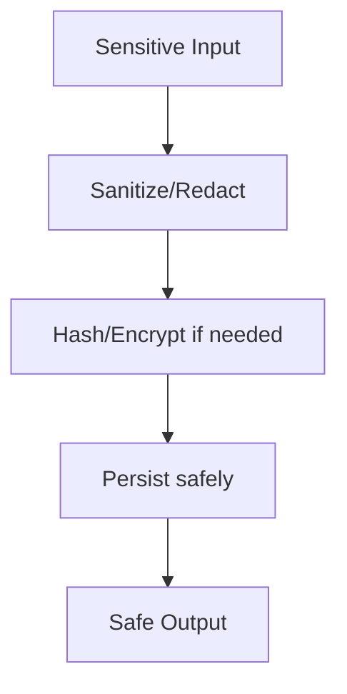

**Diagram sources**
- [src/lib/crypto.ts](file://src/lib/crypto.ts)
- [src/lib/errors.ts](file://src/lib/errors.ts)
- [src/lib/logger.ts](file://src/lib/logger.ts)

**Section sources**
- [src/lib/crypto.ts](file://src/lib/crypto.ts)
- [src/lib/errors.ts](file://src/lib/errors.ts)
- [src/lib/logger.ts](file://src/lib/logger.ts)

### Stateless Design and Session Management
- No in-process sessions; statelessness is enforced by design.
- If sessions are used, they are stored externally (e.g., token-based or remote store).
- Per-request state is isolated and discarded after response completion.

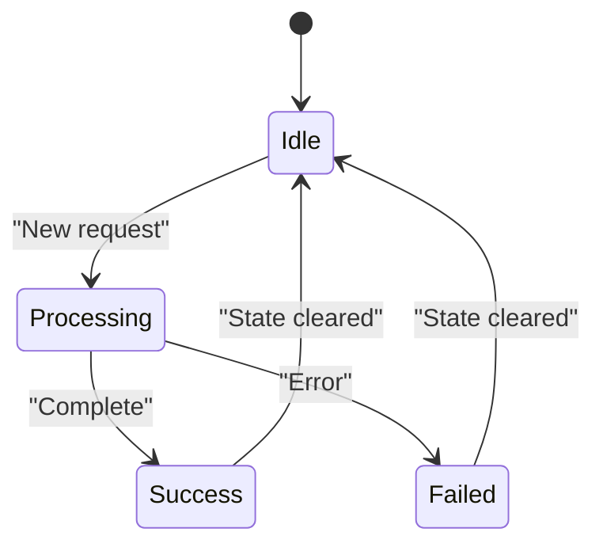

[No sources needed since this diagram shows conceptual workflow, not actual code structure]

## Dependency Analysis
The following diagram maps key dependencies between modules:

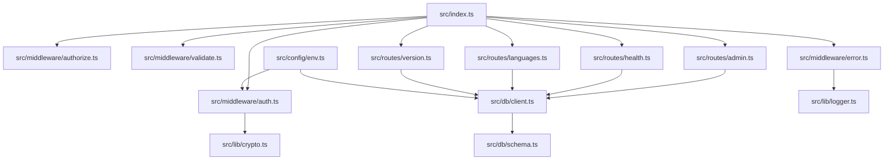

**Diagram sources**
- [src/index.ts](file://src/index.ts)
- [src/middleware/auth.ts](file://src/middleware/auth.ts)
- [src/middleware/authorize.ts](file://src/middleware/authorize.ts)
- [src/middleware/validate.ts](file://src/middleware/validate.ts)
- [src/middleware/error.ts](file://src/middleware/error.ts)
- [src/routes/admin.ts](file://src/routes/admin.ts)
- [src/routes/health.ts](file://src/routes/health.ts)
- [src/routes/languages.ts](file://src/routes/languages.ts)
- [src/routes/version.ts](file://src/routes/version.ts)
- [src/db/client.ts](file://src/db/client.ts)
- [src/db/schema.ts](file://src/db/schema.ts)
- [src/config/env.ts](file://src/config/env.ts)
- [src/lib/crypto.ts](file://src/lib/crypto.ts)
- [src/lib/logger.ts](file://src/lib/logger.ts)

**Section sources**
- [src/index.ts](file://src/index.ts)
- [src/db/client.ts](file://src/db/client.ts)
- [src/config/env.ts](file://src/config/env.ts)

## Performance Considerations
- Keep handlers lightweight and avoid blocking operations.
- Reuse database connections within the request scope; avoid creating new pools per request.
- Prefer parameterized queries and selective field projection to reduce payload sizes.
- Cache immutable or infrequently changing data at the edge or application layer when appropriate.
- Monitor latency and error rates using structured logs and request IDs.

[No sources needed since this section provides general guidance]

## Troubleshooting Guide
- Use request IDs to correlate logs across middleware and handlers.
- Inspect validation errors early to identify malformed inputs.
- Review error middleware outputs for standardized error shapes and messages.
- Verify environment configuration and secret availability at runtime.
- Check database connectivity and query performance under load.

**Section sources**
- [src/middleware/error.ts](file://src/middleware/error.ts)
- [src/middleware/logging.ts](file://src/middleware/logging.ts)
- [src/middleware/validate.ts](file://src/middleware/validate.ts)
- [src/config/env.ts](file://src/config/env.ts)

## Conclusion
TrackDub’s API adheres to a clean, stateless architecture optimized for serverless deployment. The middleware pipeline ensures consistent validation, authentication, authorization, and error handling. Database interactions are typed and parameterized, minimizing risk and improving reliability. By isolating state to request scope and leveraging secure configuration and cryptography, the system maintains strong security and scalability characteristics.

[No sources needed since this section summarizes without analyzing specific files]

## Appendices

### Data Flow Diagrams

#### End-to-End Request/Response Cycle
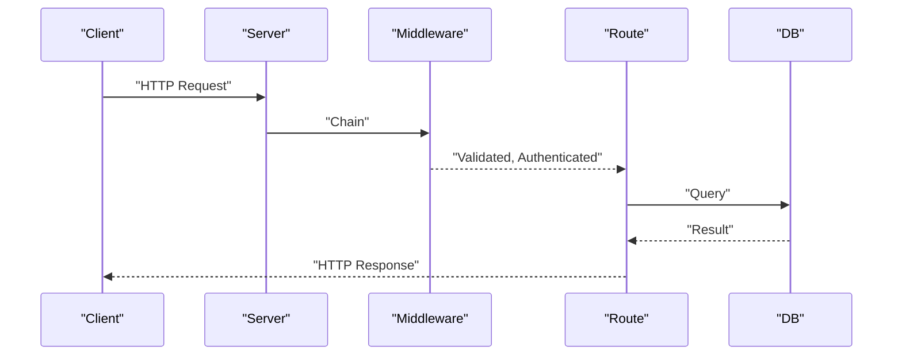

**Diagram sources**
- [src/index.ts](file://src/index.ts)
- [src/middleware/validate.ts](file://src/middleware/validate.ts)
- [src/middleware/auth.ts](file://src/middleware/auth.ts)
- [src/routes/languages.ts](file://src/routes/languages.ts)
- [src/db/client.ts](file://src/db/client.ts)

#### Validation Points and Security Boundaries
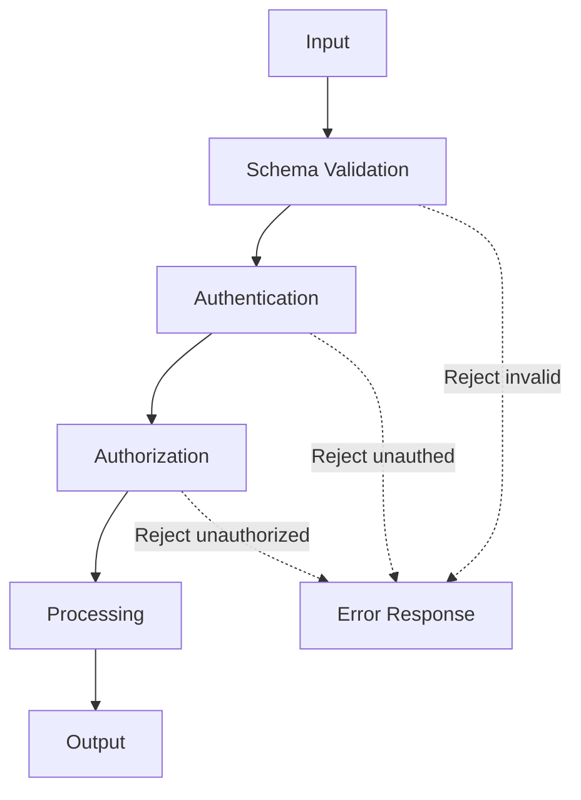

**Diagram sources**
- [src/middleware/validate.ts](file://src/middleware/validate.ts)
- [src/middleware/auth.ts](file://src/middleware/auth.ts)
- [src/middleware/authorize.ts](file://src/middleware/authorize.ts)
- [src/middleware/error.ts](file://src/middleware/error.ts)