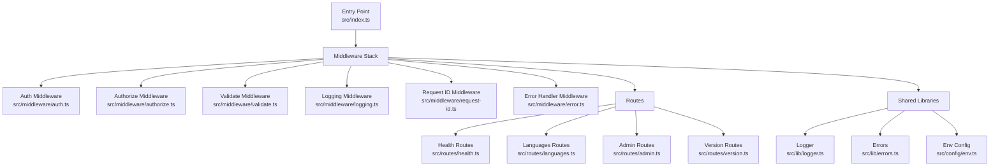
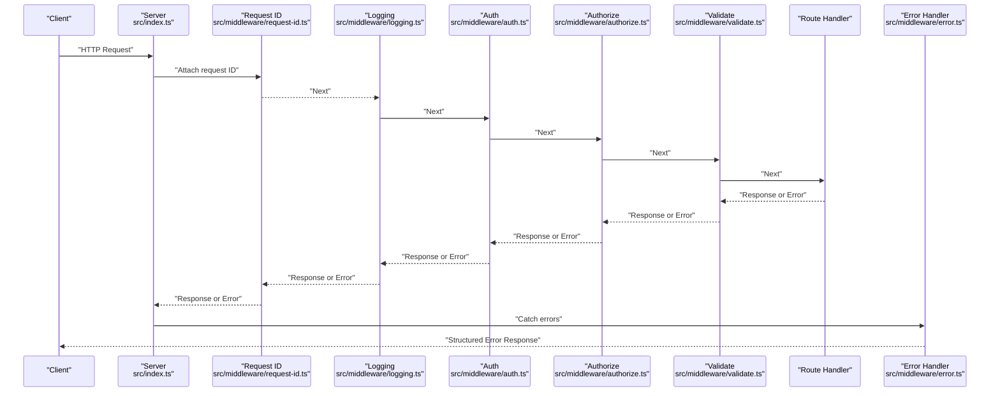
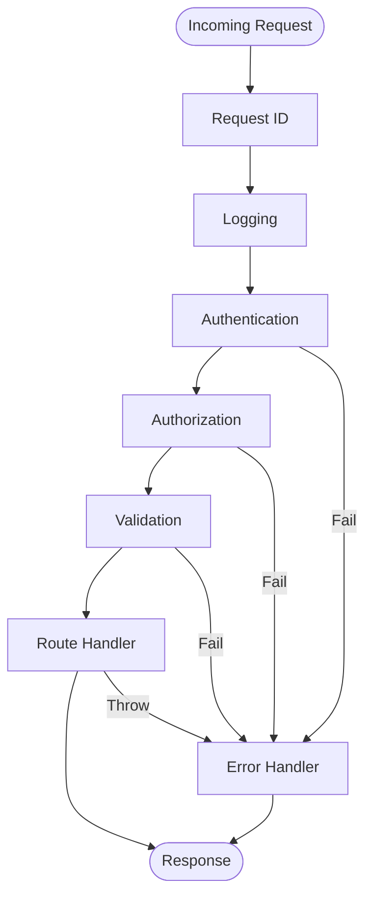

# Request Processing Pipeline

<cite>
**Referenced Files in This Document**
- [index.ts](file://src/index.ts)
- [auth.ts](file://src/middleware/auth.ts)
- [authorize.ts](file://src/middleware/authorize.ts)
- [error.ts](file://src/middleware/error.ts)
- [logging.ts](file://src/middleware/logging.ts)
- [request-id.ts](file://src/middleware/request-id.ts)
- [validate.ts](file://src/middleware/validate.ts)
- [health.ts](file://src/routes/health.ts)
- [languages.ts](file://src/routes/languages.ts)
- [admin.ts](file://src/routes/admin.ts)
- [version.ts](file://src/routes/version.ts)
- [logger.ts](file://src/lib/logger.ts)
- [errors.ts](file://src/lib/errors.ts)
- [env.ts](file://src/config/env.ts)
</cite>

## Table of Contents
1. [Introduction](#introduction)
2. [Project Structure](#project-structure)
3. [Core Components](#core-components)
4. [Architecture Overview](#architecture-overview)
5. [Detailed Component Analysis](#detailed-component-analysis)
6. [Dependency Analysis](#dependency-analysis)
7. [Performance Considerations](#performance-considerations)
8. [Troubleshooting Guide](#troubleshooting-guide)
9. [Conclusion](#conclusion)
10. [Appendices](#appendices)

## Introduction
This document explains the request processing pipeline architecture, focusing on how HTTP requests flow through the middleware stack to response generation. It covers authentication, authorization, validation, logging, and error handling middleware, detailing composition patterns, error propagation, short-circuiting behavior, and best practices for building and debugging custom middleware.

## Project Structure
The application is organized by feature and layer:
- Entry point and server setup
- Middleware modules for cross-cutting concerns
- Route handlers for domain endpoints
- Shared libraries for logging, errors, and configuration

**Diagram sources**
- [index.ts](file://src/index.ts)
- [auth.ts](file://src/middleware/auth.ts)
- [authorize.ts](file://src/middleware/authorize.ts)
- [validate.ts](file://src/middleware/validate.ts)
- [logging.ts](file://src/middleware/logging.ts)
- [request-id.ts](file://src/middleware/request-id.ts)
- [error.ts](file://src/middleware/error.ts)
- [health.ts](file://src/routes/health.ts)
- [languages.ts](file://src/routes/languages.ts)
- [admin.ts](file://src/routes/admin.ts)
- [version.ts](file://src/routes/version.ts)
- [logger.ts](file://src/lib/logger.ts)
- [errors.ts](file://src/lib/errors.ts)
- [env.ts](file://src/config/env.ts)

**Section sources**
- [index.ts](file://src/index.ts)
- [auth.ts](file://src/middleware/auth.ts)
- [authorize.ts](file://src/middleware/authorize.ts)
- [validate.ts](file://src/middleware/validate.ts)
- [logging.ts](file://src/middleware/logging.ts)
- [request-id.ts](file://src/middleware/request-id.ts)
- [error.ts](file://src/middleware/error.ts)
- [health.ts](file://src/routes/health.ts)
- [languages.ts](file://src/routes/languages.ts)
- [admin.ts](file://src/routes/admin.ts)
- [version.ts](file://src/routes/version.ts)
- [logger.ts](file://src/lib/logger.ts)
- [errors.ts](file://src/lib/errors.ts)
- [env.ts](file://src/config/env.ts)

## Core Components
- Entry point: Initializes the server, configures middleware order, and mounts routes.
- Middleware:
  - Authentication: Validates identity and attaches user context.
  - Authorization: Enforces access control based on roles or permissions.
  - Validation: Parses and validates request payloads and parameters.
  - Logging: Records structured logs per request.
  - Request ID: Injects a unique identifier into the request context.
  - Error Handling: Centralizes error serialization and response formatting.
- Routes: Endpoint handlers that implement business logic.
- Shared libraries: Logger, error utilities, and environment configuration.

Key responsibilities:
- Short-circuiting: Any middleware can return a response early (e.g., 401/403/400).
- Context mutation: Middleware can attach data to the request object (e.g., user, requestId).
- Error propagation: Errors bubble up to the error handler middleware.

**Section sources**
- [index.ts](file://src/index.ts)
- [auth.ts](file://src/middleware/auth.ts)
- [authorize.ts](file://src/middleware/authorize.ts)
- [validate.ts](file://src/middleware/validate.ts)
- [logging.ts](file://src/middleware/logging.ts)
- [request-id.ts](file://src/middleware/request-id.ts)
- [error.ts](file://src/middleware/error.ts)
- [logger.ts](file://src/lib/logger.ts)
- [errors.ts](file://src/lib/errors.ts)
- [env.ts](file://src/config/env.ts)

## Architecture Overview
The pipeline follows a composable middleware pattern where each middleware receives the request, optionally mutates it, and either passes control to the next middleware or returns a response. The error handler sits at the end to catch thrown or returned errors.

**Diagram sources**
- [index.ts](file://src/index.ts)
- [request-id.ts](file://src/middleware/request-id.ts)
- [logging.ts](file://src/middleware/logging.ts)
- [auth.ts](file://src/middleware/auth.ts)
- [authorize.ts](file://src/middleware/authorize.ts)
- [validate.ts](file://src/middleware/validate.ts)
- [error.ts](file://src/middleware/error.ts)

## Detailed Component Analysis

### Authentication Middleware
Purpose:
- Verify credentials (e.g., tokens, sessions).
- Attach authenticated user context to the request.
- Short-circuit with 401 Unauthorized when invalid.

Behavior:
- Reads authentication headers or cookies.
- Validates token/session against configured provider.
- On success, sets user context; on failure, returns an error response.

Integration:
- Placed before authorization and route handlers.
- Can be skipped for public routes if configured.

Best practices:
- Fail fast with minimal payload.
- Avoid heavy operations in the hot path.
- Use consistent error shapes for downstream consumers.

**Section sources**
- [auth.ts](file://src/middleware/auth.ts)
- [index.ts](file://src/index.ts)

### Authorization Middleware
Purpose:
- Enforce role-based or permission-based access control after authentication.
- Short-circuit with 403 Forbidden when unauthorized.

Behavior:
- Inspects user context attached by authentication middleware.
- Compares required roles/permissions against the current user.
- Returns appropriate error responses when checks fail.

Integration:
- Applied to protected routes or route groups.
- Composed after authentication and before validation.

Best practices:
- Keep checks deterministic and cacheable where possible.
- Provide clear error messages for auditability.

**Section sources**
- [authorize.ts](file://src/middleware/authorize.ts)
- [index.ts](file://src/index.ts)

### Validation Middleware
Purpose:
- Parse and validate request inputs (body, query, params, headers).
- Normalize input types and coerce values.
- Short-circuit with 400 Bad Request on validation failures.

Behavior:
- Uses schema definitions to validate incoming data.
- Aggregates validation errors into a structured response.
- Mutates request with validated and sanitized data.

Integration:
- Applied per-route or globally for shared schemas.
- Executed after authorization to avoid unnecessary parsing.

Best practices:
- Prefer strict schemas and explicit type guards.
- Return detailed but safe error messages.

**Section sources**
- [validate.ts](file://src/middleware/validate.ts)
- [index.ts](file://src/index.ts)

### Logging Middleware
Purpose:
- Record structured logs for every request (method, path, status, duration).
- Correlate logs via request ID.

Behavior:
- Starts timing and captures initial context.
- Logs post-response metrics and any errors.
- Ensures log fields are consistent across services.

Integration:
- Typically placed near the top of the stack to capture full lifecycle.
- Works alongside request ID middleware for correlation.

Best practices:
- Avoid logging sensitive data.
- Use sampling or throttling under high load.

**Section sources**
- [logging.ts](file://src/middleware/logging.ts)
- [logger.ts](file://src/lib/logger.ts)
- [index.ts](file://src/index.ts)

### Request ID Middleware
Purpose:
- Generate or forward a unique request ID.
- Attach the ID to the request context for tracing.

Behavior:
- Creates a UUID if none exists.
- Propagates the ID across internal calls.

Integration:
- Early in the stack so all downstream components can use it.

Best practices:
- Respect upstream IDs when provided.
- Ensure IDs are stable within a single request.

**Section sources**
- [request-id.ts](file://src/middleware/request-id.ts)
- [index.ts](file://src/index.ts)

### Error Handling Middleware
Purpose:
- Centralize error serialization and response formatting.
- Convert internal errors to safe client-facing responses.

Behavior:
- Catches thrown or returned errors from downstream.
- Maps known error types to HTTP status codes.
- Includes correlation ID and minimal details for clients.

Integration:
- Positioned at the end of the middleware chain.
- Should not swallow unexpected errors without logging.

Best practices:
- Separate internal logs from external responses.
- Provide actionable error codes for API consumers.

**Section sources**
- [error.ts](file://src/middleware/error.ts)
- [errors.ts](file://src/lib/errors.ts)
- [index.ts](file://src/index.ts)

### Routes
Examples of route modules:
- Health: Simple liveness/readiness checks.
- Languages: CRUD or listing endpoints for language resources.
- Admin: Administrative operations requiring elevated privileges.
- Version: API version metadata.

Behavior:
- Implement business logic using validated inputs.
- Return typed responses or throw domain-specific errors.

Integration:
- Mounted after middleware stack initialization.
- May apply route-level guards or validators.

**Section sources**
- [health.ts](file://src/routes/health.ts)
- [languages.ts](file://src/routes/languages.ts)
- [admin.ts](file://src/routes/admin.ts)
- [version.ts](file://src/routes/version.ts)
- [index.ts](file://src/index.ts)

## Dependency Analysis
The middleware stack is composed in a specific order to ensure correct behavior:
- Request ID and Logging should run early to capture full lifecycle.
- Authentication must precede Authorization.
- Validation should occur before route handlers.
- Error Handling must be last to catch all upstream errors.

**Diagram sources**
- [index.ts](file://src/index.ts)
- [request-id.ts](file://src/middleware/request-id.ts)
- [logging.ts](file://src/middleware/logging.ts)
- [auth.ts](file://src/middleware/auth.ts)
- [authorize.ts](file://src/middleware/authorize.ts)
- [validate.ts](file://src/middleware/validate.ts)
- [error.ts](file://src/middleware/error.ts)

**Section sources**
- [index.ts](file://src/index.ts)
- [auth.ts](file://src/middleware/auth.ts)
- [authorize.ts](file://src/middleware/authorize.ts)
- [validate.ts](file://src/middleware/validate.ts)
- [logging.ts](file://src/middleware/logging.ts)
- [request-id.ts](file://src/middleware/request-id.ts)
- [error.ts](file://src/middleware/error.ts)

## Performance Considerations
- Middleware ordering: Place lightweight, frequently used middleware early to minimize overhead.
- Short-circuiting: Return early on invalid requests to avoid expensive downstream work.
- Input validation: Validate only necessary fields; defer heavy parsing until needed.
- Logging: Use structured logging with sampling or async sinks to reduce latency.
- Error handling: Minimize exception usage for control flow; prefer explicit checks.
- Caching: Cache static configurations and lookups (e.g., role mappings).
- Concurrency: Avoid blocking operations in middleware; offload to background tasks.

[No sources needed since this section provides general guidance]

## Troubleshooting Guide
Common issues and resolutions:
- Missing request ID: Ensure request ID middleware runs before logging and error handlers.
- Authentication failures: Check token format, expiration, and issuer configuration.
- Authorization denials: Verify role/permission mappings and route guards.
- Validation errors: Inspect schema definitions and input normalization.
- Unexpected errors: Review error handler mapping and ensure proper error types are thrown.

Debugging techniques:
- Enable verbose logging for specific routes or environments.
- Add temporary logging in middleware to trace execution order.
- Use request ID to correlate logs across services.
- Reproduce with minimal payloads to isolate issues.

**Section sources**
- [logging.ts](file://src/middleware/logging.ts)
- [logger.ts](file://src/lib/logger.ts)
- [error.ts](file://src/middleware/error.ts)
- [errors.ts](file://src/lib/errors.ts)
- [auth.ts](file://src/middleware/auth.ts)
- [authorize.ts](file://src/middleware/authorize.ts)
- [validate.ts](file://src/middleware/validate.ts)

## Conclusion
The request processing pipeline leverages a composable middleware pattern to enforce security, validate inputs, log activity, and handle errors consistently. By adhering to established ordering, short-circuiting strategies, and error propagation mechanisms, the system remains robust, maintainable, and performant. Custom middleware can integrate seamlessly by following these patterns and respecting the shared context and error contracts.

[No sources needed since this section summarizes without analyzing specific files]

## Appendices

### Middleware Composition Pattern
- Each middleware receives the request and a next function.
- Middleware may mutate the request context (e.g., user, requestId).
- Returning a response short-circuits further processing.
- Throwing or returning an error propagates to the error handler.

### Example Request Lifecycle
- Incoming request enters the stack.
- Request ID is generated or forwarded.
- Logging records start time and context.
- Authentication validates identity.
- Authorization enforces access rights.
- Validation parses and validates inputs.
- Route handler executes business logic.
- Error handler catches and formats any errors.
- Response is sent back to the client.

### Integrating Custom Middleware
- Define a function that accepts request and next.
- Perform checks or mutations.
- Return a response to short-circuit or call next().
- Register the middleware in the correct order in the entry point.

[No sources needed since this section provides general guidance]