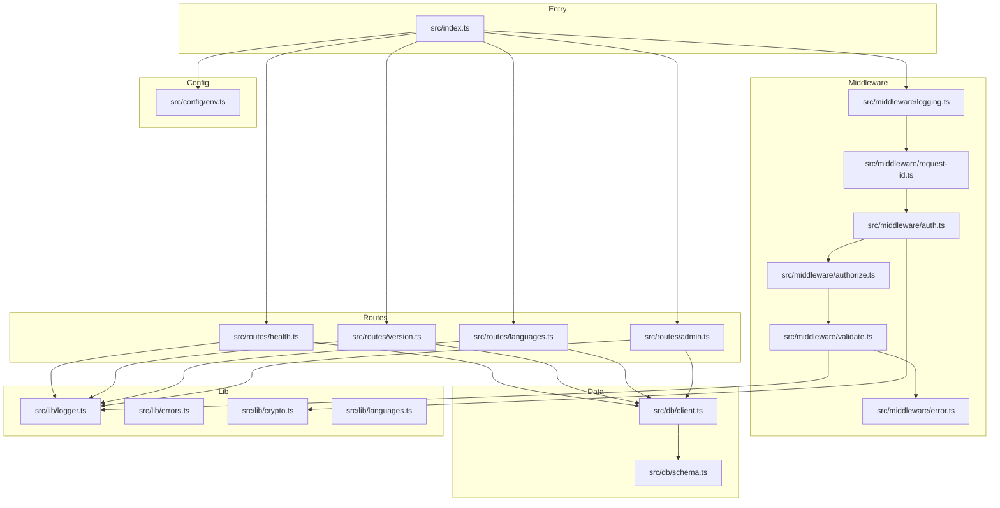
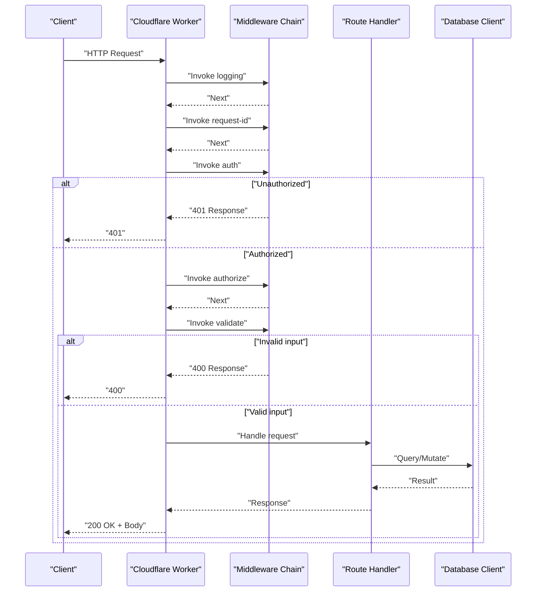
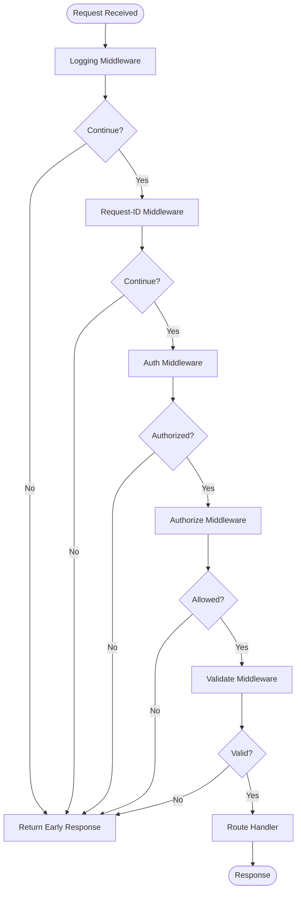
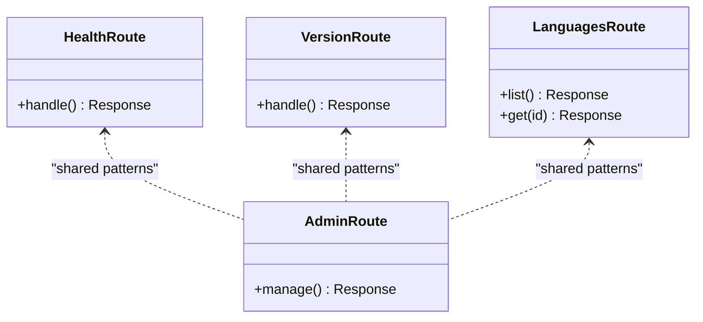
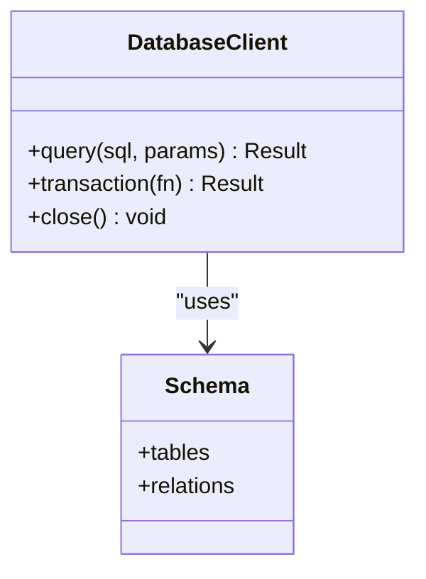
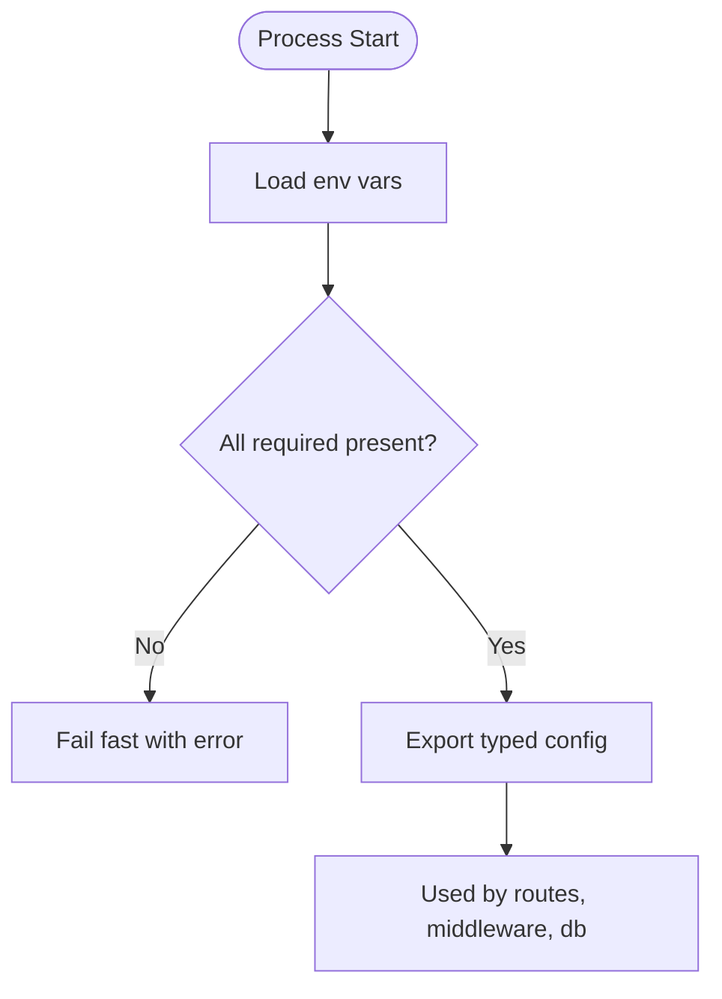
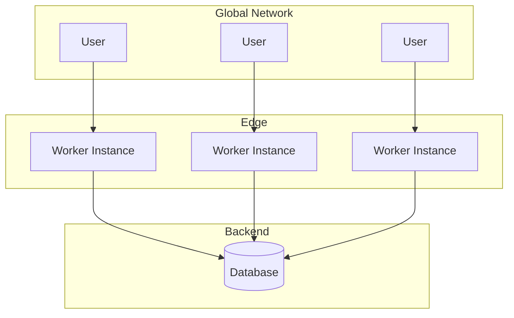
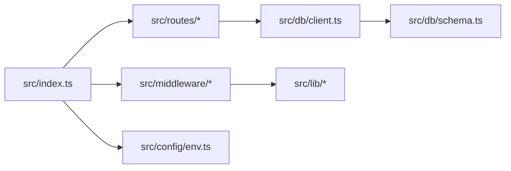

# System Design & Architecture Patterns

<cite>
**Referenced Files in This Document**
- [index.ts](file://src/index.ts)
- [env.ts](file://src/config/env.ts)
- [client.ts](file://src/db/client.ts)
- [schema.ts](file://src/db/schema.ts)
- [auth.ts](file://src/middleware/auth.ts)
- [authorize.ts](file://src/middleware/authorize.ts)
- [error.ts](file://src/middleware/error.ts)
- [logging.ts](file://src/middleware/logging.ts)
- [request-id.ts](file://src/middleware/request-id.ts)
- [validate.ts](file://src/middleware/validate.ts)
- [admin.ts](file://src/routes/admin.ts)
- [health.ts](file://src/routes/health.ts)
- [languages.ts](file://src/routes/languages.ts)
- [version.ts](file://src/routes/version.ts)
- [crypto.ts](file://src/lib/crypto.ts)
- [errors.ts](file://src/lib/errors.ts)
- [languages.ts](file://src/lib/languages.ts)
- [logger.ts](file://src/lib/logger.ts)
- [wrangler.jsonc](file://wrangler.jsonc)
- [package.json](file://package.json)
</cite>

## Table of Contents
1. [Introduction](#introduction)
2. [Project Structure](#project-structure)
3. [Core Components](#core-components)
4. [Architecture Overview](#architecture-overview)
5. [Detailed Component Analysis](#detailed-component-analysis)
6. [Dependency Analysis](#dependency-analysis)
7. [Performance Considerations](#performance-considerations)
8. [Troubleshooting Guide](#troubleshooting-guide)
9. [Conclusion](#conclusion)

## Introduction
This document describes the TrackDub API system design and core architecture patterns. It focuses on a layered architecture with clear separation between presentation (routes), business logic (middleware), and data access layers. The middleware pattern is implemented as a chain of handlers that process requests sequentially before reaching route handlers. The system is deployed as serverless functions on Cloudflare Workers, leveraging edge computing for low latency and global scalability. Stateless design principles and horizontal scaling across Cloudflare’s network are emphasized throughout.

## Project Structure
The project follows a feature-based organization under src:
- routes: HTTP endpoints grouped by domain or concern
- middleware: reusable request/response processing steps
- db: database client and schema definitions
- config: environment configuration
- lib: shared utilities (crypto, logging, errors, languages)
- index: application bootstrap and router setup

**Diagram sources**
- [index.ts](file://src/index.ts)
- [logging.ts](file://src/middleware/logging.ts)
- [request-id.ts](file://src/middleware/request-id.ts)
- [auth.ts](file://src/middleware/auth.ts)
- [authorize.ts](file://src/middleware/authorize.ts)
- [validate.ts](file://src/middleware/validate.ts)
- [error.ts](file://src/middleware/error.ts)
- [health.ts](file://src/routes/health.ts)
- [version.ts](file://src/routes/version.ts)
- [languages.ts](file://src/routes/languages.ts)
- [admin.ts](file://src/routes/admin.ts)
- [client.ts](file://src/db/client.ts)
- [schema.ts](file://src/db/schema.ts)
- [env.ts](file://src/config/env.ts)
- [logger.ts](file://src/lib/logger.ts)
- [errors.ts](file://src/lib/errors.ts)
- [crypto.ts](file://src/lib/crypto.ts)
- [languages.ts](file://src/lib/languages.ts)

**Section sources**
- [index.ts](file://src/index.ts)
- [package.json](file://package.json)
- [wrangler.jsonc](file://wrangler.jsonc)

## Core Components
- Entry point and router initialization: sets up the HTTP server adapter for Cloudflare Workers, registers middleware pipeline, and mounts route modules.
- Middleware pipeline: standardized handler interface that can short-circuit responses, attach context, validate inputs, enforce authentication/authorization, and handle errors.
- Route handlers: stateless functions that read from context, perform business operations, interact with the database layer, and return structured responses.
- Data access layer: typed database client and schema definitions used by routes to query and mutate data consistently.
- Configuration: centralized environment variable loading and validation for runtime settings.
- Shared libraries: logging, error modeling, cryptography helpers, and language utilities consumed across layers.

Key responsibilities:
- Presentation: routes define endpoints and response shapes.
- Business logic: middleware enforces cross-cutting concerns; routes implement domain-specific logic.
- Data access: db client encapsulates connection and query execution; schema defines types and constraints.

**Section sources**
- [index.ts](file://src/index.ts)
- [logging.ts](file://src/middleware/logging.ts)
- [request-id.ts](file://src/middleware/request-id.ts)
- [auth.ts](file://src/middleware/auth.ts)
- [authorize.ts](file://src/middleware/authorize.ts)
- [validate.ts](file://src/middleware/validate.ts)
- [error.ts](file://src/middleware/error.ts)
- [health.ts](file://src/routes/health.ts)
- [version.ts](file://src/routes/version.ts)
- [languages.ts](file://src/routes/languages.ts)
- [admin.ts](file://src/routes/admin.ts)
- [client.ts](file://src/db/client.ts)
- [schema.ts](file://src/db/schema.ts)
- [env.ts](file://src/config/env.ts)
- [logger.ts](file://src/lib/logger.ts)
- [errors.ts](file://src/lib/errors.ts)
- [crypto.ts](file://src/lib/crypto.ts)
- [languages.ts](file://src/lib/languages.ts)

## Architecture Overview
TrackDub uses a layered, serverless architecture optimized for Cloudflare Workers:
- Edge-first deployment: code runs close to users, reducing latency and improving responsiveness globally.
- Stateless execution: each request is independent; no in-process state is retained between invocations.
- Middleware chain: every request passes through a consistent sequence of handlers for logging, tracing, authN/Z, validation, and error handling.
- Clear separation of concerns: routes focus on endpoint behavior; middleware handles cross-cutting concerns; db layer abstracts persistence.

**Diagram sources**
- [index.ts](file://src/index.ts)
- [logging.ts](file://src/middleware/logging.ts)
- [request-id.ts](file://src/middleware/request-id.ts)
- [auth.ts](file://src/middleware/auth.ts)
- [authorize.ts](file://src/middleware/authorize.ts)
- [validate.ts](file://src/middleware/validate.ts)
- [health.ts](file://src/routes/health.ts)
- [client.ts](file://src/db/client.ts)

## Detailed Component Analysis

### Middleware Pattern Implementation
The middleware pattern implements a composable chain where each handler receives a context object and a next function. Handlers may:
- Attach metadata (e.g., request ID)
- Validate inputs and reject early
- Authenticate and authorize requests
- Centralize error handling and logging
- Short-circuit the pipeline by returning a response

**Diagram sources**
- [logging.ts](file://src/middleware/logging.ts)
- [request-id.ts](file://src/middleware/request-id.ts)
- [auth.ts](file://src/middleware/auth.ts)
- [authorize.ts](file://src/middleware/authorize.ts)
- [validate.ts](file://src/middleware/validate.ts)

**Section sources**
- [logging.ts](file://src/middleware/logging.ts)
- [request-id.ts](file://src/middleware/request-id.ts)
- [auth.ts](file://src/middleware/auth.ts)
- [authorize.ts](file://src/middleware/authorize.ts)
- [validate.ts](file://src/middleware/validate.ts)
- [error.ts](file://src/middleware/error.ts)

### Routes Layer
Routes define HTTP endpoints and delegate to business logic. They should remain thin, relying on middleware for cross-cutting concerns and the db layer for persistence. Examples include health checks, version info, language management, and admin operations.

**Diagram sources**
- [health.ts](file://src/routes/health.ts)
- [version.ts](file://src/routes/version.ts)
- [languages.ts](file://src/routes/languages.ts)
- [admin.ts](file://src/routes/admin.ts)

**Section sources**
- [health.ts](file://src/routes/health.ts)
- [version.ts](file://src/routes/version.ts)
- [languages.ts](file://src/routes/languages.ts)
- [admin.ts](file://src/routes/admin.ts)

### Data Access Layer
The data access layer provides a typed client and schema definitions. Routes use this layer to execute queries and mutations without leaking persistence details into business logic.

**Diagram sources**
- [client.ts](file://src/db/client.ts)
- [schema.ts](file://src/db/schema.ts)

**Section sources**
- [client.ts](file://src/db/client.ts)
- [schema.ts](file://src/db/schema.ts)

### Configuration and Environment
Environment variables are loaded and validated centrally. This ensures consistent configuration across all layers and avoids runtime surprises.

**Diagram sources**
- [env.ts](file://src/config/env.ts)

**Section sources**
- [env.ts](file://src/config/env.ts)

### Serverless Architecture on Cloudflare Workers
- Edge computing benefits: reduced latency due to proximity to users, automatic scaling, and resilient global distribution.
- Stateless design: no persistent in-memory state; any state must be externalized to databases or caches.
- Deployment considerations: minimal cold start overhead, limited CPU/memory per invocation, and reliance on platform services for networking and security.

**Diagram sources**
- [wrangler.jsonc](file://wrangler.jsonc)
- [index.ts](file://src/index.ts)

**Section sources**
- [wrangler.jsonc](file://wrangler.jsonc)
- [index.ts](file://src/index.ts)

## Dependency Analysis
High-level dependencies:
- index.ts wires middleware and routes, depends on config and shared libs.
- Middleware modules depend on shared logger and crypto utilities.
- Routes depend on db client and shared utilities.
- db client depends on schema definitions.

**Diagram sources**
- [index.ts](file://src/index.ts)
- [client.ts](file://src/db/client.ts)
- [schema.ts](file://src/db/schema.ts)
- [env.ts](file://src/config/env.ts)
- [logger.ts](file://src/lib/logger.ts)
- [errors.ts](file://src/lib/errors.ts)
- [crypto.ts](file://src/lib/crypto.ts)
- [languages.ts](file://src/lib/languages.ts)

**Section sources**
- [index.ts](file://src/index.ts)
- [client.ts](file://src/db/client.ts)
- [schema.ts](file://src/db/schema.ts)
- [env.ts](file://src/config/env.ts)
- [logger.ts](file://src/lib/logger.ts)
- [errors.ts](file://src/lib/errors.ts)
- [crypto.ts](file://src/lib/crypto.ts)
- [languages.ts](file://src/lib/languages.ts)

## Performance Considerations
- Keep middleware lightweight to minimize per-request overhead.
- Avoid heavy synchronous operations; prefer async I/O.
- Cache frequently accessed data at the edge when appropriate.
- Use efficient database queries and avoid N+1 patterns.
- Leverage Cloudflare’s built-in caching and compression features.
- Monitor cold starts and optimize bundle size for faster worker initialization.

[No sources needed since this section provides general guidance]

## Troubleshooting Guide
Common issues and strategies:
- Authentication failures: verify token handling and secret configuration.
- Validation errors: ensure input schemas match expected payloads.
- Database connectivity: check credentials and network policies.
- Logging and tracing: enable request IDs and structured logs for debugging.
- Error normalization: centralize error responses for consistent client handling.

**Section sources**
- [error.ts](file://src/middleware/error.ts)
- [logger.ts](file://src/lib/logger.ts)
- [errors.ts](file://src/lib/errors.ts)
- [auth.ts](file://src/middleware/auth.ts)
- [validate.ts](file://src/middleware/validate.ts)

## Conclusion
TrackDub’s architecture emphasizes clarity, scalability, and performance through a layered design and a robust middleware pipeline. Deployed on Cloudflare Workers, it leverages edge computing to deliver low-latency, globally scalable APIs. Stateless principles and horizontal scaling ensure resilience and elasticity. By separating concerns across routes, middleware, and data access, the system remains maintainable and testable while supporting rapid iteration and reliable operation at scale.