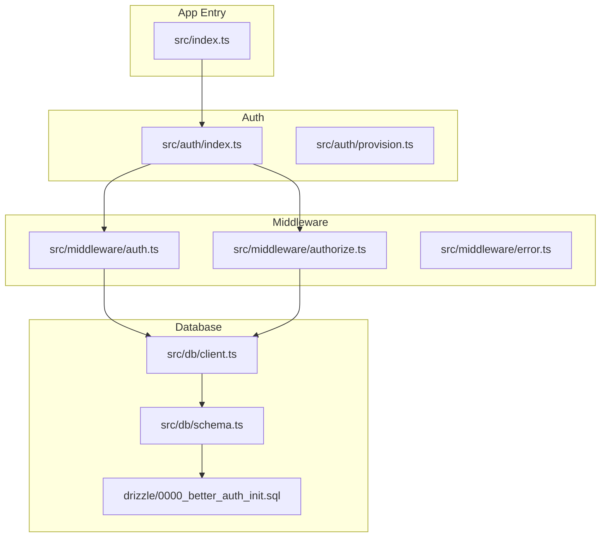
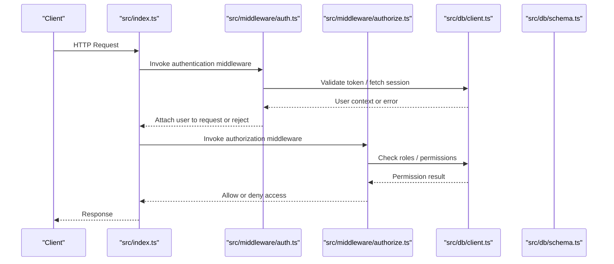
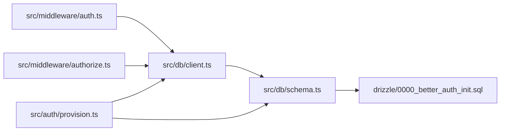

# Authentication System

<cite>
**Referenced Files in This Document**
- [src/index.ts](file://src/index.ts)
- [src/auth/index.ts](file://src/auth/index.ts)
- [src/auth/provision.ts](file://src/auth/provision.ts)
- [src/middleware/auth.ts](file://src/middleware/auth.ts)
- [src/middleware/authorize.ts](file://src/middleware/authorize.ts)
- [src/middleware/error.ts](file://src/middleware/error.ts)
- [src/db/client.ts](file://src/db/client.ts)
- [src/db/schema.ts](file://src/db/schema.ts)
- [drizzle/0000_better_auth_init.sql](file://drizzle/0000_better_auth_init.sql)
- [test/auth-middleware.test.ts](file://test/auth-middleware.test.ts)
- [test/session.test.ts](file://test/session.test.ts)
</cite>

## Table of Contents
1. [Introduction](#introduction)
2. [Project Structure](#project-structure)
3. [Core Components](#core-components)
4. [Architecture Overview](#architecture-overview)
5. [Detailed Component Analysis](#detailed-component-analysis)
6. [Dependency Analysis](#dependency-analysis)
7. [Performance Considerations](#performance-considerations)
8. [Troubleshooting Guide](#troubleshooting-guide)
9. [Conclusion](#conclusion)
10. [Appendices](#appendices)

## Introduction
This document explains the authentication and authorization system implemented in the project. It covers how users are authenticated, how sessions and tokens are managed, how permissions and roles control access to routes, and how middleware integrates with the request lifecycle. It also documents token validation, user provisioning, role-based authorization patterns, and security considerations for token storage and session handling. The goal is to make the system understandable for beginners while providing enough technical depth for implementing custom authentication providers.

## Project Structure
The authentication and authorization features are organized into focused modules:
- Authentication entrypoint and provisioning logic live under src/auth.
- Middleware for enforcing authentication and authorization lives under src/middleware.
- Database client and schema definitions reside under src/db.
- SQL migrations define the initial database schema for authentication tables.
- Tests validate middleware behavior and session handling.

**Diagram sources**
- [src/index.ts](file://src/index.ts)
- [src/auth/index.ts](file://src/auth/index.ts)
- [src/auth/provision.ts](file://src/auth/provision.ts)
- [src/middleware/auth.ts](file://src/middleware/auth.ts)
- [src/middleware/authorize.ts](file://src/middleware/authorize.ts)
- [src/middleware/error.ts](file://src/middleware/error.ts)
- [src/db/client.ts](file://src/db/client.ts)
- [src/db/schema.ts](file://src/db/schema.ts)
- [drizzle/0000_better_auth_init.sql](file://drizzle/0000_better_auth_init.sql)

**Section sources**
- [src/index.ts](file://src/index.ts)
- [src/auth/index.ts](file://src/auth/index.ts)
- [src/auth/provision.ts](file://src/auth/provision.ts)
- [src/middleware/auth.ts](file://src/middleware/auth.ts)
- [src/middleware/authorize.ts](file://src/middleware/authorize.ts)
- [src/middleware/error.ts](file://src/middleware/error.ts)
- [src/db/client.ts](file://src/db/client.ts)
- [src/db/schema.ts](file://src/db/schema.ts)
- [drizzle/0000_better_auth_init.sql](file://drizzle/0000_better_auth_init.sql)

## Core Components
- Authentication middleware: Validates requests by checking credentials (e.g., tokens or session cookies), attaches user context to the request, and rejects unauthenticated requests.
- Authorization middleware: Enforces permission checks based on roles or scopes before allowing access to protected routes.
- User provisioning: Creates or updates user records during first login or account setup, ensuring consistent data models.
- Database layer: Provides typed access to user and session data via a schema and migration-driven structure.
- Error middleware: Normalizes error responses across the stack, including authentication and authorization failures.

Key responsibilities:
- Token validation and session management occur within the auth middleware pipeline.
- Role-based access control is enforced by the authorize middleware using user attributes.
- Provisioning ensures new users are created with default roles and required fields.
- Database interactions are centralized through the client and schema definitions.

**Section sources**
- [src/middleware/auth.ts](file://src/middleware/auth.ts)
- [src/middleware/authorize.ts](file://src/middleware/authorize.ts)
- [src/auth/provision.ts](file://src/auth/provision.ts)
- [src/db/client.ts](file://src/db/client.ts)
- [src/db/schema.ts](file://src/db/schema.ts)
- [src/middleware/error.ts](file://src/middleware/error.ts)

## Architecture Overview
The authentication flow integrates middleware, database operations, and optional provisioning. Requests pass through the middleware stack where authentication validates identity and authorization enforces permissions. User data is persisted in the database according to the defined schema.

**Diagram sources**
- [src/index.ts](file://src/index.ts)
- [src/middleware/auth.ts](file://src/middleware/auth.ts)
- [src/middleware/authorize.ts](file://src/middleware/authorize.ts)
- [src/db/client.ts](file://src/db/client.ts)
- [src/db/schema.ts](file://src/db/schema.ts)

## Detailed Component Analysis

### Authentication Middleware
Responsibilities:
- Extract credentials from the request (e.g., Authorization header or cookies).
- Validate tokens or sessions against configured providers or stored secrets.
- Fetch user context from the database if needed.
- Attach user information to the request context for downstream handlers.
- Return standardized error responses for invalid or missing credentials.

Security considerations:
- Reject malformed or expired tokens early.
- Avoid logging sensitive values like tokens or cookies.
- Use secure cookie flags when applicable (HttpOnly, Secure, SameSite).

Common integration points:
- Wraps route handlers to ensure only authenticated requests proceed.
- Works alongside error middleware to normalize failure responses.

**Section sources**
- [src/middleware/auth.ts](file://src/middleware/auth.ts)
- [src/middleware/error.ts](file://src/middleware/error.ts)

### Authorization Middleware
Responsibilities:
- Inspect the authenticated user’s roles or permissions.
- Compare required permissions against route-level policies.
- Deny access when permissions are insufficient.
- Provide clear error messages indicating missing roles or scopes.

Role-based patterns:
- Route-level guards specify required roles or permissions.
- Policy functions evaluate user attributes against expected conditions.
- Centralized policy definitions simplify maintenance and testing.

**Section sources**
- [src/middleware/authorize.ts](file://src/middleware/authorize.ts)

### User Provisioning
Responsibilities:
- Create user records on first sign-in or registration.
- Assign default roles and required metadata.
- Handle conflicts when users already exist.
- Ensure data consistency with the database schema.

Integration points:
- Invoked after successful authentication to guarantee user existence.
- Uses the database client to persist user data.

**Section sources**
- [src/auth/provision.ts](file://src/auth/provision.ts)
- [src/db/client.ts](file://src/db/client.ts)
- [src/db/schema.ts](file://src/db/schema.ts)

### Database Layer and Schema
Responsibilities:
- Define typed schemas for users, sessions, and related entities.
- Provide a client for executing queries and transactions.
- Support migrations that initialize the authentication tables.

Schema highlights:
- Users table includes identifiers, roles, and timestamps.
- Sessions table stores session metadata and expiration.
- Migrations enforce constraints and indexes for performance.

**Section sources**
- [src/db/client.ts](file://src/db/client.ts)
- [src/db/schema.ts](file://src/db/schema.ts)
- [drizzle/0000_better_auth_init.sql](file://drizzle/0000_better_auth_init.sql)

### Error Handling
Responsibilities:
- Normalize authentication and authorization errors.
- Provide consistent status codes and response shapes.
- Log errors without exposing sensitive details.

Integration points:
- Used by middleware to return standardized responses.
- Ensures clients receive predictable error formats.

**Section sources**
- [src/middleware/error.ts](file://src/middleware/error.ts)

### Protected Routes and Examples
Protected routes integrate middleware to enforce authentication and authorization:
- Apply authentication middleware to routes requiring user identity.
- Apply authorization middleware to restrict access by roles or permissions.
- Use tests to verify correct behavior for valid and invalid requests.

Examples of implementation patterns:
- Wrap route handlers with authentication middleware to validate tokens.
- Add authorization guards specifying required roles per route.
- Assert success and failure cases in tests to ensure robustness.

**Section sources**
- [test/auth-middleware.test.ts](file://test/auth-middleware.test.ts)
- [test/session.test.ts](file://test/session.test.ts)

## Dependency Analysis
Authentication and authorization components depend on the database layer and schema definitions. Middleware orchestrates the request flow and interacts with the database to validate identities and permissions.

**Diagram sources**
- [src/middleware/auth.ts](file://src/middleware/auth.ts)
- [src/middleware/authorize.ts](file://src/middleware/authorize.ts)
- [src/db/client.ts](file://src/db/client.ts)
- [src/db/schema.ts](file://src/db/schema.ts)
- [drizzle/0000_better_auth_init.sql](file://drizzle/0000_better_auth_init.sql)
- [src/auth/provision.ts](file://src/auth/provision.ts)

**Section sources**
- [src/middleware/auth.ts](file://src/middleware/auth.ts)
- [src/middleware/authorize.ts](file://src/middleware/authorize.ts)
- [src/db/client.ts](file://src/db/client.ts)
- [src/db/schema.ts](file://src/db/schema.ts)
- [drizzle/0000_better_auth_init.sql](file://drizzle/0000_better_auth_init.sql)
- [src/auth/provision.ts](file://src/auth/provision.ts)

## Performance Considerations
- Cache frequently accessed user attributes to reduce database reads.
- Use indexed columns for lookups such as user IDs and session tokens.
- Minimize payload sizes by returning only necessary user context.
- Implement short-lived tokens with refresh mechanisms to balance security and latency.
- Batch database operations where possible to reduce round trips.

[No sources needed since this section provides general guidance]

## Troubleshooting Guide
Common issues and resolutions:
- Invalid token errors: Verify token format, expiration, and signing configuration.
- Missing user context: Ensure provisioning runs after successful authentication.
- Authorization denials: Confirm user roles match route requirements.
- Session not found: Check session store configuration and expiration settings.
- Error responses: Review error middleware to ensure consistent formatting and logging.

Debugging steps:
- Enable detailed logs for authentication and authorization middleware.
- Inspect request headers and cookies for token presence and correctness.
- Validate database schema and migrations are applied correctly.
- Run tests to confirm middleware behavior under various scenarios.

**Section sources**
- [src/middleware/error.ts](file://src/middleware/error.ts)
- [test/auth-middleware.test.ts](file://test/auth-middleware.test.ts)
- [test/session.test.ts](file://test/session.test.ts)

## Conclusion
The authentication and authorization system combines middleware-driven validation, role-based access control, and a structured database layer to provide secure and maintainable access management. By following the patterns outlined here, developers can implement protected routes, enforce permissions, and handle errors consistently. Security best practices should be applied to token storage, session handling, and error logging to protect against common vulnerabilities.

[No sources needed since this section summarizes without analyzing specific files]

## Appendices

### Security Considerations
- Token storage: Prefer secure, HttpOnly cookies for session tokens; avoid storing secrets in localStorage.
- Session handling: Set appropriate expiration times and rotate tokens when sensitive actions occur.
- Vulnerability protection: Guard against CSRF, XSS, and injection attacks by validating inputs and sanitizing outputs.
- Logging: Never log sensitive data such as tokens, passwords, or session identifiers.
- Configuration: Use environment variables for secrets and keys; avoid hardcoding sensitive values.

[No sources needed since this section provides general guidance]