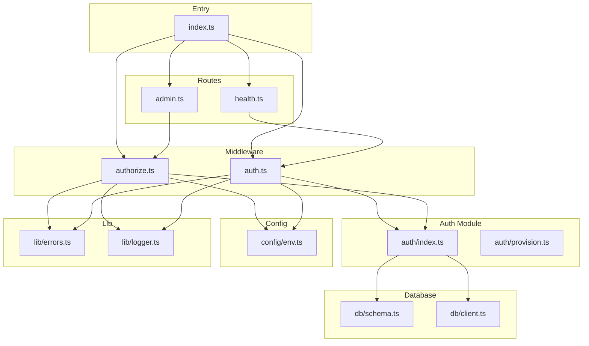
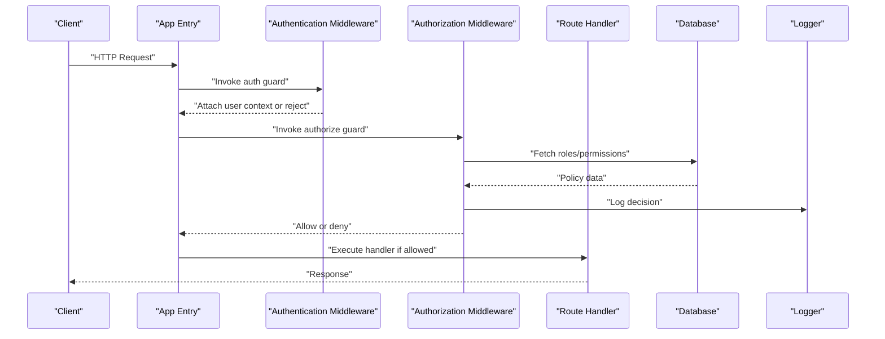
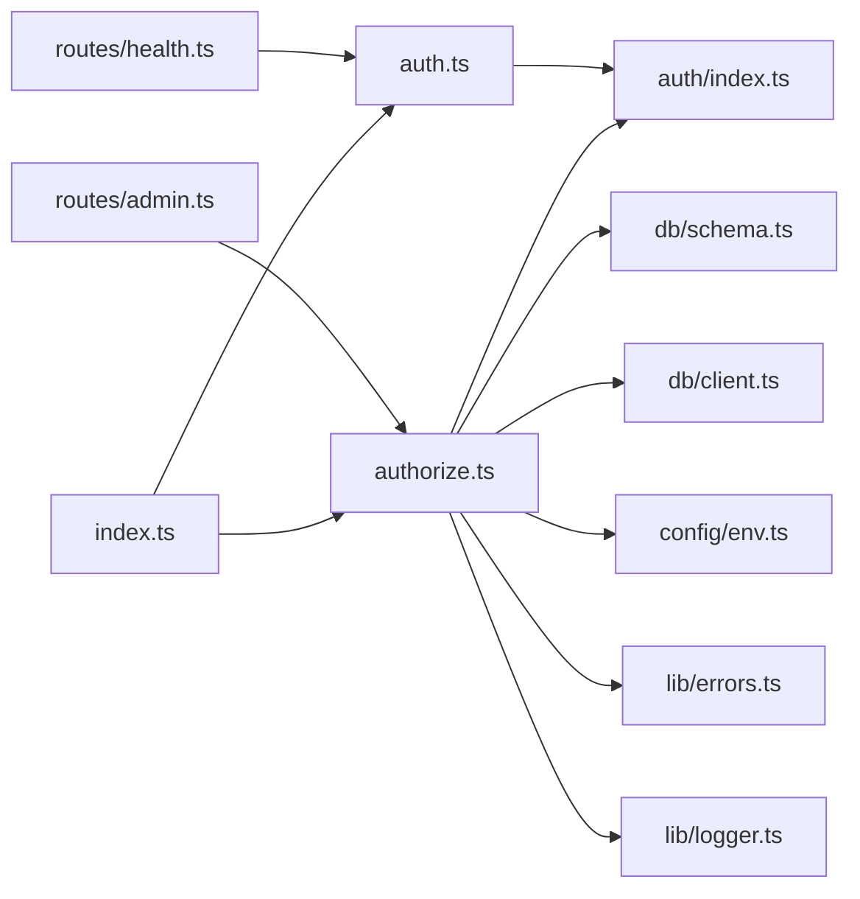

# Permission & Authorization

<cite>
**Referenced Files in This Document**
- [index.ts](file://src/index.ts)
- [auth.ts](file://src/middleware/auth.ts)
- [authorize.ts](file://src/middleware/authorize.ts)
- [admin.ts](file://src/routes/admin.ts)
- [health.ts](file://src/routes/health.ts)
- [env.ts](file://src/config/env.ts)
- [schema.ts](file://src/db/schema.ts)
- [client.ts](file://src/db/client.ts)
- [errors.ts](file://src/lib/errors.ts)
- [logger.ts](file://src/lib/logger.ts)
- [provision.ts](file://src/auth/provision.ts)
- [index.ts](file://src/auth/index.ts)
</cite>

## Table of Contents
1. [Introduction](#introduction)
2. [Project Structure](#project-structure)
3. [Core Components](#core-components)
4. [Architecture Overview](#architecture-overview)
5. [Detailed Component Analysis](#detailed-component-analysis)
6. [Dependency Analysis](#dependency-analysis)
7. [Performance Considerations](#performance-considerations)
8. [Troubleshooting Guide](#troubleshooting-guide)
9. [Conclusion](#conclusion)
10. [Appendices](#appendices)

## Introduction
This document explains the permission and authorization system implemented in the project. It covers role-based access control (RBAC), permission checking mechanisms, and authorization middleware. It also details how user roles and permissions are defined, stored, validated during request processing, and how to protect routes with specific permissions. Guidance is provided for implementing fine-grained access control, handling unauthorized access scenarios, composing complex authorization rules, optimizing performance, caching strategies, extending the system with custom permission types, and integrating with external authorization services.

## Project Structure
The authorization-related code is primarily located under:
- Middleware layer: authentication and authorization guards
- Routes: protected endpoints demonstrating RBAC usage
- Auth module: provisioning and identity utilities
- Database schema: entities related to users, roles, and permissions
- Configuration and environment: runtime settings influencing authorization behavior
- Error and logging utilities: consistent error responses and audit-friendly logs

**Diagram sources**
- [index.ts](file://src/index.ts)
- [auth.ts](file://src/middleware/auth.ts)
- [authorize.ts](file://src/middleware/authorize.ts)
- [admin.ts](file://src/routes/admin.ts)
- [health.ts](file://src/routes/health.ts)
- [index.ts](file://src/auth/index.ts)
- [provision.ts](file://src/auth/provision.ts)
- [schema.ts](file://src/db/schema.ts)
- [client.ts](file://src/db/client.ts)
- [env.ts](file://src/config/env.ts)
- [errors.ts](file://src/lib/errors.ts)
- [logger.ts](file://src/lib/logger.ts)

**Section sources**
- [index.ts](file://src/index.ts)
- [auth.ts](file://src/middleware/auth.ts)
- [authorize.ts](file://src/middleware/authorize.ts)
- [admin.ts](file://src/routes/admin.ts)
- [health.ts](file://src/routes/health.ts)
- [index.ts](file://src/auth/index.ts)
- [provision.ts](file://src/auth/provision.ts)
- [schema.ts](file://src/db/schema.ts)
- [client.ts](file://src/db/client.ts)
- [env.ts](file://src/config/env.ts)
- [errors.ts](file://src/lib/errors.ts)
- [logger.ts](file://src/lib/logger.ts)

## Core Components
- Authentication middleware: validates session or token presence and attaches a minimal user context to the request.
- Authorization middleware: enforces RBAC by checking that the authenticated user holds required roles or permissions before allowing route handlers to execute.
- Route protection: demonstrates applying authorization guards to admin-only endpoints.
- Auth module: provides utilities for provisioning identities and resolving roles/permissions from storage.
- Database schema: defines tables for users, roles, and permissions, including relationships and constraints.
- Environment configuration: controls feature flags and policy behaviors such as strict mode and cache toggles.
- Error and logging: standardizes unauthorized and forbidden responses and records authorization decisions for auditing.

Key responsibilities:
- Enforce least privilege by default; deny unless explicitly allowed.
- Centralize policy evaluation to avoid duplication across routes.
- Provide clear error semantics distinguishing unauthenticated vs unauthorized vs forbidden.

**Section sources**
- [auth.ts](file://src/middleware/auth.ts)
- [authorize.ts](file://src/middleware/authorize.ts)
- [admin.ts](file://src/routes/admin.ts)
- [health.ts](file://src/routes/health.ts)
- [index.ts](file://src/auth/index.ts)
- [provision.ts](file://src/auth/provision.ts)
- [schema.ts](file://src/db/schema.ts)
- [env.ts](file://src/config/env.ts)
- [errors.ts](file://src/lib/errors.ts)
- [logger.ts](file://src/lib/logger.ts)

## Architecture Overview
The authorization flow integrates authentication and authorization middleware into the HTTP pipeline. Requests pass through authentication first, then authorization, before reaching route handlers. The authorization layer consults the auth module and database to evaluate roles and permissions based on configured policies.

**Diagram sources**
- [index.ts](file://src/index.ts)
- [auth.ts](file://src/middleware/auth.ts)
- [authorize.ts](file://src/middleware/authorize.ts)
- [schema.ts](file://src/db/schema.ts)
- [client.ts](file://src/db/client.ts)
- [logger.ts](file://src/lib/logger.ts)

## Detailed Component Analysis

### Authentication Middleware
Purpose:
- Validate incoming requests for valid credentials (session or token).
- Attach a minimal user context object to the request for downstream use.
- Reject unauthenticated requests with appropriate status codes.

Behavior highlights:
- Early exit on missing credentials.
- Context enrichment with user identifiers and metadata.
- Consistent error responses for unauthenticated access.

Usage pattern:
- Applied globally or per-route to ensure only authenticated users proceed.

**Section sources**
- [auth.ts](file://src/middleware/auth.ts)
- [errors.ts](file://src/lib/errors.ts)
- [logger.ts](file://src/lib/logger.ts)

### Authorization Middleware (RBAC)
Purpose:
- Enforce role-based access control by verifying that the authenticated user possesses required roles or permissions.
- Support composition of multiple permissions and logical operators.
- Provide fine-grained checks for resource-level access when combined with route parameters.

Behavior highlights:
- Reads required roles/permissions from route definitions or guard configuration.
- Resolves user’s effective roles and permissions via the auth module and database.
- Applies policy evaluation with configurable strictness and caching.
- Logs authorization decisions for auditability.

Protection examples:
- Protect admin routes requiring an “admin” role.
- Require specific permissions like “users:read”, “users:write”.
- Combine permissions using AND/OR logic where supported.

Unauthorized handling:
- Returns distinct statuses for unauthenticated vs unauthorized vs forbidden.
- Provides structured error payloads for clients.

**Section sources**
- [authorize.ts](file://src/middleware/authorize.ts)
- [admin.ts](file://src/routes/admin.ts)
- [health.ts](file://src/routes/health.ts)
- [index.ts](file://src/auth/index.ts)
- [provision.ts](file://src/auth/provision.ts)
- [schema.ts](file://src/db/schema.ts)
- [client.ts](file://src/db/client.ts)
- [errors.ts](file://src/lib/errors.ts)
- [logger.ts](file://src/lib/logger.ts)

### Route Protection Examples
- Admin-only endpoints: guarded by requiring an “admin” role.
- Health endpoint: typically public but can be secured if needed.
- Demonstrates attaching guards at route registration time.

Best practices:
- Keep route handlers focused on business logic; delegate security to middleware.
- Use explicit permission names rather than ad-hoc checks inside handlers.

**Section sources**
- [admin.ts](file://src/routes/admin.ts)
- [health.ts](file://src/routes/health.ts)

### Auth Module and Provisioning
Responsibilities:
- Resolve user roles and permissions from persistent storage.
- Provide helper functions for provisioning new users with default roles.
- Normalize role and permission representations for consistent evaluation.

Integration points:
- Uses the database client to query role-permission mappings.
- Supports caching of resolved policies to reduce latency.

**Section sources**
- [index.ts](file://src/auth/index.ts)
- [provision.ts](file://src/auth/provision.ts)
- [client.ts](file://src/db/client.ts)
- [schema.ts](file://src/db/schema.ts)

### Database Schema for RBAC
Entities:
- Users: core identity attributes and links to roles.
- Roles: named sets of permissions with inheritance capabilities.
- Permissions: atomic actions (e.g., “users:read”) and hierarchical grouping.
- Role-permission mappings: many-to-many relationships defining effective permissions.

Constraints and relationships:
- Foreign keys enforce referential integrity between users, roles, and permissions.
- Unique constraints prevent duplicate role assignments and permission names.

Design considerations:
- Hierarchical roles enable inheritance (e.g., “editor” inherits from “viewer”).
- Permission strings support dot notation for namespaces and actions.

**Section sources**
- [schema.ts](file://src/db/schema.ts)
- [client.ts](file://src/db/client.ts)

### Environment Configuration
Controls:
- Strict mode for authorization failures.
- Cache toggles for role/permission resolution.
- Feature flags for advanced authorization features.

Impact:
- Toggling strict mode changes whether missing permissions result in denial-by-default.
- Enabling caching reduces database queries during authorization checks.

**Section sources**
- [env.ts](file://src/config/env.ts)

## Dependency Analysis
The authorization system depends on:
- Middleware layer for request interception and policy enforcement.
- Auth module for role/permission resolution and provisioning.
- Database layer for persistent storage of RBAC entities.
- Configuration for runtime behavior.
- Logging and error utilities for consistent responses and audit trails.

**Diagram sources**
- [auth.ts](file://src/middleware/auth.ts)
- [authorize.ts](file://src/middleware/authorize.ts)
- [index.ts](file://src/auth/index.ts)
- [schema.ts](file://src/db/schema.ts)
- [client.ts](file://src/db/client.ts)
- [env.ts](file://src/config/env.ts)
- [errors.ts](file://src/lib/errors.ts)
- [logger.ts](file://src/lib/logger.ts)
- [admin.ts](file://src/routes/admin.ts)
- [health.ts](file://src/routes/health.ts)

**Section sources**
- [auth.ts](file://src/middleware/auth.ts)
- [authorize.ts](file://src/middleware/authorize.ts)
- [index.ts](file://src/auth/index.ts)
- [schema.ts](file://src/db/schema.ts)
- [client.ts](file://src/db/client.ts)
- [env.ts](file://src/config/env.ts)
- [errors.ts](file://src/lib/errors.ts)
- [logger.ts](file://src/lib/logger.ts)
- [admin.ts](file://src/routes/admin.ts)
- [health.ts](file://src/routes/health.ts)

## Performance Considerations
Optimization strategies:
- Cache role and permission resolution results keyed by user ID and tenant scope.
- Use short-lived caches with invalidation on role/permission updates.
- Batch fetches for multi-tenant scenarios to minimize round trips.
- Prefer read replicas for policy lookups to offload primary writes.
- Avoid heavy computations in hot paths; precompute effective permissions where feasible.

Caching recommendations:
- In-memory cache for frequent reads with TTL.
- External cache (e.g., Redis) for distributed deployments.
- Cache invalidation triggers on role/permission mutations.

Evaluation efficiency:
- Normalize permission strings and use set operations for fast membership checks.
- Short-circuit evaluation for denied cases to reduce overhead.

[No sources needed since this section provides general guidance]

## Troubleshooting Guide
Common issues and resolutions:
- Unauthenticated requests: verify credential presence and middleware ordering.
- Unauthorized access: confirm user has required roles/permissions; check policy evaluation logs.
- Forbidden responses: ensure resource-level checks include correct identifiers and scopes.
- Performance regressions: inspect cache hit rates and database query patterns.
- Audit gaps: validate logging includes user ID, action, resource, and decision outcome.

Diagnostic steps:
- Enable verbose logging for authorization decisions.
- Inspect environment flags affecting strictness and caching.
- Verify schema migrations applied correctly for RBAC tables.
- Test with known good and bad credentials to reproduce issues.

**Section sources**
- [errors.ts](file://src/lib/errors.ts)
- [logger.ts](file://src/lib/logger.ts)
- [env.ts](file://src/config/env.ts)
- [schema.ts](file://src/db/schema.ts)

## Conclusion
The authorization system implements robust RBAC with middleware-driven enforcement, clear separation of concerns, and extensible design. By centralizing policy evaluation, leveraging caching, and providing comprehensive logging, it supports secure, performant, and auditable access control. Extending the system with custom permissions and external services is straightforward due to modular architecture and well-defined interfaces.

[No sources needed since this section summarizes without analyzing specific files]

## Appendices

### Extending with Custom Permission Types
Approach:
- Define new permission strings following namespace conventions.
- Update role-permission mappings in the database schema.
- Extend the auth module to recognize and evaluate custom permissions.
- Add tests to validate new permission logic.

Integration points:
- Modify the policy evaluator to handle custom checks.
- Ensure caching accounts for new permission types.

**Section sources**
- [index.ts](file://src/auth/index.ts)
- [schema.ts](file://src/db/schema.ts)
- [authorize.ts](file://src/middleware/authorize.ts)

### Integrating with External Authorization Services
Approach:
- Implement an adapter that translates internal roles/permissions to external service formats.
- Cache external policy results to reduce latency.
- Handle fallbacks to local evaluation when external service is unavailable.
- Log all external calls and decisions for compliance.

Considerations:
- Network resilience and timeouts.
- Data privacy and minimization when sending user context externally.
- Versioning of policy schemas to maintain compatibility.

**Section sources**
- [index.ts](file://src/auth/index.ts)
- [authorize.ts](file://src/middleware/authorize.ts)
- [logger.ts](file://src/lib/logger.ts)