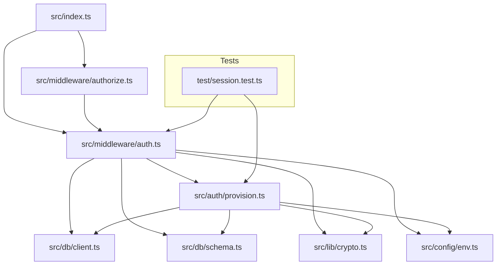
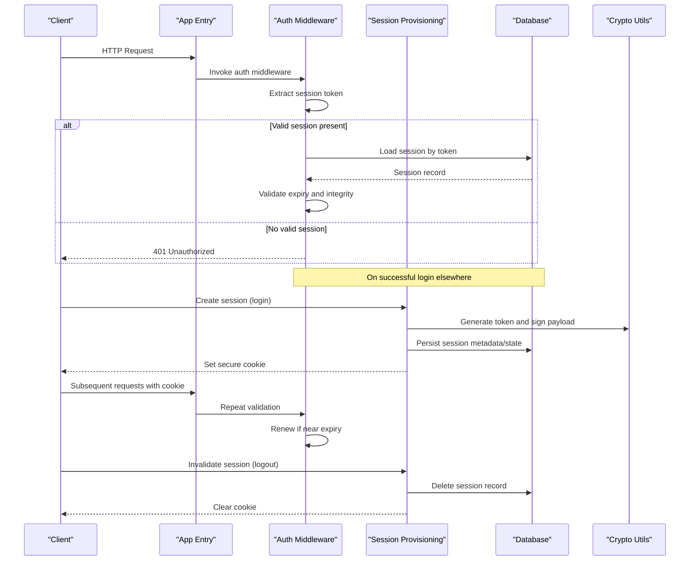
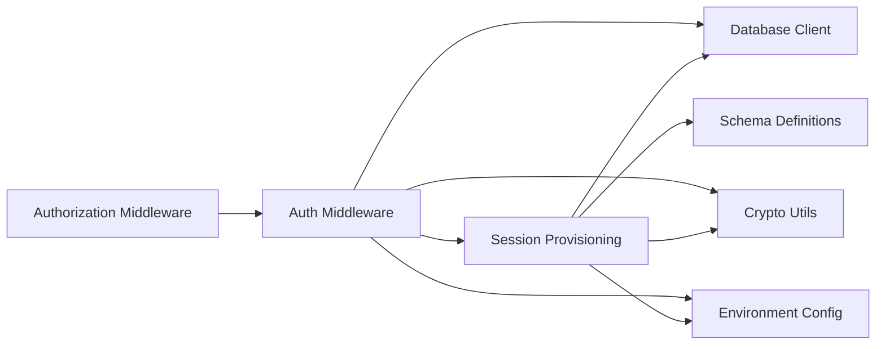

# Session Management

<cite>
**Referenced Files in This Document**
- [index.ts](file://src/index.ts)
- [auth.ts](file://src/middleware/auth.ts)
- [authorize.ts](file://src/middleware/authorize.ts)
- [provision.ts](file://src/auth/provision.ts)
- [client.ts](file://src/db/client.ts)
- [schema.ts](file://src/db/schema.ts)
- [crypto.ts](file://src/lib/crypto.ts)
- [env.ts](file://src/config/env.ts)
- [session.test.ts](file://test/session.test.ts)
</cite>

## Table of Contents
1. [Introduction](#introduction)
2. [Project Structure](#project-structure)
3. [Core Components](#core-components)
4. [Architecture Overview](#architecture-overview)
5. [Detailed Component Analysis](#detailed-component-analysis)
6. [Dependency Analysis](#dependency-analysis)
7. [Performance Considerations](#performance-considerations)
8. [Troubleshooting Guide](#troubleshooting-guide)
9. [Conclusion](#conclusion)
10. [Appendices](#appendices)

## Introduction
This document explains how sessions are managed in the project, covering creation, storage, validation, renewal, and termination. It details the provisioning process, user data serialization, expiration handling, concurrent session management, and the relationship with the database layer for persistence. Security considerations such as session fixation protection, secure cookie configuration, and memory management are addressed. Practical examples illustrate login-based session creation, automatic renewal, and manual invalidation. Guidance is provided for customizing session behavior and implementing session-based features.

## Project Structure
The session management spans authentication middleware, authorization middleware, session provisioning logic, database client and schema, cryptographic utilities, environment configuration, and tests. The main entrypoint wires up middleware and routes that rely on sessions.

**Diagram sources**
- [index.ts](file://src/index.ts)
- [auth.ts](file://src/middleware/auth.ts)
- [authorize.ts](file://src/middleware/authorize.ts)
- [provision.ts](file://src/auth/provision.ts)
- [client.ts](file://src/db/client.ts)
- [schema.ts](file://src/db/schema.ts)
- [crypto.ts](file://src/lib/crypto.ts)
- [env.ts](file://src/config/env.ts)
- [session.test.ts](file://test/session.test.ts)

**Section sources**
- [index.ts](file://src/index.ts)
- [auth.ts](file://src/middleware/auth.ts)
- [authorize.ts](file://src/middleware/authorize.ts)
- [provision.ts](file://src/auth/provision.ts)
- [client.ts](file://src/db/client.ts)
- [schema.ts](file://src/db/schema.ts)
- [crypto.ts](file://src/lib/crypto.ts)
- [env.ts](file://src/config/env.ts)
- [session.test.ts](file://test/session.test.ts)

## Core Components
- Authentication middleware: Validates requests, extracts or creates sessions, and attaches user context to the request.
- Authorization middleware: Enforces access control based on authenticated sessions.
- Session provisioning: Creates, updates, and destroys sessions; serializes user data; handles expiration and concurrency.
- Database layer: Persists session metadata and optional session state using Drizzle ORM.
- Cryptographic utilities: Generates secure tokens and signs payloads to prevent tampering.
- Environment configuration: Provides settings for session lifetime, cookie options, and storage backend selection.
- Tests: Validate session lifecycle behaviors including creation, renewal, and invalidation.

**Section sources**
- [auth.ts](file://src/middleware/auth.ts)
- [authorize.ts](file://src/middleware/authorize.ts)
- [provision.ts](file://src/auth/provision.ts)
- [client.ts](file://src/db/client.ts)
- [schema.ts](file://src/db/schema.ts)
- [crypto.ts](file://src/lib/crypto.ts)
- [env.ts](file://src/config/env.ts)
- [session.test.ts](file://test/session.test.ts)

## Architecture Overview
Sessions flow through a layered architecture:
- Requests enter via the application entrypoint and pass through authentication middleware.
- Middleware checks for an existing session token (typically in a cookie), validates it, and loads session data from storage.
- If no valid session exists, provisioning creates one upon successful authentication.
- Authorization middleware enforces permissions based on the authenticated session.
- Expiration and renewal occur transparently during request processing.
- Termination removes session records and clears cookies.

**Diagram sources**
- [index.ts](file://src/index.ts)
- [auth.ts](file://src/middleware/auth.ts)
- [provision.ts](file://src/auth/provision.ts)
- [client.ts](file://src/db/client.ts)
- [schema.ts](file://src/db/schema.ts)
- [crypto.ts](file://src/lib/crypto.ts)
- [env.ts](file://src/config/env.ts)

## Detailed Component Analysis

### Authentication Middleware
Responsibilities:
- Parse incoming requests and extract session identifiers (e.g., from cookies).
- Validate session existence, integrity, and expiration.
- Attach authenticated user context to the request for downstream handlers.
- Trigger renewal when sessions approach expiration thresholds.

Key behaviors:
- Secure cookie parsing and validation.
- Atomic session loading and validation to avoid race conditions.
- Graceful fallbacks for missing or malformed tokens.

Security considerations:
- Reject expired or tampered tokens.
- Prevent session fixation by rotating tokens on privilege changes.
- Enforce strict cookie attributes (secure, httpOnly, sameSite) per environment.

**Section sources**
- [auth.ts](file://src/middleware/auth.ts)
- [env.ts](file://src/config/env.ts)

### Authorization Middleware
Responsibilities:
- Ensure the current session has sufficient privileges to access the requested resource.
- Short-circuit unauthorized requests early.
- Provide consistent error responses for authorization failures.

Integration:
- Depends on the authenticated context established by the authentication middleware.

**Section sources**
- [authorize.ts](file://src/middleware/authorize.ts)
- [auth.ts](file://src/middleware/auth.ts)

### Session Provisioning
Responsibilities:
- Create new sessions upon successful authentication.
- Serialize user data into a compact, secure payload.
- Persist session metadata and optional state to the database.
- Handle session expiration policies and background cleanup.
- Manage concurrent session limits and conflicts.

Provisioning flow:
- Generate a cryptographically secure session token.
- Sign and optionally encrypt the session payload.
- Store session record with timestamps and metadata.
- Return a secure cookie to the client.

Expiration and renewal:
- Evaluate expiration on each request.
- Optionally refresh tokens and update last-accessed timestamps.
- Clean up stale sessions periodically.

Concurrency:
- Use atomic operations to prevent duplicate sessions or lost updates.
- Enforce maximum active sessions per user if configured.

**Section sources**
- [provision.ts](file://src/auth/provision.ts)
- [client.ts](file://src/db/client.ts)
- [schema.ts](file://src/db/schema.ts)
- [crypto.ts](file://src/lib/crypto.ts)
- [env.ts](file://src/config/env.ts)

### Database Layer
Responsibilities:
- Define session-related tables and indexes.
- Provide typed queries for session CRUD operations.
- Support efficient lookups by token and user identifiers.

Design patterns:
- Use Drizzle ORM for schema definition and migrations.
- Maintain indexes on frequently queried fields (token, user_id, expires_at).

Persistence strategy:
- Store minimal sensitive data; prefer references to user profiles.
- Keep audit fields like created_at, updated_at, and expires_at.

**Section sources**
- [client.ts](file://src/db/client.ts)
- [schema.ts](file://src/db/schema.ts)

### Cryptographic Utilities
Responsibilities:
- Generate secure random tokens.
- Sign session payloads to detect tampering.
- Optionally encrypt sensitive session data.

Best practices:
- Use strong algorithms and adequate key lengths.
- Rotate signing keys securely when necessary.

**Section sources**
- [crypto.ts](file://src/lib/crypto.ts)
- [env.ts](file://src/config/env.ts)

### Environment Configuration
Responsibilities:
- Provide session lifetime, cookie attributes, and storage backend settings.
- Toggle features like automatic renewal and concurrent session limits.

Configuration keys:
- Session TTL and sliding window thresholds.
- Cookie flags (secure, httpOnly, sameSite).
- Database connection parameters and migration settings.

**Section sources**
- [env.ts](file://src/config/env.ts)

### Tests
Responsibilities:
- Validate session creation, validation, renewal, and invalidation flows.
- Assert security properties (expiration, tamper detection).
- Simulate concurrent session scenarios.

Coverage areas:
- Login triggers session creation and sets cookies.
- Subsequent requests validate and renew sessions.
- Logout deletes session records and clears cookies.

**Section sources**
- [session.test.ts](file://test/session.test.ts)

## Dependency Analysis
The session system depends on middleware, provisioning, database, crypto, and environment modules. The following diagram shows core dependencies:

**Diagram sources**
- [auth.ts](file://src/middleware/auth.ts)
- [authorize.ts](file://src/middleware/authorize.ts)
- [provision.ts](file://src/auth/provision.ts)
- [client.ts](file://src/db/client.ts)
- [schema.ts](file://src/db/schema.ts)
- [crypto.ts](file://src/lib/crypto.ts)
- [env.ts](file://src/config/env.ts)

**Section sources**
- [auth.ts](file://src/middleware/auth.ts)
- [authorize.ts](file://src/middleware/authorize.ts)
- [provision.ts](file://src/auth/provision.ts)
- [client.ts](file://src/db/client.ts)
- [schema.ts](file://src/db/schema.ts)
- [crypto.ts](file://src/lib/crypto.ts)
- [env.ts](file://src/config/env.ts)

## Performance Considerations
- Minimize payload size by serializing only necessary user data.
- Cache frequently accessed session metadata where appropriate.
- Use database indexes on token and expiration fields for fast lookups.
- Implement sliding expiration to reduce write frequency while maintaining freshness.
- Avoid blocking operations in the request path; offload cleanup tasks asynchronously.

[No sources needed since this section provides general guidance]

## Troubleshooting Guide
Common issues and resolutions:
- Expired sessions: Ensure renewal logic is enabled and TTL is appropriate.
- Invalid tokens: Verify signature verification and key rotation procedures.
- Missing cookies: Check cookie attributes (secure, httpOnly, sameSite) and domain/path settings.
- Concurrent session conflicts: Review atomicity of session updates and concurrency limits.
- Database connectivity: Confirm connection parameters and migration status.

Debugging steps:
- Inspect request headers and cookies for presence and correctness.
- Log session lookup results and validation outcomes.
- Validate schema definitions and indexes.
- Reproduce issues using test cases in the session test suite.

**Section sources**
- [auth.ts](file://src/middleware/auth.ts)
- [provision.ts](file://src/auth/provision.ts)
- [session.test.ts](file://test/session.test.ts)

## Conclusion
The session management implementation integrates authentication and authorization middleware with robust provisioning, secure cryptography, and persistent storage. It supports secure cookie handling, expiration and renewal, and concurrent session controls. By following the outlined best practices and customization guidance, you can extend session behavior to meet specific application needs while maintaining security and performance.

[No sources needed since this section summarizes without analyzing specific files]

## Appendices

### Practical Examples

- Session creation during login:
  - Authenticate credentials, generate a secure token, serialize user data, persist session, and set a secure cookie.
  - Reference: [provision.ts](file://src/auth/provision.ts), [crypto.ts](file://src/lib/crypto.ts), [client.ts](file://src/db/client.ts)

- Automatic session renewal:
  - On each request, check proximity to expiration and refresh token and timestamps atomically.
  - Reference: [auth.ts](file://src/middleware/auth.ts), [env.ts](file://src/config/env.ts)

- Manual session invalidation:
  - Delete session record and clear cookie to terminate the session.
  - Reference: [provision.ts](file://src/auth/provision.ts), [auth.ts](file://src/middleware/auth.ts)

### Security Considerations
- Session fixation protection: Rotate tokens on privilege escalation and after login.
- Secure cookie configuration: Enforce secure, httpOnly, and sameSite attributes; set appropriate domains and paths.
- Memory management: Limit in-memory caches; rely on database persistence; implement periodic cleanup of stale sessions.

[No sources needed since this section provides general guidance]

### Customization Guidance
- Adjust session TTL and renewal thresholds via environment configuration.
- Extend serialized user data carefully to balance functionality and payload size.
- Implement custom concurrency policies to limit active sessions per user.
- Add audit logging for session lifecycle events.

[No sources needed since this section provides general guidance]