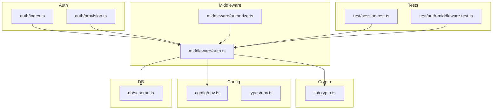
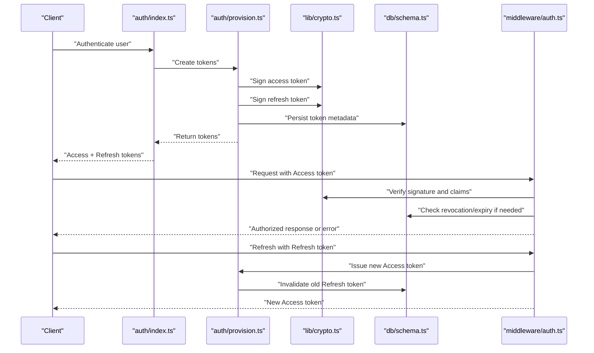
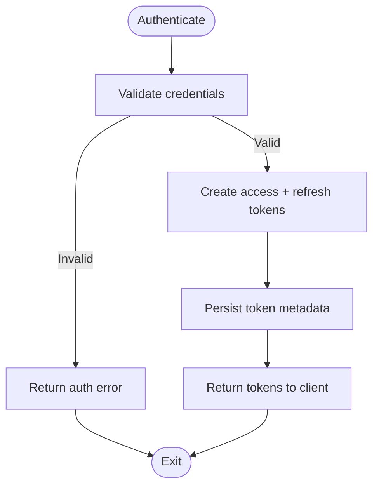
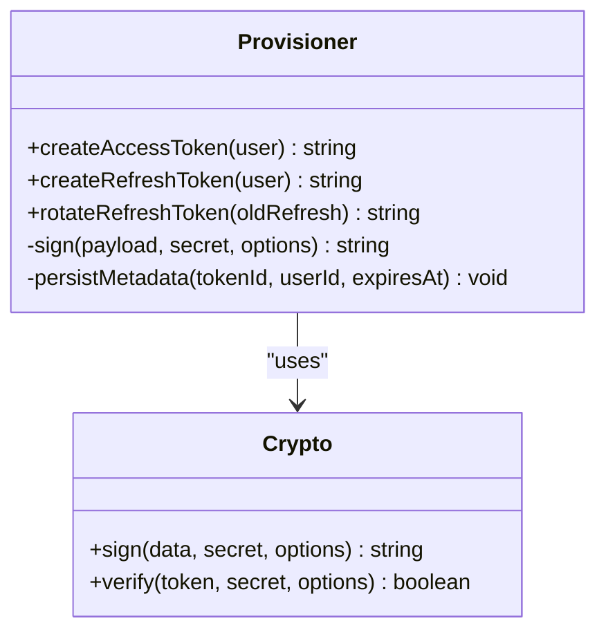
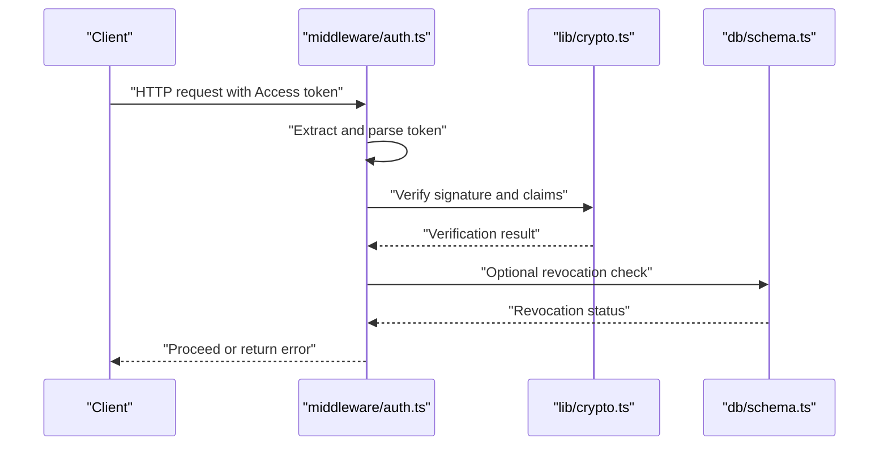
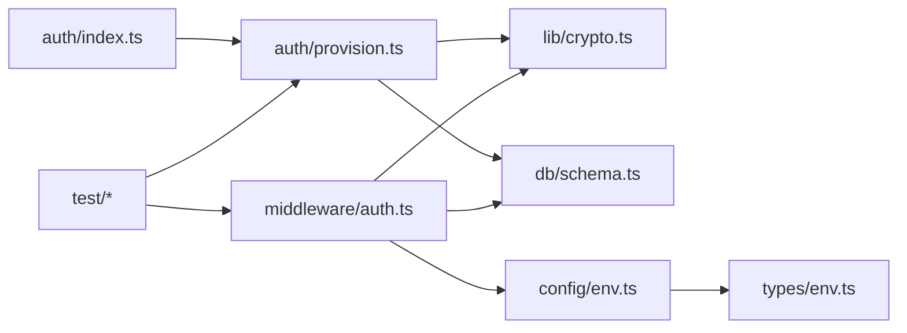

# Token Handling

<cite>
**Referenced Files in This Document**
- [src/auth/index.ts](file://src/auth/index.ts)
- [src/auth/provision.ts](file://src/auth/provision.ts)
- [src/middleware/auth.ts](file://src/middleware/auth.ts)
- [src/middleware/authorize.ts](file://src/middleware/authorize.ts)
- [src/lib/crypto.ts](file://src/lib/crypto.ts)
- [src/lib/errors.ts](file://src/lib/errors.ts)
- [src/config/env.ts](file://src/config/env.ts)
- [src/types/env.ts](file://src/types/env.ts)
- [src/db/schema.ts](file://src/db/schema.ts)
- [test/session.test.ts](file://test/session.test.ts)
- [test/auth-middleware.test.ts](file://test/auth-middleware.test.ts)
</cite>

## Table of Contents
1. [Introduction](#introduction)
2. [Project Structure](#project-structure)
3. [Core Components](#core-components)
4. [Architecture Overview](#architecture-overview)
5. [Detailed Component Analysis](#detailed-component-analysis)
6. [Dependency Analysis](#dependency-analysis)
7. [Performance Considerations](#performance-considerations)
8. [Troubleshooting Guide](#troubleshooting-guide)
9. [Conclusion](#conclusion)
10. [Appendices](#appendices)

## Introduction
This document explains how tokens are generated, signed, validated, and rotated within the authentication system. It covers token types (access and refresh), lifecycles, usage patterns, security considerations, cryptographic integration, error handling for malformed or expired tokens, and guidance for implementing custom token providers and migrating between formats. The content is derived from the repository’s authentication modules, middleware, crypto utilities, configuration, database schema, and tests.

## Project Structure
The token-handling logic spans several modules:
- Authentication orchestration and provisioning
- Middleware for request authentication and authorization
- Cryptographic utilities for signing and verification
- Configuration and environment variables
- Database schema for persistent token storage
- Tests validating behavior

**Diagram sources**
- [src/auth/index.ts](file://src/auth/index.ts)
- [src/auth/provision.ts](file://src/auth/provision.ts)
- [src/middleware/auth.ts](file://src/middleware/auth.ts)
- [src/middleware/authorize.ts](file://src/middleware/authorize.ts)
- [src/lib/crypto.ts](file://src/lib/crypto.ts)
- [src/config/env.ts](file://src/config/env.ts)
- [src/types/env.ts](file://src/types/env.ts)
- [src/db/schema.ts](file://src/db/schema.ts)
- [test/session.test.ts](file://test/session.test.ts)
- [test/auth-middleware.test.ts](file://test/auth-middleware.test.ts)

**Section sources**
- [src/auth/index.ts](file://src/auth/index.ts)
- [src/auth/provision.ts](file://src/auth/provision.ts)
- [src/middleware/auth.ts](file://src/middleware/auth.ts)
- [src/middleware/authorize.ts](file://src/middleware/authorize.ts)
- [src/lib/crypto.ts](file://src/lib/crypto.ts)
- [src/config/env.ts](file://src/config/env.ts)
- [src/types/env.ts](file://src/types/env.ts)
- [src/db/schema.ts](file://src/db/schema.ts)
- [test/session.test.ts](file://test/session.test.ts)
- [test/auth-middleware.test.ts](file://test/auth-middleware.test.ts)

## Core Components
- Authentication entrypoint and session/token issuance flow
- Provisioning helpers to create and manage tokens
- Request authentication middleware that validates tokens and attaches user context
- Authorization middleware that enforces permissions based on authenticated state
- Crypto utilities for signing and verifying tokens
- Environment configuration for keys, algorithms, and expiration settings
- Database schema for storing tokens and related metadata
- Tests covering token lifecycle and middleware behavior

Key responsibilities:
- Generate access and refresh tokens with appropriate claims and lifetimes
- Sign tokens using secure algorithms configured via environment
- Validate tokens on each request, handling expiry and integrity checks
- Rotate refresh tokens securely and invalidate old ones
- Persist token metadata for revocation and auditing
- Provide clear error responses for malformed or expired tokens

**Section sources**
- [src/auth/index.ts](file://src/auth/index.ts)
- [src/auth/provision.ts](file://src/auth/provision.ts)
- [src/middleware/auth.ts](file://src/middleware/auth.ts)
- [src/middleware/authorize.ts](file://src/middleware/authorize.ts)
- [src/lib/crypto.ts](file://src/lib/crypto.ts)
- [src/config/env.ts](file://src/config/env.ts)
- [src/types/env.ts](file://src/types/env.ts)
- [src/db/schema.ts](file://src/db/schema.ts)
- [test/session.test.ts](file://test/session.test.ts)
- [test/auth-middleware.test.ts](file://test/auth-middleware.test.ts)

## Architecture Overview
The token architecture follows a layered approach:
- Auth layer issues tokens after successful authentication
- Middleware validates tokens on every protected route
- Crypto layer provides signing and verification primitives
- Config layer supplies algorithm and key material
- DB layer persists token metadata for rotation and revocation
- Tests validate expected behaviors across flows

**Diagram sources**
- [src/auth/index.ts](file://src/auth/index.ts)
- [src/auth/provision.ts](file://src/auth/provision.ts)
- [src/lib/crypto.ts](file://src/lib/crypto.ts)
- [src/db/schema.ts](file://src/db/schema.ts)
- [src/middleware/auth.ts](file://src/middleware/auth.ts)

## Detailed Component Analysis

### Authentication Orchestration (Token Issuance)
Responsibilities:
- Orchestrates authentication and delegates token creation to provisioning
- Ensures consistent payload structure and lifetime policies
- Returns both access and refresh tokens upon success

Implementation highlights:
- Delegates to provisioning module for token generation
- Uses configuration to determine lifetimes and algorithms
- Integrates with database to persist token metadata

**Diagram sources**
- [src/auth/index.ts](file://src/auth/index.ts)
- [src/auth/provision.ts](file://src/auth/provision.ts)
- [src/db/schema.ts](file://src/db/schema.ts)

**Section sources**
- [src/auth/index.ts](file://src/auth/index.ts)
- [src/auth/provision.ts](file://src/auth/provision.ts)

### Provisioning Module (Token Generation and Rotation)
Responsibilities:
- Generates access tokens with short lifetimes and minimal claims
- Generates refresh tokens with longer lifetimes and secure identifiers
- Signs tokens using configured algorithms and keys
- Persists token metadata for revocation and audit
- Supports refresh rotation by invalidating previous refresh tokens

Implementation highlights:
- Uses crypto utilities for signing and verification
- Reads configuration for algorithms, secrets, and expirations
- Stores token fingerprints or IDs along with associated user/session data

**Diagram sources**
- [src/auth/provision.ts](file://src/auth/provision.ts)
- [src/lib/crypto.ts](file://src/lib/crypto.ts)

**Section sources**
- [src/auth/provision.ts](file://src/auth/provision.ts)
- [src/lib/crypto.ts](file://src/lib/crypto.ts)

### Request Authentication Middleware
Responsibilities:
- Extracts access token from requests (e.g., Authorization header)
- Validates signature, expiration, and claims
- Attaches authenticated user context to the request
- Handles malformed or expired tokens with standardized errors

Implementation highlights:
- Relies on crypto verification functions
- Optionally checks revocation lists stored in the database
- Enforces strict parsing and error mapping

**Diagram sources**
- [src/middleware/auth.ts](file://src/middleware/auth.ts)
- [src/lib/crypto.ts](file://src/lib/crypto.ts)
- [src/db/schema.ts](file://src/db/schema.ts)

**Section sources**
- [src/middleware/auth.ts](file://src/middleware/auth.ts)
- [src/lib/crypto.ts](file://src/lib/crypto.ts)
- [src/db/schema.ts](file://src/db/schema.ts)

### Authorization Middleware
Responsibilities:
- Enforces role-based or policy-based access control
- Depends on authenticated context established by authentication middleware
- Rejects unauthorized requests with appropriate status codes

Implementation highlights:
- Reads roles/permissions from the authenticated payload
- Applies policy rules before allowing route handlers to execute

**Section sources**
- [src/middleware/authorize.ts](file://src/middleware/authorize.ts)

### Crypto Utilities
Responsibilities:
- Provides signing and verification functions for tokens
- Supports configurable algorithms and key management
- Encapsulates cryptographic best practices

Implementation highlights:
- Uses strong hashing and signing algorithms
- Exposes simple interfaces for token operations
- Centralizes key retrieval from configuration

**Section sources**
- [src/lib/crypto.ts](file://src/lib/crypto.ts)

### Configuration and Types
Responsibilities:
- Loads environment variables for secrets, algorithms, and expiration durations
- Defines typed configuration structures for safety and clarity

Implementation highlights:
- Validates presence and format of required variables
- Exposes defaults where appropriate while enforcing critical values

**Section sources**
- [src/config/env.ts](file://src/config/env.ts)
- [src/types/env.ts](file://src/types/env.ts)

### Database Schema
Responsibilities:
- Stores token metadata such as identifiers, associated user/session IDs, and expiration timestamps
- Supports revocation and rotation by marking tokens as invalidated

Implementation highlights:
- Includes fields for token fingerprint/hash and linked entities
- Enables efficient queries for revocation checks and audits

**Section sources**
- [src/db/schema.ts](file://src/db/schema.ts)

### Error Handling
Responsibilities:
- Maps validation failures to standardized error responses
- Differentiates between malformed tokens, expired tokens, and revoked tokens

Implementation highlights:
- Uses centralized error definitions
- Ensures consistent HTTP status codes and messages

**Section sources**
- [src/lib/errors.ts](file://src/lib/errors.ts)

### Tests
Responsibilities:
- Validate token issuance, verification, and rotation flows
- Assert middleware behavior under various conditions (valid, expired, malformed)

Implementation highlights:
- Mocks crypto and database interactions
- Exercises edge cases like concurrent refresh rotations

**Section sources**
- [test/session.test.ts](file://test/session.test.ts)
- [test/auth-middleware.test.ts](file://test/auth-middleware.test.ts)

## Dependency Analysis
The token system has clear dependencies:
- Auth and Provisioning depend on Crypto for signing/verification
- Middleware depends on Crypto and optionally DB for revocation
- Config and Types provide runtime parameters and type safety
- Tests depend on all components to assert correctness

**Diagram sources**
- [src/auth/index.ts](file://src/auth/index.ts)
- [src/auth/provision.ts](file://src/auth/provision.ts)
- [src/middleware/auth.ts](file://src/middleware/auth.ts)
- [src/lib/crypto.ts](file://src/lib/crypto.ts)
- [src/config/env.ts](file://src/config/env.ts)
- [src/types/env.ts](file://src/types/env.ts)
- [src/db/schema.ts](file://src/db/schema.ts)
- [test/session.test.ts](file://test/session.test.ts)
- [test/auth-middleware.test.ts](file://test/auth-middleware.test.ts)

**Section sources**
- [src/auth/index.ts](file://src/auth/index.ts)
- [src/auth/provision.ts](file://src/auth/provision.ts)
- [src/middleware/auth.ts](file://src/middleware/auth.ts)
- [src/lib/crypto.ts](file://src/lib/crypto.ts)
- [src/config/env.ts](file://src/config/env.ts)
- [src/types/env.ts](file://src/types/env.ts)
- [src/db/schema.ts](file://src/db/schema.ts)
- [test/session.test.ts](file://test/session.test.ts)
- [test/auth-middleware.test.ts](file://test/auth-middleware.test.ts)

## Performance Considerations
- Keep access tokens small and short-lived to minimize payload size and reduce risk exposure
- Use efficient signing algorithms supported by the platform; avoid unnecessary overhead
- Cache frequently accessed token metadata judiciously to reduce DB load during high traffic
- Implement batched revocation checks when possible to avoid per-request DB calls
- Prefer asynchronous operations for persistence and background cleanup of expired tokens

[No sources needed since this section provides general guidance]

## Troubleshooting Guide
Common issues and resolutions:
- Malformed token: Ensure correct encoding and structure; verify parsing logic in middleware
- Expired token: Adjust expiration settings or implement automatic refresh; log expiry events
- Revoked token: Confirm revocation logic and ensure old refresh tokens are invalidated on rotation
- Signature mismatch: Verify secret/key configuration and algorithm consistency across services
- Missing environment variables: Validate config loading and default fallbacks

Error handling references:
- Standardized error mappings for token-related failures
- Consistent HTTP status codes and diagnostic messages

**Section sources**
- [src/lib/errors.ts](file://src/lib/errors.ts)
- [src/middleware/auth.ts](file://src/middleware/auth.ts)
- [src/config/env.ts](file://src/config/env.ts)

## Conclusion
The token system integrates authentication, provisioning, middleware, cryptography, configuration, and persistence to deliver secure and reliable token handling. By following the outlined lifecycles, rotation strategies, and security practices, developers can maintain robust protection against token misuse while ensuring smooth user experiences.

[No sources needed since this section summarizes without analyzing specific files]

## Appendices

### Token Lifecycle and Usage Patterns
- Access tokens: Short-lived, used for API authorization, included in Authorization headers
- Refresh tokens: Longer-lived, used to obtain new access tokens without re-authentication
- Rotation: On refresh, issue a new refresh token and invalidate the previous one
- Storage: Store only necessary metadata; avoid sensitive payloads in logs

[No sources needed since this section provides general guidance]

### Security Considerations
- Encryption: Use transport-layer encryption (HTTPS/TLS) for all token transmissions
- Signing: Employ strong algorithms and rotate secrets periodically
- Theft prevention: Minimize token exposure, use secure cookies where applicable, and enforce strict CORS policies
- Revocation: Maintain revocation lists and honor them during verification

[No sources needed since this section provides general guidance]

### Custom Token Providers and Migration
- Implement a provider interface that supports signing, verification, and metadata persistence
- Migrate gradually by supporting multiple token formats during transition
- Validate new implementations with comprehensive tests mirroring existing flows

[No sources needed since this section provides general guidance]