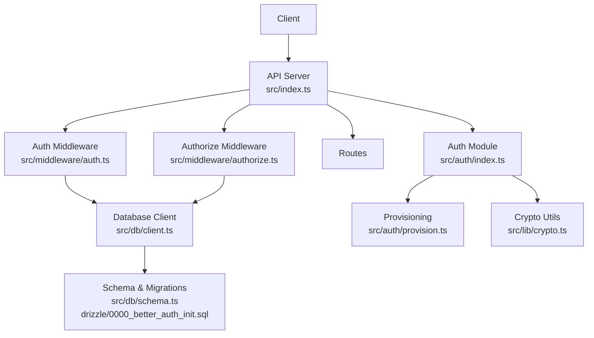
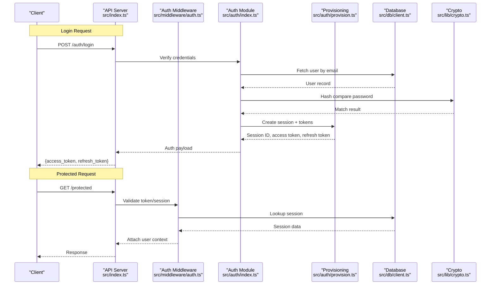
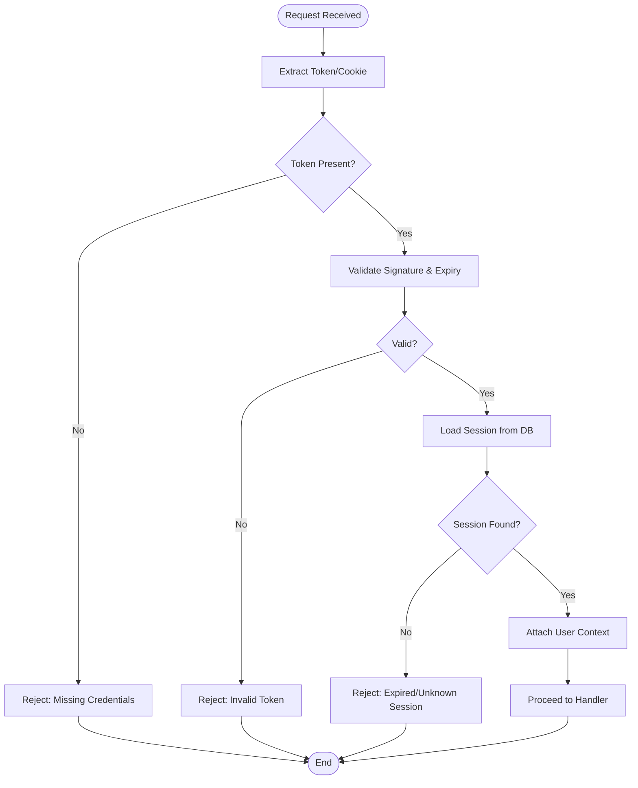
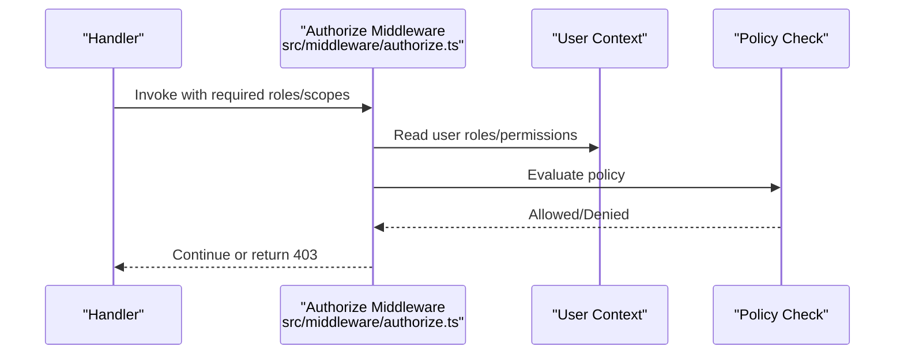
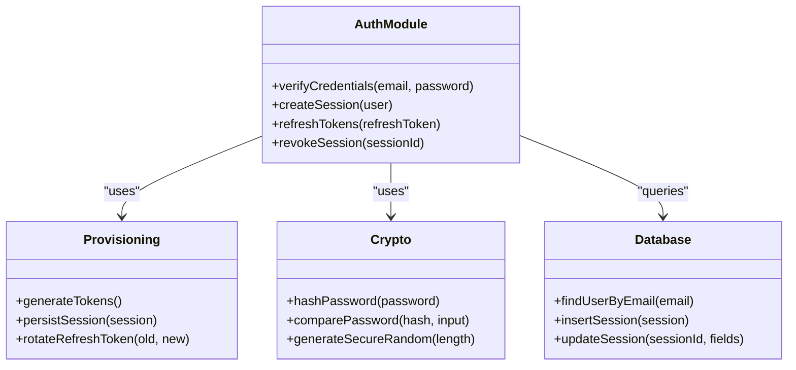
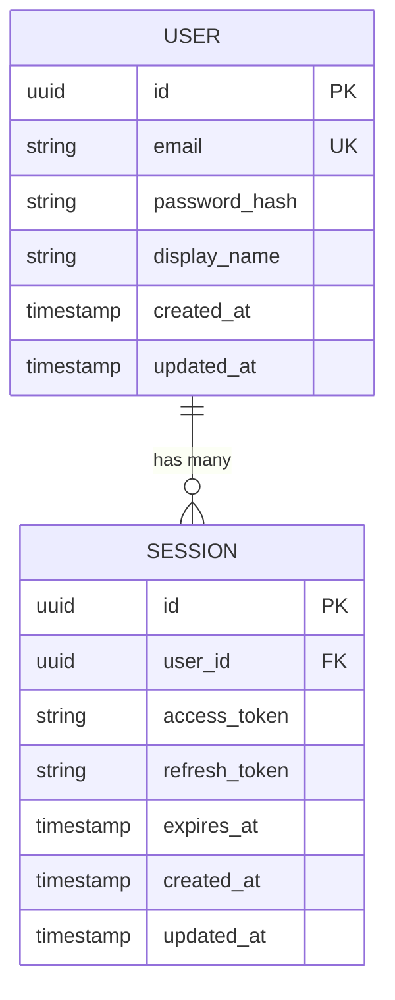
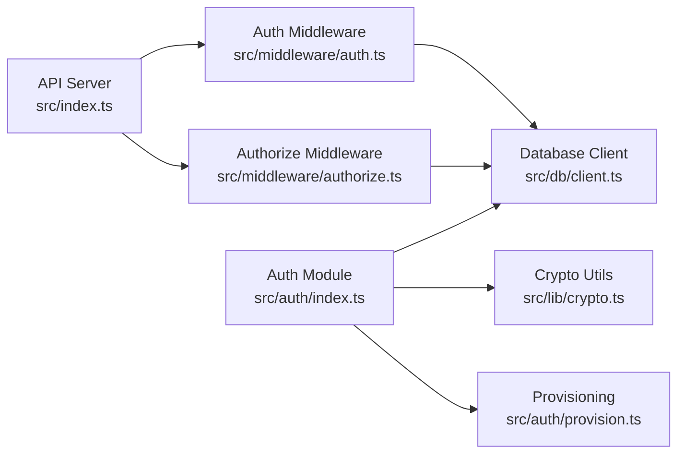

# User Authentication Flow

<cite>
**Referenced Files in This Document**
- [src/index.ts](file://src/index.ts)
- [src/auth/index.ts](file://src/auth/index.ts)
- [src/auth/provision.ts](file://src/auth/provision.ts)
- [src/middleware/auth.ts](file://src/middleware/auth.ts)
- [src/middleware/authorize.ts](file://src/middleware/authorize.ts)
- [src/db/client.ts](file://src/db/client.ts)
- [src/db/schema.ts](file://src/db/schema.ts)
- [drizzle/0000_better_auth_init.sql](file://drizzle/0000_better_auth_init.sql)
- [src/lib/crypto.ts](file://src/lib/crypto.ts)
- [src/lib/errors.ts](file://src/lib/errors.ts)
- [src/config/env.ts](file://src/config/env.ts)
- [test/auth-middleware.test.ts](file://test/auth-middleware.test.ts)
- [test/session.test.ts](file://test/session.test.ts)
</cite>

## Table of Contents
1. [Introduction](#introduction)
2. [Project Structure](#project-structure)
3. [Core Components](#core-components)
4. [Architecture Overview](#architecture-overview)
5. [Detailed Component Analysis](#detailed-component-analysis)
6. [Dependency Analysis](#dependency-analysis)
7. [Performance Considerations](#performance-considerations)
8. [Troubleshooting Guide](#troubleshooting-guide)
9. [Conclusion](#conclusion)
10. [Appendices](#appendices)

## Introduction
This document explains the user authentication lifecycle in the project, from login request to session creation, token generation and validation, refresh mechanisms, and middleware-based request interception for identity verification. It also covers protected route implementation, error handling, database integration for user data retrieval, security best practices (password hashing, secure token storage, CSRF/XSS protections), and troubleshooting guidance with debugging techniques.

## Project Structure
The authentication system is implemented across several modules:
- Entry point and server setup
- Auth module initialization and provisioning
- Middleware for authentication and authorization
- Database client and schema definitions
- Crypto utilities for hashing and secure operations
- Error handling utilities
- Environment configuration
- Tests validating middleware behavior and sessions

**Diagram sources**
- [src/index.ts](file://src/index.ts)
- [src/middleware/auth.ts](file://src/middleware/auth.ts)
- [src/middleware/authorize.ts](file://src/middleware/authorize.ts)
- [src/auth/index.ts](file://src/auth/index.ts)
- [src/auth/provision.ts](file://src/auth/provision.ts)
- [src/db/client.ts](file://src/db/client.ts)
- [src/db/schema.ts](file://src/db/schema.ts)
- [drizzle/0000_better_auth_init.sql](file://drizzle/0000_better_auth_init.sql)
- [src/lib/crypto.ts](file://src/lib/crypto.ts)

**Section sources**
- [src/index.ts](file://src/index.ts)
- [src/auth/index.ts](file://src/auth/index.ts)
- [src/middleware/auth.ts](file://src/middleware/auth.ts)
- [src/middleware/authorize.ts](file://src/middleware/authorize.ts)
- [src/db/client.ts](file://src/db/client.ts)
- [src/db/schema.ts](file://src/db/schema.ts)
- [drizzle/0000_better_auth_init.sql](file://drizzle/0000_better_auth_init.sql)
- [src/lib/crypto.ts](file://src/lib/crypto.ts)

## Core Components
- Authentication middleware: Intercepts incoming requests, validates tokens or sessions, and attaches user context to the request.
- Authorization middleware: Enforces role-based or resource-based access control on top of authenticated requests.
- Auth module: Initializes auth providers, manages session/token lifecycle, and integrates with provisioning flows.
- Database layer: Provides typed queries and schema definitions for users, sessions, and related entities.
- Crypto utilities: Implements password hashing and secure random token generation.
- Error handling: Centralized error types and responses for authentication failures.
- Environment configuration: Secure loading of secrets and feature flags.

Key responsibilities:
- Validate credentials securely using hashed passwords.
- Generate short-lived access tokens and long-lived refresh tokens.
- Store sessions securely and rotate tokens upon refresh.
- Protect routes via middleware that checks identity and permissions.
- Return consistent error responses for failed authentication attempts.

**Section sources**
- [src/middleware/auth.ts](file://src/middleware/auth.ts)
- [src/middleware/authorize.ts](file://src/middleware/authorize.ts)
- [src/auth/index.ts](file://src/auth/index.ts)
- [src/auth/provision.ts](file://src/auth/provision.ts)
- [src/db/client.ts](file://src/db/client.ts)
- [src/db/schema.ts](file://src/db/schema.ts)
- [src/lib/crypto.ts](file://src/lib/crypto.ts)
- [src/lib/errors.ts](file://src/lib/errors.ts)
- [src/config/env.ts](file://src/config/env.ts)

## Architecture Overview
The authentication flow follows a layered approach:
- Clients send login requests to the API.
- The API invokes the auth module to verify credentials and create sessions/tokens.
- Subsequent requests are intercepted by the auth middleware to validate tokens/sessions.
- Authorized endpoints enforce additional permissions via the authorize middleware.
- All user data interactions go through the database client with schema-defined models.

**Diagram sources**
- [src/index.ts](file://src/index.ts)
- [src/middleware/auth.ts](file://src/middleware/auth.ts)
- [src/auth/index.ts](file://src/auth/index.ts)
- [src/auth/provision.ts](file://src/auth/provision.ts)
- [src/db/client.ts](file://src/db/client.ts)
- [src/lib/crypto.ts](file://src/lib/crypto.ts)

## Detailed Component Analysis

### Authentication Middleware
Responsibilities:
- Extracts tokens from headers or cookies.
- Validates token signatures and expiration.
- Retrieves session data from the database.
- Attaches user context to the request for downstream handlers.
- Returns standardized errors for invalid or missing credentials.

**Diagram sources**
- [src/middleware/auth.ts](file://src/middleware/auth.ts)
- [src/db/client.ts](file://src/db/client.ts)
- [src/lib/errors.ts](file://src/lib/errors.ts)

**Section sources**
- [src/middleware/auth.ts](file://src/middleware/auth.ts)
- [src/db/client.ts](file://src/db/client.ts)
- [src/lib/errors.ts](file://src/lib/errors.ts)

### Authorization Middleware
Responsibilities:
- Enforces role-based or resource-based policies after authentication.
- Checks user roles/permissions against required scopes.
- Short-circuits unauthorized requests with appropriate error responses.

**Diagram sources**
- [src/middleware/authorize.ts](file://src/middleware/authorize.ts)

**Section sources**
- [src/middleware/authorize.ts](file://src/middleware/authorize.ts)

### Auth Module and Provisioning
Responsibilities:
- Orchestrates login verification and session creation.
- Integrates with crypto utilities for hashing and token generation.
- Coordinates with the database to persist sessions and user data.
- Supports token refresh workflows and rotation.

**Diagram sources**
- [src/auth/index.ts](file://src/auth/index.ts)
- [src/auth/provision.ts](file://src/auth/provision.ts)
- [src/lib/crypto.ts](file://src/lib/crypto.ts)
- [src/db/client.ts](file://src/db/client.ts)

**Section sources**
- [src/auth/index.ts](file://src/auth/index.ts)
- [src/auth/provision.ts](file://src/auth/provision.ts)
- [src/lib/crypto.ts](file://src/lib/crypto.ts)
- [src/db/client.ts](file://src/db/client.ts)

### Database Layer and Schema
Responsibilities:
- Defines tables for users, sessions, and related entities.
- Provides typed queries for safe and efficient data access.
- Ensures migrations are applied consistently.

**Diagram sources**
- [src/db/schema.ts](file://src/db/schema.ts)
- [drizzle/0000_better_auth_init.sql](file://drizzle/0000_better_auth_init.sql)

**Section sources**
- [src/db/schema.ts](file://src/db/schema.ts)
- [drizzle/0000_better_auth_init.sql](file://drizzle/0000_better_auth_init.sql)
- [src/db/client.ts](file://src/db/client.ts)

### Security Best Practices
- Password hashing: Use strong, adaptive hashing algorithms; never store plaintext passwords.
- Secure token storage: Prefer httpOnly, secure, sameSite cookies for tokens; avoid localStorage for sensitive tokens.
- CSRF protection: Implement SameSite cookie attributes and anti-CSRF tokens for state-changing requests.
- XSS prevention: Sanitize outputs, set Content-Security-Policy headers, and avoid injecting untrusted data into HTML.
- Rate limiting and account lockout: Prevent brute-force attacks by throttling login attempts and locking accounts after repeated failures.
- Token rotation: Rotate refresh tokens on use and invalidate old ones to mitigate theft.
- Minimal exposure: Return generic error messages for failed authentication to avoid leaking information.

[No sources needed since this section provides general guidance]

### Protected Route Implementation
- Apply auth middleware to all protected routes to ensure identity verification.
- Apply authorize middleware where role-based access is required.
- Keep public routes separate and explicitly opt-in to protection.

Example pattern:
- Define a route handler that expects user context attached by auth middleware.
- Use authorize middleware to restrict access based on roles or scopes.
- Handle errors centrally to return consistent responses.

**Section sources**
- [src/middleware/auth.ts](file://src/middleware/auth.ts)
- [src/middleware/authorize.ts](file://src/middleware/authorize.ts)

### Error Handling for Failed Authentication
- Distinguish between missing credentials, invalid tokens, expired sessions, and unauthorized access.
- Return standardized error codes and messages without exposing internal details.
- Log authentication failures securely for auditing while avoiding sensitive data leakage.

**Section sources**
- [src/lib/errors.ts](file://src/lib/errors.ts)

### Integration with Database Layer
- Fetch user records by unique identifiers (e.g., email).
- Persist sessions with secure token values and expiration times.
- Update sessions during refresh and revoke sessions on logout.

**Section sources**
- [src/db/client.ts](file://src/db/client.ts)
- [src/db/schema.ts](file://src/db/schema.ts)

## Dependency Analysis
Authentication components depend on each other in a clear hierarchy:
- API server depends on auth and authorize middleware.
- Auth module depends on crypto and database clients.
- Middleware depends on database client for session lookup.
- Tests validate middleware behavior and session lifecycle.

**Diagram sources**
- [src/index.ts](file://src/index.ts)
- [src/middleware/auth.ts](file://src/middleware/auth.ts)
- [src/middleware/authorize.ts](file://src/middleware/authorize.ts)
- [src/auth/index.ts](file://src/auth/index.ts)
- [src/auth/provision.ts](file://src/auth/provision.ts)
- [src/db/client.ts](file://src/db/client.ts)
- [src/lib/crypto.ts](file://src/lib/crypto.ts)

**Section sources**
- [src/index.ts](file://src/index.ts)
- [src/middleware/auth.ts](file://src/middleware/auth.ts)
- [src/middleware/authorize.ts](file://src/middleware/authorize.ts)
- [src/auth/index.ts](file://src/auth/index.ts)
- [src/auth/provision.ts](file://src/auth/provision.ts)
- [src/db/client.ts](file://src/db/client.ts)
- [src/lib/crypto.ts](file://src/lib/crypto.ts)

## Performance Considerations
- Minimize database queries per request; cache frequently accessed user data when safe.
- Use connection pooling for the database client.
- Avoid heavy cryptographic operations on hot paths; precompute where possible.
- Implement token caching strategies carefully to balance security and performance.
- Monitor and log slow queries to identify bottlenecks.

[No sources needed since this section provides general guidance]

## Troubleshooting Guide
Common issues and debugging steps:
- Missing or malformed tokens:
  - Verify header or cookie names and formats.
  - Ensure tokens are transmitted over HTTPS.
- Invalid or expired sessions:
  - Check session expiration times and clock synchronization.
  - Confirm session persistence and retrieval logic.
- Password hash mismatches:
  - Validate hashing algorithm and salt parameters.
  - Ensure stored hashes match expected format.
- CSRF/XSS vulnerabilities:
  - Inspect cookie settings (httpOnly, secure, sameSite).
  - Review CSP headers and output sanitization.
- Rate limiting and lockouts:
  - Check counters and thresholds for login attempts.
  - Verify unlock procedures and audit logs.

Debugging techniques:
- Enable detailed logging for auth flows (without sensitive data).
- Use tests to reproduce issues locally (see test files).
- Validate environment variables and secrets configuration.

**Section sources**
- [test/auth-middleware.test.ts](file://test/auth-middleware.test.ts)
- [test/session.test.ts](file://test/session.test.ts)
- [src/lib/errors.ts](file://src/lib/errors.ts)
- [src/config/env.ts](file://src/config/env.ts)

## Conclusion
The authentication system combines robust middleware, secure crypto utilities, and a well-defined database schema to provide a complete lifecycle from login to session management. By following the outlined best practices and troubleshooting steps, developers can maintain a secure, performant, and reliable authentication flow.

[No sources needed since this section summarizes without analyzing specific files]

## Appendices
- Environment configuration: Ensure secrets like JWT keys, database credentials, and feature flags are loaded securely.
- Migration management: Apply database migrations before starting the server to ensure schema consistency.
- Testing strategy: Use existing tests as templates for validating auth middleware and session behaviors.

**Section sources**
- [src/config/env.ts](file://src/config/env.ts)
- [drizzle/0000_better_auth_init.sql](file://drizzle/0000_better_auth_init.sql)
- [test/auth-middleware.test.ts](file://test/auth-middleware.test.ts)
- [test/session.test.ts](file://test/session.test.ts)