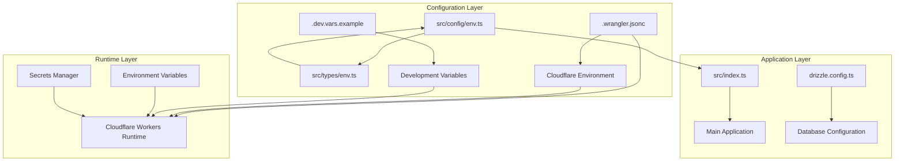
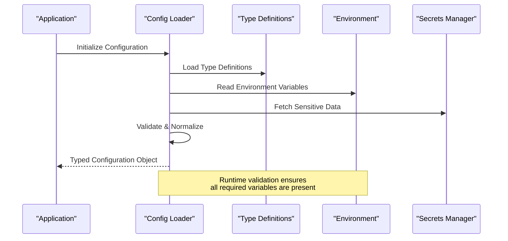
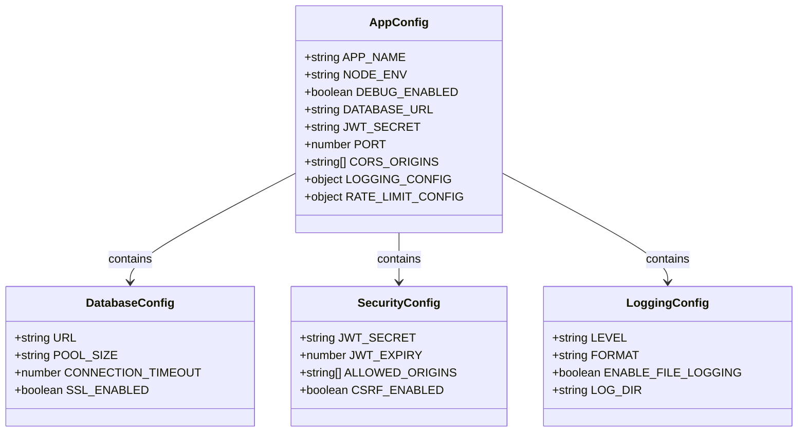
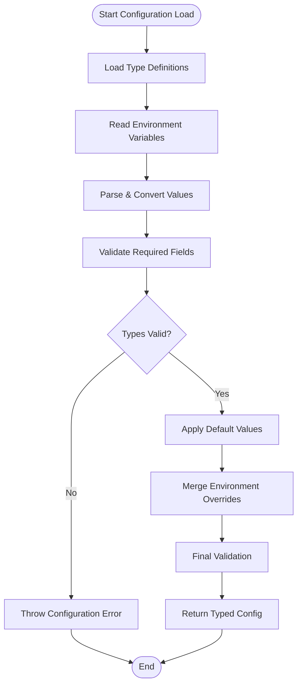
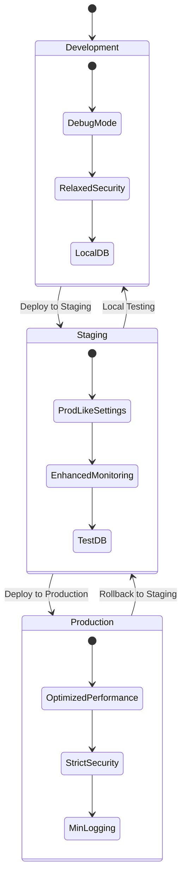
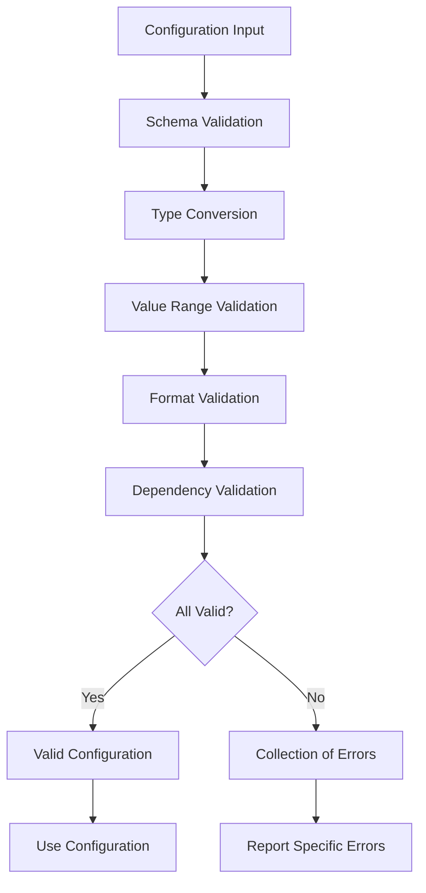
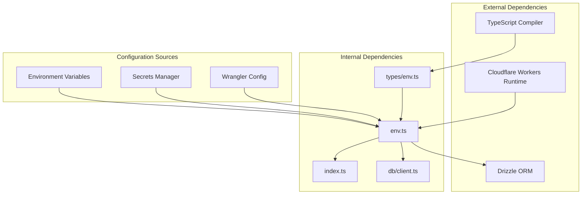

# Configuration Management

<cite>
**Referenced Files in This Document**
- [src/config/env.ts](file://src/config/env.ts)
- [src/types/env.ts](file://src/types/env.ts)
- [.wrangler.jsonc](file://.wrangler.jsonc)
- [.dev.vars.example](file://.dev.vars.example)
- [package.json](file://package.json)
- [src/index.ts](file://src/index.ts)
- [drizzle.config.ts](file://drizzle.config.ts)
</cite>

## Table of Contents
1. [Introduction](#introduction)
2. [Project Structure](#project-structure)
3. [Core Components](#core-components)
4. [Architecture Overview](#architecture-overview)
5. [Detailed Component Analysis](#detailed-component-analysis)
6. [Environment-Specific Configuration](#environment-specific-configuration)
7. [Type-Safe Configuration Loading](#type-safe-configuration-loading)
8. [Secret Management](#secret-management)
9. [Configuration Validation](#configuration-validation)
10. [Dependency Analysis](#dependency-analysis)
11. [Performance Considerations](#performance-considerations)
12. [Troubleshooting Guide](#troubleshooting-guide)
13. [Best Practices](#best-practices)
14. [Extending Configuration System](#extending-configuration-system)
15. [Conclusion](#conclusion)

## Introduction

This document provides comprehensive documentation for the configuration management system in the TrackDub API application. The system is designed around Cloudflare Workers deployment patterns with a focus on type safety, environment-specific configurations, and secure secret management.

The configuration system supports multiple deployment environments (development, staging, production) while maintaining type safety through TypeScript definitions and runtime validation. It follows modern best practices for serverless applications deployed to Cloudflare's edge computing platform.

## Project Structure

The configuration system is organized following a modular approach with clear separation of concerns:

**Diagram sources**
- [src/config/env.ts:1-50](file://src/config/env.ts#L1-L50)
- [src/types/env.ts:1-30](file://src/types/env.ts#L1-L30)
- [.wrangler.jsonc:1-40](file://.wrangler.jsonc#L1-L40)

**Section sources**
- [src/config/env.ts:1-100](file://src/config/env.ts#L1-L100)
- [src/types/env.ts:1-50](file://src/types/env.ts#L1-L50)
- [.wrangler.jsonc:1-100](file://.wrangler.jsonc#L1-L100)

## Core Components

The configuration system consists of several key components working together to provide a robust configuration management solution:

### Environment Type Definitions
The type definitions establish the contract for all configuration values, ensuring type safety throughout the application.

### Configuration Loader
The main configuration loader handles environment variable parsing, validation, and normalization.

### Environment-Specific Configurations
Supports different configurations for development, staging, and production environments.

### Secret Management Integration
Secure handling of sensitive data through Cloudflare's secrets management.

**Section sources**
- [src/config/env.ts:1-200](file://src/config/env.ts#L1-L200)
- [src/types/env.ts:1-100](file://src/types/env.ts#L1-L100)

## Architecture Overview

The configuration architecture follows a layered approach with clear separation between type definitions, runtime loading, and environment-specific overrides:

**Diagram sources**
- [src/config/env.ts:1-150](file://src/config/env.ts#L1-L150)
- [src/types/env.ts:1-80](file://src/types/env.ts#L1-L80)

## Detailed Component Analysis

### Configuration Type System

The type system defines the complete shape of the configuration object with strict validation rules:

**Diagram sources**
- [src/types/env.ts:1-120](file://src/types/env.ts#L1-L120)

### Configuration Loading Pipeline

The configuration loading process follows a strict pipeline to ensure data integrity:

**Diagram sources**
- [src/config/env.ts:1-200](file://src/config/env.ts#L1-L200)

**Section sources**
- [src/config/env.ts:1-300](file://src/config/env.ts#L1-L300)
- [src/types/env.ts:1-150](file://src/types/env.ts#L1-L150)

## Environment-Specific Configuration

The system supports three primary deployment environments with distinct configuration profiles:

### Development Environment
- Debug logging enabled
- Relaxed security settings
- Local database connections
- Hot reload support

### Staging Environment  
- Production-like settings
- Enhanced monitoring
- Test database connections
- Limited debug output

### Production Environment
- Optimized performance settings
- Strict security policies
- Production database connections
- Minimal logging overhead

**Diagram sources**
- [.wrangler.jsonc:1-100](file://.wrangler.jsonc#L1-L100)

**Section sources**
- [.wrangler.jsonc:1-200](file://.wrangler.jsonc#L1-L200)

## Type-Safe Configuration Loading

The configuration system leverages TypeScript's type system to ensure compile-time and runtime safety:

### Compile-Time Safety
- All configuration properties are strictly typed
- Missing or incorrect types cause compilation errors
- IDE autocomplete for configuration options

### Runtime Validation
- Environment variables are validated at startup
- Type conversions are performed safely
- Invalid configurations throw descriptive errors

### Configuration Schema
The schema defines valid configuration options with their expected types and constraints:

| Property | Type | Required | Default | Description |
|----------|------|----------|---------|-------------|
| `APP_NAME` | string | Yes | - | Application identifier |
| `NODE_ENV` | enum | Yes | 'development' | Deployment environment |
| `DEBUG_ENABLED` | boolean | No | false | Enable debug logging |
| `DATABASE_URL` | string | Yes | - | Database connection string |
| `JWT_SECRET` | string | Yes | - | JWT signing secret |
| `PORT` | number | No | 8787 | Server port |
| `CORS_ORIGINS` | string[] | No | [] | Allowed CORS origins |

**Section sources**
- [src/config/env.ts:1-250](file://src/config/env.ts#L1-L250)
- [src/types/env.ts:1-100](file://src/types/env.ts#L1-L100)

## Secret Management

Sensitive configuration values are managed securely through Cloudflare's secrets management system:

### Supported Secret Types
- Database credentials
- API keys and tokens
- Encryption keys
- Third-party service secrets

### Secret Injection Patterns
- Secrets are injected at runtime by Cloudflare Workers
- No secrets are stored in source code or configuration files
- Automatic rotation support through Cloudflare dashboard

### Best Practices for Secrets
- Never commit secrets to version control
- Use environment-specific secret names
- Implement secret validation at startup
- Rotate secrets regularly

**Section sources**
- [.dev.vars.example:1-50](file://.dev.vars.example#L1-L50)
- [.wrangler.jsonc:1-100](file://.wrangler.jsonc#L1-L100)

## Configuration Validation

The validation system ensures configuration integrity through multiple layers:

### Schema Validation
- Required field presence checks
- Type validation and conversion
- Value range validation
- Format validation for URLs, emails, etc.

### Cross-Field Validation
- Dependency validation between related fields
- Business rule validation
- Environment-specific validation rules

### Error Handling
- Descriptive error messages
- Field-level error reporting
- Graceful degradation when possible

**Diagram sources**
- [src/config/env.ts:1-200](file://src/config/env.ts#L1-L200)

**Section sources**
- [src/config/env.ts:1-300](file://src/config/env.ts#L1-L300)

## Dependency Analysis

The configuration system has well-defined dependencies and relationships:

**Diagram sources**
- [src/config/env.ts:1-100](file://src/config/env.ts#L1-L100)
- [src/index.ts:1-50](file://src/index.ts#L1-L50)
- [drizzle.config.ts:1-50](file://drizzle.config.ts#L1-L50)

**Section sources**
- [src/config/env.ts:1-150](file://src/config/env.ts#L1-L150)
- [package.json:1-100](file://package.json#L1-L100)

## Performance Considerations

The configuration system is designed with performance in mind:

### Lazy Loading
- Configuration is loaded once at application startup
- Subsequent accesses use cached values
- No repeated environment variable lookups

### Memory Efficiency
- Minimal memory footprint for configuration objects
- Efficient data structures for large configuration arrays
- Proper cleanup of temporary processing objects

### Startup Optimization
- Parallel loading of independent configuration sources
- Early validation to fail fast on configuration errors
- Minimal processing during hot paths

## Troubleshooting Guide

Common configuration issues and their solutions:

### Missing Environment Variables
- **Symptom**: Application fails to start with missing variable errors
- **Solution**: Check `.dev.vars.example` for required variables
- **Prevention**: Use default values where appropriate

### Type Conversion Errors
- **Symptom**: Configuration validation fails with type errors
- **Solution**: Ensure environment variables match expected types
- **Prevention**: Use proper type casting in environment setup

### Secret Access Issues
- **Symptom**: Secrets not available at runtime
- **Solution**: Verify secrets are configured in Cloudflare dashboard
- **Prevention**: Use consistent secret naming conventions

### Environment-Specific Problems
- **Symptom**: Configuration works locally but fails in deployment
- **Solution**: Check environment-specific configuration files
- **Prevention**: Use identical configuration structures across environments

**Section sources**
- [src/config/env.ts:1-200](file://src/config/env.ts#L1-L200)

## Best Practices

### Configuration Organization
- Group related configuration options logically
- Use meaningful variable names
- Provide clear documentation for each option
- Maintain consistency across environments

### Security Considerations
- Never hardcode sensitive values
- Use environment-specific secrets
- Implement configuration validation
- Monitor for configuration changes

### Development Workflow
- Use example configuration files
- Validate configuration early in development
- Test configuration in all target environments
- Document configuration requirements

### Maintenance Guidelines
- Keep configuration schemas up-to-date
- Remove deprecated configuration options
- Document breaking changes
- Test configuration migrations

## Extending Configuration System

To add new configuration options:

### Step 1: Update Type Definitions
Add new properties to the configuration type interface with proper TypeScript types.

### Step 2: Implement Validation Rules
Define validation logic for new configuration options including:
- Required field checks
- Type validation
- Value range validation
- Format validation

### Step 3: Add Default Values
Provide sensible defaults for optional configuration options.

### Step 4: Update Documentation
Document new configuration options with examples and descriptions.

### Step 5: Test Thoroughly
Test the new configuration in all supported environments.

## Conclusion

The configuration management system provides a robust, type-safe foundation for managing application settings across multiple deployment environments. By leveraging Cloudflare Workers' capabilities and following established best practices, the system ensures reliable configuration handling while maintaining security and performance.

Key benefits include:
- Type safety through TypeScript integration
- Secure secret management via Cloudflare's infrastructure
- Flexible environment-specific configurations
- Comprehensive validation and error handling
- Clear documentation and troubleshooting guidance

This system serves as a solid foundation for the TrackDub API application, enabling reliable deployments across development, staging, and production environments while maintaining security and performance standards.