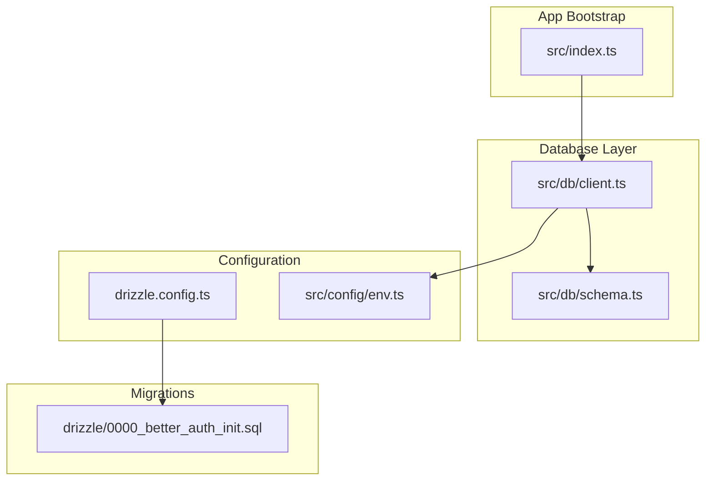
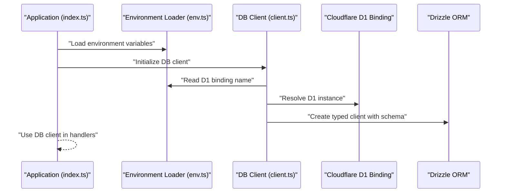
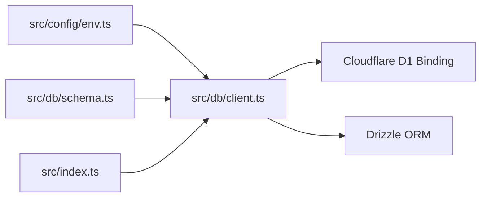

# Database Client

<cite>
**Referenced Files in This Document**
- [client.ts](file://src/db/client.ts)
- [schema.ts](file://src/db/schema.ts)
- [drizzle.config.ts](file://drizzle.config.ts)
- [env.ts](file://src/config/env.ts)
- [index.ts](file://src/index.ts)
- [0000_better_auth_init.sql](file://drizzle/0000_better_auth_init.sql)
- [logger.ts](file://src/lib/logger.ts)
- [errors.ts](file://src/lib/errors.ts)
</cite>

## Table of Contents
1. [Introduction](#introduction)
2. [Project Structure](#project-structure)
3. [Core Components](#core-components)
4. [Architecture Overview](#architecture-overview)
5. [Detailed Component Analysis](#detailed-component-analysis)
6. [Dependency Analysis](#dependency-analysis)
7. [Performance Considerations](#performance-considerations)
8. [Troubleshooting Guide](#troubleshooting-guide)
9. [Conclusion](#conclusion)

## Introduction
This document explains the database client implementation for a Cloudflare D1-backed application using Drizzle ORM. It covers configuration, connection management, initialization flow, pooling strategies, error handling, and transaction management. It also provides guidance on performance optimization, timeouts, and debugging in serverless environments.

## Project Structure
The database layer is organized under src/db with two primary files:
- A client module that configures Drizzle and exposes typed query helpers for D1.
- A schema module that defines tables and relationships used by Drizzle to generate types and migrations.

Drizzle configuration lives at the repository root, alongside SQL migration files under drizzle. Environment variables are loaded from a centralized env module. Application bootstrap wires up logging and middleware before serving requests.

**Diagram sources**
- [index.ts](file://src/index.ts)
- [client.ts](file://src/db/client.ts)
- [schema.ts](file://src/db/schema.ts)
- [drizzle.config.ts](file://drizzle.config.ts)
- [env.ts](file://src/config/env.ts)
- [0000_better_auth_init.sql](file://drizzle/0000_better_auth_init.sql)

**Section sources**
- [client.ts](file://src/db/client.ts)
- [schema.ts](file://src/db/schema.ts)
- [drizzle.config.ts](file://drizzle.config.ts)
- [env.ts](file://src/config/env.ts)
- [index.ts](file://src/index.ts)

## Core Components
- Drizzle ORM client for D1: Initializes a D1 instance via environment configuration and creates a typed Drizzle client bound to the schema.
- Schema definitions: Declares table structures and relations; Drizzle uses these to infer TypeScript types and build migrations.
- Configuration: Centralized environment access ensures secure retrieval of D1 binding names and other runtime settings.
- Migration file: The initial SQL migration that sets up the database schema referenced by Drizzle.

Key responsibilities:
- Provide a single, reusable database client instance per request or worker lifecycle.
- Enforce type safety across queries through schema inference.
- Keep configuration decoupled from business logic.

**Section sources**
- [client.ts](file://src/db/client.ts)
- [schema.ts](file://src/db/schema.ts)
- [drizzle.config.ts](file://drizzle.config.ts)
- [env.ts](file://src/config/env.ts)
- [0000_better_auth_init.sql](file://drizzle/0000_better_auth_init.sql)

## Architecture Overview
The database client integrates with Cloudflare D1 through an environment-provided binding. Drizzle wraps the D1 API to provide a familiar SQL-like interface with strong typing. The application bootstraps logging and middleware, then resolves the D1 binding and constructs the Drizzle client.

**Diagram sources**
- [index.ts](file://src/index.ts)
- [env.ts](file://src/config/env.ts)
- [client.ts](file://src/db/client.ts)

## Detailed Component Analysis

### Drizzle ORM Configuration
- Configuration file defines the dialect, schema location, and output paths for generated types and migrations.
- Uses the D1 driver to target Cloudflare’s serverless SQL database.
- Ensures consistent generation of types aligned with the schema definitions.

Best practices:
- Pin versions for reproducibility.
- Keep schema and migration directories separate for clarity.
- Validate configuration against environment-specific values during development and deployment.

**Section sources**
- [drizzle.config.ts](file://drizzle.config.ts)

### Connection Management and Initialization
- The client module reads the D1 binding name from environment configuration.
- It instantiates the D1 binding and passes it into Drizzle’s D1 adapter.
- The resulting Drizzle client is exported for use throughout the application.

Initialization flow:
1. Load environment variables.
2. Resolve the D1 binding.
3. Create a typed Drizzle client bound to the schema.
4. Export the client for reuse.

Connection lifecycle:
- In serverless workers, connections are typically short-lived and scoped to the request or worker instance.
- Avoid long-running connections; rely on D1’s managed connection model.

**Section sources**
- [client.ts](file://src/db/client.ts)
- [env.ts](file://src/config/env.ts)

### Schema Definitions
- Tables and columns are declared using Drizzle’s schema DSL.
- Relations and constraints are defined to ensure data integrity.
- Types inferred from the schema enable compile-time safety for queries.

Recommendations:
- Use explicit column types and constraints.
- Define indexes where appropriate for query performance.
- Keep schema changes versioned via migrations.

**Section sources**
- [schema.ts](file://src/db/schema.ts)

### Migrations
- The initial migration SQL establishes the baseline schema.
- Drizzle CLI can generate and apply migrations based on schema changes.

Workflow:
- Modify schema definitions.
- Generate migration SQL.
- Apply migrations in development and production environments.

**Section sources**
- [0000_better_auth_init.sql](file://drizzle/0000_better_auth_init.sql)
- [drizzle.config.ts](file://drizzle.config.ts)

### Error Handling Patterns
- Centralized error utilities provide structured error responses and logging.
- Database errors should be caught and transformed into user-friendly messages while preserving stack traces for debugging.
- Logging is integrated to capture context around failures.

Guidelines:
- Wrap database calls in try/catch blocks.
- Log errors with correlation IDs for traceability.
- Return consistent error shapes to clients.

**Section sources**
- [errors.ts](file://src/lib/errors.ts)
- [logger.ts](file://src/lib/logger.ts)

### Transaction Management
- Use Drizzle’s transaction API to group multiple operations atomically.
- Ensure all statements within a transaction succeed or roll back together.
- Handle partial failures explicitly to maintain consistency.

Typical pattern:
- Begin transaction.
- Execute related queries.
- Commit on success; rollback on any error.

**Section sources**
- [client.ts](file://src/db/client.ts)

## Dependency Analysis
The database client depends on environment configuration and the D1 binding provided by Cloudflare. Drizzle ORM acts as the abstraction layer over D1. The application bootstrap wires logging and middleware before invoking database operations.

**Diagram sources**
- [env.ts](file://src/config/env.ts)
- [client.ts](file://src/db/client.ts)
- [schema.ts](file://src/db/schema.ts)
- [index.ts](file://src/index.ts)

**Section sources**
- [client.ts](file://src/db/client.ts)
- [env.ts](file://src/config/env.ts)
- [schema.ts](file://src/db/schema.ts)
- [index.ts](file://src/index.ts)

## Performance Considerations
- Connection pooling: Rely on D1’s managed connections; avoid manual pooling in serverless contexts.
- Query efficiency: Use selective column projections and proper indexing to minimize payload size and improve lookup speed.
- Batch operations: Group writes when possible to reduce round-trips.
- Caching: Cache frequently accessed data at the edge or within worker memory where appropriate.
- Timeouts: Configure request-level timeouts to fail fast and free resources promptly.
- Cold starts: Minimize initialization overhead by deferring non-critical setup until first use.

[No sources needed since this section provides general guidance]

## Troubleshooting Guide
Common issues and resolutions:
- Missing D1 binding: Verify environment variable names and binding configuration in deployment settings.
- Migration mismatches: Ensure schema and migration files are synchronized; re-run Drizzle CLI commands to regenerate.
- Permission errors: Confirm the D1 binding has sufficient privileges for read/write operations.
- Timeout errors: Increase request timeouts if necessary and optimize slow queries.
- Logging and debugging: Enable detailed logs with correlation IDs; inspect error stacks and query plans.

Debugging steps:
- Log environment resolution and D1 binding availability.
- Capture query payloads and results in development mode.
- Use structured error messages to pinpoint failure points.

**Section sources**
- [logger.ts](file://src/lib/logger.ts)
- [errors.ts](file://src/lib/errors.ts)

## Conclusion
The database client leverages Drizzle ORM with Cloudflare D1 to provide a type-safe, efficient, and serverless-friendly data layer. By centralizing configuration, managing connections through D1’s model, and applying robust error handling and transaction patterns, the application achieves reliability and performance in edge environments. Follow the recommended practices for migrations, performance tuning, and debugging to maintain a healthy database integration.