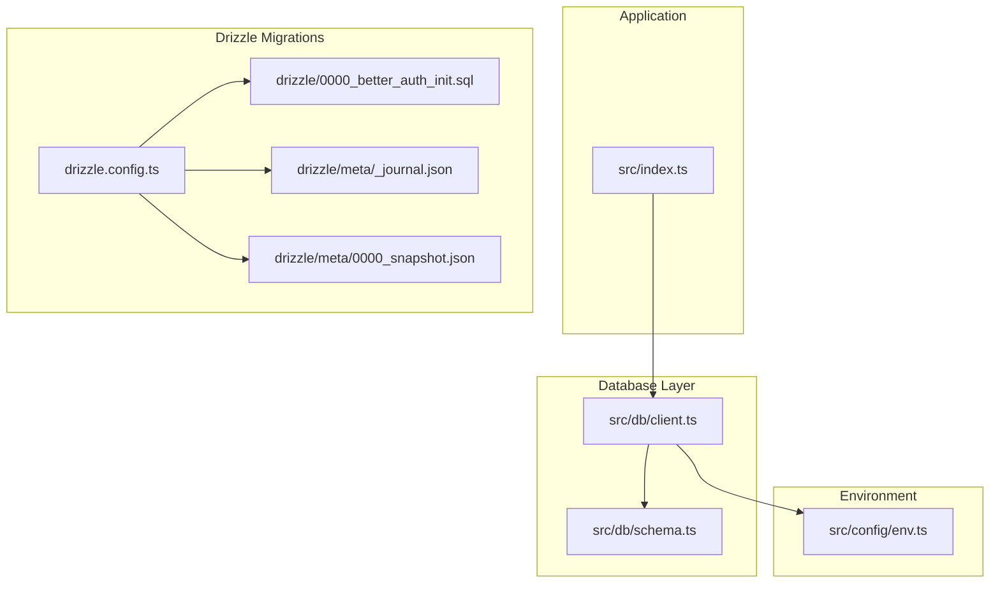
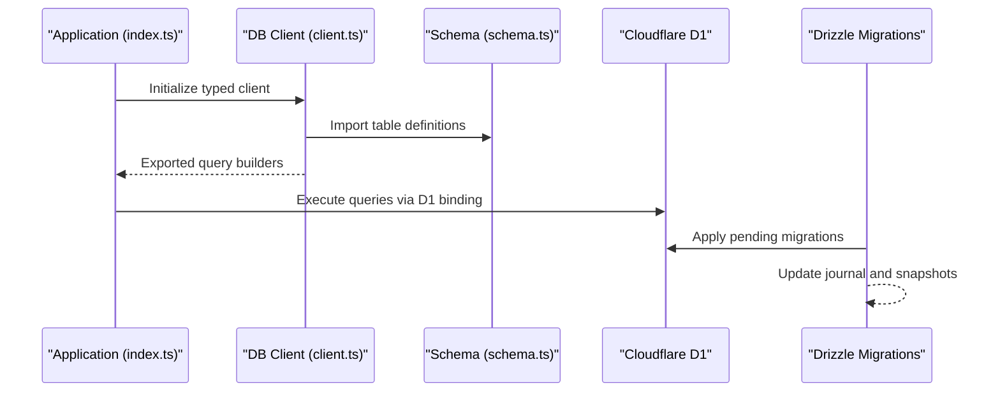
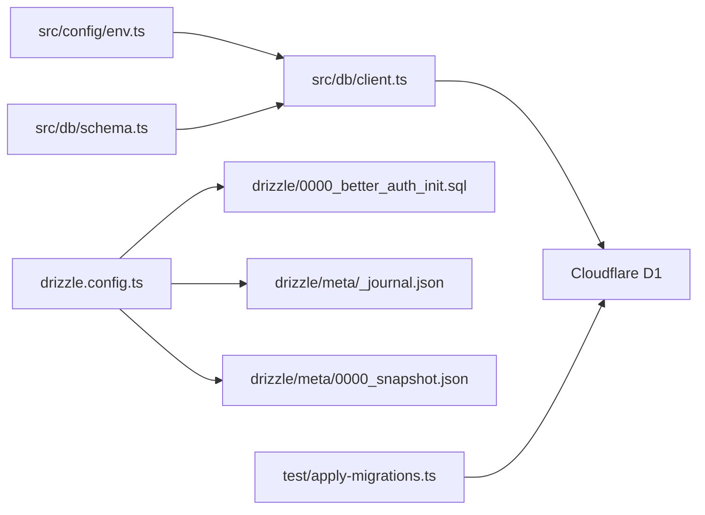

# Database Layer

<cite>
**Referenced Files in This Document**
- [schema.ts](file://src/db/schema.ts)
- [client.ts](file://src/db/client.ts)
- [drizzle.config.ts](file://drizzle.config.ts)
- [0000_better_auth_init.sql](file://drizzle/0000_better_auth_init.sql)
- [_journal.json](file://drizzle/meta/_journal.json)
- [0000_snapshot.json](file://drizzle/meta/0000_snapshot.json)
- [apply-migrations.ts](file://test/apply-migrations.ts)
- [env.ts](file://src/config/env.ts)
- [index.ts](file://src/index.ts)
</cite>

## Table of Contents
1. [Introduction](#introduction)
2. [Project Structure](#project-structure)
3. [Core Components](#core-components)
4. [Architecture Overview](#architecture-overview)
5. [Detailed Component Analysis](#detailed-component-analysis)
6. [Dependency Analysis](#dependency-analysis)
7. [Performance Considerations](#performance-considerations)
8. [Troubleshooting Guide](#troubleshooting-guide)
9. [Conclusion](#conclusion)
10. [Appendices](#appendices)

## Introduction
This document provides comprehensive data model documentation for the TrackDub API database schema implemented with Drizzle ORM and Cloudflare D1. It covers entity relationships, field definitions, data types, primary and foreign keys, indexes, constraints, validation rules, business logic constraints, migration strategies, data access patterns, caching considerations, performance tuning, lifecycle management, backup strategies, versioning, security, privacy, and access control at the database layer.

## Project Structure
The database layer is organized under src/db with a clear separation between schema definitions and client configuration:
- Schema definitions define tables, relations, and constraints using Drizzle’s TypeScript-first API.
- Client configuration initializes the D1 connection and exposes typed query builders.
- Drizzle migrations are stored under drizzle/, including SQL migration files and metadata snapshots.
- Environment configuration centralizes D1-related settings consumed by the application.

**Diagram sources**
- [client.ts](file://src/db/client.ts)
- [schema.ts](file://src/db/schema.ts)
- [drizzle.config.ts](file://drizzle.config.ts)
- [0000_better_auth_init.sql](file://drizzle/0000_better_auth_init.sql)
- [_journal.json](file://drizzle/meta/_journal.json)
- [0000_snapshot.json](file://drizzle/meta/0000_snapshot.json)
- [env.ts](file://src/config/env.ts)
- [index.ts](file://src/index.ts)

**Section sources**
- [client.ts](file://src/db/client.ts)
- [schema.ts](file://src/db/schema.ts)
- [drizzle.config.ts](file://drizzle.config.ts)
- [0000_better_auth_init.sql](file://drizzle/0000_better_auth_init.sql)
- [_journal.json](file://drizzle/meta/_journal.json)
- [0000_snapshot.json](file://drizzle/meta/0000_snapshot.json)
- [env.ts](file://src/config/env.ts)
- [index.ts](file://src/index.ts)

## Core Components
- Data schema definitions: Centralized table schemas, column types, constraints, and relations defined via Drizzle.
- Database client: D1 client initialization, environment-driven configuration, and exported typed query builder instances.
- Migration tooling: Drizzle configuration, migration SQL, and metadata used to apply and track schema changes.
- Environment variables: D1 binding names and optional settings consumed by the client.

Key responsibilities:
- Enforce type safety across queries and mutations.
- Provide a consistent interface for all data access.
- Ensure migrations are reproducible and auditable.

**Section sources**
- [schema.ts](file://src/db/schema.ts)
- [client.ts](file://src/db/client.ts)
- [drizzle.config.ts](file://drizzle.config.ts)
- [env.ts](file://src/config/env.ts)

## Architecture Overview
The data architecture integrates Drizzle ORM with Cloudflare D1:
- The application imports typed clients from the database module.
- Schemas define entities and relationships that map directly to D1 tables.
- Drizzle CLI manages migrations and generates type-safe query builders.
- Environment variables configure the D1 binding name and runtime options.

**Diagram sources**
- [index.ts](file://src/index.ts)
- [client.ts](file://src/db/client.ts)
- [schema.ts](file://src/db/schema.ts)
- [drizzle.config.ts](file://drizzle.config.ts)
- [0000_better_auth_init.sql](file://drizzle/0000_better_auth_init.sql)
- [_journal.json](file://drizzle/meta/_journal.json)
- [0000_snapshot.json](file://drizzle/meta/0000_snapshot.json)

## Detailed Component Analysis

### Data Model and Schema
- Tables and columns are defined using Drizzle’s schema API, mapping to D1-compatible types.
- Primary keys are declared per table; foreign keys establish referential integrity where applicable.
- Indexes are applied to frequently queried columns to optimize read performance.
- Constraints include NOT NULL, UNIQUE, and DEFAULT values as needed by business rules.

Entity relationships:
- One-to-many relationships are modeled via foreign keys on child tables referencing parent primary keys.
- Many-to-many relationships can be represented through join tables if required by domain logic.

Validation and constraints:
- Column-level constraints enforce data integrity at the database layer.
- Application-level validations complement schema constraints for richer business rules.

Data types:
- Strings, numbers, booleans, timestamps, and JSON fields are used according to Drizzle and D1 support.
- Enum-like behavior is achieved via CHECK constraints or application-enforced enums.

Indexes:
- B-tree indexes on high-cardinality columns improve lookup speed.
- Composite indexes support common query patterns involving multiple columns.

**Section sources**
- [schema.ts](file://src/db/schema.ts)

### Database Client Configuration
- The client initializes the D1 connection using environment-provided binding names.
- Typed query builders are exported for use across routes and services.
- Connection pooling and retry policies are configured based on D1 best practices.

Environment integration:
- D1 binding names and optional flags are read from environment configuration.
- Secrets and sensitive configuration are kept out of source code.

Error handling:
- Database errors are caught and transformed into application-friendly error responses.
- Logging captures diagnostic information without exposing sensitive data.

**Section sources**
- [client.ts](file://src/db/client.ts)
- [env.ts](file://src/config/env.ts)

### Migration Strategy
- Drizzle migrations are stored as SQL files under drizzle/.
- Metadata includes a journal tracking applied migrations and snapshots capturing schema state.
- Migration commands generate incremental SQL and update metadata accordingly.

Versioning approach:
- Each migration has a unique identifier and timestamp.
- Rollbacks are managed by applying reverse migrations when supported.

Testing migrations:
- Test utilities apply migrations against a test database to validate schema evolution.

**Section sources**
- [drizzle.config.ts](file://drizzle.config.ts)
- [0000_better_auth_init.sql](file://drizzle/0000_better_auth_init.sql)
- [_journal.json](file://drizzle/meta/_journal.json)
- [0000_snapshot.json](file://drizzle/meta/0000_snapshot.json)
- [apply-migrations.ts](file://test/apply-migrations.ts)

### Data Access Patterns
- All data operations go through typed query builders generated by Drizzle.
- Read-heavy paths leverage indexes and selective column projection.
- Write operations batch updates where possible to reduce round trips.

Caching strategies:
- In-memory caches can wrap frequent reads with TTL-based invalidation.
- Cache keys align with entity IDs and version stamps to ensure consistency.

Type safety:
- Query results are strongly typed, reducing runtime errors and improving developer experience.

**Section sources**
- [client.ts](file://src/db/client.ts)
- [schema.ts](file://src/db/schema.ts)

### Security, Privacy, and Access Control
- Database credentials are bound via D1 bindings and never hardcoded.
- Row-level access control is enforced at the application layer using middleware and authorization checks.
- Sensitive fields are masked in logs and error messages.

Privacy requirements:
- Personal data is minimized and handled according to privacy policies.
- Audit trails capture necessary metadata without storing sensitive content.

Access control patterns:
- Role-based permissions determine allowed operations on entities.
- Tenant isolation is enforced via foreign key constraints and application-scoped queries.

**Section sources**
- [client.ts](file://src/db/client.ts)
- [env.ts](file://src/config/env.ts)

## Dependency Analysis
The database layer depends on environment configuration and Drizzle tooling:
- The client imports schema definitions and environment variables.
- Drizzle config references migration files and metadata.
- Tests import migration utilities to bootstrap the test database.

**Diagram sources**
- [env.ts](file://src/config/env.ts)
- [client.ts](file://src/db/client.ts)
- [schema.ts](file://src/db/schema.ts)
- [drizzle.config.ts](file://drizzle.config.ts)
- [0000_better_auth_init.sql](file://drizzle/0000_better_auth_init.sql)
- [_journal.json](file://drizzle/meta/_journal.json)
- [0000_snapshot.json](file://drizzle/meta/0000_snapshot.json)
- [apply-migrations.ts](file://test/apply-migrations.ts)

**Section sources**
- [client.ts](file://src/db/client.ts)
- [schema.ts](file://src/db/schema.ts)
- [drizzle.config.ts](file://drizzle.config.ts)
- [apply-migrations.ts](file://test/apply-migrations.ts)

## Performance Considerations
- Use targeted SELECT projections to minimize payload size.
- Leverage indexes aligned with query predicates to avoid full table scans.
- Batch writes to reduce network overhead and transaction contention.
- Avoid N+1 queries by joining related entities or using in-memory lookups.
- Monitor D1 latency and adjust query complexity accordingly.

[No sources needed since this section provides general guidance]

## Troubleshooting Guide
Common issues and resolutions:
- Migration failures: Verify migration order and idempotency; inspect journal and snapshots for inconsistencies.
- Type mismatches: Regenerate Drizzle types after schema changes; ensure client imports updated schema.
- D1 binding errors: Confirm environment variable names match Wrangler configuration.
- Query timeouts: Optimize queries with proper indexing and reduced result sets.

Debugging steps:
- Enable verbose logging for database operations during development.
- Run tests against a fresh database to isolate environment-specific problems.
- Validate schema snapshots against expected state before deploying migrations.

**Section sources**
- [apply-migrations.ts](file://test/apply-migrations.ts)
- [drizzle.config.ts](file://drizzle.config.ts)
- [client.ts](file://src/db/client.ts)

## Conclusion
The TrackDub API database layer leverages Drizzle ORM and Cloudflare D1 to provide a type-safe, efficient, and secure data access experience. Clear separation of concerns between schema definitions, client configuration, and migration tooling ensures maintainability and reliability. Adhering to the outlined performance, security, and lifecycle practices will help sustain robust operations as the application evolves.

[No sources needed since this section summarizes without analyzing specific files]

## Appendices

### Sample Queries Demonstrating Type-Safe Operations
- Select with filters and projections using typed query builders.
- Insert with validated payloads conforming to schema types.
- Update with conditional clauses and atomic transactions.
- Join queries leveraging foreign key relationships for efficient data retrieval.

[No sources needed since this section provides conceptual examples]

### Data Lifecycle Management and Backup Strategies
- Regular backups scheduled via D1-native tools or external automation.
- Point-in-time recovery enabled where supported by the platform.
- Data retention policies aligned with compliance requirements.

[No sources needed since this section provides conceptual guidance]

### Migration Versioning Approaches
- Semantic versioning for major schema changes.
- Backward-compatible migrations preferred to minimize downtime.
- Automated CI checks validate migrations against test databases.

[No sources needed since this section provides conceptual guidance]