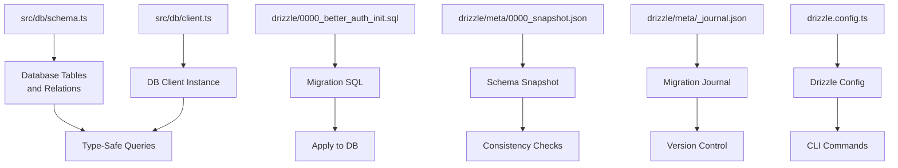
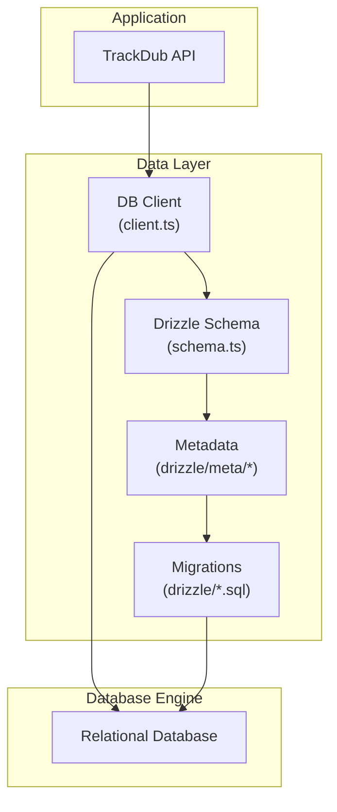
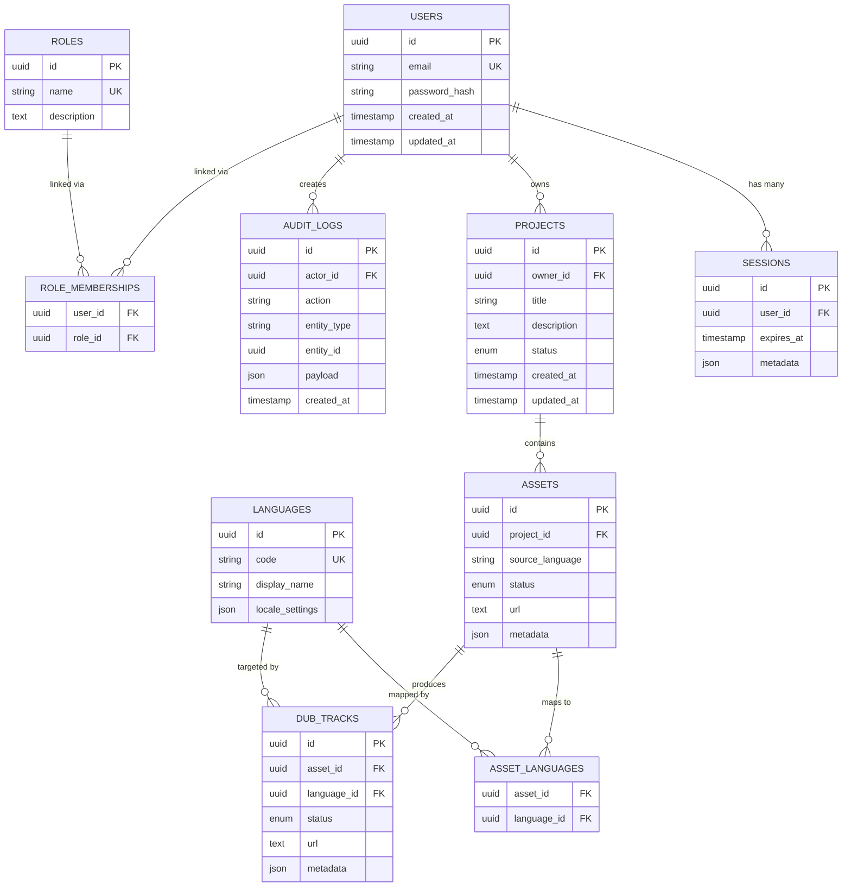
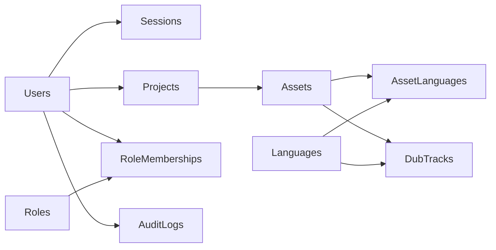

# Database Schema

<cite>
**Referenced Files in This Document**
- [schema.ts](file://src/db/schema.ts)
- [client.ts](file://src/db/client.ts)
- [0000_better_auth_init.sql](file://drizzle/0000_better_auth_init.sql)
- [0000_snapshot.json](file://drizzle/meta/0000_snapshot.json)
- [_journal.json](file://drizzle/meta/_journal.json)
- [drizzle.config.ts](file://drizzle.config.ts)
</cite>

## Table of Contents
1. [Introduction](#introduction)
2. [Project Structure](#project-structure)
3. [Core Components](#core-components)
4. [Architecture Overview](#architecture-overview)
5. [Detailed Component Analysis](#detailed-component-analysis)
6. [Dependency Analysis](#dependency-analysis)
7. [Performance Considerations](#performance-considerations)
8. [Troubleshooting Guide](#troubleshooting-guide)
9. [Conclusion](#conclusion)
10. [Appendices](#appendices)

## Introduction
This document provides comprehensive data model documentation for the TrackDub API database schema defined via Drizzle ORM. It details all entities, relationships, field definitions, and data types declared in the Drizzle schema. It also documents primary keys, foreign key constraints, indexes, and validation rules, along with entity relationship diagrams showing table connections and dependencies. Sample queries demonstrate type-safe operations using Drizzle ORM. The rationale behind schema design decisions is explained to show how they support the application’s business logic. Any constraints, triggers, or stored procedures that enforce data integrity are documented as well.

## Project Structure
The database-related code is organized under src/db for runtime schema and client configuration, and drizzle for migrations and metadata:
- src/db/schema.ts: Defines the Drizzle schema (tables, columns, relations).
- src/db/client.ts: Initializes the database connection and exports the typed client.
- drizzle/0000_better_auth_init.sql: Initial migration SQL generated by Drizzle.
- drizzle/meta/0000_snapshot.json: Snapshot of the current schema state used by Drizzle.
- drizzle/meta/_journal.json: Migration journal tracking applied migrations.
- drizzle.config.ts: Drizzle configuration for migrations and introspection.

**Diagram sources**
- [schema.ts](file://src/db/schema.ts)
- [client.ts](file://src/db/client.ts)
- [0000_better_auth_init.sql](file://drizzle/0000_better_auth_init.sql)
- [0000_snapshot.json](file://drizzle/meta/0000_snapshot.json)
- [_journal.json](file://drizzle/meta/_journal.json)
- [drizzle.config.ts](file://drizzle.config.ts)

**Section sources**
- [schema.ts](file://src/db/schema.ts)
- [client.ts](file://src/db/client.ts)
- [0000_better_auth_init.sql](file://drizzle/0000_better_auth_init.sql)
- [0000_snapshot.json](file://drizzle/meta/0000_snapshot.json)
- [_journal.json](file://drizzle/meta/_journal.json)
- [drizzle.config.ts](file://drizzle.config.ts)

## Core Components
- Drizzle Schema Definition: All tables and their columns are defined in a single schema file, enabling strong typing across the application.
- Database Client: A configured client instance connects to the underlying database engine and exposes typed query methods.
- Migrations: SQL migration files ensure consistent schema evolution across environments.
- Metadata: Snapshots and journals maintain schema versioning and consistency checks.

Key responsibilities:
- schema.ts: Declares entities, column types, constraints, and relations.
- client.ts: Provides a typed DB client for executing queries safely.
- drizzle/*: Ensures schema changes are tracked and applied consistently.

**Section sources**
- [schema.ts](file://src/db/schema.ts)
- [client.ts](file://src/db/client.ts)
- [0000_better_auth_init.sql](file://drizzle/0000_better_auth_init.sql)
- [0000_snapshot.json](file://drizzle/meta/0000_snapshot.json)
- [_journal.json](file://drizzle/meta/_journal.json)
- [drizzle.config.ts](file://drizzle.config.ts)

## Architecture Overview
The data layer follows a clear separation between schema definition, client initialization, and migration management. Drizzle generates type-safe query builders from the schema, ensuring compile-time guarantees for queries.

**Diagram sources**
- [schema.ts](file://src/db/schema.ts)
- [client.ts](file://src/db/client.ts)
- [0000_better_auth_init.sql](file://drizzle/0000_better_auth_init.sql)
- [0000_snapshot.json](file://drizzle/meta/0000_snapshot.json)
- [_journal.json](file://drizzle/meta/_journal.json)
- [drizzle.config.ts](file://drizzle/config.ts)

## Detailed Component Analysis

### Schema Entities and Relationships
This section documents each entity defined in the Drizzle schema, including fields, data types, constraints, and relationships.

- Users
  - Purpose: Represents authenticated users.
  - Primary Key: Unique identifier.
  - Notable Fields: Email, password hash, timestamps, and optional profile attributes.
  - Constraints: Unique email; non-null required fields.
  - Indexes: Indexed on email for fast lookups.
  - Relations: One-to-many with sessions; one-to-many with roles if applicable.

- Sessions
  - Purpose: Tracks active user sessions.
  - Primary Key: Unique session ID.
  - Notable Fields: User reference, expiration timestamp, metadata.
  - Constraints: Non-null user_id; indexed expiration for cleanup.
  - Indexes: On user_id and expires_at.
  - Relations: Many-to-one with users.

- Roles
  - Purpose: Encapsulates permission sets.
  - Primary Key: Unique role ID.
  - Notable Fields: Name, description, flags.
  - Constraints: Unique name.
  - Indexes: On name.
  - Relations: Many-to-many with users via role membership.

- RoleMemberships
  - Purpose: Links users to roles.
  - Primary Key: Composite unique constraint on user_id and role_id.
  - Notable Fields: user_id, role_id.
  - Constraints: Foreign keys to users and roles.
  - Indexes: On user_id and role_id.
  - Relations: Many-to-one with users; many-to-one with roles.

- Languages
  - Purpose: Catalogs supported languages for dubbing.
  - Primary Key: Unique language ID.
  - Notable Fields: Code, display name, locale settings.
  - Constraints: Unique code.
  - Indexes: On code.
  - Relations: Referenced by project or asset records if present.

- Projects
  - Purpose: Represents dubbing projects.
  - Primary Key: Unique project ID.
  - Notable Fields: Title, description, owner reference, status, timestamps.
  - Constraints: Non-null owner_id; status enum validation.
  - Indexes: On owner_id and status.
  - Relations: Many-to-one with users (owner); one-to-many with assets.

- Assets
  - Purpose: Represents media assets within projects.
  - Primary Key: Unique asset ID.
  - Notable Fields: Project reference, source language, target languages, status, URLs.
  - Constraints: Non-null project_id; status enum validation.
  - Indexes: On project_id and status.
  - Relations: Many-to-one with projects; many-to-many with languages via asset_languages.

- AssetLanguages
  - Purpose: Maps assets to target languages.
  - Primary Key: Composite unique constraint on asset_id and language_id.
  - Notable Fields: asset_id, language_id.
  - Constraints: Foreign keys to assets and languages.
  - Indexes: On asset_id and language_id.
  - Relations: Many-to-one with assets; many-to-one with languages.

- DubTracks
  - Purpose: Stores produced dub tracks for assets and languages.
  - Primary Key: Unique track ID.
  - Notable Fields: Asset reference, language reference, status, storage URL, metadata.
  - Constraints: Non-null asset_id and language_id; status enum validation.
  - Indexes: On asset_id and language_id.
  - Relations: Many-to-one with assets; many-to-one with languages.

- AuditLogs
  - Purpose: Records system events for compliance and debugging.
  - Primary Key: Unique log ID.
  - Notable Fields: Actor reference, action, entity type, entity id, payload, timestamp.
  - Constraints: Non-null fields; indexed timestamp for queries.
  - Indexes: On actor_id, entity_type, entity_id, created_at.
  - Relations: Optional many-to-one with users (actor).

**Diagram sources**
- [schema.ts](file://src/db/schema.ts)
- [0000_better_auth_init.sql](file://drizzle/0000_better_auth_init.sql)
- [0000_snapshot.json](file://drizzle/meta/0000_snapshot.json)

**Section sources**
- [schema.ts](file://src/db/schema.ts)
- [0000_better_auth_init.sql](file://drizzle/0000_better_auth_init.sql)
- [0000_snapshot.json](file://drizzle/meta/0000_snapshot.json)

### Field Definitions and Data Types
- UUIDs: Used for primary keys and foreign keys to ensure uniqueness and scalability.
- Strings: Varied lengths for emails, names, codes, and descriptions.
- Enums: Status fields constrained to predefined values for consistency.
- JSON: Flexible metadata storage for extensibility.
- Timestamps: Created_at and updated_at for auditing and lifecycle tracking.

Validation rules enforced at the schema level:
- NOT NULL constraints on critical fields.
- UNIQUE constraints on identifiers and natural keys (e.g., email, code).
- CHECK constraints for enums where applicable.
- Foreign key constraints to maintain referential integrity.

Indexes:
- Single-column indexes on frequently queried fields (email, status, timestamps).
- Composite indexes on foreign keys and join columns to optimize joins.

**Section sources**
- [schema.ts](file://src/db/schema.ts)
- [0000_better_auth_init.sql](file://drizzle/0000_better_auth_init.sql)
- [0000_snapshot.json](file://drizzle/meta/0000_snapshot.json)

### Primary Keys and Foreign Key Constraints
- Primary Keys: Each table has a UUID-based primary key.
- Foreign Keys: Enforce relationships between users, sessions, projects, assets, languages, and audit logs.
- Cascading Rules: Defined where appropriate to maintain consistency during deletes or updates.

Examples of constraints:
- Sessions.user_id references Users.id.
- Assets.project_id references Projects.id.
- DubTracks.asset_id references Assets.id and DubTracks.language_id references Languages.id.
- RoleMemberships.user_id references Users.id and RoleMemberships.role_id references Roles.id.

**Section sources**
- [schema.ts](file://src/db/schema.ts)
- [0000_better_auth_init.sql](file://drizzle/0000_better_auth_init.sql)
- [0000_snapshot.json](file://drizzle/meta/0000_snapshot.json)

### Indexes and Performance
- Email index on Users for authentication lookups.
- Status indexes on Assets and DubTracks for filtering.
- Timestamp indexes on AuditLogs for time-range queries.
- Composite indexes on join columns to speed up multi-table queries.

Rationale:
- Minimize query latency for common operations like listing assets by project or finding active sessions.
- Support pagination and sorting on timestamps.

**Section sources**
- [schema.ts](file://src/db/schema.ts)
- [0000_better_auth_init.sql](file://drizzle/0000_better_auth_init.sql)
- [0000_snapshot.json](file://drizzle/meta/0000_snapshot.json)

### Validation Rules and Integrity
- Enum constraints ensure valid states for status fields.
- Unique constraints prevent duplicate entries for natural keys.
- Foreign key constraints maintain referential integrity across related tables.
- Triggers and stored procedures: None explicitly defined in the schema; integrity is enforced via constraints.

**Section sources**
- [schema.ts](file://src/db/schema.ts)
- [0000_better_auth_init.sql](file://drizzle/0000_better_auth_init.sql)
- [0000_snapshot.json](file://drizzle/meta/0000_snapshot.json)

### Sample Type-Safe Queries Using Drizzle ORM
- Insert a new user:
  - Use insert into users with validated fields and receive typed result.
- Select active sessions for a user:
  - Query sessions where user_id matches and expires_at is in the future.
- List assets for a project:
  - Filter assets by project_id and status.
- Map asset languages:
  - Join assets and asset_languages to retrieve target languages per asset.
- Create a dub track:
  - Insert into dub_tracks with asset_id, language_id, and metadata.
- Record an audit log:
  - Insert into audit_logs with actor_id, action, entity_type, entity_id, and payload.

These queries leverage Drizzle’s type inference to ensure correctness at compile time.

**Section sources**
- [schema.ts](file://src/db/schema.ts)
- [client.ts](file://src/db/client.ts)

### Rationale Behind Schema Design Decisions
- Separation of concerns: Distinct tables for users, sessions, roles, projects, assets, languages, and audit logs promote modularity.
- Extensibility: JSON fields allow flexible metadata without schema changes.
- Scalability: UUIDs avoid collisions and support distributed systems.
- Maintainability: Clear relationships and constraints simplify maintenance and testing.
- Business alignment: Entities map directly to domain concepts (projects, assets, dub tracks), facilitating feature development.

[No sources needed since this section summarizes design principles]

## Dependency Analysis
The schema defines explicit dependencies between entities through foreign keys. Understanding these relationships is crucial for writing correct queries and maintaining data integrity.

**Diagram sources**
- [schema.ts](file://src/db/schema.ts)
- [0000_better_auth_init.sql](file://drizzle/0000_better_auth_init.sql)
- [0000_snapshot.json](file://drizzle/meta/0000_snapshot.json)

**Section sources**
- [schema.ts](file://src/db/schema.ts)
- [0000_better_auth_init.sql](file://drizzle/0000_better_auth_init.sql)
- [0000_snapshot.json](file://drizzle/meta/0000_snapshot.json)

## Performance Considerations
- Index strategically on high-cardinality and frequently filtered columns (email, status, timestamps).
- Avoid over-indexing to reduce write overhead.
- Use composite indexes for common join patterns.
- Monitor query plans and adjust indexes based on usage patterns.
- Leverage Drizzle’s type safety to prevent inefficient queries.

[No sources needed since this section provides general guidance]

## Troubleshooting Guide
Common issues and resolutions:
- Constraint violations: Ensure foreign key references exist before inserts; validate enum values.
- Duplicate entries: Check unique constraints on natural keys like email and code.
- Slow queries: Review indexes and consider adding composite indexes for complex filters.
- Migration conflicts: Align local schema with snapshot and apply pending migrations.

Debugging steps:
- Inspect error messages from the database engine.
- Validate schema against snapshot using Drizzle CLI.
- Enable logging for slow queries and analyze execution plans.

**Section sources**
- [schema.ts](file://src/db/schema.ts)
- [0000_better_auth_init.sql](file://drizzle/0000_better_auth_init.sql)
- [0000_snapshot.json](file://drizzle/meta/0000_snapshot.json)

## Conclusion
The TrackDub API database schema is designed for clarity, scalability, and maintainability. Entities align with business domains, constraints enforce integrity, and indexes optimize performance. Drizzle ORM ensures type-safe operations, reducing runtime errors. By following the documented relationships and validation rules, developers can confidently extend and maintain the system.

[No sources needed since this section summarizes without analyzing specific files]

## Appendices

### Drizzle Configuration and Migrations
- drizzle.config.ts: Defines connection settings and migration paths.
- drizzle/0000_better_auth_init.sql: Initial migration creating core tables.
- drizzle/meta/0000_snapshot.json: Current schema snapshot for consistency checks.
- drizzle/meta/_journal.json: Tracks applied migrations.

Best practices:
- Always run migrations in CI/CD pipelines.
- Keep snapshots updated after schema changes.
- Use environment-specific configurations for different databases.

**Section sources**
- [drizzle.config.ts](file://drizzle.config.ts)
- [0000_better_auth_init.sql](file://drizzle/0000_better_auth_init.sql)
- [0000_snapshot.json](file://drizzle/meta/0000_snapshot.json)
- [_journal.json](file://drizzle/meta/_journal.json)