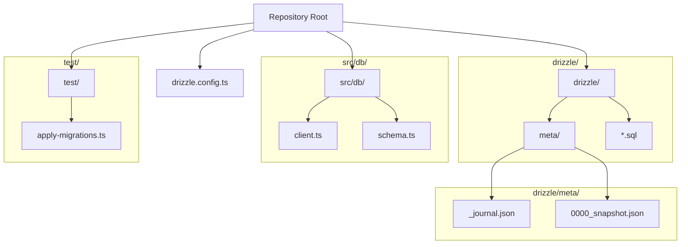
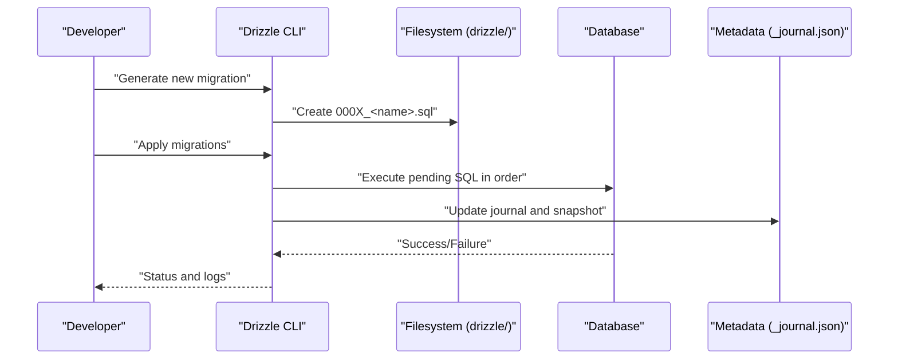
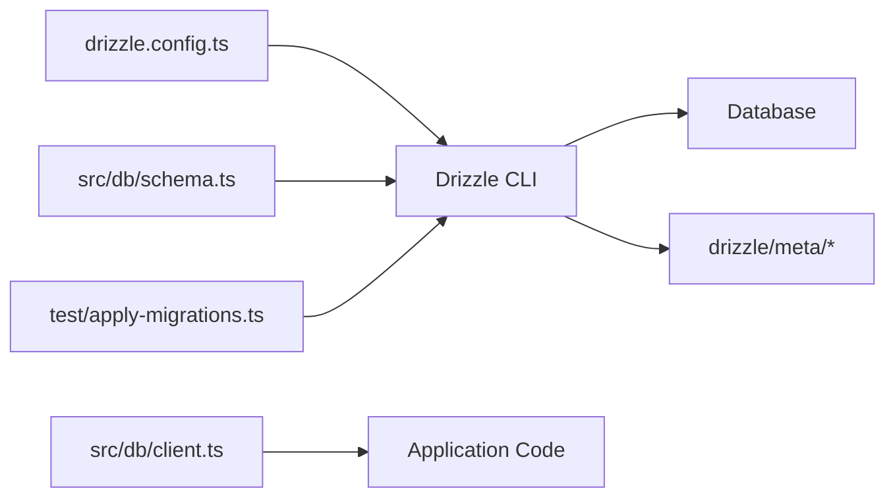

# Migrations

<cite>
**Referenced Files in This Document**
- [drizzle.config.ts](file://drizzle.config.ts)
- [0000_better_auth_init.sql](file://drizzle/0000_better_auth_init.sql)
- [_journal.json](file://drizzle/meta/_journal.json)
- [0000_snapshot.json](file://drizzle/meta/0000_snapshot.json)
- [client.ts](file://src/db/client.ts)
- [schema.ts](file://src/db/schema.ts)
- [apply-migrations.ts](file://test/apply-migrations.ts)
- [vitest.config.ts](file://vitest.config.ts)
</cite>

## Table of Contents
1. [Introduction](#introduction)
2. [Project Structure](#project-structure)
3. [Core Components](#core-components)
4. [Architecture Overview](#architecture-overview)
5. [Detailed Component Analysis](#detailed-component-analysis)
6. [Dependency Analysis](#dependency-analysis)
7. [Performance Considerations](#performance-considerations)
8. [Troubleshooting Guide](#troubleshooting-guide)
9. [Conclusion](#conclusion)
10. [Appendices](#appendices)

## Introduction
This document explains the Drizzle-based migration system used by the project. It covers how migrations are organized, named, and versioned; how to create and apply them in development and production; and how rollbacks are handled. It also includes common migration patterns, testing strategies, environment-specific considerations, and troubleshooting guidance. The goal is to make migration workflows predictable, safe, and easy to maintain across environments.

## Project Structure
The migration system centers around the drizzle directory for SQL files and metadata, a configuration file at the repository root, and a test utility that applies migrations during tests.

**Diagram sources**
- [drizzle.config.ts:1-200](file://drizzle.config.ts#L1-L200)
- [0000_better_auth_init.sql:1-200](file://drizzle/0000_better_auth_init.sql#L1-L200)
- [_journal.json:1-200](file://drizzle/meta/_journal.json#L1-L200)
- [0000_snapshot.json:1-200](file://drizzle/meta/0000_snapshot.json#L1-L200)
- [client.ts:1-200](file://src/db/client.ts#L1-L200)
- [schema.ts:1-200](file://src/db/schema.ts#L1-L200)
- [apply-migrations.ts:1-200](file://test/apply-migrations.ts#L1-L200)

**Section sources**
- [drizzle.config.ts:1-200](file://drizzle.config.ts#L1-L200)
- [0000_better_auth_init.sql:1-200](file://drizzle/0000_better_auth_init.sql#L1-L200)
- [_journal.json:1-200](file://drizzle/meta/_journal.json#L1-L200)
- [0000_snapshot.json:1-200](file://drizzle/meta/0000_snapshot.json#L1-L200)
- [client.ts:1-200](file://src/db/client.ts#L1-L200)
- [schema.ts:1-200](file://src/db/schema.ts#L1-L200)
- [apply-migrations.ts:1-200](file://test/apply-migrations.ts#L1-L200)

## Core Components
- Migration configuration: Defines the database connection, driver, schema source, and output directories for SQL and metadata.
- Migration files: SQL scripts under drizzle/, each representing a single change set with a numeric prefix for ordering.
- Metadata: JSON files under drizzle/meta/ that track snapshots and journal entries for versioning and integrity checks.
- Database client: Initializes the Drizzle client using environment variables and connects to the target database.
- Schema definitions: TypeScript schema used as the source of truth for generating migrations or validating state.
- Test migration application: Utility to apply pending migrations before running tests.

Key responsibilities:
- Ensure deterministic ordering via zero-padded numeric prefixes.
- Maintain consistency between schema definitions and applied SQL migrations.
- Provide a repeatable process for applying migrations in CI and local environments.

**Section sources**
- [drizzle.config.ts:1-200](file://drizzle.config.ts#L1-L200)
- [client.ts:1-200](file://src/db/client.ts#L1-L200)
- [schema.ts:1-200](file://src/db/schema.ts#L1-L200)
- [apply-migrations.ts:1-200](file://test/apply-migrations.ts#L1-L200)

## Architecture Overview
The migration workflow integrates configuration, SQL migration files, metadata tracking, and runtime application through the Drizzle CLI and Node.js utilities.

**Diagram sources**
- [drizzle.config.ts:1-200](file://drizzle.config.ts#L1-L200)
- [0000_better_auth_init.sql:1-200](file://drizzle/0000_better_auth_init.sql#L1-L200)
- [_journal.json:1-200](file://drizzle/meta/_journal.json#L1-L200)

## Detailed Component Analysis

### Migration Configuration
- Purpose: Centralizes database connection details, driver selection, schema path, and output directories for SQL and metadata.
- Typical settings include:
  - Database URL from environment variables
  - Driver type (e.g., mysql, postgres, sqlite)
  - Schema source path for generation/validation
  - Output paths for generated SQL and metadata
- Environment variables should be provided per environment (development, staging, production).

Operational notes:
- Ensure the configured database user has sufficient privileges to create/alter tables and write to the migration tracking table.
- Keep secrets out of version control; use environment injection at runtime.

**Section sources**
- [drizzle.config.ts:1-200](file://drizzle.config.ts#L1-L200)

### Migration Files and Naming Conventions
- Location: drizzle/*.sql
- Naming: Zero-padded numeric prefix followed by an underscore and descriptive name (e.g., 0000_better_auth_init.sql).
- Ordering: Deterministic based on the numeric prefix; always increment the next number when creating new migrations.
- Content: Each file should contain idempotent, reversible changes where possible. Use transactions if supported by the driver to ensure atomicity.

Best practices:
- One logical change per migration file.
- Avoid destructive operations without safeguards.
- Include comments explaining intent and dependencies.

**Section sources**
- [0000_better_auth_init.sql:1-200](file://drizzle/0000_better_auth_init.sql#L1-L200)

### Version Management and Metadata
- Journal: drizzle/meta/_journal.json tracks applied migrations and their checksums.
- Snapshots: drizzle/meta/<version>_snapshot.json captures schema state after each migration.
- Integrity: Drizzle uses these files to detect drift and enforce consistent state across environments.

Guidelines:
- Commit both SQL files and metadata to version control.
- Never manually edit metadata; rely on the CLI to update it.
- Re-generate snapshots only via the CLI to avoid inconsistencies.

**Section sources**
- [_journal.json:1-200](file://drizzle/meta/_journal.json#L1-L200)
- [0000_snapshot.json:1-200](file://drizzle/meta/0000_snapshot.json#L1-L200)

### Database Client Integration
- Purpose: Establishes the Drizzle client connection using environment variables and exposes it to the application.
- Responsibilities:
  - Read database URL and driver settings from environment
  - Initialize the client once and reuse connections
  - Handle connection errors gracefully

Integration points:
- Used by application code to execute queries against the migrated schema.
- Should be initialized early in the application lifecycle.

**Section sources**
- [client.ts:1-200](file://src/db/client.ts#L1-L200)

### Schema Definitions
- Purpose: TypeScript schema defines tables, columns, constraints, and relationships.
- Usage:
  - Source of truth for generating migrations or validating state
  - Can be used alongside SQL migrations for hybrid workflows

Recommendations:
- Keep schema definitions aligned with applied migrations.
- Use schema validation in tests to catch drift early.

**Section sources**
- [schema.ts:1-200](file://src/db/schema.ts#L1-L200)

### Test Suite Integration
- Utility: test/apply-migrations.ts applies pending migrations before running tests.
- Benefits:
  - Ensures tests run against a fresh, consistent schema
  - Isolates test runs from manual migration steps

Workflow:
- Tests invoke the utility to apply migrations
- Drizzle CLI executes SQL in order and updates metadata
- Tests proceed against the prepared database

**Section sources**
- [apply-migrations.ts:1-200](file://test/apply-migrations.ts#L1-L200)
- [vitest.config.ts:1-200](file://vitest.config.ts#L1-L200)

## Dependency Analysis
The migration system depends on configuration, schema definitions, and the database client. Tests depend on the migration utility to prepare the environment.

**Diagram sources**
- [drizzle.config.ts:1-200](file://drizzle.config.ts#L1-L200)
- [schema.ts:1-200](file://src/db/schema.ts#L1-L200)
- [client.ts:1-200](file://src/db/client.ts#L1-L200)
- [apply-migrations.ts:1-200](file://test/apply-migrations.ts#L1-L200)
- [_journal.json:1-200](file://drizzle/meta/_journal.json#L1-L200)

**Section sources**
- [drizzle.config.ts:1-200](file://drizzle.config.ts#L1-L200)
- [schema.ts:1-200](file://src/db/schema.ts#L1-L200)
- [client.ts:1-200](file://src/db/client.ts#L1-L200)
- [apply-migrations.ts:1-200](file://test/apply-migrations.ts#L1-L200)

## Performance Considerations
- Batch operations: Group multiple statements within a transaction to reduce round-trips.
- Index management: Add indexes judiciously; consider rebuilding large tables during off-peak hours.
- Connection pooling: Ensure the client uses appropriate pool sizes for your workload.
- Migration size: Keep individual migrations focused to minimize lock times and rollback complexity.

[No sources needed since this section provides general guidance]

## Troubleshooting Guide
Common issues and resolutions:
- Missing environment variables: Ensure DATABASE_URL and any driver-specific settings are set correctly in each environment.
- Permission errors: Verify the database user has CREATE/ALTER/DROP privileges as required by your migrations.
- Drift detection failures: Do not manually edit metadata; re-run the CLI to regenerate consistent snapshots.
- Transaction failures: Wrap complex migrations in transactions if supported; verify driver capabilities.
- Test environment mismatches: Confirm the test utility applies migrations before tests and that the test database is isolated.

Diagnostic steps:
- Inspect _journal.json for applied versions and checksums.
- Review migration SQL for syntax errors or unsupported features.
- Validate schema definitions against the current database state.

**Section sources**
- [_journal.json:1-200](file://drizzle/meta/_journal.json#L1-L200)
- [apply-migrations.ts:1-200](file://test/apply-migrations.ts#L1-L200)

## Conclusion
The Drizzle migration system provides a robust, versioned approach to managing database schema changes. By adhering to naming conventions, maintaining metadata, and integrating migrations into both development and test workflows, teams can ensure reliable deployments and consistent environments. Following the best practices outlined here will help prevent drift, simplify rollbacks, and improve overall database reliability.

[No sources needed since this section summarizes without analyzing specific files]

## Appendices

### Creating New Migrations
Steps:
- Create a new SQL file under drizzle/ with a zero-padded numeric prefix and descriptive name.
- Implement the necessary DDL/DML changes.
- Run the Drizzle CLI to apply and update metadata.
- Commit both the SQL file and updated metadata.

Environment-specific considerations:
- Development: Frequent iterations; use local databases for rapid feedback.
- Staging/Production: Validate migrations thoroughly; prefer additive changes and backfills.

**Section sources**
- [drizzle.config.ts:1-200](file://drizzle.config.ts#L1-L200)
- [0000_better_auth_init.sql:1-200](file://drizzle/0000_better_auth_init.sql#L1-L200)

### Applying Migrations
Development:
- Apply locally using the CLI against a development database.
- Verify schema changes and run tests.

Production:
- Apply via CI/CD pipeline or a controlled deployment step.
- Monitor execution logs and database metrics.

Rollbacks:
- Prefer additive changes and deprecate old fields gradually.
- If rollback is necessary, create a reverse migration that undoes changes safely.

**Section sources**
- [apply-migrations.ts:1-200](file://test/apply-migrations.ts#L1-L200)

### Common Migration Patterns
- Adding a table: Define structure, constraints, and indexes; ensure default values and foreign keys are correct.
- Modifying a column: Add new columns first, backfill data, then switch references and drop old columns in a subsequent migration.
- Data transformations: Use batched updates within transactions; handle partial failures and retries.

**Section sources**
- [schema.ts:1-200](file://src/db/schema.ts#L1-L200)

### Testing Strategies
- Pre-test setup: Apply migrations before running tests using the utility.
- Isolation: Use separate test databases to avoid cross-test contamination.
- Assertions: Validate schema state and data integrity post-migration.

**Section sources**
- [apply-migrations.ts:1-200](file://test/apply-migrations.ts#L1-L200)
- [vitest.config.ts:1-200](file://vitest.config.ts#L1-L200)