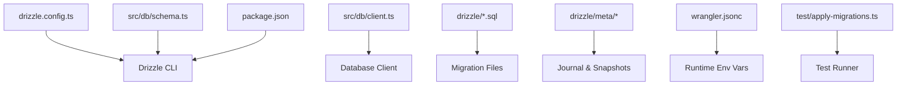
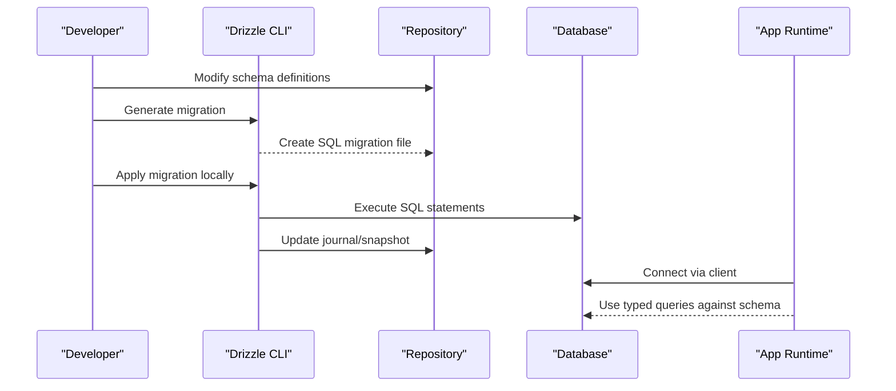
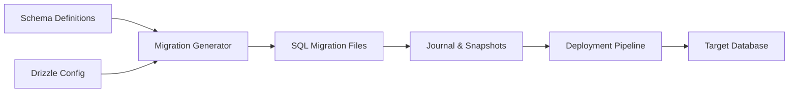

# Database Migrations

<cite>
**Referenced Files in This Document**
- [drizzle.config.ts](file://drizzle.config.ts)
- [package.json](file://package.json)
- [wrangler.jsonc](file://wrangler.jsonc)
- [src/db/client.ts](file://src/db/client.ts)
- [src/db/schema.ts](file://src/db/schema.ts)
- [drizzle/0000_better_auth_init.sql](file://drizzle/0000_better_auth_init.sql)
- [drizzle/meta/_journal.json](file://drizzle/meta/_journal.json)
- [drizzle/meta/0000_snapshot.json](file://drizzle/meta/0000_snapshot.json)
- [test/apply-migrations.ts](file://test/apply-migrations.ts)
</cite>

## Table of Contents
1. [Introduction](#introduction)
2. [Project Structure](#project-structure)
3. [Core Components](#core-components)
4. [Architecture Overview](#architecture-overview)
5. [Detailed Component Analysis](#detailed-component-analysis)
6. [Dependency Analysis](#dependency-analysis)
7. [Performance Considerations](#performance-considerations)
8. [Troubleshooting Guide](#troubleshooting-guide)
9. [Conclusion](#conclusion)
10. [Appendices](#appendices)

## Introduction
This document explains how to manage database migrations for the TrackDub API using Drizzle ORM. It covers the end-to-end migration workflow: creating new migrations, applying them locally and in production, managing schema versions, and handling team collaboration scenarios such as conflicts and rollbacks. It also provides guidance on testing migrations and automating deployments with CI/CD.

## Project Structure
The project uses Drizzle’s standard layout for SQL migrations and metadata, alongside TypeScript configuration files that define how Drizzle connects to the database and how CLI commands are executed. Key locations include:
- drizzle/: Contains generated SQL migration files and Drizzle snapshot/journal metadata.
- src/db/: Contains the database client and schema definitions used by Drizzle.
- drizzle.config.ts: Drizzle configuration file (database connection, dialect, schema paths).
- package.json: Scripts for running Drizzle commands.
- wrangler.jsonc: Cloudflare Workers configuration that may influence environment variables during deployment.
- test/apply-migrations.ts: Test utility to apply migrations in a test environment.

**Diagram sources**
- [drizzle.config.ts](file://drizzle.config.ts)
- [src/db/schema.ts](file://src/db/schema.ts)
- [src/db/client.ts](file://src/db/client.ts)
- [drizzle/0000_better_auth_init.sql](file://drizzle/0000_better_auth_init.sql)
- [drizzle/meta/_journal.json](file://drizzle/meta/_journal.json)
- [drizzle/meta/0000_snapshot.json](file://drizzle/meta/0000_snapshot.json)
- [package.json](file://package.json)
- [wrangler.jsonc](file://wrangler.jsonc)
- [test/apply-migrations.ts](file://test/apply-migrations.ts)

**Section sources**
- [drizzle.config.ts](file://drizzle.config.ts)
- [package.json](file://package.json)
- [wrangler.jsonc](file://wrangler.jsonc)
- [src/db/client.ts](file://src/db/client.ts)
- [src/db/schema.ts](file://src/db/schema.ts)
- [drizzle/0000_better_auth_init.sql](file://drizzle/0000_better_auth_init.sql)
- [drizzle/meta/_journal.json](file://drizzle/meta/_journal.json)
- [drizzle/meta/0000_snapshot.json](file://drizzle/meta/0000_snapshot.json)
- [test/apply-migrations.ts](file://test/apply-migrations.ts)

## Core Components
- Drizzle Configuration: Defines database connection details, dialect, and schema paths for generating and applying migrations.
- Schema Definitions: Centralized type-safe schema definitions used to generate migrations.
- Migration Files: SQL files under drizzle/ representing incremental changes to the database schema.
- Journal and Snapshots: Metadata tracking applied migrations and current schema state.
- Test Utilities: Helpers to apply migrations in tests to ensure consistency between code and DB state.

**Section sources**
- [drizzle.config.ts](file://drizzle.config.ts)
- [src/db/schema.ts](file://src/db/schema.ts)
- [drizzle/0000_better_auth_init.sql](file://drizzle/0000_better_auth_init.sql)
- [drizzle/meta/_journal.json](file://drizzle/meta/_journal.json)
- [drizzle/meta/0000_snapshot.json](file://drizzle/meta/0000_snapshot.json)
- [test/apply-migrations.ts](file://test/apply-migrations.ts)

## Architecture Overview
The migration architecture centers around Drizzle CLI and the application’s database client. Developers modify schema definitions, generate SQL migrations, and apply them via CLI or automated scripts. The journal tracks which migrations have been applied, ensuring idempotent upgrades.

**Diagram sources**
- [src/db/schema.ts](file://src/db/schema.ts)
- [drizzle.config.ts](file://drizzle.config.ts)
- [drizzle/0000_better_auth_init.sql](file://drizzle/0000_better_auth_init.sql)
- [drizzle/meta/_journal.json](file://drizzle/meta/_journal.json)
- [drizzle/meta/0000_snapshot.json](file://drizzle/meta/0000_snapshot.json)
- [src/db/client.ts](file://src/db/client.ts)

## Detailed Component Analysis

### Drizzle Configuration
- Purpose: Configure Drizzle CLI and runtime connection settings, including dialect, database URL, and schema source paths.
- Typical options:
  - dialect: Specifies the database engine (e.g., SQLite, PostgreSQL).
  - dbCredentials: Connection parameters such as host, port, user, password, and database name.
  - schema: Paths to TypeScript schema files used for generation.
  - out: Output directory for migration files.
- Environment integration: Values often come from environment variables; ensure they are set locally and in production.

Best practices:
- Keep sensitive credentials out of version control; use environment variables.
- Pin dialect and driver versions to avoid unexpected behavior across environments.
- Validate configuration at startup to catch misconfigurations early.

**Section sources**
- [drizzle.config.ts](file://drizzle.config.ts)
- [src/db/client.ts](file://src/db/client.ts)

### Schema Definitions
- Purpose: Define tables, columns, constraints, and relationships in a type-safe manner.
- Benefits:
  - Drizzle generates consistent SQL based on these definitions.
  - Strong typing reduces drift between code and database.
- Common patterns:
  - Primary keys and unique constraints.
  - Foreign keys and indexes.
  - Default values and nullable fields.

When modifying schema:
- Make small, focused changes per migration.
- Add comments explaining intent and context.
- Ensure backward compatibility when possible (e.g., add columns before removing defaults).

**Section sources**
- [src/db/schema.ts](file://src/db/schema.ts)

### Migration Files and Metadata
- Migration files:
  - Located under drizzle/.
  - Named with numeric prefixes to enforce ordering.
  - Contain raw SQL statements to evolve the schema.
- Journal and snapshots:
  - _journal.json tracks applied migrations and their order.
  - Snapshot files represent the schema state at each migration step.

Workflow:
- Generate migration from schema changes.
- Review generated SQL for correctness.
- Apply migration to target databases.
- Commit both SQL and metadata to version control.

Rollback strategy:
- Drizzle does not auto-generate rollback SQL.
- Maintain manual rollback scripts if needed.
- Prefer additive changes to minimize rollback complexity.

**Section sources**
- [drizzle/0000_better_auth_init.sql](file://drizzle/0000_better_auth_init.sql)
- [drizzle/meta/_journal.json](file://drizzle/meta/_journal.json)
- [drizzle/meta/0000_snapshot.json](file://drizzle/meta/0000_snapshot.json)

### Applying Migrations Locally and in Production
Local development:
- Set up local database and environment variables.
- Run Drizzle CLI to apply migrations.
- Verify schema state and run tests.

Production deployment:
- Integrate migration steps into CI/CD pipeline.
- Apply migrations before deploying application code.
- Monitor execution logs and errors.

Automation strategies:
- Use pre-deploy hooks to run migrations.
- Guard deployments with health checks post-migration.
- Implement feature flags to decouple schema changes from code releases.

**Section sources**
- [package.json](file://package.json)
- [wrangler.jsonc](file://wrangler.jsonc)
- [test/apply-migrations.ts](file://test/apply-migrations.ts)

### Testing Migrations
- Unit tests:
  - Apply migrations in an isolated test database.
  - Assert schema structure and constraints.
- Integration tests:
  - Seed data and execute queries against migrated schema.
  - Validate query results and error handling.
- Best practices:
  - Reset test database state between runs.
  - Use fixtures for predictable data.
  - Fail fast on migration errors.

**Section sources**
- [test/apply-migrations.ts](file://test/apply-migrations.ts)

### Common Migration Scenarios
- Adding a table:
  - Define table in schema.
  - Generate migration.
  - Apply and verify.
- Modifying a column:
  - Add new column with default value.
  - Backfill existing data if necessary.
  - Drop old column in a subsequent migration.
- Data backfills:
  - Write idempotent UPDATE statements.
  - Batch large updates to avoid long locks.
  - Log progress for observability.

**Section sources**
- [src/db/schema.ts](file://src/db/schema.ts)
- [drizzle/0000_better_auth_init.sql](file://drizzle/0000_better_auth_init.sql)

### Rollback Procedures
- Preferred approach:
  - Design additive migrations to avoid rollbacks.
  - Use feature flags to toggle behavior without reverting schema.
- If rollback is required:
  - Create a reverse migration manually.
  - Test rollback thoroughly in staging.
  - Coordinate with team to minimize downtime.

**Section sources**
- [drizzle/meta/_journal.json](file://drizzle/meta/_journal.json)

### Handling Migration Conflicts in Teams
- Branching strategy:
  - Create feature branches for schema changes.
  - Rebase frequently to incorporate upstream changes.
- Conflict resolution:
  - Merge conflicting migrations carefully.
  - Ensure ordering remains correct.
  - Run full migration suite after merge.
- Communication:
  - Discuss schema changes in PRs.
  - Document breaking changes and timelines.

**Section sources**
- [drizzle/meta/_journal.json](file://drizzle/meta/_journal.json)

## Dependency Analysis
Migrations depend on:
- Drizzle CLI and configuration.
- Schema definitions for generating SQL.
- Environment variables for database connectivity.
- CI/CD pipelines for automated application.

**Diagram sources**
- [src/db/schema.ts](file://src/db/schema.ts)
- [drizzle.config.ts](file://drizzle.config.ts)
- [drizzle/0000_better_auth_init.sql](file://drizzle/0000_better_auth_init.sql)
- [drizzle/meta/_journal.json](file://drizzle/meta/_journal.json)

**Section sources**
- [src/db/schema.ts](file://src/db/schema.ts)
- [drizzle.config.ts](file://drizzle.config.ts)
- [drizzle/0000_better_auth_init.sql](file://drizzle/0000_better_auth_init.sql)
- [drizzle/meta/_journal.json](file://drizzle/meta/_journal.json)

## Performance Considerations
- Large backfills:
  - Use batched updates to reduce lock contention.
  - Schedule during low-traffic windows.
- Indexes:
  - Add indexes judiciously to support queries.
  - Monitor index usage and remove unused ones.
- Transaction boundaries:
  - Group related changes in transactions where supported.
  - Avoid long-running transactions in production.

[No sources needed since this section provides general guidance]

## Troubleshooting Guide
Common issues and resolutions:
- Connection failures:
  - Verify environment variables and network access.
  - Check credentials and permissions.
- Migration errors:
  - Inspect generated SQL for syntax issues.
  - Confirm schema state matches expectations.
- Conflicts:
  - Resolve ordering and dependencies.
  - Re-run migration suite after fixes.

Debugging tips:
- Enable verbose logging for Drizzle CLI.
- Compare snapshots to identify drift.
- Use staging environments to validate changes.

**Section sources**
- [src/db/client.ts](file://src/db/client.ts)
- [drizzle/meta/_journal.json](file://drizzle/meta/_journal.json)

## Conclusion
Adopting a disciplined migration workflow ensures reliable schema evolution for the TrackDub API. By leveraging Drizzle’s type-safe schema definitions, generating explicit SQL migrations, and integrating automation into CI/CD, teams can maintain consistency across environments and reduce risk during deployments. Prioritize additive changes, test thoroughly, and communicate effectively to handle team collaboration and conflicts smoothly.

[No sources needed since this section summarizes without analyzing specific files]

## Appendices

### Migration Workflow Checklist
- Define schema changes in TypeScript.
- Generate migration and review SQL.
- Apply locally and run tests.
- Commit migration and metadata.
- Automate application in CI/CD.
- Monitor and validate post-deployment.

**Section sources**
- [package.json](file://package.json)
- [test/apply-migrations.ts](file://test/apply-migrations.ts)

### Example Commands
- Generate migration:
  - Use Drizzle CLI command to create SQL from schema changes.
- Apply migration:
  - Run Drizzle CLI to execute SQL against target database.
- Reset local database:
  - Drop and recreate database, then apply migrations.

Note: Replace placeholders with actual commands configured in your environment.

**Section sources**
- [package.json](file://package.json)