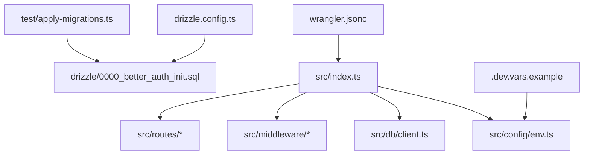
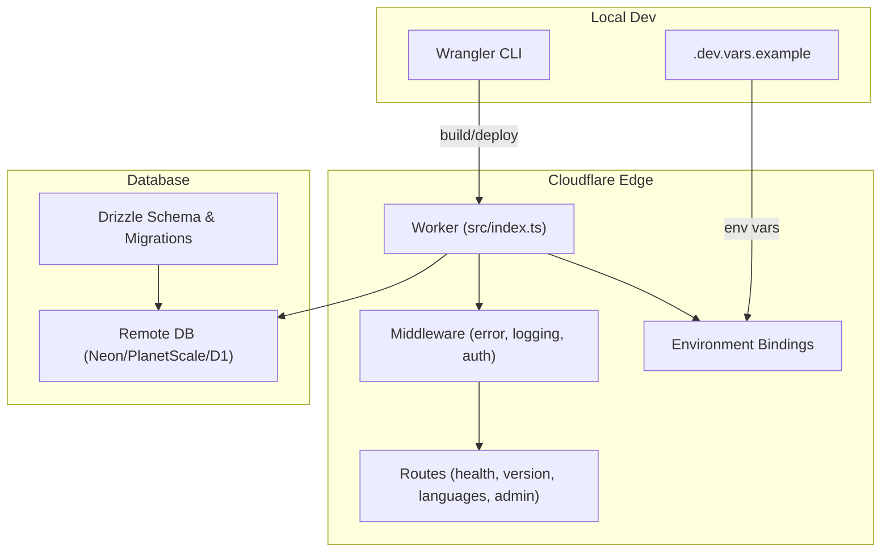
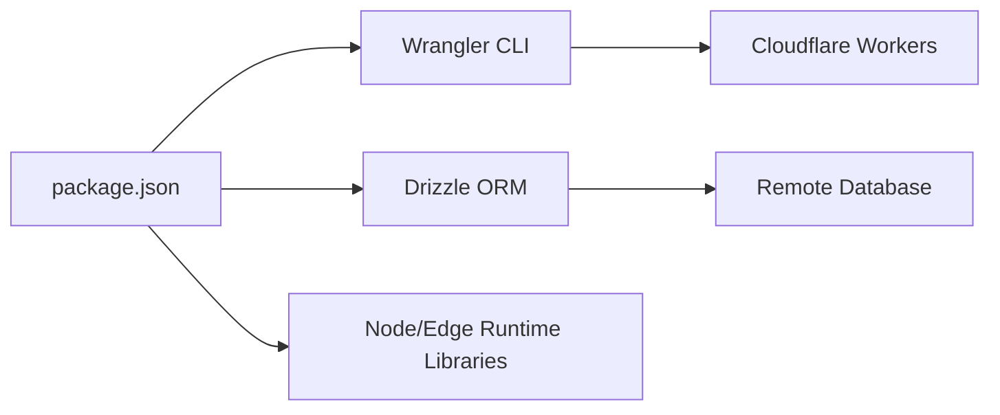

# Deployment Guide

<cite>
**Referenced Files in This Document**
- [wrangler.jsonc](file://wrangler.jsonc)
- [package.json](file://package.json)
- [drizzle.config.ts](file://drizzle.config.ts)
- [.dev.vars.example](file://.dev.vars.example)
- [src/index.ts](file://src/index.ts)
- [src/config/env.ts](file://src/config/env.ts)
- [src/db/client.ts](file://src/db/client.ts)
- [drizzle/0000_better_auth_init.sql](file://drizzle/0000_better_auth_init.sql)
- [drizzle/meta/_journal.json](file://drizzle/meta/_journal.json)
- [test/apply-migrations.ts](file://test/apply-migrations.ts)
- [src/middleware/error.ts](file://src/middleware/error.ts)
- [src/lib/logger.ts](file://src/lib/logger.ts)
</cite>

## Table of Contents
1. [Introduction](#introduction)
2. [Project Structure](#project-structure)
3. [Core Components](#core-components)
4. [Architecture Overview](#architecture-overview)
5. [Detailed Component Analysis](#detailed-component-analysis)
6. [Dependency Analysis](#dependency-analysis)
7. [Performance Considerations](#performance-considerations)
8. [Troubleshooting Guide](#troubleshooting-guide)
9. [Conclusion](#conclusion)
10. [Appendices](#appendices)

## Introduction
This guide provides a comprehensive deployment workflow for the TrackDub API on Cloudflare Workers using the Wrangler CLI. It covers environment configuration across development, staging, and production; database migration strategies with Drizzle ORM; build and asset optimization for serverless; security hardening; monitoring and alerting; rollback and blue-green deployment patterns; disaster recovery; scaling and cost optimization; and troubleshooting tailored to Cloudflare’s edge network.

## Project Structure
The project is organized into clear layers:
- Entry point and runtime configuration
- Environment variables and secrets management
- Database client and schema migrations
- Middleware for error handling, logging, and request processing
- Routes for health, version, languages, and admin endpoints
- Tests including a migration runner utility

**Diagram sources**
- [wrangler.jsonc](file://wrangler.jsonc)
- [src/index.ts](file://src/index.ts)
- [src/config/env.ts](file://src/config/env.ts)
- [src/db/client.ts](file://src/db/client.ts)
- [drizzle.config.ts](file://drizzle.config.ts)
- [drizzle/0000_better_auth_init.sql](file://drizzle/0000_better_auth_init.sql)
- [test/apply-migrations.ts](file://test/apply-migrations.ts)
- [.dev.vars.example](file://.dev.vars.example)

**Section sources**
- [wrangler.jsonc](file://wrangler.jsonc)
- [package.json](file://package.json)
- [drizzle.config.ts](file://drizzle.config.ts)
- [.dev.vars.example](file://.dev.vars.example)
- [src/index.ts](file://src/index.ts)
- [src/config/env.ts](file://src/config/env.ts)
- [src/db/client.ts](file://src/db/client.ts)
- [drizzle/0000_better_auth_init.sql](file://drizzle/0000_better_auth_init.sql)
- [test/apply-migrations.ts](file://test/apply-migrations.ts)

## Core Components
- Worker entrypoint: Initializes middleware, routes, and binds environment variables and DB client.
- Environment configuration: Reads typed environment variables from Cloudflare environment bindings.
- Database client: Configures connection to the target database (e.g., Neon, PlanetScale, or Cloudflare D1) via Drizzle.
- Migrations: SQL-based schema definitions managed by Drizzle with a journal for tracking changes.
- Error handling and logging: Centralized error middleware and structured logger for observability.

Key responsibilities:
- Entrypoint wires routing and middleware lifecycle.
- Env module enforces required variables and types.
- DB client abstracts connection pooling and query execution.
- Migration tooling ensures consistent schema evolution across environments.

**Section sources**
- [src/index.ts](file://src/index.ts)
- [src/config/env.ts](file://src/config/env.ts)
- [src/db/client.ts](file://src/db/client.ts)
- [drizzle/0000_better_auth_init.sql](file://drizzle/0000_better_auth_init.sql)
- [src/middleware/error.ts](file://src/middleware/error.ts)
- [src/lib/logger.ts](file://src/lib/logger.ts)

## Architecture Overview
The TrackDub API runs as a Cloudflare Worker with environment-specific configuration and a remote database. Wrangler orchestrates builds, deployments, and local development. Drizzle manages schema migrations and type-safe queries.

**Diagram sources**
- [wrangler.jsonc](file://wrangler.jsonc)
- [src/index.ts](file://src/index.ts)
- [src/config/env.ts](file://src/config/env.ts)
- [src/db/client.ts](file://src/db/client.ts)
- [drizzle.config.ts](file://drizzle.config.ts)
- [drizzle/0000_better_auth_init.sql](file://drizzle/0000_better_auth_init.sql)

## Detailed Component Analysis

### Wrangler Configuration and Deployment Workflow
- Use Wrangler to build and deploy the Worker.
- Configure environments (development, staging, production) via Wrangler settings and environment files.
- Secrets are injected through environment bindings; avoid committing sensitive values.

Recommended steps:
- Install dependencies and set up local environment variables from the example file.
- Run local dev server to validate behavior.
- Build the Worker bundle.
- Deploy to the desired environment with appropriate flags.

**Section sources**
- [wrangler.jsonc](file://wrangler.jsonc)
- [.dev.vars.example](file://.dev.vars.example)
- [package.json](file://package.json)

### Environment Configuration
- Typed environment variables are defined and validated at runtime.
- Separate .dev.vars for local development; use Wrangler secrets or CI/CD environment variables for staging and production.
- Ensure all required variables are present before deployment.

Best practices:
- Validate required variables on startup.
- Use distinct variable names per environment to prevent cross-env leakage.
- Rotate secrets regularly and restrict access via least privilege.

**Section sources**
- [src/config/env.ts](file://src/config/env.ts)
- [.dev.vars.example](file://.dev.vars.example)

### Database Client and Migrations
- The DB client initializes a connection pool and exposes typed queries via Drizzle.
- Migrations are stored as SQL files under drizzle with a journal tracking applied versions.
- A test utility applies migrations locally or in CI pipelines.

Migration strategy:
- Generate new migrations when schema changes are needed.
- Apply migrations before deploying code that depends on new schema.
- Keep backward-compatible changes where possible to enable zero-downtime deployments.

Rollback approach:
- Maintain reverse migration scripts or revert to previous schema snapshot.
- Use feature flags to toggle new features until validation succeeds.

**Section sources**
- [src/db/client.ts](file://src/db/client.ts)
- [drizzle.config.ts](file://drizzle.config.ts)
- [drizzle/0000_better_auth_init.sql](file://drizzle/0000_better_auth_init.sql)
- [drizzle/meta/_journal.json](file://drizzle/meta/_journal.json)
- [test/apply-migrations.ts](file://test/apply-migrations.ts)

### Build Process and Asset Optimization
- The build step bundles TypeScript, optimizes assets, and produces a minimal Worker payload.
- Externalize heavy dependencies and leverage Cloudflare’s native modules where possible.
- Enable minification and tree-shaking via Wrangler defaults.

Optimization tips:
- Avoid large synchronous operations during initialization.
- Preload only necessary modules.
- Cache static responses at the edge when applicable.

**Section sources**
- [wrangler.jsonc](file://wrangler.jsonc)
- [package.json](file://package.json)

### Security Hardening
- Enforce CORS policies and input validation in middleware.
- Use HTTPS-only endpoints and secure headers.
- Restrict admin routes behind authentication and authorization middleware.
- Sanitize logs to avoid leaking sensitive data.

**Section sources**
- [src/middleware/error.ts](file://src/middleware/error.ts)
- [src/lib/logger.ts](file://src/lib/logger.ts)

### Monitoring and Alerting
- Emit structured logs for requests, errors, and performance metrics.
- Integrate with Cloudflare Logs Analytics or external log aggregation services.
- Set alerts for error rates, latency spikes, and dependency failures.

Implementation guidance:
- Add request IDs and correlation IDs for traceability.
- Log key events without sensitive payloads.
- Use health check endpoints to probe availability.

**Section sources**
- [src/lib/logger.ts](file://src/lib/logger.ts)
- [src/middleware/error.ts](file://src/middleware/error.ts)

### Rollback Strategies and Blue-Green Deployment
- Use Wrangler environments to maintain separate deployments for blue/green.
- Route traffic gradually between environments using DNS or Cloudflare Load Balancing.
- Keep quick rollback procedures ready by preserving previous environment configurations.

Operational flow:
- Deploy new version to green environment.
- Validate health and metrics.
- Shift traffic incrementally.
- Revert if anomalies detected.

[No sources needed since this section describes conceptual deployment patterns]

### Disaster Recovery Procedures
- Regularly back up database schemas and critical data.
- Maintain migration history and snapshots for fast restoration.
- Test recovery drills periodically to ensure RTO/RPO targets.

[No sources needed since this section describes conceptual procedures]

## Dependency Analysis
External dependencies include Wrangler for deployment, Drizzle for database migrations, and any runtime libraries used by the Worker.

**Diagram sources**
- [package.json](file://package.json)
- [wrangler.jsonc](file://wrangler.jsonc)
- [drizzle.config.ts](file://drizzle.config.ts)

**Section sources**
- [package.json](file://package.json)
- [wrangler.jsonc](file://wrangler.jsonc)
- [drizzle.config.ts](file://drizzle.config.ts)

## Performance Considerations
- Minimize cold start time by lazy-loading heavy modules and avoiding synchronous initialization.
- Leverage Cloudflare’s global edge network for low-latency responses.
- Use connection pooling for database clients and cache frequently accessed data at the edge when safe.
- Monitor memory usage and CPU hotspots; profile with Wrangler’s local debugging tools.

[No sources needed since this section provides general guidance]

## Troubleshooting Guide
Common issues and resolutions:
- Missing environment variables: Ensure all required variables are set in the target environment; verify secret injection via Wrangler.
- Migration failures: Check migration journal and SQL syntax; apply migrations in order and confirm connectivity to the database.
- High error rates: Inspect structured logs and error middleware outputs; correlate request IDs to pinpoint failures.
- Slow responses: Profile database queries, reduce payload sizes, and enable caching where appropriate.

Debugging steps:
- Run local dev server with detailed logging.
- Validate environment variables and secrets.
- Execute migration tests against a staging database.
- Review Cloudflare logs and analytics for anomalies.

**Section sources**
- [src/middleware/error.ts](file://src/middleware/error.ts)
- [src/lib/logger.ts](file://src/lib/logger.ts)
- [test/apply-migrations.ts](file://test/apply-migrations.ts)

## Conclusion
This guide outlines a robust deployment strategy for the TrackDub API on Cloudflare Workers using Wrangler and Drizzle. By following the outlined workflows for environment configuration, migrations, security, monitoring, and performance tuning, teams can achieve reliable, scalable, and secure serverless deployments. Adopt blue-green patterns and disaster recovery procedures to maintain high availability and resilience in production.

[No sources needed since this section summarizes without analyzing specific files]

## Appendices

### Appendix A: Environment Variables Reference
- Required variables for development, staging, and production should be documented and enforced via typed configuration.
- Use separate files or CI/CD secrets per environment to avoid accidental exposure.

[No sources needed since this section provides general guidance]

### Appendix B: Migration Checklist
- Generate migration files for schema changes.
- Apply migrations to staging first and validate.
- Promote to production after successful validation.
- Maintain rollback scripts and document recovery steps.

[No sources needed since this section provides general guidance]