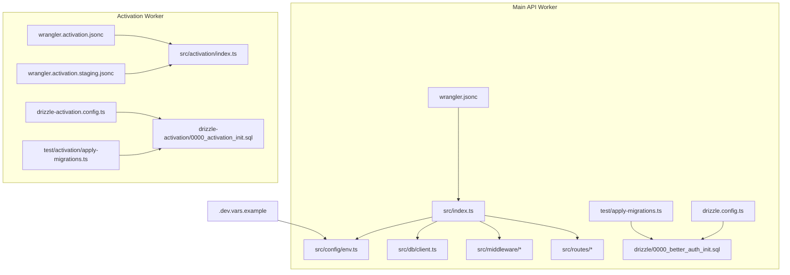
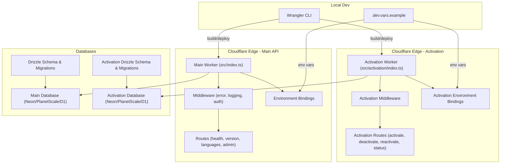
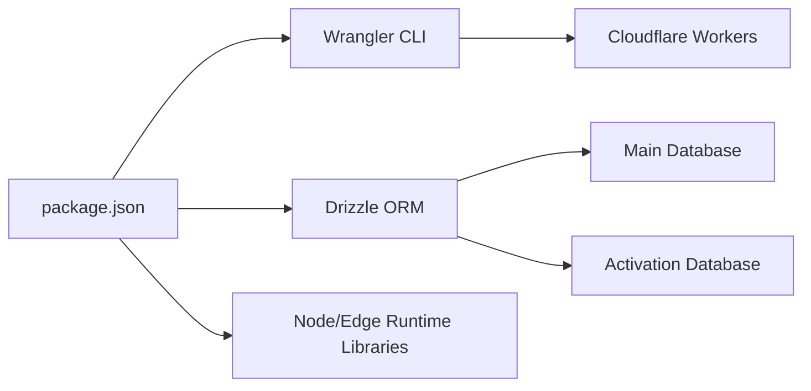

# Deployment Guide

<cite>
**Referenced Files in This Document**
- [wrangler.jsonc](file://wrangler.jsonc)
- [wrangler.activation.jsonc](file://wrangler.activation.jsonc)
- [wrangler.activation.staging.jsonc](file://wrangler.activation.staging.jsonc)
- [package.json](file://package.json)
- [drizzle.config.ts](file://drizzle.config.ts)
- [drizzle-activation.config.ts](file://drizzle-activation.config.ts)
- [.dev.vars.example](file://.dev.vars.example)
- [src/index.ts](file://src/index.ts)
- [src/activation/index.ts](file://src/activation/index.ts)
- [src/config/env.ts](file://src/config/env.ts)
- [src/db/client.ts](file://src/db/client.ts)
- [drizzle/0000_better_auth_init.sql](file://drizzle/0000_better_auth_init.sql)
- [drizzle-activation/0000_activation_init.sql](file://drizzle-activation/0000_activation_init.sql)
- [test/apply-migrations.ts](file://test/apply-migrations.ts)
- [test/activation/apply-migrations.ts](file://test/activation/apply-migrations.ts)
- [src/middleware/error.ts](file://src/middleware/error.ts)
- [src/lib/logger.ts](file://src/lib/logger.ts)
</cite>

## Update Summary
**Changes Made**
- Added documentation for the new activation worker deployment configuration
- Updated Wrangler configuration section to cover multiple workers (main API and activation worker)
- Added separate database migration strategy for the activation system
- Enhanced project structure diagram to include activation worker components
- Updated deployment workflow to handle dual-worker architecture

## Table of Contents
1. [Introduction](#introduction)
2. [Project Structure](#project-structure)
3. [Core Components](#core-components)
4. [Architecture Overview](#architecture-overview)
5. [Detailed Component Analysis](#detailed-component-analysis)
6. [Dependency Analysis](#dependency-analysis)
7. [Performance Considerations](#performance-considerations)
8. [Troubleshooting Guide](#troubleshooting-guide)
9. [Conclusion](#conclusion)
10. [Appendices](#appendices)

## Introduction
This guide provides a comprehensive deployment workflow for the TrackDub API on Cloudflare Workers using the Wrangler CLI. The system now consists of two separate workers: the main API worker and the activation worker, each with their own configuration files and database migrations. It covers environment configuration across development, staging, and production; database migration strategies with Drizzle ORM; build and asset optimization for serverless; security hardening; monitoring and alerting; rollback and blue-green deployment patterns; disaster recovery; scaling and cost optimization; and troubleshooting tailored to Cloudflare's edge network.

## Project Structure
The project is organized into clear layers with dual-worker architecture:
- Main API worker entry point and runtime configuration
- Activation worker for license management and seat validation
- Environment variables and secrets management
- Separate database clients and schema migrations for each worker
- Middleware for error handling, logging, and request processing
- Routes for health, version, languages, admin endpoints (main API)
- Activation routes for activate, deactivate, reactivate, and status endpoints
- Tests including migration runners for both workers

**Diagram sources**
- [wrangler.jsonc](file://wrangler.jsonc)
- [wrangler.activation.jsonc](file://wrangler.activation.jsonc)
- [wrangler.activation.staging.jsonc](file://wrangler.activation.staging.jsonc)
- [src/index.ts](file://src/index.ts)
- [src/activation/index.ts](file://src/activation/index.ts)
- [src/config/env.ts](file://src/config/env.ts)
- [src/db/client.ts](file://src/db/client.ts)
- [drizzle.config.ts](file://drizzle.config.ts)
- [drizzle-activation.config.ts](file://drizzle-activation.config.ts)
- [drizzle/0000_better_auth_init.sql](file://drizzle/0000_better_auth_init.sql)
- [drizzle-activation/0000_activation_init.sql](file://drizzle-activation/0000_activation_init.sql)
- [test/apply-migrations.ts](file://test/apply-migrations.ts)
- [test/activation/apply-migrations.ts](file://test/activation/apply-migrations.ts)
- [.dev.vars.example](file://.dev.vars.example)

**Section sources**
- [wrangler.jsonc](file://wrangler.jsonc)
- [wrangler.activation.jsonc](file://wrangler.activation.jsonc)
- [wrangler.activation.staging.jsonc](file://wrangler.activation.staging.jsonc)
- [package.json](file://package.json)
- [drizzle.config.ts](file://drizzle.config.ts)
- [drizzle-activation.config.ts](file://drizzle-activation.config.ts)
- [.dev.vars.example](file://.dev.vars.example)
- [src/index.ts](file://src/index.ts)
- [src/activation/index.ts](file://src/activation/index.ts)
- [src/config/env.ts](file://src/config/env.ts)
- [src/db/client.ts](file://src/db/client.ts)
- [drizzle/0000_better_auth_init.sql](file://drizzle/0000_better_auth_init.sql)
- [drizzle-activation/0000_activation_init.sql](file://drizzle-activation/0000_activation_init.sql)
- [test/apply-migrations.ts](file://test/apply-migrations.ts)
- [test/activation/apply-migrations.ts](file://test/activation/apply-migrations.ts)

## Core Components
- **Main API Worker**: Initializes middleware, routes, and binds environment variables and DB client for core API functionality.
- **Activation Worker**: Dedicated worker for license activation, deactivation, and seat management with separate configuration.
- **Environment Configuration**: Reads typed environment variables from Cloudflare environment bindings for both workers.
- **Database Clients**: Separate DB clients for main API and activation system via Drizzle ORM.
- **Migrations**: SQL-based schema definitions managed by Drizzle with separate journals for each worker.
- **Error handling and logging**: Centralized error middleware and structured logger for observability across both workers.

Key responsibilities:
- Main worker handles core API endpoints (health, version, languages, admin).
- Activation worker manages license lifecycle operations (activate, deactivate, reactivate, status).
- Each worker has independent environment configuration and database connections.
- Migration tooling ensures consistent schema evolution across both environments.

**Section sources**
- [src/index.ts](file://src/index.ts)
- [src/activation/index.ts](file://src/activation/index.ts)
- [src/config/env.ts](file://src/config/env.ts)
- [src/db/client.ts](file://src/db/client.ts)
- [drizzle/0000_better_auth_init.sql](file://drizzle/0000_better_auth_init.sql)
- [drizzle-activation/0000_activation_init.sql](file://drizzle-activation/0000_activation_init.sql)
- [src/middleware/error.ts](file://src/middleware/error.ts)
- [src/lib/logger.ts](file://src/lib/logger.ts)

## Architecture Overview
The TrackDub system runs as two separate Cloudflare Workers with independent configurations and database connections. The main API worker handles core functionality while the activation worker manages license operations. Wrangler orchestrates builds and deployments for both workers, while Drizzle manages schema migrations independently for each database.

**Diagram sources**
- [wrangler.jsonc](file://wrangler.jsonc)
- [wrangler.activation.jsonc](file://wrangler.activation.jsonc)
- [wrangler.activation.staging.jsonc](file://wrangler.activation.staging.jsonc)
- [src/index.ts](file://src/index.ts)
- [src/activation/index.ts](file://src/activation/index.ts)
- [src/config/env.ts](file://src/config/env.ts)
- [src/db/client.ts](file://src/db/client.ts)
- [drizzle.config.ts](file://drizzle.config.ts)
- [drizzle-activation.config.ts](file://drizzle-activation.config.ts)
- [drizzle/0000_better_auth_init.sql](file://drizzle/0000_better_auth_init.sql)
- [drizzle-activation/0000_activation_init.sql](file://drizzle-activation/0000_activation_init.sql)

## Detailed Component Analysis

### Dual Worker Wrangler Configuration and Deployment Workflow
**Updated** The system now uses two separate Wrangler configurations for the main API worker and activation worker.

- **Main API Worker**: Uses `wrangler.jsonc` for core API deployment configuration.
- **Activation Worker**: Uses `wrangler.activation.jsonc` for activation-specific deployment settings.
- **Staging Configuration**: Uses `wrangler.activation.staging.jsonc` for activation worker staging environment.

Recommended deployment steps:
- Install dependencies and set up local environment variables from the example file.
- Run local dev server for main API worker.
- Run local dev server for activation worker separately.
- Build both workers independently.
- Deploy main API worker with appropriate environment flags.
- Deploy activation worker with corresponding environment configuration.

**Section sources**
- [wrangler.jsonc](file://wrangler.jsonc)
- [wrangler.activation.jsonc](file://wrangler.activation.jsonc)
- [wrangler.activation.staging.jsonc](file://wrangler.activation.staging.jsonc)
- [.dev.vars.example](file://.dev.vars.example)
- [package.json](file://package.json)

### Environment Configuration for Multiple Workers
**Updated** Each worker maintains its own environment configuration with separate variable sets.

- **Main API Worker**: Uses standard environment variables for core functionality.
- **Activation Worker**: Uses activation-specific environment variables for license management.
- **Shared Variables**: Common configuration can be shared through `.dev.vars.example`.
- **Worker-Specific Secrets**: Each worker should have isolated secrets for security.

Best practices:
- Validate required variables per worker on startup.
- Use distinct variable names per worker to prevent cross-env leakage.
- Rotate secrets regularly and restrict access via least privilege.
- Maintain separate CI/CD pipelines for each worker if needed.

**Section sources**
- [src/config/env.ts](file://src/config/env.ts)
- [.dev.vars.example](file://.dev.vars.example)

### Separate Database Client and Migration Strategy
**Updated** Each worker has its own database connection and migration system.

- **Main API Database**: Configured through `drizzle.config.ts` with migrations in `drizzle/` directory.
- **Activation Database**: Configured through `drizzle-activation.config.ts` with migrations in `drizzle-activation/` directory.
- **Independent Migrations**: Each worker manages its own schema evolution.
- **Separate Test Utilities**: Migration testing utilities exist for both workers.

Migration strategy:
- Generate new migrations independently for each worker.
- Apply migrations before deploying code that depends on new schema.
- Keep backward-compatible changes where possible to enable zero-downtime deployments.
- Coordinate migration order when workers depend on each other's data.

Rollback approach:
- Maintain reverse migration scripts for each worker independently.
- Use feature flags to toggle new features until validation succeeds.
- Test rollback procedures in staging before production deployment.

**Section sources**
- [src/db/client.ts](file://src/db/client.ts)
- [drizzle.config.ts](file://drizzle.config.ts)
- [drizzle-activation.config.ts](file://drizzle-activation.config.ts)
- [drizzle/0000_better_auth_init.sql](file://drizzle/0000_better_auth_init.sql)
- [drizzle-activation/0000_activation_init.sql](file://drizzle-activation/0000_activation_init.sql)
- [test/apply-migrations.ts](file://test/apply-migrations.ts)
- [test/activation/apply-migrations.ts](file://test/activation/apply-migrations.ts)

### Build Process and Asset Optimization for Dual Workers
**Updated** Build process now handles two separate workers with independent optimizations.

- **Main API Build**: Bundles TypeScript, optimizes assets for core API functionality.
- **Activation Worker Build**: Independent build process for license management worker.
- **External Dependencies**: Heavy dependencies externalized for both workers.
- **Cloudflare Native Modules**: Leverage native modules where possible in both workers.
- **Minification and Tree-shaking**: Enabled via Wrangler defaults for optimal payload size.

Optimization tips:
- Avoid large synchronous operations during initialization in both workers.
- Preload only necessary modules per worker.
- Cache static responses at the edge when applicable.
- Monitor bundle sizes for both workers independently.

**Section sources**
- [wrangler.jsonc](file://wrangler.jsonc)
- [wrangler.activation.jsonc](file://wrangler.activation.jsonc)
- [package.json](file://package.json)

### Security Hardening for Multi-Worker Architecture
**Updated** Security considerations apply to both workers with isolation between them.

- **CORS Policies**: Enforce CORS policies and input validation in middleware for both workers.
- **HTTPS-only Endpoints**: Use HTTPS-only endpoints and secure headers across all workers.
- **Authentication Isolation**: Restrict admin routes behind authentication and authorization middleware.
- **Secret Management**: Separate secrets for each worker to limit blast radius.
- **Log Sanitization**: Sanitize logs to avoid leaking sensitive data in both workers.

**Section sources**
- [src/middleware/error.ts](file://src/middleware/error.ts)
- [src/lib/logger.ts](file://src/lib/logger.ts)

### Monitoring and Alerting for Multiple Workers
**Updated** Monitoring setup needs to track both workers independently.

- **Structured Logging**: Emit structured logs for requests, errors, and performance metrics in both workers.
- **Cloudflare Logs Analytics**: Integrate with Cloudflare Logs Analytics or external log aggregation services.
- **Worker-Specific Alerts**: Set alerts for error rates, latency spikes, and dependency failures per worker.
- **Health Checks**: Implement health check endpoints for both workers.

Implementation guidance:
- Add request IDs and correlation IDs for traceability across workers.
- Log key events without sensitive payloads in both workers.
- Use health check endpoints to probe availability of both workers.
- Monitor inter-worker communication if they interact directly.

**Section sources**
- [src/lib/logger.ts](file://src/lib/logger.ts)
- [src/middleware/error.ts](file://src/middleware/error.ts)

### Rollback Strategies and Blue-Green Deployment for Dual Workers
**Updated** Deployment strategy must coordinate both workers.

- **Independent Environments**: Use Wrangler environments to maintain separate deployments for blue/green for each worker.
- **Traffic Routing**: Route traffic gradually between environments using DNS or Cloudflare Load Balancing.
- **Coordination**: Ensure both workers are deployed together to maintain compatibility.
- **Quick Rollback**: Keep quick rollback procedures ready by preserving previous environment configurations.

Operational flow:
- Deploy new versions to green environments for both workers.
- Validate health and metrics for both workers.
- Shift traffic incrementally between environments.
- Revert both workers if anomalies detected.

[No sources needed since this section describes conceptual deployment patterns]

### Disaster Recovery Procedures for Multi-Worker System
**Updated** Recovery procedures must account for both workers and databases.

- **Database Backups**: Regularly back up both main API and activation databases.
- **Schema History**: Maintain migration history and snapshots for fast restoration of both systems.
- **Worker State**: Consider stateless design for easier recovery.
- **Testing**: Test recovery drills periodically to ensure RTO/RPO targets.

[No sources needed since this section describes conceptual procedures]

## Dependency Analysis
**Updated** External dependencies now include separate configurations for both workers.

External dependencies include Wrangler for deployment, Drizzle for database migrations, and any runtime libraries used by both workers.

**Diagram sources**
- [package.json](file://package.json)
- [wrangler.jsonc](file://wrangler.jsonc)
- [wrangler.activation.jsonc](file://wrangler.activation.jsonc)
- [drizzle.config.ts](file://drizzle.config.ts)
- [drizzle-activation.config.ts](file://drizzle-activation.config.ts)

**Section sources**
- [package.json](file://package.json)
- [wrangler.jsonc](file://wrangler.jsonc)
- [wrangler.activation.jsonc](file://wrangler.activation.jsonc)
- [drizzle.config.ts](file://drizzle.config.ts)
- [drizzle-activation.config.ts](file://drizzle-activation.config.ts)

## Performance Considerations
**Updated** Performance optimization applies to both workers independently.

- **Cold Start Optimization**: Minimize cold start time by lazy-loading heavy modules and avoiding synchronous initialization in both workers.
- **Edge Network Benefits**: Leverage Cloudflare's global edge network for low-latency responses in both workers.
- **Connection Pooling**: Use connection pooling for database clients and cache frequently accessed data at the edge when safe.
- **Monitoring**: Monitor memory usage and CPU hotspots; profile with Wrangler's local debugging tools for both workers.
- **Bundle Size**: Optimize bundle sizes for both workers independently.

[No sources needed since this section provides general guidance]

## Troubleshooting Guide
**Updated** Troubleshooting now covers issues specific to dual-worker architecture.

Common issues and resolutions:
- **Missing environment variables**: Ensure all required variables are set in the target environment for both workers; verify secret injection via Wrangler.
- **Migration failures**: Check migration journal and SQL syntax for both workers; apply migrations in order and confirm connectivity to respective databases.
- **High error rates**: Inspect structured logs and error middleware outputs for both workers; correlate request IDs to pinpoint failures.
- **Slow responses**: Profile database queries, reduce payload sizes, and enable caching where appropriate for both workers.
- **Worker coordination issues**: If workers communicate, check inter-worker connectivity and timeout configurations.

Debugging steps:
- Run local dev server with detailed logging for both workers.
- Validate environment variables and secrets for both workers.
- Execute migration tests against staging databases for both workers.
- Review Cloudflare logs and analytics for anomalies in both workers.

**Section sources**
- [src/middleware/error.ts](file://src/middleware/error.ts)
- [src/lib/logger.ts](file://src/lib/logger.ts)
- [test/apply-migrations.ts](file://test/apply-migrations.ts)
- [test/activation/apply-migrations.ts](file://test/activation/apply-migrations.ts)

## Conclusion
This guide outlines a robust deployment strategy for the TrackDub system on Cloudflare Workers using Wrangler and Drizzle with dual-worker architecture. By following the outlined workflows for environment configuration, separate database migrations, security, monitoring, and performance tuning for both the main API and activation workers, teams can achieve reliable, scalable, and secure serverless deployments. Adopt blue-green patterns and disaster recovery procedures to maintain high availability and resilience in production.

[No sources needed since this section summarizes without analyzing specific files]

## Appendices

### Appendix A: Environment Variables Reference
**Updated** Environment variables are now separated by worker type.

- **Main API Worker**: Required variables for development, staging, and production should be documented and enforced via typed configuration.
- **Activation Worker**: Activation-specific variables for license management and seat tracking.
- **Shared Variables**: Common configuration that can be shared between workers.
- **Secret Management**: Use separate files or CI/CD secrets per worker to avoid accidental exposure.

[No sources needed since this section provides general guidance]

### Appendix B: Migration Checklist
**Updated** Migration checklist now covers both workers.

- **Main API Migrations**: Generate migration files for main API schema changes.
- **Activation Migrations**: Generate migration files for activation system schema changes.
- **Apply Order**: Apply migrations to staging first and validate for both workers.
- **Coordination**: Promote to production after successful validation of both workers.
- **Rollback Scripts**: Maintain rollback scripts and document recovery steps for both systems.

[No sources needed since this section provides general guidance]

### Appendix C: Deployment Commands Reference
**Updated** Deployment commands now include both workers.

- **Main API Worker**:
  - Development: `wrangler dev`
  - Staging: `wrangler deploy --env staging`
  - Production: `wrangler deploy --env production`
  
- **Activation Worker**:
  - Development: `wrangler dev --config wrangler.activation.jsonc`
  - Staging: `wrangler deploy --config wrangler.activation.staging.jsonc`
  - Production: `wrangler deploy --config wrangler.activation.jsonc`

[No sources needed since this section provides general guidance]