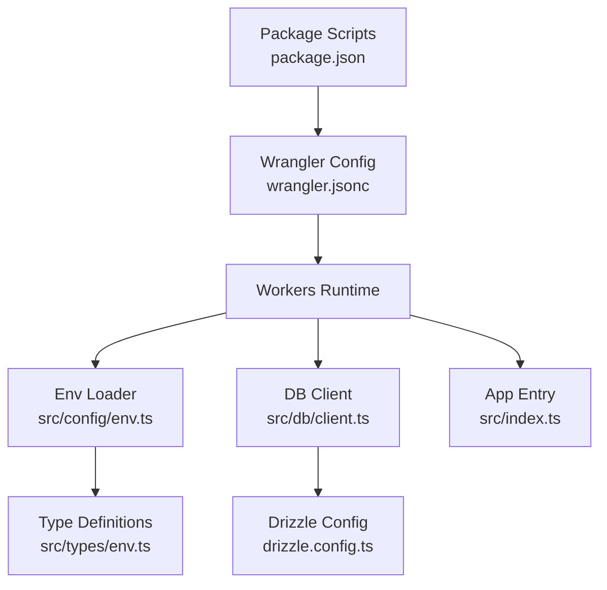
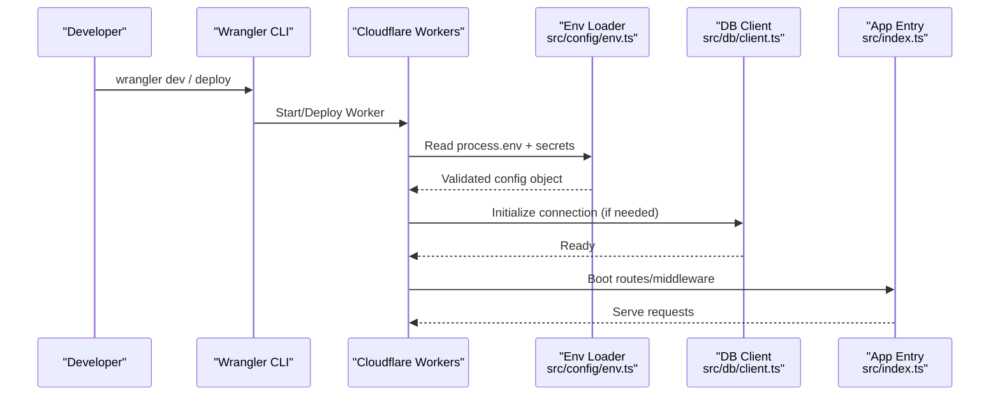
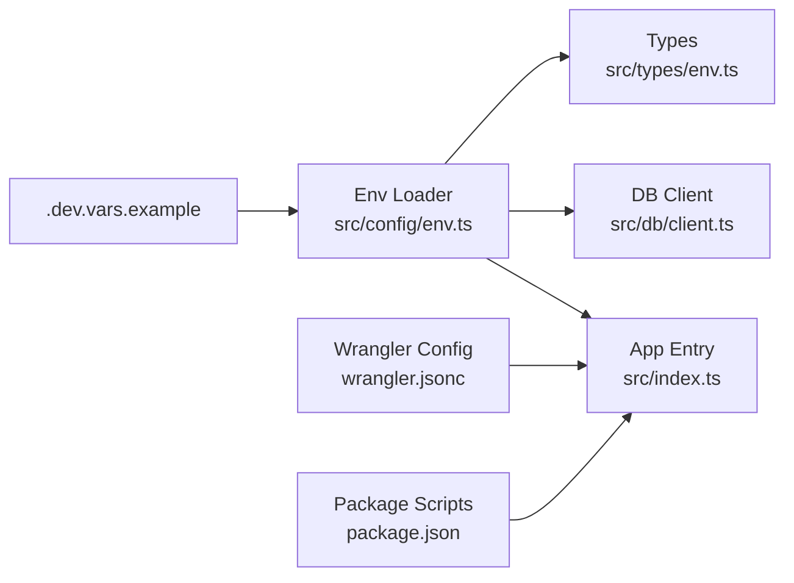

# Environment Setup

<cite>
**Referenced Files in This Document**
- [.dev.vars.example](file://.dev.vars.example)
- [wrangler.jsonc](file://wrangler.jsonc)
- [package.json](file://package.json)
- [src/config/env.ts](file://src/config/env.ts)
- [src/types/env.ts](file://src/types/env.ts)
- [src/db/client.ts](file://src/db/client.ts)
- [src/index.ts](file://src/index.ts)
- [drizzle.config.ts](file://drizzle.config.ts)
</cite>

## Table of Contents
1. [Introduction](#introduction)
2. [Project Structure](#project-structure)
3. [Core Components](#core-components)
4. [Architecture Overview](#architecture-overview)
5. [Detailed Component Analysis](#detailed-component-analysis)
6. [Dependency Analysis](#dependency-analysis)
7. [Performance Considerations](#performance-considerations)
8. [Troubleshooting Guide](#troubleshooting-guide)
9. [Conclusion](#conclusion)
10. [Appendices](#appendices)

## Introduction
This document explains how to set up the TrackDub API for development, staging, and production using Wrangler CLI and Cloudflare Workers. It covers environment configuration, required variables from .dev.vars.example, dependency installation, local server setup, and best practices for managing secrets across environments.

## Project Structure
The project is a Cloudflare Worker application with TypeScript, Drizzle ORM, and Wrangler for deployment. Key areas relevant to environment setup include:
- Configuration and types for environment variables
- Database client initialization
- Wrangler configuration for Workers
- Package scripts for running and deploying
- Drizzle configuration for migrations

**Diagram sources**
- [package.json](file://package.json)
- [wrangler.jsonc](file://wrangler.jsonc)
- [src/config/env.ts](file://src/config/env.ts)
- [src/types/env.ts](file://src/types/env.ts)
- [src/db/client.ts](file://src/db/client.ts)
- [drizzle.config.ts](file://drizzle.config.ts)
- [src/index.ts](file://src/index.ts)

**Section sources**
- [package.json](file://package.json)
- [wrangler.jsonc](file://wrangler.jsonc)
- [src/config/env.ts](file://src/config/env.ts)
- [src/types/env.ts](file://src/types/env.ts)
- [src/db/client.ts](file://src/db/client.ts)
- [drizzle.config.ts](file://drizzle.config.ts)
- [src/index.ts](file://src/index.ts)

## Core Components
- Environment loader: Centralizes reading and validating environment variables at runtime.
- Type definitions: Enforces expected variable names and types.
- Database client: Initializes connections based on environment variables.
- Wrangler config: Defines Workers metadata, bindings, and deployment targets.
- Package scripts: Provide commands for local dev, testing, and deployment.

**Section sources**
- [src/config/env.ts](file://src/config/env.ts)
- [src/types/env.ts](file://src/types/env.ts)
- [src/db/client.ts](file://src/db/client.ts)
- [wrangler.jsonc](file://wrangler.jsonc)
- [package.json](file://package.json)

## Architecture Overview
The runtime loads environment variables from Wrangler’s secret store or local .dev.vars file, validates them via the env loader, and initializes services such as the database client. The app entry point registers routes and middleware that depend on these configurations.

**Diagram sources**
- [src/config/env.ts](file://src/config/env.ts)
- [src/db/client.ts](file://src/db/client.ts)
- [src/index.ts](file://src/index.ts)
- [wrangler.jsonc](file://wrangler.jsonc)

## Detailed Component Analysis

### Environment Variables and Secrets
- Source of truth for variables: .dev.vars.example lists all required keys for local development.
- Local secrets: Copy .dev.vars.example to .dev.vars and fill values; this file is ignored by version control.
- Production/staging secrets: Configure via Wrangler secrets or Cloudflare dashboard.
- Validation: The env loader reads and validates variables at startup, failing fast if required keys are missing.

Recommended workflow:
- Create .dev.vars from .dev.vars.example and populate local values.
- For remote environments, add secrets through Wrangler CLI or dashboard.
- Ensure type safety by referencing src/types/env.ts when adding new variables.

**Section sources**
- [.dev.vars.example](file://.dev.vars.example)
- [src/config/env.ts](file://src/config/env.ts)
- [src/types/env.ts](file://src/types/env.ts)

### Database Configuration
- Connection parameters are provided via environment variables consumed by the DB client.
- Migrations are managed through Drizzle; ensure drizzle.config.ts aligns with your target database credentials.
- In local development, use .dev.vars for DB credentials; in remote environments, configure via Wrangler secrets.

Operational notes:
- Validate connectivity during startup to fail fast on misconfiguration.
- Use separate databases or schemas per environment to avoid cross-contamination.

**Section sources**
- [src/db/client.ts](file://src/db/client.ts)
- [drizzle.config.ts](file://drizzle.config.ts)

### Wrangler Configuration
- wrangler.jsonc defines Worker metadata, bindings, and environment-specific settings.
- Use it to specify secrets, KV/D1/R2 bindings, and deployment targets.
- For local development, Wrangler will read .dev.vars automatically.

Best practices:
- Keep wrangler.jsonc minimal and environment-agnostic where possible.
- Store sensitive values as secrets rather than inline config.

**Section sources**
- [wrangler.jsonc](file://wrangler.jsonc)

### Application Entry Point
- src/index.ts boots the Worker, registers routes, and applies middleware.
- It depends on validated environment configuration and any initialized services (e.g., DB).

Development tip:
- Ensure the entry point can start without external dependencies when running locally with mocked services if necessary.

**Section sources**
- [src/index.ts](file://src/index.ts)

### Package Scripts and Tooling
- package.json contains scripts for running the local dev server, building, testing, and deploying.
- Use the provided scripts to start the local server with hot reload and to run tests against your configured environment.

Common tasks:
- Install dependencies
- Start local development server
- Run tests
- Deploy to Cloudflare

**Section sources**
- [package.json](file://package.json)

## Dependency Analysis
The following diagram shows how environment configuration flows into core modules.

**Diagram sources**
- [.dev.vars.example](file://.dev.vars.example)
- [src/config/env.ts](file://src/config/env.ts)
- [src/types/env.ts](file://src/types/env.ts)
- [src/db/client.ts](file://src/db/client.ts)
- [src/index.ts](file://src/index.ts)
- [wrangler.jsonc](file://wrangler.jsonc)
- [package.json](file://package.json)

**Section sources**
- [src/config/env.ts](file://src/config/env.ts)
- [src/types/env.ts](file://src/types/env.ts)
- [src/db/client.ts](file://src/db/client.ts)
- [src/index.ts](file://src/index.ts)
- [wrangler.jsonc](file://wrangler.jsonc)
- [package.json](file://package.json)

## Performance Considerations
- Avoid heavy initialization in module scope; defer expensive setup until first request if appropriate.
- Reuse database connections and clients across requests.
- Cache immutable configuration after validation to prevent repeated parsing.
- Minimize cold-start impact by keeping dependencies lean and avoiding unnecessary I/O at boot.

[No sources needed since this section provides general guidance]

## Troubleshooting Guide
Common issues and resolutions:
- Missing environment variables:
  - Ensure .dev.vars exists and contains all required keys from .dev.vars.example.
  - For remote environments, verify secrets are added via Wrangler CLI or dashboard.
- Database connection failures:
  - Confirm DB host, port, user, password, and database name are correct.
  - Check network access rules and firewall settings for the target database.
- Wrangler errors:
  - Verify wrangler login status and permissions.
  - Ensure wrangler.jsonc syntax is valid and references correct bindings.
- Local dev server not starting:
  - Reinstall dependencies and clear caches.
  - Validate Node.js and Wrangler versions match project requirements.

**Section sources**
- [.dev.vars.example](file://.dev.vars.example)
- [wrangler.jsonc](file://wrangler.jsonc)
- [package.json](file://package.json)

## Conclusion
By following the steps outlined here—setting up .dev.vars, configuring Wrangler secrets, validating environment variables, and initializing the database—you can reliably run the TrackDub API across development, staging, and production. Adhering to the recommended patterns ensures secure, maintainable, and predictable deployments.

[No sources needed since this section summarizes without analyzing specific files]

## Appendices

### Installation and Local Development
- Install dependencies using the package manager defined in package.json.
- Start the local development server with the provided script to enable hot reload.
- Run tests to validate environment configuration and functionality.

**Section sources**
- [package.json](file://package.json)

### Environment-Specific Configuration Examples
- Development:
  - Populate .dev.vars with local database credentials and service endpoints.
  - Use Wrangler dev to run locally with hot reload.
- Staging:
  - Add staging secrets via Wrangler CLI or dashboard.
  - Deploy with Wrangler targeting the staging environment.
- Production:
  - Add production secrets via Wrangler CLI or dashboard.
  - Deploy with Wrangler targeting the production environment.

[No sources needed since this section provides general guidance]

### Secret Management Best Practices
- Never commit secrets to version control.
- Use .dev.vars only for local development; rely on Wrangler secrets for remote environments.
- Rotate secrets regularly and audit access.
- Separate secrets per environment to reduce blast radius.

[No sources needed since this section provides general guidance]