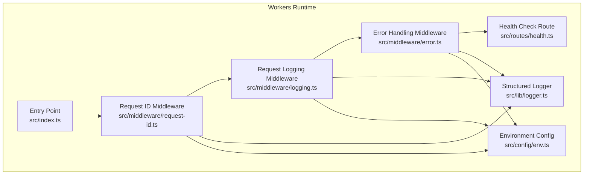
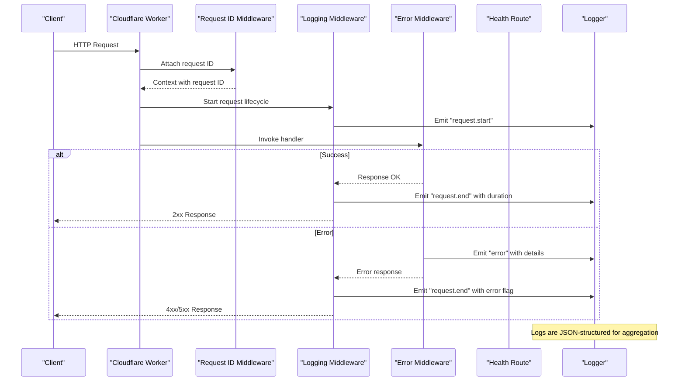
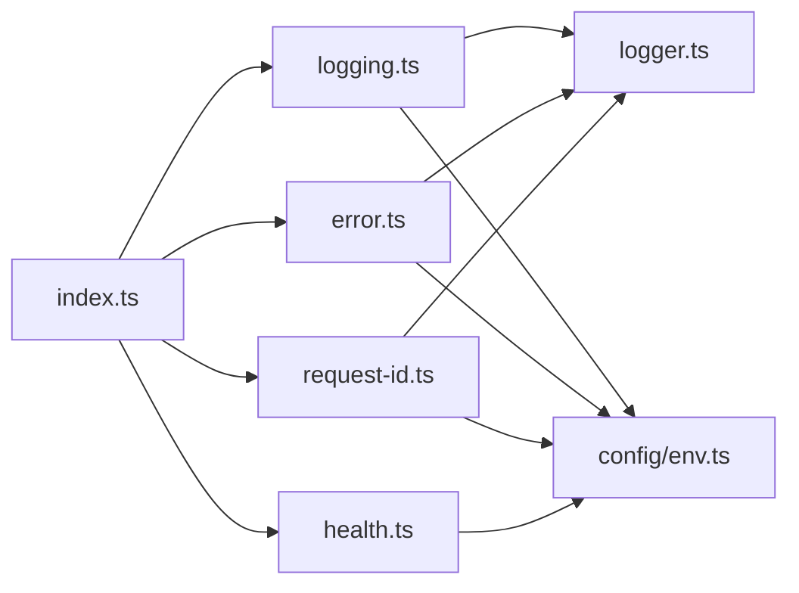

# Monitoring and Observability

<cite>
**Referenced Files in This Document**
- [index.ts](file://src/index.ts)
- [logger.ts](file://src/lib/logger.ts)
- [logging.ts](file://src/middleware/logging.ts)
- [error.ts](file://src/middleware/error.ts)
- [request-id.ts](file://src/middleware/request-id.ts)
- [health.ts](file://src/routes/health.ts)
- [env.ts](file://src/config/env.ts)
- [env.ts](file://src/types/env.ts)
- [wrangler.jsonc](file://wrangler.jsonc)
</cite>

## Table of Contents
1. [Introduction](#introduction)
2. [Project Structure](#project-structure)
3. [Core Components](#core-components)
4. [Architecture Overview](#architecture-overview)
5. [Detailed Component Analysis](#detailed-component-analysis)
6. [Dependency Analysis](#dependency-analysis)
7. [Performance Considerations](#performance-considerations)
8. [Troubleshooting Guide](#troubleshooting-guide)
9. [Conclusion](#conclusion)
10. [Appendices](#appendices)

## Introduction
This document provides comprehensive monitoring and observability guidance for the TrackDub API running on Cloudflare Workers. It covers structured logging, log levels, formatting standards, request tracing across middleware, error tracking, performance monitoring, custom metrics collection, alerting strategies, health checks, log aggregation, retention policies, and debugging production issues. The goal is to make the system observable, reliable, and easy to troubleshoot in production environments.

## Project Structure
The monitoring and observability features are implemented through a combination of:
- A centralized logger utility for structured logs
- Middleware that instruments requests with IDs, timing, and error handling
- A health check route for liveness/readiness probes
- Environment configuration for runtime settings
- Wrangler configuration for Cloudflare Workers deployment and analytics

**Diagram sources**
- [index.ts](file://src/index.ts)
- [logging.ts](file://src/middleware/logging.ts)
- [error.ts](file://src/middleware/error.ts)
- [request-id.ts](file://src/middleware/request-id.ts)
- [health.ts](file://src/routes/health.ts)
- [logger.ts](file://src/lib/logger.ts)
- [env.ts](file://src/config/env.ts)

**Section sources**
- [index.ts](file://src/index.ts)
- [logging.ts](file://src/middleware/logging.ts)
- [error.ts](file://src/middleware/error.ts)
- [request-id.ts](file://src/middleware/request-id.ts)
- [health.ts](file://src/routes/health.ts)
- [logger.ts](file://src/lib/logger.ts)
- [env.ts](file://src/config/env.ts)

## Core Components
- Structured Logger: Provides consistent JSON-formatted logs with fields such as timestamp, level, message, and contextual metadata (e.g., request ID).
- Request Logging Middleware: Captures incoming requests, measures latency, and emits structured logs at appropriate levels.
- Error Handling Middleware: Normalizes errors into structured logs and responses, ensuring consistent error telemetry.
- Request ID Middleware: Generates or propagates a unique request identifier to correlate logs across layers.
- Health Check Route: Exposes endpoints for liveness and readiness checks used by orchestrators and external monitors.
- Environment Configuration: Centralizes environment variables controlling log levels, feature flags, and service behavior.

Key responsibilities:
- Ensure every request produces a traceable, structured log entry.
- Standardize error representation and severity classification.
- Provide stable health endpoints for automated monitoring.
- Keep configuration simple and secure via environment variables.

**Section sources**
- [logger.ts](file://src/lib/logger.ts)
- [logging.ts](file://src/middleware/logging.ts)
- [error.ts](file://src/middleware/error.ts)
- [request-id.ts](file://src/middleware/request-id.ts)
- [health.ts](file://src/routes/health.ts)
- [env.ts](file://src/config/env.ts)

## Architecture Overview
The observability architecture follows a layered approach:
- Entry point initializes middleware and routes.
- Request ID middleware assigns a correlation ID to each request.
- Logging middleware records start/end events and duration.
- Error middleware captures exceptions and emits structured error logs.
- Health route exposes status endpoints.
- Logger writes structured logs suitable for aggregation.

**Diagram sources**
- [index.ts](file://src/index.ts)
- [request-id.ts](file://src/middleware/request-id.ts)
- [logging.ts](file://src/middleware/logging.ts)
- [error.ts](file://src/middleware/error.ts)
- [health.ts](file://src/routes/health.ts)
- [logger.ts](file://src/lib/logger.ts)

## Detailed Component Analysis

### Structured Logger
- Purpose: Centralized logging utility producing consistent JSON logs with fields like timestamp, level, message, and context.
- Features:
  - Log levels: debug, info, warn, error.
  - Context enrichment: request ID, route, method, status code where available.
  - Output format: JSON lines suitable for log aggregation pipelines.
- Usage patterns:
  - Emit request lifecycle events from middleware.
  - Emit business KPIs via dedicated log entries tagged with event names.
  - Avoid sensitive data in logs; redact tokens and PII.

Best practices:
- Use structured fields instead of freeform strings.
- Include correlation IDs for cross-layer tracing.
- Keep messages concise; attach detailed context as fields.

**Section sources**
- [logger.ts](file://src/lib/logger.ts)

### Request ID Middleware
- Purpose: Generate or propagate a unique request ID to correlate logs and traces.
- Behavior:
  - If absent, generate a UUID-like ID.
  - Attach to request context for downstream use.
  - Propagate via headers when forwarding requests.

Operational impact:
- Enables log correlation across middleware and services.
- Facilitates distributed tracing when integrated with external systems.

**Section sources**
- [request-id.ts](file://src/middleware/request-id.ts)

### Logging Middleware
- Purpose: Capture request start/end events, measure latency, and emit structured logs.
- Responsibilities:
  - Record start time and initial context.
  - Measure duration and status code.
  - Emit standardized log entries for successful and failed requests.
  - Respect log level configuration.

Metrics derived:
- Request rate per route.
- Latency percentiles (p50, p95, p99).
- Error rates by route and status code.

**Section sources**
- [logging.ts](file://src/middleware/logging.ts)

### Error Handling Middleware
- Purpose: Normalize errors into structured logs and responses.
- Responsibilities:
  - Catch unhandled exceptions.
  - Classify severity based on error type and status.
  - Emit structured error logs with stack traces only when safe.
  - Return consistent error responses.

Security considerations:
- Do not expose internal stack traces to clients.
- Redact secrets and sensitive information before logging.

**Section sources**
- [error.ts](file://src/middleware/error.ts)

### Health Check Route
- Purpose: Provide liveness and readiness endpoints for orchestration and monitoring.
- Endpoints:
  - Liveness: Quick check that the worker is alive.
  - Readiness: Verify dependencies (e.g., database connectivity) if applicable.
- Responses:
  - 200 OK when healthy.
  - 503 Service Unavailable when unhealthy.

Integration:
- Used by load balancers, CI/CD pipelines, and alerting systems.

**Section sources**
- [health.ts](file://src/routes/health.ts)

### Environment Configuration
- Purpose: Centralize environment variables for runtime behavior.
- Key variables:
  - LOG_LEVEL: Controls verbosity (debug, info, warn, error).
  - CF_API_TOKEN: For Cloudflare API interactions if needed.
  - Feature flags: Enable/disable optional observability features.
- Validation:
  - Enforce required variables at startup.
  - Provide defaults for non-critical settings.

**Section sources**
- [env.ts](file://src/config/env.ts)
- [env.ts](file://src/types/env.ts)

## Dependency Analysis
Observability components interact as follows:
- Entry point wires middleware and routes.
- Request ID middleware depends on logger for context logging.
- Logging middleware depends on logger and env config for level filtering.
- Error middleware depends on logger and env config for safe error serialization.
- Health route may depend on env config for dependency checks.

**Diagram sources**
- [index.ts](file://src/index.ts)
- [request-id.ts](file://src/middleware/request-id.ts)
- [logging.ts](file://src/middleware/logging.ts)
- [error.ts](file://src/middleware/error.ts)
- [health.ts](file://src/routes/health.ts)
- [logger.ts](file://src/lib/logger.ts)
- [env.ts](file://src/config/env.ts)

**Section sources**
- [index.ts](file://src/index.ts)
- [request-id.ts](file://src/middleware/request-id.ts)
- [logging.ts](file://src/middleware/logging.ts)
- [error.ts](file://src/middleware/error.ts)
- [health.ts](file://src/routes/health.ts)
- [logger.ts](file://src/lib/logger.ts)
- [env.ts](file://src/config/env.ts)

## Performance Considerations
- Minimize log volume:
  - Set appropriate LOG_LEVEL for production (info or warn).
  - Avoid logging large payloads; log identifiers and summaries.
- Efficient timing:
  - Use high-resolution timers for latency measurement.
  - Compute percentiles in aggregation pipelines rather than in-worker.
- Reduce overhead:
  - Defer expensive operations until necessary.
  - Batch logs if supported by the aggregation pipeline.
- Cache-friendly health checks:
  - Keep liveness checks lightweight.
  - Make readiness checks idempotent and fast.

[No sources needed since this section provides general guidance]

## Troubleshooting Guide
Common issues and resolutions:
- Missing request IDs:
  - Ensure request ID middleware runs before other middleware.
  - Validate header propagation when calling downstream services.
- Excessive logs:
  - Adjust LOG_LEVEL and filter noisy routes.
  - Add sampling for high-volume events.
- Errors not captured:
  - Confirm error middleware wraps all handlers.
  - Check that async errors are properly caught and logged.
- Health checks failing:
  - Verify dependency availability and timeouts.
  - Inspect readiness logic for external services.

Debugging steps:
- Correlate logs using request ID.
- Reproduce issues locally with elevated LOG_LEVEL.
- Inspect error logs for stack traces and context fields.
- Use Cloudflare Workers Analytics for request counts and error rates.

**Section sources**
- [request-id.ts](file://src/middleware/request-id.ts)
- [logging.ts](file://src/middleware/logging.ts)
- [error.ts](file://src/middleware/error.ts)
- [health.ts](file://src/routes/health.ts)

## Conclusion
By implementing structured logging, request tracing, error normalization, and health checks, the TrackDub API achieves robust observability on Cloudflare Workers. Combine these foundations with Cloudflare Analytics, log aggregation, and alerting to maintain high reliability and rapid incident resolution.

[No sources needed since this section summarizes without analyzing specific files]

## Appendices

### Cloudflare Workers Analytics Setup
- Enable analytics in your project configuration.
- Use built-in metrics for request counts, error rates, and latency distributions.
- Export logs to external systems via Cloudflare’s integrations or workers’ fetch calls.

**Section sources**
- [wrangler.jsonc](file://wrangler.jsonc)

### Custom Metrics Collection
- Emit business KPIs as structured logs with event names and tags.
- Aggregate metrics in your log pipeline to compute rates, totals, and percentiles.
- Example KPIs:
  - Successful translations per minute.
  - Average translation latency.
  - Language distribution.

**Section sources**
- [logger.ts](file://src/lib/logger.ts)
- [logging.ts](file://src/middleware/logging.ts)

### Alerting Strategies
- Define alerts for:
  - Elevated error rates (e.g., >5% 5xx responses).
  - Latency spikes (p95 > threshold).
  - Health check failures.
- Integrate with notification channels (Slack, PagerDuty, email).

[No sources needed since this section provides general guidance]

### Log Aggregation and Retention
- Aggregate JSON logs into a central system (e.g., Cloudflare Logs, third-party SIEM).
- Apply retention policies based on compliance and cost constraints.
- Index key fields (request_id, level, route, status_code) for fast queries.

[No sources needed since this section provides general guidance]

### Health Check Examples
- Liveness endpoint returns 200 OK when the worker is running.
- Readiness endpoint verifies dependencies and returns 503 if unavailable.
- Use these endpoints in orchestrators and monitoring tools.

**Section sources**
- [health.ts](file://src/routes/health.ts)