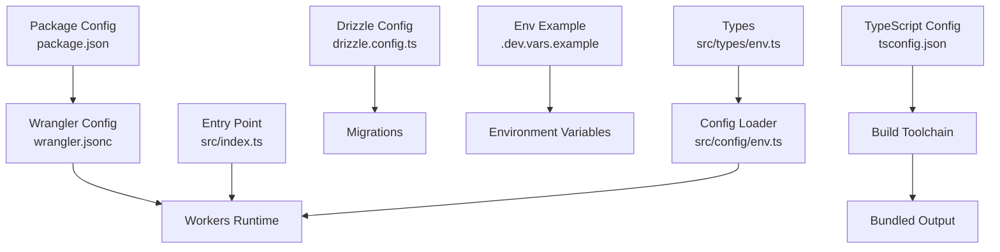
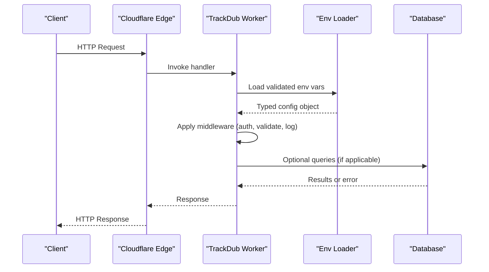
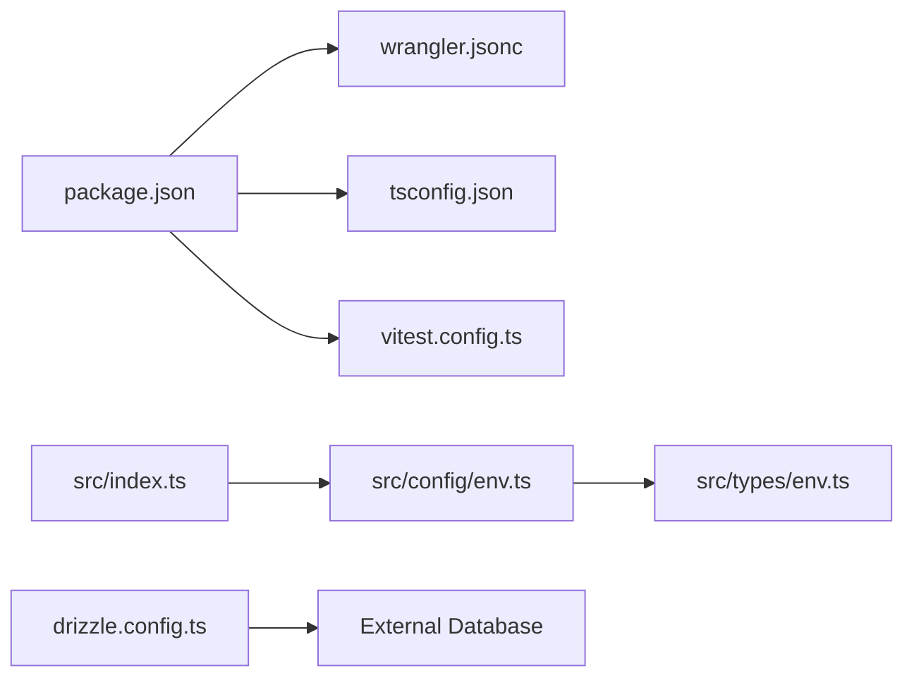

# Production Deployment

<cite>
**Referenced Files in This Document**
- [README.md](file://README.md)
- [package.json](file://package.json)
- [wrangler.jsonc](file://wrangler.jsonc)
- [.dev.vars.example](file://.dev.vars.example)
- [src/index.ts](file://src/index.ts)
- [src/config/env.ts](file://src/config/env.ts)
- [src/types/env.ts](file://src/types/env.ts)
- [drizzle.config.ts](file://drizzle.config.ts)
- [tsconfig.json](file://tsconfig.json)
- [vitest.config.ts](file://vitest.config.ts)
</cite>

## Table of Contents
1. [Introduction](#introduction)
2. [Project Structure](#project-structure)
3. [Core Components](#core-components)
4. [Architecture Overview](#architecture-overview)
5. [Detailed Component Analysis](#detailed-component-analysis)
6. [Dependency Analysis](#dependency-analysis)
7. [Performance Considerations](#performance-considerations)
8. [Troubleshooting Guide](#troubleshooting-guide)
9. [Conclusion](#conclusion)
10. [Appendices](#appendices)

## Introduction
This document provides production deployment guidance for the TrackDub API on Cloudflare Workers using Wrangler. It covers build and bundling, dependency optimization, asset handling, deployment strategies (versioning, blue-green, rollback), security hardening, performance tuning for edge environments, monitoring, CI/CD configuration examples, environment variable management, scaling considerations, cost optimization, and disaster recovery procedures.

## Project Structure
The project is a TypeScript-based API with:
- Entry point and routing under src/
- Configuration via wrangler.jsonc and environment variables
- Database migrations via Drizzle
- Testing via Vitest
- Build and runtime configuration through package.json and tsconfig.json

**Diagram sources**
- [package.json](file://package.json)
- [wrangler.jsonc](file://wrangler.jsonc)
- [tsconfig.json](file://tsconfig.json)
- [drizzle.config.ts](file://drizzle.config.ts)
- [.dev.vars.example](file://.dev.vars.example)
- [src/index.ts](file://src/index.ts)
- [src/config/env.ts](file://src/config/env.ts)
- [src/types/env.ts](file://src/types/env.ts)

**Section sources**
- [README.md](file://README.md)
- [package.json](file://package.json)
- [wrangler.jsonc](file://wrangler.jsonc)
- [src/index.ts](file://src/index.ts)
- [src/config/env.ts](file://src/config/env.ts)
- [src/types/env.ts](file://src/types/env.ts)
- [drizzle.config.ts](file://drizzle.config.ts)
- [tsconfig.json](file://tsconfig.json)
- [.dev.vars.example](file://.dev.vars.example)

## Core Components
- Entrypoint and routing: The Workers entrypoint initializes middleware, routes, and error handling.
- Environment configuration: Centralized loader validates and exposes typed environment variables to the runtime.
- Database layer: Drizzle ORM configured for migrations; ensure connection settings are provided at runtime.
- Middleware stack: Authentication, authorization, validation, logging, request ID, and error handling.
- Routes: Health, version, languages, and admin endpoints.

Key responsibilities:
- src/index.ts: Application bootstrap and route registration.
- src/config/env.ts: Environment variable parsing and validation.
- src/types/env.ts: Type definitions for environment variables.
- drizzle.config.ts: Migration configuration and database client setup.

**Section sources**
- [src/index.ts](file://src/index.ts)
- [src/config/env.ts](file://src/config/env.ts)
- [src/types/env.ts](file://src/types/env.ts)
- [drizzle.config.ts](file://drizzle.config.ts)

## Architecture Overview
At runtime, Cloudflare Workers executes the bundled JavaScript from the build step. Requests flow through middleware into route handlers, which may interact with external services or databases. Environment variables are injected by Wrangler and available via process.env or a custom loader.

**Diagram sources**
- [src/index.ts](file://src/index.ts)
- [src/config/env.ts](file://src/config/env.ts)
- [wrangler.jsonc](file://wrangler.jsonc)

## Detailed Component Analysis

### Build and Bundling
- Use Wrangler to build and bundle the TypeScript application targeting the Workers runtime.
- Ensure tsconfig.json targets an appropriate module format compatible with Workers.
- Exclude unnecessary dependencies and enable tree-shaking to reduce bundle size.
- Configure static assets if any are served directly by the worker.

Operational steps:
- Install dependencies.
- Run the build command defined in package.json.
- Verify bundle size and inspect dependencies.

**Section sources**
- [package.json](file://package.json)
- [tsconfig.json](file://tsconfig.json)
- [wrangler.jsonc](file://wrangler.jsonc)

### Dependency Optimization
- Remove dev-only dependencies from production bundles.
- Prefer lightweight libraries suitable for edge environments.
- Avoid Node.js built-ins not supported by Workers.
- Pin versions to ensure reproducible builds.

Best practices:
- Audit dependencies regularly.
- Replace heavy packages with smaller alternatives where possible.
- Use Wrangler’s built-in optimizations and exclude patterns.

**Section sources**
- [package.json](file://package.json)
- [wrangler.jsonc](file://wrangler.jsonc)

### Asset Bundling
- If serving static files, configure Wrangler to include them in the bundle.
- Compress and cache assets appropriately.
- Keep assets minimal to reduce cold start times.

**Section sources**
- [wrangler.jsonc](file://wrangler.jsonc)

### Environment Variables Management
- Define required variables in .dev.vars.example as a template.
- In production, set secrets and configuration via Wrangler secrets or environment bindings.
- Validate all required variables at startup and fail fast if missing.

Recommended variables:
- Database connection strings and credentials
- API keys for external services
- Feature flags and toggles
- Logging levels and sampling rates

**Section sources**
- [.dev.vars.example](file://.dev.vars.example)
- [src/config/env.ts](file://src/config/env.ts)
- [src/types/env.ts](file://src/types/env.ts)
- [wrangler.jsonc](file://wrangler.jsonc)

### Database Migrations
- Use Drizzle CLI to generate and apply migrations against your target database.
- Store migration scripts under drizzle/ and reference them via drizzle.config.ts.
- Apply migrations before deploying new code that changes schema.

Migration workflow:
- Generate migration when schema changes.
- Test locally with a staging database.
- Apply to production via CI/CD pipeline.

**Section sources**
- [drizzle.config.ts](file://drizzle.config.ts)

### Monitoring and Observability
- Emit structured logs with request IDs for traceability.
- Integrate with Cloudflare Logs and third-party observability platforms.
- Expose health check endpoint for uptime monitoring.

Implementation tips:
- Add correlation IDs to requests and responses.
- Sample high-volume logs to control costs.
- Alert on error rates and latency thresholds.

**Section sources**
- [src/index.ts](file://src/index.ts)

### Security Hardening
- Enforce authentication and authorization middleware on protected routes.
- Validate inputs rigorously and reject malformed requests early.
- Set strict CORS policies and rate limiting where applicable.
- Rotate secrets regularly and avoid logging sensitive data.

**Section sources**
- [src/index.ts](file://src/index.ts)

### Testing Strategy
- Unit tests for middleware and utilities.
- Integration tests for routes and database interactions.
- Contract tests to ensure API stability.

Run tests locally and in CI before deploying.

**Section sources**
- [vitest.config.ts](file://vitest.config.ts)

## Dependency Analysis
The application depends on:
- Wrangler for building and deploying to Cloudflare Workers.
- TypeScript toolchain for compilation.
- Drizzle for database migrations.
- Testing framework for unit and integration tests.

**Diagram sources**
- [package.json](file://package.json)
- [wrangler.jsonc](file://wrangler.jsonc)
- [tsconfig.json](file://tsconfig.json)
- [vitest.config.ts](file://vitest.config.ts)
- [src/index.ts](file://src/index.ts)
- [src/config/env.ts](file://src/config/env.ts)
- [src/types/env.ts](file://src/types/env.ts)
- [drizzle.config.ts](file://drizzle.config.ts)

**Section sources**
- [package.json](file://package.json)
- [wrangler.jsonc](file://wrangler.jsonc)
- [tsconfig.json](file://tsconfig.json)
- [vitest.config.config.ts](file://vitest.config.ts)
- [src/index.ts](file://src/index.ts)
- [src/config/env.ts](file://src/config/env.ts)
- [src/types/env.ts](file://src/types/env.ts)
- [drizzle.config.ts](file://drizzle.config.ts)

## Performance Considerations
- Minimize bundle size to reduce cold starts.
- Avoid synchronous operations and blocking calls.
- Cache frequently accessed data at the edge where possible.
- Use streaming responses for large payloads.
- Tune logging verbosity and sampling to balance visibility and cost.

Edge-specific tips:
- Leverage Cloudflare’s global network for low-latency access.
- Keep session state out of the worker; use external stores.
- Pre-warm critical paths during peak hours if necessary.

[No sources needed since this section provides general guidance]

## Troubleshooting Guide
Common issues and resolutions:
- Missing environment variables: Ensure all required variables are set in Wrangler secrets or environment bindings.
- Migration failures: Verify database connectivity and permissions; run migrations in a controlled order.
- Bundle size too large: Audit dependencies and remove unused modules.
- Cold start latency: Reduce initialization work and defer non-critical tasks.

Debugging steps:
- Enable detailed logs temporarily.
- Reproduce locally with .dev.vars.example populated.
- Inspect bundle contents and dependency tree.

**Section sources**
- [src/config/env.ts](file://src/config/env.ts)
- [drizzle.config.ts](file://drizzle.config.ts)

## Conclusion
Deploying TrackDub API to Cloudflare Workers requires careful attention to build configuration, dependency optimization, environment management, and security. By following the outlined strategies for versioning, blue-green deployments, rollback procedures, and monitoring, you can achieve reliable, scalable, and cost-effective production operations.

[No sources needed since this section summarizes without analyzing specific files]

## Appendices

### CI/CD Pipeline Configuration Examples
- Use a GitHub Actions workflow to install dependencies, run tests, build the bundle, and deploy via Wrangler.
- Store secrets in repository settings and inject them into the pipeline.
- Implement branch protection rules and require passing checks before merging.

Suggested stages:
- Install and lint
- Test
- Build
- Deploy to preview/staging
- Promote to production after approval

[No sources needed since this section provides general guidance]

### Versioning and Rollback Procedures
- Tag releases and store artifact hashes for reproducibility.
- Use Wrangler aliases or environments to manage previews and production.
- Maintain quick rollback by keeping previous versions active until new ones are verified.

[No sources needed since this section provides general guidance]

### Blue-Green Deployment Strategy
- Deploy to a temporary alias first.
- Route traffic gradually to the new version.
- Monitor metrics and roll back if anomalies are detected.

[No sources needed since this section provides general guidance]

### Scaling Considerations
- Workers scale automatically; focus on request efficiency and resource usage.
- Rate limit abusive clients and implement circuit breakers for downstream services.
- Monitor memory and CPU usage to identify hotspots.

[No sources needed since this section provides general guidance]

### Cost Optimization Techniques
- Reduce bundle size and minimize execution time per request.
- Adjust log sampling and disable verbose logs in production.
- Use caching headers effectively to reduce repeated computations.

[No sources needed since this section provides general guidance]

### Disaster Recovery Procedures
- Regularly backup database schemas and critical data.
- Maintain documented runbooks for incident response.
- Practice restoration drills to ensure readiness.

[No sources needed since this section provides general guidance]