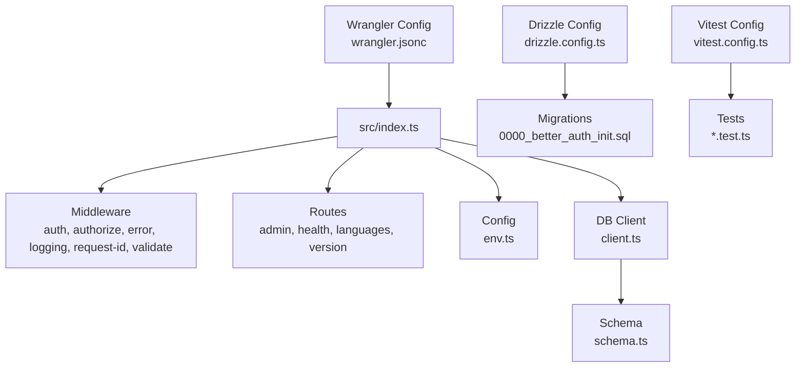
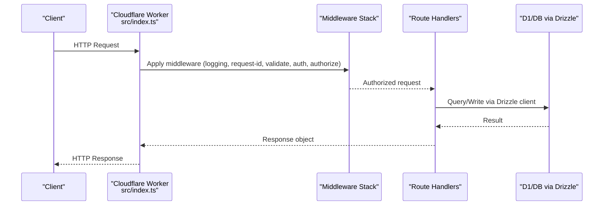
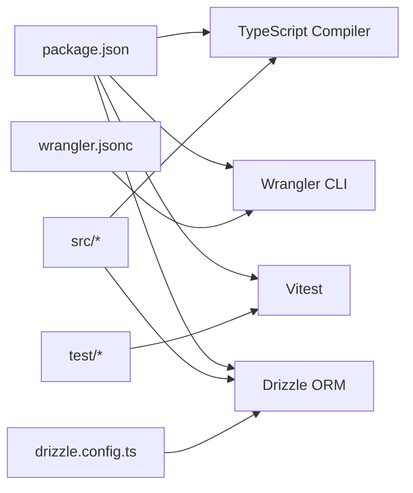

# Getting Started

<cite>
**Referenced Files in This Document**
- [README.md](file://README.md)
- [package.json](file://package.json)
- [tsconfig.json](file://tsconfig.json)
- [wrangler.jsonc](file://wrangler.jsonc)
- [.dev.vars.example](file://.dev.vars.example)
- [drizzle.config.ts](file://drizzle.config.ts)
- [vitest.config.ts](file://vitest.config.ts)
- [src/index.ts](file://src/index.ts)
- [src/config/env.ts](file://src/config/env.ts)
- [src/types/env.ts](file://src/types/env.ts)
- [src/db/client.ts](file://src/db/client.ts)
- [src/db/schema.ts](file://src/db/schema.ts)
- [drizzle/0000_better_auth_init.sql](file://drizzle/0000_better_auth_init.sql)
- [test/apply-migrations.ts](file://test/apply-migrations.ts)
- [test/auth-middleware.test.ts](file://test/auth-middleware.test.ts)
- [test/cors.test.ts](file://test/cors.test.ts)
- [test/error.test.ts](file://test/error.test.ts)
- [test/health.test.ts](file://test/health.test.ts)
- [test/session.test.ts](file://test/session.test.ts)
</cite>

## Table of Contents
1. Introduction
2. Project Structure
3. Core Components
4. Architecture Overview
5. Detailed Component Analysis
6. Dependency Analysis
7. Performance Considerations
8. Troubleshooting Guide
9. Conclusion
10. Appendices

## Introduction
This guide helps you get TrackDub API up and running quickly. You will set up the development environment, configure Cloudflare Workers, initialize the database with Drizzle migrations, run tests with Vitest, and deploy to Cloudflare. It assumes basic familiarity with TypeScript fundamentals, REST API concepts, and the Cloudflare ecosystem (Workers, KV/D1/R2 as applicable).

Prerequisites:
- Node.js LTS and npm or pnpm
- Basic TypeScript knowledge (types, modules, tsconfig)
- Understanding of REST APIs (HTTP methods, status codes, headers)
- Familiarity with Cloudflare Workers and Wrangler CLI
- A Cloudflare account and a D1 database instance for local and production

## Project Structure
TrackDub is a Cloudflare Workers application built with TypeScript, Drizzle ORM, and Vitest for testing. The entry point serves HTTP requests, middleware handles auth, validation, logging, and errors, and routes expose endpoints. Database configuration and schema live under src/db, while migrations are managed via Drizzle.

**Diagram sources**
- [src/index.ts](file://src/index.ts)
- [src/config/env.ts](file://src/config/env.ts)
- [src/db/client.ts](file://src/db/client.ts)
- [src/db/schema.ts](file://src/db/schema.ts)
- [drizzle.config.ts](file://drizzle.config.ts)
- [drizzle/0000_better_auth_init.sql](file://drizzle/0000_better_auth_init.sql)
- [wrangler.jsonc](file://wrangler.jsonc)
- [vitest.config.ts](file://vitest.config.ts)

**Section sources**
- [README.md](file://README.md)
- [package.json](file://package.json)
- [tsconfig.json](file://tsconfig.json)
- [wrangler.jsonc](file://wrangler.jsonc)
- [src/index.ts](file://src/index.ts)
- [src/config/env.ts](file://src/config/env.ts)
- [src/db/client.ts](file://src/db/client.ts)
- [src/db/schema.ts](file://src/db/schema.ts)
- [drizzle.config.ts](file://drizzle.config.ts)
- [drizzle/0000_better_auth_init.sql](file://drizzle/0000_better_auth_init.sql)
- [vitest.config.ts](file://vitest.config.ts)

## Core Components
- Entry point and server setup: The main worker initializes middleware, routes, and environment configuration.
- Environment configuration: Centralized env loading and type-safe access for runtime variables.
- Database client and schema: Drizzle client setup and schema definitions used by migrations and queries.
- Middleware stack: Authentication, authorization, validation, logging, request ID generation, and error handling.
- Routes: Health check, admin, languages, and version endpoints.
- Testing: Vitest configuration and test utilities including migration application helpers.

Key files to review during setup:
- [src/index.ts](file://src/index.ts)
- [src/config/env.ts](file://src/config/env.ts)
- [src/types/env.ts](file://src/types/env.ts)
- [src/db/client.ts](file://src/db/client.ts)
- [src/db/schema.ts](file://src/db/schema.ts)
- [wrangler.jsonc](file://wrangler.jsonc)
- [drizzle.config.ts](file://drizzle.config.ts)
- [vitest.config.ts](file://vitest.config.ts)

**Section sources**
- [src/index.ts](file://src/index.ts)
- [src/config/env.ts](file://src/config/env.ts)
- [src/types/env.ts](file://src/types/env.ts)
- [src/db/client.ts](file://src/db/client.ts)
- [src/db/schema.ts](file://src/db/schema.ts)
- [wrangler.jsonc](file://wrangler.jsonc)
- [drizzle.config.ts](file://drizzle.config.ts)
- [vitest.config.ts](file://vitest.config.ts)

## Architecture Overview
The API follows a layered architecture:
- Request lifecycle: Incoming HTTP request -> middleware chain -> route handler -> DB operations -> response.
- Configuration: Environment variables validated at startup; secrets loaded from .dev.vars locally and Wrangler bindings in production.
- Data layer: Drizzle ORM abstracts SQL; migrations ensure schema consistency across environments.

**Diagram sources**
- [src/index.ts](file://src/index.ts)
- [src/db/client.ts](file://src/db/client.ts)

## Detailed Component Analysis

### Environment Setup and Configuration
- Local variables: Copy the example file to create your local vars file and fill in required keys.
- Wrangler configuration: Define bindings, compatibility flags, and deployment settings.
- Type-safe env access: Use the typed env module to read and validate variables at runtime.

Steps:
1. Create local variables file from the example template.
2. Ensure Wrangler is authenticated and configured for your project.
3. Verify that all required environment variables are present before starting the worker.

Relevant files:
- [.dev.vars.example](file://.dev.vars.example)
- [wrangler.jsonc](file://wrangler.jsonc)
- [src/config/env.ts](file://src/config/env.ts)
- [src/types/env.ts](file://src/types/env.ts)

**Section sources**
- [.dev.vars.example](file://.dev.vars.example)
- [wrangler.jsonc](file://wrangler.jsonc)
- [src/config/env.ts](file://src/config/env.ts)
- [src/types/env.ts](file://src/types/env.ts)

### Database Initialization with Drizzle
- Schema and migrations: Schema is defined in code and persisted via SQL migration files.
- Drizzle config: Points to the schema and migration files and defines the target database.
- Test migrations: A helper applies migrations in tests to ensure isolated state.

Steps:
1. Initialize or connect to a D1 database using Wrangler.
2. Run Drizzle migrations to apply the initial schema.
3. For tests, use the provided helper to apply migrations automatically.

Relevant files:
- [drizzle.config.ts](file://drizzle.config.ts)
- [src/db/schema.ts](file://src/db/schema.ts)
- [drizzle/0000_better_auth_init.sql](file://drizzle/0000_better_auth_init.sql)
- [test/apply-migrations.ts](file://test/apply-migrations.ts)

**Section sources**
- [drizzle.config.ts](file://drizzle.config.ts)
- [src/db/schema.ts](file://src/db/schema.ts)
- [drizzle/0000_better_auth_init.sql](file://drizzle/0000_better_auth_init.sql)
- [test/apply-migrations.ts](file://test/apply-migrations.ts)

### Running Tests with Vitest
- Test runner: Vitest is configured for TypeScript and Workers-compatible globals.
- Test suites: Coverage includes auth middleware, CORS, error handling, health endpoint, and session behavior.
- Migration helper: Tests can apply migrations to ensure consistent DB state.

Steps:
1. Install dependencies.
2. Run unit tests with the default script.
3. Optionally, run specific test files or suites.

Relevant files:
- [vitest.config.ts](file://vitest.config.ts)
- [test/auth-middleware.test.ts](file://test/auth-middleware.test.ts)
- [test/cors.test.ts](file://test/cors.test.ts)
- [test/error.test.ts](file://test/error.test.ts)
- [test/health.test.ts](file://test/health.test.ts)
- [test/session.test.ts](file://test/session.test.ts)

**Section sources**
- [vitest.config.ts](file://vitest.config.ts)
- [test/auth-middleware.test.ts](file://test/auth-middleware.test.ts)
- [test/cors.test.ts](file://test/cors.test.ts)
- [test/error.test.ts](file://test/error.test.ts)
- [test/health.test.ts](file://test/health.test.ts)
- [test/session.test.ts](file://test/session.test.ts)

### Development Workflow
- Start the local dev server using Wrangler.
- Ensure environment variables are present in the local vars file.
- Apply migrations before running the app if needed.
- Use the health endpoint to verify the service is running.

Commands overview:
- Install dependencies
- Start local development server
- Apply migrations
- Run tests

Relevant files:
- [package.json](file://package.json)
- [wrangler.jsonc](file://wrangler.jsonc)
- [drizzle.config.ts](file://drizzle.config.ts)
- [.dev.vars.example](file://.dev.vars.example)

**Section sources**
- [package.json](file://package.json)
- [wrangler.jsonc](file://wrangler.jsonc)
- [drizzle.config.ts](file://drizzle.config.ts)
- [.dev.vars.example](file://.dev.vars.example)

### Deployment Considerations
- Bindings: Ensure all required bindings (e.g., D1, KV, R2) are declared in Wrangler config and available in production.
- Secrets: Use Wrangler secrets or environment variables for sensitive values.
- Compatibility: Confirm compatibility flags and Node.js mode settings match your runtime needs.
- CI/CD: Automate build, migration, and deploy steps using Wrangler commands.

Relevant files:
- [wrangler.jsonc](file://wrangler.jsonc)
- [package.json](file://package.json)

**Section sources**
- [wrangler.jsonc](file://wrangler.jsonc)
- [package.json](file://package.json)

## Dependency Analysis
TrackDub relies on:
- Cloudflare Workers runtime and Wrangler CLI
- Drizzle ORM for database access and migrations
- Vitest for testing
- TypeScript tooling for compilation and type safety

**Diagram sources**
- [package.json](file://package.json)
- [wrangler.jsonc](file://wrangler.jsonc)
- [drizzle.config.ts](file://drizzle.config.ts)
- [vitest.config.ts](file://vitest.config.ts)

**Section sources**
- [package.json](file://package.json)
- [wrangler.jsonc](file://wrangler.jsonc)
- [drizzle.config.ts](file://drizzle.config.ts)
- [vitest.config.ts](file://vitest.config.ts)

## Performance Considerations
- Keep middleware minimal and efficient; avoid heavy computations per request.
- Use connection pooling where supported by your database driver.
- Cache frequently accessed data with KV when appropriate.
- Profile cold starts by minimizing initialization work in the worker entrypoint.

[No sources needed since this section provides general guidance]

## Troubleshooting Guide
Common issues and resolutions:
- Missing environment variables: Ensure .dev.vars contains all required keys and matches types defined in the env module.
- Migration failures: Verify Drizzle config points to the correct schema and migration files; re-run migrations against the intended database.
- Wrangler authentication: Log in to Wrangler and confirm permissions for your project and resources.
- CORS errors: Check allowed origins and methods in your middleware and Wrangler configuration.
- Test failures: Ensure the migration helper runs before tests that require DB state.

Relevant files:
- [.dev.vars.example](file://.dev.vars.example)
- [src/config/env.ts](file://src/config/env.ts)
- [drizzle.config.ts](file://drizzle.config.ts)
- [wrangler.jsonc](file://wrangler.jsonc)
- [test/apply-migrations.ts](file://test/apply-migrations.ts)

**Section sources**
- [.dev.vars.example](file://.dev.vars.example)
- [src/config/env.ts](file://src/config/env.ts)
- [drizzle.config.ts](file://drizzle.config.ts)
- [wrangler.jsonc](file://wrangler.jsonc)
- [test/apply-migrations.ts](file://test/apply-migrations.ts)

## Conclusion
You now have the essentials to develop, test, and deploy TrackDub API on Cloudflare Workers. Follow the setup steps, keep environment variables secure, apply migrations consistently, and leverage the provided tests to maintain reliability. Refer to the linked files for deeper insights into each component.

[No sources needed since this section summarizes without analyzing specific files]

## Appendices

### Prerequisite Knowledge
- TypeScript: Modules, types, interfaces, tsconfig basics
- REST APIs: HTTP verbs, status codes, headers, JSON payloads
- Cloudflare Workers: Request/response model, bindings, Wrangler CLI

[No sources needed since this section provides general guidance]

### Quick Start Checklist
- Install dependencies
- Create local variables file from the example
- Authenticate Wrangler
- Initialize or connect to D1
- Apply migrations
- Start the dev server
- Run tests
- Deploy to production

[No sources needed since this section provides general guidance]