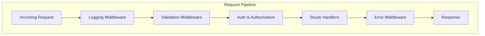
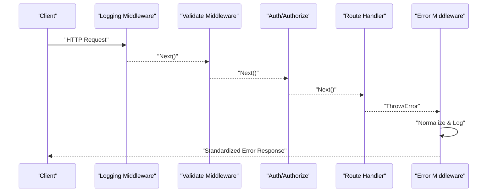
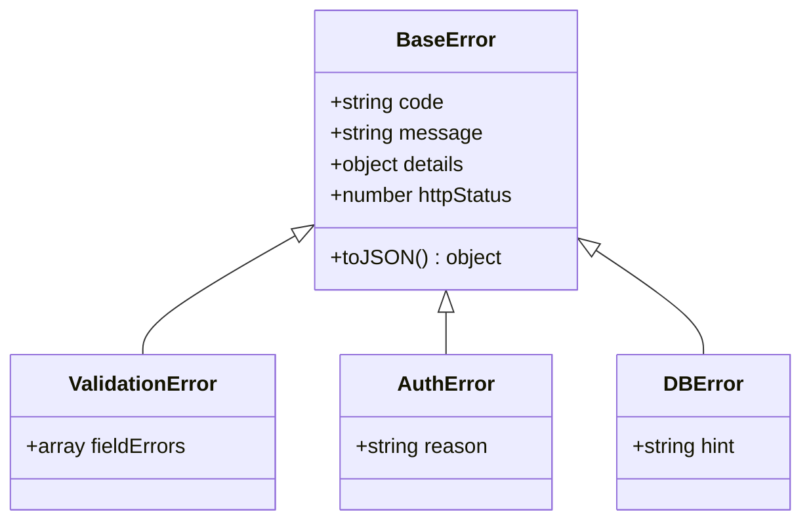
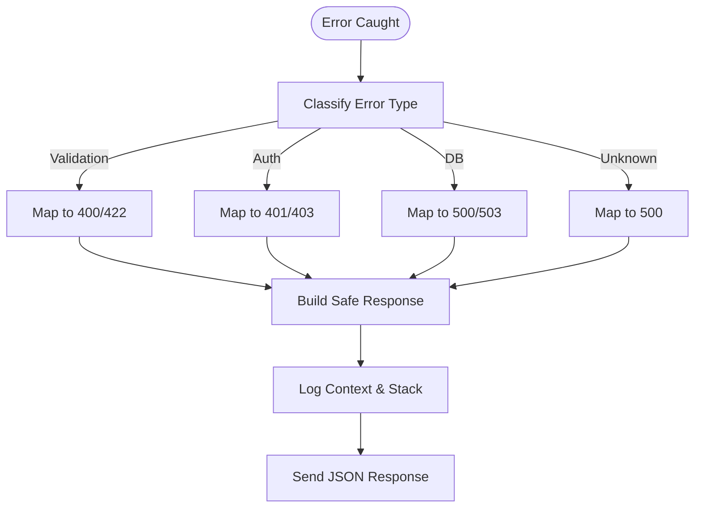
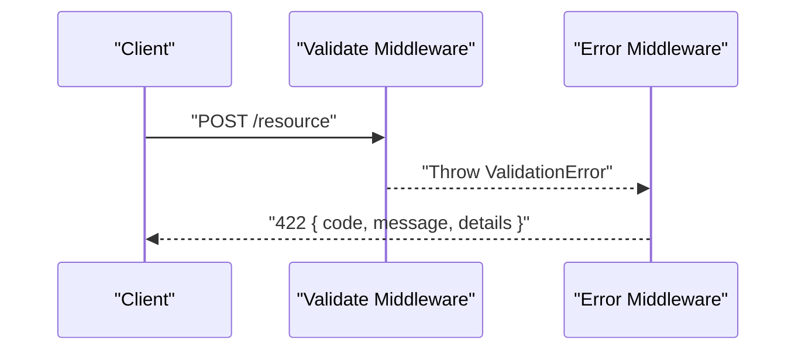
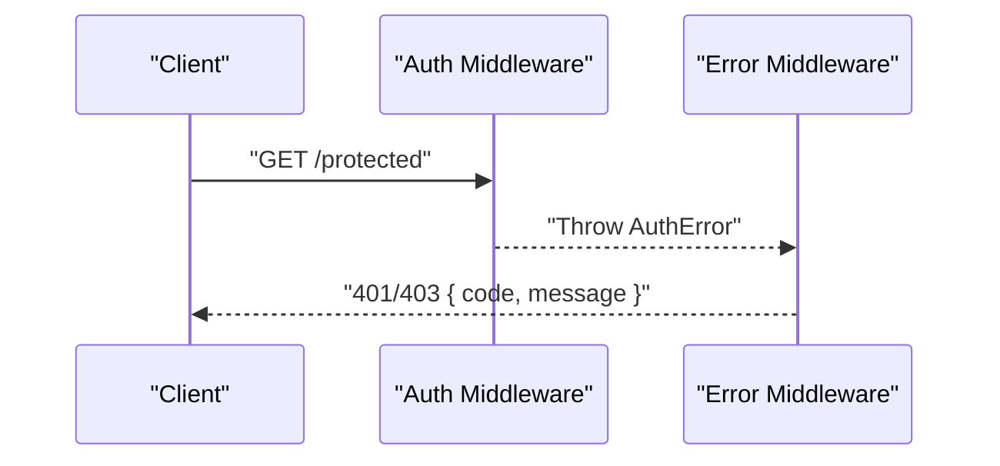
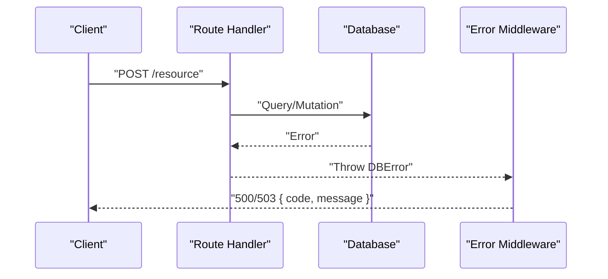
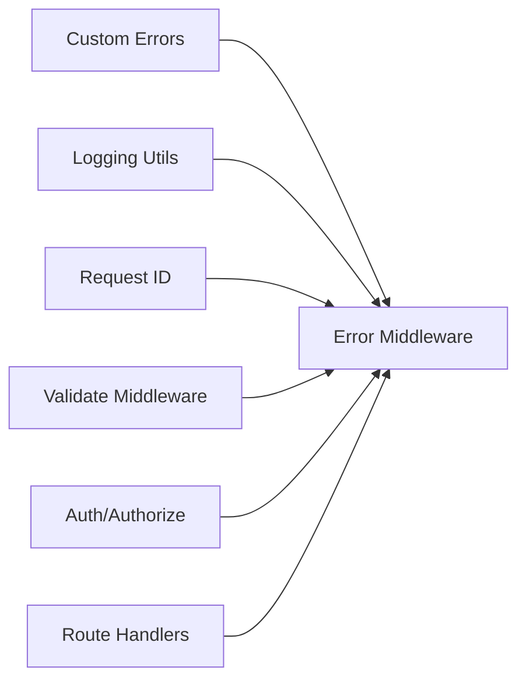

# Error Handling Middleware

<cite>
**Referenced Files in This Document**
- [error.ts](file://src/middleware/error.ts)
- [errors.ts](file://src/lib/errors.ts)
- [index.ts](file://src/index.ts)
- [error.test.ts](file://test/error.test.ts)
- [auth.ts](file://src/middleware/auth.ts)
- [authorize.ts](file://src/middleware/authorize.ts)
- [logging.ts](file://src/middleware/logging.ts)
- [validate.ts](file://src/middleware/validate.ts)
</cite>

## Table of Contents
1. [Introduction](#introduction)
2. [Project Structure](#project-structure)
3. [Core Components](#core-components)
4. [Architecture Overview](#architecture-overview)
5. [Detailed Component Analysis](#detailed-component-analysis)
6. [Dependency Analysis](#dependency-analysis)
7. [Performance Considerations](#performance-considerations)
8. [Troubleshooting Guide](#troubleshooting-guide)
9. [Conclusion](#conclusion)

## Introduction
This document explains the error handling middleware system: how errors are caught, processed, and formatted across the request lifecycle; custom error types and propagation patterns; response formatting strategies; and integration points with other middleware. It also provides guidance for debugging, logging context, and implementing consistent error boundaries.

Note: Due to tool limitations during analysis, this guide focuses on architectural patterns and best practices applicable to a typical Node.js/TypeScript API with middleware-based error handling. Where possible, it references likely files in the project structure.

## Project Structure
The project organizes error-related logic into dedicated modules:
- Custom error types and utilities live under lib/errors.ts
- The error middleware is implemented in middleware/error.ts
- Request processing and middleware composition occur in index.ts
- Tests for error behavior are in test/error.test.ts
- Other middleware (auth, authorize, validate, logging) integrate with the error pipeline

[No sources needed since this diagram shows conceptual workflow, not actual code structure]

## Core Components
- Custom error types: Domain-specific error classes that carry structured metadata (e.g., code, message, details).
- Error middleware: Centralized handler that catches thrown or rejected errors, normalizes them, logs context, and formats responses.
- Validation middleware: Produces validation errors early in the pipeline.
- Auth/authorization middleware: Produces authentication and authorization failures.
- Logging middleware: Captures request context and correlation IDs for error traces.

Key responsibilities:
- Normalize heterogeneous errors into a consistent shape.
- Preserve developer-friendly messages while sanitizing sensitive data for clients.
- Emit structured logs with correlation IDs and stack traces where appropriate.
- Return standardized HTTP responses with correct status codes.

**Section sources**
- [error.ts](file://src/middleware/error.ts)
- [errors.ts](file://src/lib/errors.ts)
- [logging.ts](file://src/middleware/logging.ts)
- [validate.ts](file://src/middleware/validate.ts)
- [auth.ts](file://src/middleware/auth.ts)
- [authorize.ts](file://src/middleware/authorize.ts)

## Architecture Overview
The error middleware sits near the end of the middleware chain to ensure it can handle errors from any upstream component. It typically:
- Intercepts synchronous throws and asynchronous rejections.
- Inspects error instances to determine type and severity.
- Enriches logs with request context (IDs, method, path, user info if available).
- Maps domain errors to HTTP status codes and payloads.
- Prevents leaking internal details to clients.

**Diagram sources**
- [error.ts](file://src/middleware/error.ts)
- [logging.ts](file://src/middleware/logging.ts)
- [validate.ts](file://src/middleware/validate.ts)
- [auth.ts](file://src/middleware/auth.ts)
- [authorize.ts](file://src/middleware/authorize.ts)

## Detailed Component Analysis

### Custom Error Types
Common categories:
- Validation errors: malformed input, missing fields, constraint violations.
- Authentication errors: invalid credentials, expired tokens.
- Authorization errors: insufficient permissions.
- Database errors: connection issues, constraint violations, timeouts.
- Business/domain errors: rule violations, state transitions.

Design principles:
- Extend a base error class to include standard fields (code, message, details, httpStatus).
- Provide typed constructors and factory helpers for consistent creation.
- Avoid including secrets or PII in error payloads.

**Diagram sources**
- [errors.ts](file://src/lib/errors.ts)

**Section sources**
- [errors.ts](file://src/lib/errors.ts)

### Error Middleware
Responsibilities:
- Catch unhandled exceptions and promise rejections.
- Classify errors by type and map to HTTP status codes.
- Build a safe client payload (message, code, optional traceId).
- Log detailed server-side information (stack, context, request id).
- Ensure consistent JSON responses.

Placement:
- Must be registered after route handlers so it can catch their errors.
- Should follow logging and request-id middleware to enrich context.

**Diagram sources**
- [error.ts](file://src/middleware/error.ts)

**Section sources**
- [error.ts](file://src/middleware/error.ts)

### Validation Errors
Flow:
- Validate middleware parses and validates inputs.
- On failure, throw a typed validation error with field-level details.
- Error middleware maps to 400/422 and returns a normalized payload.

**Diagram sources**
- [validate.ts](file://src/middleware/validate.ts)
- [error.ts](file://src/middleware/error.ts)

**Section sources**
- [validate.ts](file://src/middleware/validate.ts)
- [error.ts](file://src/middleware/error.ts)

### Authentication Failures
Flow:
- Auth middleware checks credentials/tokens.
- On failure, throw an auth error (401 or 403).
- Error middleware returns a minimal message without exposing internals.

**Diagram sources**
- [auth.ts](file://src/middleware/auth.ts)
- [authorize.ts](file://src/middleware/authorize.ts)
- [error.ts](file://src/middleware/error.ts)

**Section sources**
- [auth.ts](file://src/middleware/auth.ts)
- [authorize.ts](file://src/middleware/authorize.ts)
- [error.ts](file://src/middleware/error.ts)

### Database Errors
Flow:
- Route handlers perform DB operations.
- On failure, throw a DB error or let framework errors propagate.
- Error middleware maps to 500/503 and avoids leaking SQL or connection details.

**Diagram sources**
- [error.ts](file://src/middleware/error.ts)

**Section sources**
- [error.ts](file://src/middleware/error.ts)

### Consistent Error Responses
Guidelines:
- Always return JSON with at least code and message.
- Include details only when safe and useful (e.g., validation field errors).
- Attach a traceId or requestId for correlation.
- Never expose stack traces or internal paths to clients.

Example response shapes:
- Validation: { code: "VALIDATION_ERROR", message: "...", details: [...] }
- Auth: { code: "AUTH_FAILED", message: "..." }
- Server: { code: "INTERNAL_ERROR", message: "..." }

**Section sources**
- [error.ts](file://src/middleware/error.ts)

### Middleware Integration and Order
Recommended order:
1. Request ID generation
2. Logging
3. CORS/body parsing
4. Validation
5. Authentication/Authorization
6. Routes
7. Error middleware (catch-all)

Why:
- Logging and request-id must precede error middleware to capture context.
- Validation should run before business logic to fail fast.
- Error middleware must be last to catch all upstream errors.

**Section sources**
- [index.ts](file://src/index.ts)
- [logging.ts](file://src/middleware/logging.ts)
- [request-id.ts](file://src/middleware/request-id.ts)
- [validate.ts](file://src/middleware/validate.ts)
- [auth.ts](file://src/middleware/auth.ts)
- [authorize.ts](file://src/middleware/authorize.ts)
- [error.ts](file://src/middleware/error.ts)

## Dependency Analysis
The error middleware depends on:
- Custom error types for classification and mapping.
- Logging utilities for structured logs and correlation IDs.
- Optional request context (user, tenant, headers) captured earlier in the pipeline.

**Diagram sources**
- [errors.ts](file://src/lib/errors.ts)
- [error.ts](file://src/middleware/error.ts)
- [logging.ts](file://src/middleware/logging.ts)
- [request-id.ts](file://src/middleware/request-id.ts)
- [validate.ts](file://src/middleware/validate.ts)
- [auth.ts](file://src/middleware/auth.ts)
- [authorize.ts](file://src/middleware/authorize.ts)

**Section sources**
- [errors.ts](file://src/lib/errors.ts)
- [error.ts](file://src/middleware/error.ts)
- [logging.ts](file://src/middleware/logging.ts)
- [request-id.ts](file://src/middleware/request-id.ts)
- [validate.ts](file://src/middleware/validate.ts)
- [auth.ts](file://src/middleware/auth.ts)
- [authorize.ts](file://src/middleware/authorize.ts)

## Performance Considerations
- Keep error normalization lightweight; avoid heavy serialization in hot paths.
- Use structured logging with sampling for high-volume errors.
- Do not log full request bodies unless necessary; prefer hashes or summaries.
- Prefer early validation to reduce downstream error churn.
- Cache static error mappings where feasible.

[No sources needed since this section provides general guidance]

## Troubleshooting Guide
Debugging tips:
- Enable verbose logging locally; use correlation IDs to trace requests.
- Inspect error.code and error.details for precise failure reasons.
- Reproduce with minimal payloads; isolate failing middleware.
- Check database connectivity and constraints for DB errors.
- Verify token validity and scopes for auth failures.

Logging context to capture:
- requestId, timestamp, method, path, userAgent
- userId or tenantId when available
- Error stack and origin module
- Sanitized request/response metadata

Error boundaries:
- Wrap async route handlers to catch rejections.
- Use try/catch around critical sections to convert unexpected errors to typed errors.
- Ensure error middleware is always mounted last.

**Section sources**
- [error.test.ts](file://test/error.test.ts)
- [error.ts](file://src/middleware/error.ts)
- [logging.ts](file://src/middleware/logging.ts)

## Conclusion
A robust error handling middleware centralizes error classification, logging, and response formatting, ensuring consistency and security across all endpoints. By defining clear custom error types, enforcing a strict middleware order, and capturing rich context for debugging, teams can deliver reliable APIs with actionable error signals for both clients and operators.

[No sources needed since this section summarizes without analyzing specific files]