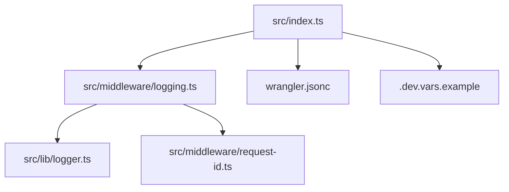
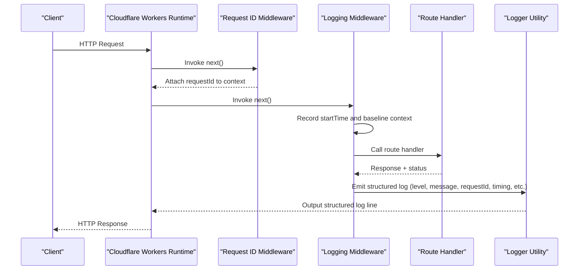
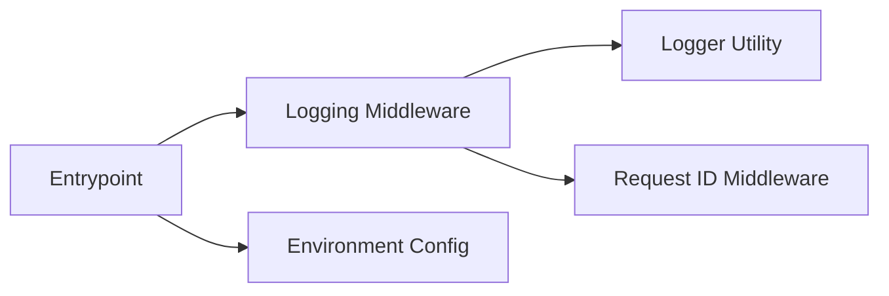

# Logging Middleware

<cite>
**Referenced Files in This Document**
- [src/lib/logger.ts](file://src/lib/logger.ts)
- [src/middleware/logging.ts](file://src/middleware/logging.ts)
- [src/middleware/request-id.ts](file://src/middleware/request-id.ts)
- [src/index.ts](file://src/index.ts)
- [wrangler.jsonc](file://wrangler.jsonc)
- [.dev.vars.example](file://.dev.vars.example)
</cite>

## Table of Contents
1. [Introduction](#introduction)
2. [Project Structure](#project-structure)
3. [Core Components](#core-components)
4. [Architecture Overview](#architecture-overview)
5. [Detailed Component Analysis](#detailed-component-analysis)
6. [Dependency Analysis](#dependency-analysis)
7. [Performance Considerations](#performance-considerations)
8. [Troubleshooting Guide](#troubleshooting-guide)
9. [Conclusion](#conclusion)
10. [Appendices](#appendices)

## Introduction
This document explains the structured logging middleware used in the application, focusing on how request and response data are captured, logged, and formatted consistently across the Cloudflare Workers runtime. It covers log levels, contextual information (request IDs, user context, timing), output formats, adding custom log entries, filtering sensitive data, configuring destinations, performance optimization for serverless environments, aggregation strategies, debugging techniques, and production best practices.

## Project Structure
The logging system is implemented as a reusable middleware that integrates with the application’s logger utility and request ID middleware. The key files involved are:
- Logger utility for structured logs
- Logging middleware to capture request/response lifecycle
- Request ID middleware to inject correlation identifiers
- Application entrypoint wiring the middleware stack
- Wrangler configuration for environment variables and destinations
- Development variables example for local configuration

**Diagram sources**
- [src/index.ts](file://src/index.ts)
- [src/middleware/logging.ts](file://src/middleware/logging.ts)
- [src/lib/logger.ts](file://src/lib/logger.ts)
- [src/middleware/request-id.ts](file://src/middleware/request-id.ts)
- [wrangler.jsonc](file://wrangler.jsonc)
- [.dev.vars.example](file://.dev.vars.example)

**Section sources**
- [src/index.ts](file://src/index.ts)
- [src/middleware/logging.ts](file://src/middleware/logging.ts)
- [src/lib/logger.ts](file://src/lib/logger.ts)
- [src/middleware/request-id.ts](file://src/middleware/request-id.ts)
- [wrangler.jsonc](file://wrangler.jsonc)
- [.dev.vars.example](file://.dev.vars.example)

## Core Components
- Structured logger utility: Provides typed methods for different log levels and supports attaching contextual fields such as request metadata, user identity, and timing.
- Logging middleware: Intercepts requests, measures duration, captures relevant request/response attributes, and emits structured logs at appropriate levels.
- Request ID middleware: Generates or forwards a unique identifier per request to correlate all logs within a single request flow.

Key responsibilities:
- Capture request method, path, headers (filtered), query parameters, and status codes
- Measure latency from start to end of request handling
- Inject consistent fields like timestamp, level, message, requestId, and service name
- Provide helpers to add custom log entries with contextual data
- Ensure sensitive data is never logged by design

**Section sources**
- [src/lib/logger.ts](file://src/lib/logger.ts)
- [src/middleware/logging.ts](file://src/middleware/logging.ts)
- [src/middleware/request-id.ts](file://src/middleware/request-id.ts)

## Architecture Overview
The logging middleware sits early in the request pipeline. It uses the request ID middleware to ensure every log includes a stable correlation ID. The logger utility formats logs into a structured JSON object suitable for consumption by Cloudflare’s logging infrastructure and external aggregators.

**Diagram sources**
- [src/middleware/request-id.ts](file://src/middleware/request-id.ts)
- [src/middleware/logging.ts](file://src/middleware/logging.ts)
- [src/lib/logger.ts](file://src/lib/logger.ts)

## Detailed Component Analysis

### Logger Utility
Responsibilities:
- Define log levels (e.g., debug, info, warn, error)
- Build structured log records with consistent keys
- Support contextual fields injection (requestId, userId, traceId, timing)
- Provide convenience methods for common scenarios (e.g., request started/completed)

Design considerations:
- Immutable context objects to avoid cross-request pollution
- Sensitive field redaction before serialization
- Minimal overhead in hot paths; defer heavy formatting until emission

Usage patterns:
- Use level-specific methods to emit logs
- Attach contextual data via a dedicated method or parameter
- Avoid logging large payloads; prefer summaries or hashes

**Section sources**
- [src/lib/logger.ts](file://src/lib/logger.ts)

### Logging Middleware
Responsibilities:
- Wrap request handling to measure duration and capture lifecycle events
- Extract safe request attributes (method, path, query, headers subset)
- Capture response status and size when available
- Merge request ID and other context into each log record
- Emit standardized log lines at appropriate levels

Behavior highlights:
- Always include requestId, timestamp, level, message, and service name
- Include timing metrics (start time, end time, durationMs)
- Filter out sensitive headers (e.g., authorization, cookies)
- Handle errors gracefully without breaking request flow

Customization points:
- Extend filters for additional headers or body parts
- Add custom fields to the log record (e.g., tenantId, region)
- Adjust sampling or suppression rules for high-volume endpoints

**Section sources**
- [src/middleware/logging.ts](file://src/middleware/logging.ts)

### Request ID Middleware
Responsibilities:
- Generate a unique identifier if none exists
- Forward existing identifiers from upstream headers when present
- Attach the identifier to the request context for downstream use

Best practices:
- Prefer standard header names for interoperability
- Validate format and length to prevent abuse
- Ensure idempotency and collision resistance

**Section sources**
- [src/middleware/request-id.ts](file://src/middleware/request-id.ts)

### Middleware Integration in Entrypoint
Responsibilities:
- Compose middleware in the correct order (request ID → logging → routes)
- Apply global error handling around the stack
- Configure environment-driven behavior (e.g., log verbosity)

Ordering rationale:
- Request ID must be set before logging so all logs carry correlation
- Logging should wrap handlers to capture full lifecycle
- Error middleware should be last to catch unhandled exceptions

**Section sources**
- [src/index.ts](file://src/index.ts)

## Dependency Analysis
The logging middleware depends on:
- Logger utility for structured output
- Request ID middleware for correlation
- Environment configuration for destinations and settings

**Diagram sources**
- [src/middleware/logging.ts](file://src/middleware/logging.ts)
- [src/lib/logger.ts](file://src/lib/logger.ts)
- [src/middleware/request-id.ts](file://src/middleware/request-id.ts)
- [src/index.ts](file://src/index.ts)

**Section sources**
- [src/middleware/logging.ts](file://src/middleware/logging.ts)
- [src/lib/logger.ts](file://src/lib/logger.ts)
- [src/middleware/request-id.ts](file://src/middleware/request-id.ts)
- [src/index.ts](file://src/index.ts)

## Performance Considerations
- Keep log payload small: avoid serializing large bodies or headers; summarize instead.
- Defer expensive operations: compute derived fields only when needed.
- Use appropriate log levels: reduce debug logs in production to minimize I/O.
- Batch emissions where possible: rely on the runtime’s buffering to reduce flush overhead.
- Avoid synchronous blocking: ensure logging calls are non-blocking and lightweight.
- Sample noisy endpoints: implement sampling for high-frequency logs to control volume.
- Minimize string concatenation: build structured objects directly and let the logger serialize once.

[No sources needed since this section provides general guidance]

## Troubleshooting Guide
Common issues and resolutions:
- Missing requestId in logs: verify request ID middleware runs before logging middleware.
- Excessive log volume: adjust log levels and enable sampling for high-traffic routes.
- Sensitive data leakage: review header/body filters and ensure redaction is applied before serialization.
- Inconsistent timestamps: ensure timestamps are generated at the earliest point in the request lifecycle.
- Logs not appearing in aggregator: check destination configuration and permissions in environment settings.

Debugging techniques:
- Enable verbose logging locally using development variables.
- Correlate logs using requestId across services and layers.
- Inspect structured fields to validate expected data presence.
- Reproduce issues with minimal payloads to isolate noise.

**Section sources**
- [src/middleware/logging.ts](file://src/middleware/logging.ts)
- [src/lib/logger.ts](file://src/lib/logger.ts)
- [src/middleware/request-id.ts](file://src/middleware/request-id.ts)

## Conclusion
The structured logging middleware provides a robust, consistent approach to capturing request/response data and emitting actionable logs in Cloudflare Workers. By combining correlation identifiers, careful data filtering, and structured output, it enables effective debugging, observability, and compliance in production. Adopting the recommended practices ensures optimal performance and reliability in serverless environments.

[No sources needed since this section summarizes without analyzing specific files]

## Appendices

### Log Levels and Contextual Fields
- Levels: debug, info, warn, error
- Standard fields: timestamp, level, message, requestId, service, durationMs, statusCode
- Optional fields: userId, tenantId, region, traceId, userAgent, ip

### Adding Custom Log Entries
- Use the logger’s level-specific methods to emit custom messages
- Attach contextual fields via the provided helper to maintain consistency
- Avoid logging secrets or large payloads; prefer hashes or summaries

### Filtering Sensitive Data
- Exclude authorization headers, cookies, tokens, and personal data
- Redact or hash any required identifiers before inclusion
- Centralize filter rules in the logger or middleware configuration

### Configuring Log Destinations
- Set environment variables for destination selection and credentials
- Use separate configurations for dev, staging, and prod
- Validate permissions and quotas for external aggregators

### Cloudflare Workers Integration
- Leverage built-in console and worker logs for structured output
- Route logs to external sinks via environment-configured destinations
- Monitor usage and costs associated with log egress

### Aggregation Strategies
- Ship logs to centralized platforms (e.g., ELK, Datadog, Splunk)
- Use structured JSON for easy parsing and querying
- Implement retention policies and indexing strategies

### Best Practices for Production
- Enforce strict log levels and sampling
- Audit logs regularly for sensitive data exposure
- Maintain correlation across distributed components
- Document log schemas and evolve them carefully

**Section sources**
- [wrangler.jsonc](file://wrangler.jsonc)
- [.dev.vars.example](file://.dev.vars.example)