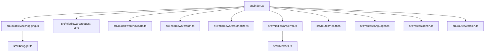
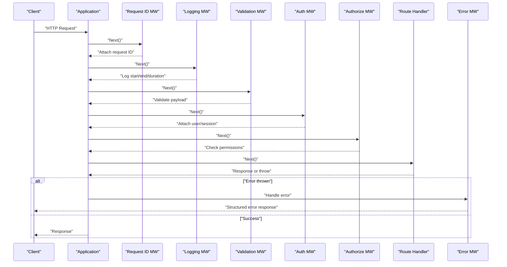
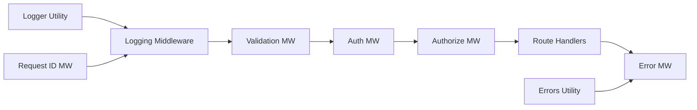

# Middleware Stack

<cite>
**Referenced Files in This Document**
- [index.ts](file://src/index.ts)
- [logging.ts](file://src/middleware/logging.ts)
- [request-id.ts](file://src/middleware/request-id.ts)
- [validate.ts](file://src/middleware/validate.ts)
- [auth.ts](file://src/middleware/auth.ts)
- [authorize.ts](file://src/middleware/authorize.ts)
- [error.ts](file://src/middleware/error.ts)
- [health.ts](file://src/routes/health.ts)
- [languages.ts](file://src/routes/languages.ts)
- [admin.ts](file://src/routes/admin.ts)
- [version.ts](file://src/routes/version.ts)
- [logger.ts](file://src/lib/logger.ts)
- [errors.ts](file://src/lib/errors.ts)
</cite>

## Table of Contents
1. [Introduction](#introduction)
2. [Project Structure](#project-structure)
3. [Core Components](#core-components)
4. [Architecture Overview](#architecture-overview)
5. [Detailed Component Analysis](#detailed-component-analysis)
6. [Dependency Analysis](#dependency-analysis)
7. [Performance Considerations](#performance-considerations)
8. [Troubleshooting Guide](#troubleshooting-guide)
9. [Conclusion](#conclusion)
10. [Appendices](#appendices)

## Introduction
This document explains the middleware system architecture, focusing on how requests and responses flow through a composable stack, how middleware is ordered, and how each component contributes to structured logging, request ID generation, input validation, authentication, authorization, and error handling. It also provides guidance for creating custom middleware, chaining functions, handling asynchronous operations, integrating with routing, and debugging middleware behavior. The content is designed to be accessible to beginners while offering advanced patterns for experienced developers extending the system.

## Project Structure
The middleware system lives under src/middleware and integrates with routes defined under src/routes. Core utilities for logging and errors are under src/lib. The application entry point wires up middleware and routes.

**Diagram sources**
- [index.ts](file://src/index.ts)
- [logging.ts](file://src/middleware/logging.ts)
- [request-id.ts](file://src/middleware/request-id.ts)
- [validate.ts](file://src/middleware/validate.ts)
- [auth.ts](file://src/middleware/auth.ts)
- [authorize.ts](file://src/middleware/authorize.ts)
- [error.ts](file://src/middleware/error.ts)
- [health.ts](file://src/routes/health.ts)
- [languages.ts](file://src/routes/languages.ts)
- [admin.ts](file://src/routes/admin.ts)
- [version.ts](file://src/routes/version.ts)
- [logger.ts](file://src/lib/logger.ts)
- [errors.ts](file://src/lib/errors.ts)

**Section sources**
- [index.ts](file://src/index.ts)
- [logging.ts](file://src/middleware/logging.ts)
- [request-id.ts](file://src/middleware/request-id.ts)
- [validate.ts](file://src/middleware/validate.ts)
- [auth.ts](file://src/middleware/auth.ts)
- [authorize.ts](file://src/middleware/authorize.ts)
- [error.ts](file://src/middleware/error.ts)
- [health.ts](file://src/routes/health.ts)
- [languages.ts](file://src/routes/languages.ts)
- [admin.ts](file://src/routes/admin.ts)
- [version.ts](file://src/routes/version.ts)
- [logger.ts](file://src/lib/logger.ts)
- [errors.ts](file://src/lib/errors.ts)

## Core Components
- Logging middleware: Adds structured logs around request lifecycle (start, end, duration).
- Request ID middleware: Generates or propagates a unique identifier per request and attaches it to context/logs.
- Validation middleware: Validates incoming request payloads against schemas and returns standardized errors.
- Authentication middleware: Verifies identity (e.g., tokens/sessions) and enriches the request context with user info.
- Authorization middleware: Enforces access control based on roles/permissions after authentication.
- Error middleware: Centralizes error formatting, status codes, and structured error logs.

These components follow a consistent interface so they can be composed into a pipeline that processes requests in a predictable order.

**Section sources**
- [logging.ts](file://src/middleware/logging.ts)
- [request-id.ts](file://src/middleware/request-id.ts)
- [validate.ts](file://src/middleware/validate.ts)
- [auth.ts](file://src/middleware/auth.ts)
- [authorize.ts](file://src/middleware/authorize.ts)
- [error.ts](file://src/middleware/error.ts)

## Architecture Overview
The request/response pipeline is a chain of middleware functions executed in order. Each middleware can:
- Inspect and mutate the request
- Attach data to the response
- Short-circuit by sending a response early
- Throw or return an error to propagate downstream

Typical execution order:
1. Request ID
2. Logging
3. Validation
4. Authentication
5. Authorization
6. Route handler
7. Error handling (if any error occurred)

**Diagram sources**
- [index.ts](file://src/index.ts)
- [logging.ts](file://src/middleware/logging.ts)
- [request-id.ts](file://src/middleware/request-id.ts)
- [validate.ts](file://src/middleware/validate.ts)
- [auth.ts](file://src/middleware/auth.ts)
- [authorize.ts](file://src/middleware/authorize.ts)
- [error.ts](file://src/middleware/error.ts)

## Detailed Component Analysis

### Logging Middleware
Responsibilities:
- Log request start and completion with method, path, and timing
- Include request ID in log entries for correlation
- Capture response status and duration

Execution characteristics:
- Wraps next() to measure elapsed time
- Uses structured logger utility for consistent output

Integration points:
- Depends on request ID being present (should run after request ID middleware)
- Consumes logger utility for output

**Section sources**
- [logging.ts](file://src/middleware/logging.ts)
- [logger.ts](file://src/lib/logger.ts)

### Request ID Middleware
Responsibilities:
- Generate a unique ID if not provided
- Attach ID to request context and headers for propagation
- Ensure downstream components can correlate logs and traces

Behavior:
- Skips regeneration if header already exists
- Sets response header for client visibility

**Section sources**
- [request-id.ts](file://src/middleware/request-id.ts)

### Validation Middleware
Responsibilities:
- Parse and validate request body/query/params against schema
- Return standardized error responses on failure
- Pass validated data to downstream handlers

Error handling:
- Converts validation failures into structured error responses
- Ensures consistent error shape across endpoints

**Section sources**
- [validate.ts](file://src/middleware/validate.ts)

### Authentication Middleware
Responsibilities:
- Verify credentials (e.g., token/session)
- Attach authenticated user/session to request context
- Reject unauthenticated requests with appropriate status

Security considerations:
- Fail fast on invalid credentials
- Avoid leaking sensitive information in logs

**Section sources**
- [auth.ts](file://src/middleware/auth.ts)

### Authorization Middleware
Responsibilities:
- Enforce role/permission checks after authentication
- Allow or deny access based on policy
- Provide clear error messages for unauthorized attempts

Policy integration:
- Can read resource/action from route metadata or request context
- Supports fine-grained checks before reaching route handlers

**Section sources**
- [authorize.ts](file://src/middleware/authorize.ts)

### Error Middleware
Responsibilities:
- Catch errors thrown by upstream middleware or handlers
- Normalize error shapes and set HTTP status codes
- Emit structured error logs including request ID and context

Error propagation:
- Ensures no unhandled exceptions escape to the runtime
- Provides consistent error responses to clients

**Section sources**
- [error.ts](file://src/middleware/error.ts)
- [errors.ts](file://src/lib/errors.ts)

### Routing Integration
Routes are defined under src/routes and registered in the application entry point. Middleware is applied globally or per-route to enforce cross-cutting concerns.

Examples of route files:
- Health check endpoint
- Languages management
- Admin endpoints
- Version endpoint

Routing typically follows this pattern:
- Register global middleware stack
- Mount route-specific middleware where needed
- Define handlers that rely on enriched request context

**Section sources**
- [index.ts](file://src/index.ts)
- [health.ts](file://src/routes/health.ts)
- [languages.ts](file://src/routes/languages.ts)
- [admin.ts](file://src/routes/admin.ts)
- [version.ts](file://src/routes/version.ts)

## Dependency Analysis
Middleware dependencies and relationships:
- Logging depends on logger utility and request ID presence
- Validation depends on schema definitions and error normalization
- Authentication depends on credential stores or providers
- Authorization depends on authenticated context and policy rules
- Error middleware depends on error utilities and request context

**Diagram sources**
- [logging.ts](file://src/middleware/logging.ts)
- [request-id.ts](file://src/middleware/request-id.ts)
- [validate.ts](file://src/middleware/validate.ts)
- [auth.ts](file://src/middleware/auth.ts)
- [authorize.ts](file://src/middleware/authorize.ts)
- [error.ts](file://src/middleware/error.ts)
- [logger.ts](file://src/lib/logger.ts)
- [errors.ts](file://src/lib/errors.ts)

**Section sources**
- [logging.ts](file://src/middleware/logging.ts)
- [request-id.ts](file://src/middleware/request-id.ts)
- [validate.ts](file://src/middleware/validate.ts)
- [auth.ts](file://src/middleware/auth.ts)
- [authorize.ts](file://src/middleware/authorize.ts)
- [error.ts](file://src/middleware/error.ts)
- [logger.ts](file://src/lib/logger.ts)
- [errors.ts](file://src/lib/errors.ts)

## Performance Considerations
- Keep middleware lightweight; avoid heavy computations in hot paths
- Use request ID early to enable efficient log correlation without extra lookups
- Validate inputs early to fail fast and reduce downstream work
- Cache expensive lookups when safe (e.g., feature flags, config)
- Avoid unnecessary object allocations inside middleware loops
- Stream large payloads when possible; parse only what you need
- Measure middleware latency via logging middleware and optimize bottlenecks

[No sources needed since this section provides general guidance]

## Troubleshooting Guide
Common issues and debugging techniques:
- Missing request ID: Ensure request ID middleware runs before logging and validation
- Validation errors: Check schema definitions and ensure correct parsing order
- Authentication failures: Verify credential sources and token formats
- Authorization denials: Confirm roles/permissions and policy logic
- Unhandled errors: Confirm error middleware is last and catches all exceptions
- Structured logs: Use request ID to trace across services and components

Debugging tips:
- Add temporary debug logs in middleware with request ID
- Inspect response headers for request ID propagation
- Reproduce with minimal middleware chain to isolate issues
- Use test suites to assert middleware behavior and error shapes

**Section sources**
- [logging.ts](file://src/middleware/logging.ts)
- [request-id.ts](file://src/middleware/request-id.ts)
- [validate.ts](file://src/middleware/validate.ts)
- [auth.ts](file://src/middleware/auth.ts)
- [authorize.ts](file://src/middleware/authorize.ts)
- [error.ts](file://src/middleware/error.ts)
- [logger.ts](file://src/lib/logger.ts)
- [errors.ts](file://src/lib/errors.ts)

## Conclusion
The middleware stack provides a robust, composable pipeline for request processing. By ordering middleware correctly and following consistent patterns, you can implement secure, observable, and maintainable APIs. Use the provided components as building blocks and extend them with custom middleware to meet evolving requirements.

[No sources needed since this section summarizes without analyzing specific files]

## Appendices

### Creating Custom Middleware
Guidelines:
- Accept request and next function parameters
- Perform side effects (logging, validation, enrichment)
- Call next() to continue the chain
- Handle errors and short-circuit when necessary
- Attach contextual data to the request for downstream use

Chaining middleware:
- Compose middleware in the desired order in the application entry point
- Apply global middleware once and route-specific middleware where needed

Asynchronous operations:
- Await async tasks within middleware (e.g., DB queries, external calls)
- Ensure proper error handling and timeouts
- Propagate errors to the error middleware consistently

Relationships with routing:
- Register middleware before route handlers
- Use route-level middleware for scoped concerns (e.g., admin-only routes)

Authentication and authorization flows:
- Authentication should precede authorization
- Enrich request context with user/session data
- Enforce policies based on roles/permissions before reaching handlers

**Section sources**
- [index.ts](file://src/index.ts)
- [logging.ts](file://src/middleware/logging.ts)
- [request-id.ts](file://src/middleware/request-id.ts)
- [validate.ts](file://src/middleware/validate.ts)
- [auth.ts](file://src/middleware/auth.ts)
- [authorize.ts](file://src/middleware/authorize.ts)
- [error.ts](file://src/middleware/error.ts)