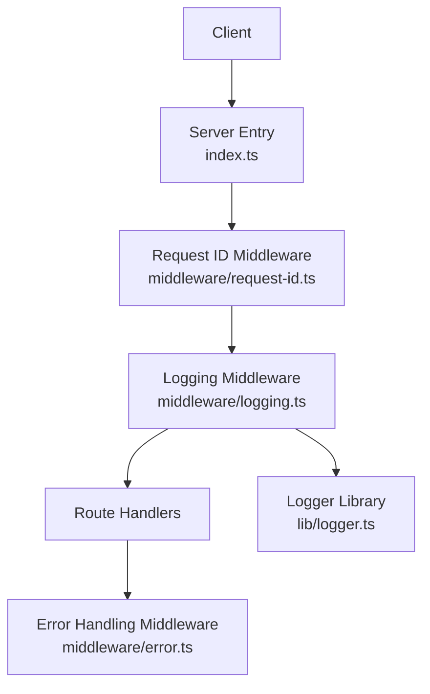
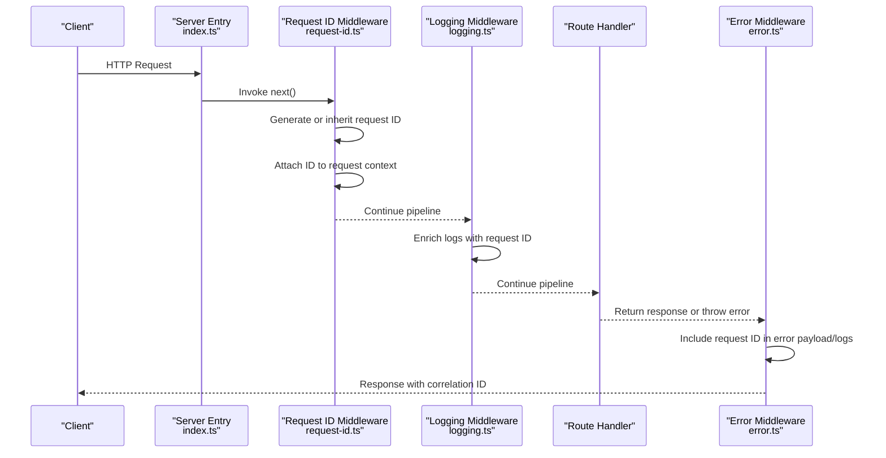
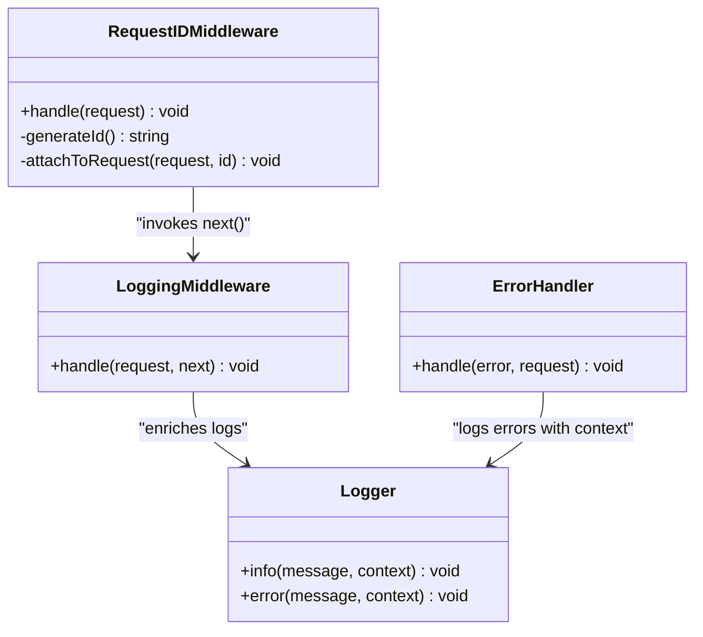

# Request ID Middleware

<cite>
**Referenced Files in This Document**
- [request-id.ts](file://src/middleware/request-id.ts)
- [logging.ts](file://src/middleware/logging.ts)
- [error.ts](file://src/middleware/error.ts)
- [index.ts](file://src/index.ts)
- [logger.ts](file://src/lib/logger.ts)
</cite>

## Table of Contents
1. [Introduction](#introduction)
2. [Project Structure](#project-structure)
3. [Core Components](#core-components)
4. [Architecture Overview](#architecture-overview)
5. [Detailed Component Analysis](#detailed-component-analysis)
6. [Dependency Analysis](#dependency-analysis)
7. [Performance Considerations](#performance-considerations)
8. [Troubleshooting Guide](#troubleshooting-guide)
9. [Conclusion](#conclusion)
10. [Appendices](#appendices)

## Introduction
This document explains the request ID generation and propagation middleware used across the application’s processing pipeline. It covers how unique identifiers are created for each incoming request, attached to the request context, and propagated through all subsequent middleware and route handlers. It also documents the ID format, generation strategy, inclusion in logs and error responses, and best practices for distributed tracing and debugging in serverless environments.

## Project Structure
The request ID feature is implemented as a dedicated middleware that runs early in the request lifecycle. It integrates with logging and error handling middleware to ensure consistent correlation across the entire stack.

**Diagram sources**
- [index.ts](file://src/index.ts)
- [request-id.ts](file://src/middleware/request-id.ts)
- [logging.ts](file://src/middleware/logging.ts)
- [error.ts](file://src/middleware/error.ts)
- [logger.ts](file://src/lib/logger.ts)

**Section sources**
- [index.ts](file://src/index.ts)
- [request-id.ts](file://src/middleware/request-id.ts)
- [logging.ts](file://src/middleware/logging.ts)
- [error.ts](file://src/middleware/error.ts)
- [logger.ts](file://src/lib/logger.ts)

## Core Components
- Request ID Middleware: Generates or inherits a unique identifier per request and attaches it to the request context for downstream use.
- Logging Middleware: Ensures every log line includes the request ID for correlation.
- Error Handling Middleware: Includes the request ID in error responses and structured error logs.
- Logger Library: Provides a centralized logging interface that can include contextual fields such as request ID.

Key responsibilities:
- Generate a stable, globally unique ID when none exists in the incoming request.
- Preserve an existing request ID if provided by upstream systems (e.g., reverse proxy).
- Attach the ID to the request object so it is accessible throughout the pipeline.
- Ensure the ID is present in logs and error payloads.

**Section sources**
- [request-id.ts](file://src/middleware/request-id.ts)
- [logging.ts](file://src/middleware/logging.ts)
- [error.ts](file://src/middleware/error.ts)
- [logger.ts](file://src/lib/logger.ts)

## Architecture Overview
The middleware chain ensures that every request carries a single source of truth for its identifier from entry to exit.

**Diagram sources**
- [index.ts](file://src/index.ts)
- [request-id.ts](file://src/middleware/request-id.ts)
- [logging.ts](file://src/middleware/logging.ts)
- [error.ts](file://src/middleware/error.ts)

## Detailed Component Analysis

### Request ID Middleware
Responsibilities:
- Determine whether an incoming request already contains a request ID header. If yes, reuse it; otherwise, generate a new one.
- Attach the ID to the request object in a predictable location for easy access in handlers and utilities.
- Ensure the ID is available to logging and error-handling layers.

Generation strategy and format:
- The ID should be globally unique and deterministic enough to correlate traces across services.
- A common approach is to use a UUID v4 string or a compact random token. The exact implementation resides in the middleware file.

Propagation:
- The ID is attached to the request object immediately after generation/inheritance.
- Downstream components read the ID from the same location without additional setup.

Access patterns:
- Route handlers can read the ID from the request object.
- Custom middleware can read and forward the ID as needed.
- Utility functions can accept the ID via parameters or extract it from the current request context.

Best practices:
- Do not overwrite an existing request ID unless explicitly required by upstream policy.
- Keep the ID immutable during the lifetime of the request.
- Avoid heavy computation in the ID generator to maintain low latency.

**Section sources**
- [request-id.ts](file://src/middleware/request-id.ts)

#### Class Diagram: Request ID Flow

**Diagram sources**
- [request-id.ts](file://src/middleware/request-id.ts)
- [logging.ts](file://src/middleware/logging.ts)
- [error.ts](file://src/middleware/error.ts)
- [logger.ts](file://src/lib/logger.ts)

### Logging Middleware
Responsibilities:
- Ensure every log entry includes the request ID for correlation.
- Wrap handler execution to capture timing and status information alongside the ID.

Integration points:
- Reads the request ID from the same location set by the request ID middleware.
- Uses the logger library to emit structured logs with the ID included.

**Section sources**
- [logging.ts](file://src/middleware/logging.ts)
- [logger.ts](file://src/lib/logger.ts)

### Error Handling Middleware
Responsibilities:
- Capture errors thrown by downstream handlers.
- Include the request ID in both error responses and error logs to aid debugging.

Integration points:
- Reads the request ID from the request object.
- Uses the logger library to record structured error events.

**Section sources**
- [error.ts](file://src/middleware/error.ts)
- [logger.ts](file://src/lib/logger.ts)

### Server Entry and Middleware Ordering
Responsibilities:
- Initialize the middleware chain and ensure the request ID middleware runs before logging and error handling.
- Provide a consistent entry point for all requests.

Ordering considerations:
- Request ID must run first so all subsequent layers can rely on its presence.
- Logging should follow to enrich logs with the ID.
- Error handling should be last to catch and annotate errors with the ID.

**Section sources**
- [index.ts](file://src/index.ts)

## Dependency Analysis
The request ID middleware has minimal dependencies but is central to observability. It depends on the request/response contract of the runtime and exposes the ID to other layers.

**Diagram sources**
- [index.ts](file://src/index.ts)
- [request-id.ts](file://src/middleware/request-id.ts)
- [logging.ts](file://src/middleware/logging.ts)
- [logger.ts](file://src/lib/logger.ts)
- [error.ts](file://src/middleware/error.ts)

**Section sources**
- [index.ts](file://src/index.ts)
- [request-id.ts](file://src/middleware/request-id.ts)
- [logging.ts](file://src/middleware/logging.ts)
- [logger.ts](file://src/lib/logger.ts)
- [error.ts](file://src/middleware/error.ts)

## Performance Considerations
- Generation cost: Use a fast, constant-time ID generator. Avoid heavy cryptographic operations unless required by security policy.
- Allocation overhead: Minimize object allocations in hot paths; attach the ID once and reuse it.
- I/O avoidance: Do not perform network calls or disk writes during ID generation.
- Header parsing: Only parse necessary headers to determine if an upstream ID exists.
- Serverless specifics: Keep cold-start impact low by avoiding global initialization that depends on external services. Prefer lazy evaluation where appropriate.

[No sources needed since this section provides general guidance]

## Troubleshooting Guide
Common issues and resolutions:
- Missing request ID in logs:
  - Verify that the request ID middleware runs before logging.
  - Confirm that the request object is passed consistently through the middleware chain.
- Inconsistent IDs across services:
  - Ensure upstream services propagate the same header name.
  - Validate that downstream services do not overwrite the ID unintentionally.
- Errors without correlation:
  - Check that error middleware reads the ID from the same location as other middleware.
  - Confirm that error logs include the request ID field.

Debugging steps:
- Inspect the incoming request headers for the expected ID header.
- Add temporary debug logs in the request ID middleware to confirm generation or inheritance.
- Validate that route handlers and utility functions receive the ID correctly.

**Section sources**
- [request-id.ts](file://src/middleware/request-id.ts)
- [logging.ts](file://src/middleware/logging.ts)
- [error.ts](file://src/middleware/error.ts)

## Conclusion
The request ID middleware is a foundational component for observability and debugging. By generating or inheriting a unique identifier early in the request lifecycle and propagating it through logging and error handling, it enables reliable correlation across the entire processing pipeline. Following the best practices outlined here will help maintain performance and consistency, especially in serverless architectures.

[No sources needed since this section summarizes without analyzing specific files]

## Appendices

### ID Format and Generation Strategy
- Recommended format: UUID v4 or a compact random token suitable for headers.
- Generation strategy: Fast, collision-resistant, and globally unique.
- Upstream override: Respect existing request ID headers when present.

**Section sources**
- [request-id.ts](file://src/middleware/request-id.ts)

### Accessing Request IDs in Code
- Route handlers: Read the ID from the request object at the location set by the middleware.
- Custom middleware: Read and optionally forward the ID in outgoing requests.
- Utility functions: Accept the ID as a parameter or extract it from the current request context.

**Section sources**
- [request-id.ts](file://src/middleware/request-id.ts)
- [logging.ts](file://src/middleware/logging.ts)
- [error.ts](file://src/middleware/error.ts)

### Distributed Tracing and Correlation
- Propagate the ID in outbound requests using standard headers.
- Maintain a single ID per logical request across service boundaries.
- Use the ID to stitch together logs and metrics for end-to-end visibility.

**Section sources**
- [request-id.ts](file://src/middleware/request-id.ts)
- [logging.ts](file://src/middleware/logging.ts)
- [error.ts](file://src/middleware/error.ts)