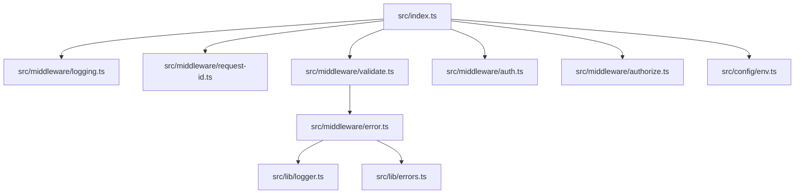
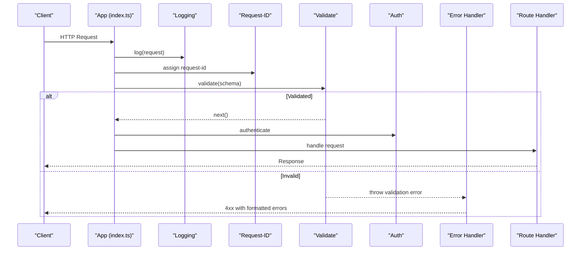
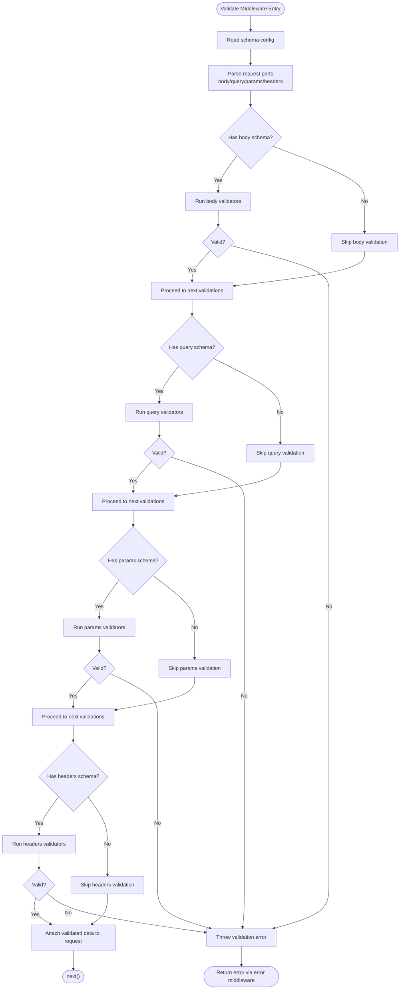
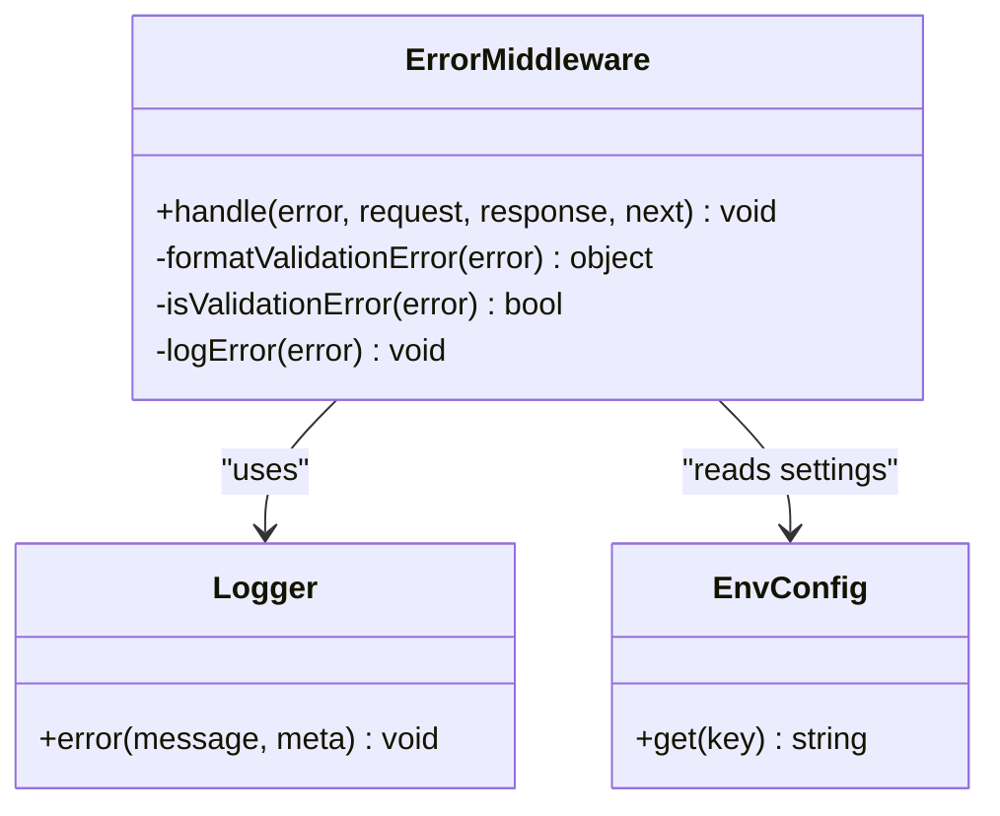
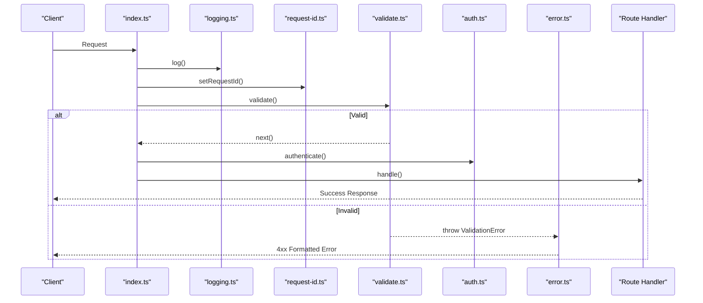
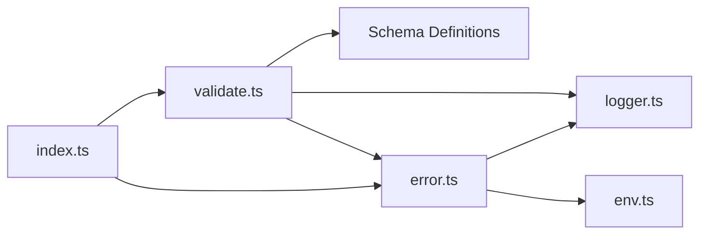

# Validation Middleware

<cite>
**Referenced Files in This Document**
- [validate.ts](file://src/middleware/validate.ts)
- [error.ts](file://src/middleware/error.ts)
- [index.ts](file://src/index.ts)
- [auth.ts](file://src/middleware/auth.ts)
- [authorize.ts](file://src/middleware/authorize.ts)
- [logging.ts](file://src/middleware/logging.ts)
- [request-id.ts](file://src/middleware/request-id.ts)
- [env.ts](file://src/config/env.ts)
- [errors.ts](file://src/lib/errors.ts)
- [logger.ts](file://src/lib/logger.ts)
</cite>

## Table of Contents
1. [Introduction](#introduction)
2. [Project Structure](#project-structure)
3. [Core Components](#core-components)
4. [Architecture Overview](#architecture-overview)
5. [Detailed Component Analysis](#detailed-component-analysis)
6. [Dependency Analysis](#dependency-analysis)
7. [Performance Considerations](#performance-considerations)
8. [Troubleshooting Guide](#troubleshooting-guide)
9. [Conclusion](#conclusion)
10. [Appendices](#appendices)

## Introduction
This document explains the input validation middleware system, focusing on how request data is validated against schemas, error handling for invalid inputs, and integration with TypeScript type safety. It covers supported validation rules, custom validators, error formatting, examples across different input types (query parameters, request bodies, headers), conditional validation, reusable schemas, composition with other middleware, and performance optimization and testing strategies.

## Project Structure
The validation middleware resides under src/middleware and integrates with the application’s global error handling and logging. The main entry point wires up middleware order and routes.

**Diagram sources**
- [index.ts](file://src/index.ts)
- [validate.ts](file://src/middleware/validate.ts)
- [error.ts](file://src/middleware/error.ts)
- [logging.ts](file://src/middleware/logging.ts)
- [request-id.ts](file://src/middleware/request-id.ts)
- [auth.ts](file://src/middleware/auth.ts)
- [authorize.ts](file://src/middleware/authorize.ts)
- [env.ts](file://src/config/env.ts)
- [errors.ts](file://src/lib/errors.ts)
- [logger.ts](file://src/lib/logger.ts)

**Section sources**
- [index.ts](file://src/index.ts)
- [validate.ts](file://src/middleware/validate.ts)
- [error.ts](file://src/middleware/error.ts)

## Core Components
- Validation middleware: Validates incoming requests against schemas and attaches typed results to the request context.
- Error middleware: Centralized error handler that formats validation errors into consistent responses.
- Logger and environment utilities: Provide structured logging and configuration access used by error reporting.

Key responsibilities:
- Parse and validate request parts (body, query, params, headers).
- Normalize validation failures into a standard error shape.
- Preserve TypeScript type inference through schema definitions.
- Compose with auth, authorization, logging, and request-id middleware.

**Section sources**
- [validate.ts](file://src/middleware/validate.ts)
- [error.ts](file://src/middleware/error.ts)
- [logger.ts](file://src/lib/logger.ts)
- [env.ts](file://src/config/env.ts)

## Architecture Overview
The validation pipeline runs early in the request lifecycle. After logging and request-id assignment, the validator checks inputs before authentication and authorization. If validation fails, the error middleware formats and returns a response without invoking route handlers.

**Diagram sources**
- [index.ts](file://src/index.ts)
- [validate.ts](file://src/middleware/validate.ts)
- [error.ts](file://src/middleware/error.ts)
- [logging.ts](file://src/middleware/logging.ts)
- [request-id.ts](file://src/middleware/request-id.ts)
- [auth.ts](file://src/middleware/auth.ts)

## Detailed Component Analysis

### Validation Middleware
Responsibilities:
- Accepts a schema definition describing expected inputs.
- Validates body, query, params, and headers based on schema configuration.
- Attaches validated, typed data to the request object for downstream use.
- Throws structured validation errors on failure.

Supported validations:
- Type checks for strings, numbers, booleans, arrays, objects.
- Required fields and optional fields.
- Constraints such as min/max length, numeric ranges, enums, patterns.
- Nested object validation and array item validation.
- Conditional validation based on presence or values of other fields.

Custom validators:
- Define async or sync functions that receive the value and return a boolean or throw an error.
- Integrate with the schema to provide domain-specific checks.

TypeScript integration:
- Schema definitions are typed so that validated outputs infer precise types.
- Downstream handlers receive strongly-typed request payloads.

Validation error formatting:
- Errors include field paths, messages, and rule names.
- Consistent structure enables client-side parsing and user-friendly messages.

Composition:
- Placed after logging and request-id, before auth and authorization.
- Can be applied per-route or globally for specific prefixes.

**Diagram sources**
- [validate.ts](file://src/middleware/validate.ts)

**Section sources**
- [validate.ts](file://src/middleware/validate.ts)

### Error Middleware
Responsibilities:
- Intercepts thrown errors from upstream middleware and route handlers.
- Detects validation errors and formats them into a standardized payload.
- Sets appropriate HTTP status codes and headers.
- Logs structured error details using the logger utility.

Integration points:
- Consumes error objects produced by the validation middleware.
- Uses environment configuration for sensitive masking and logging levels.
- Provides consistent error shapes for clients and observability tools.

**Diagram sources**
- [error.ts](file://src/middleware/error.ts)
- [logger.ts](file://src/lib/logger.ts)
- [env.ts](file://src/config/env.ts)

**Section sources**
- [error.ts](file://src/middleware/error.ts)
- [logger.ts](file://src/lib/logger.ts)
- [env.ts](file://src/config/env.ts)

### Composition and Integration
Order of middleware:
- Logging captures request metadata.
- Request-ID assigns a unique identifier to each request.
- Validation ensures inputs conform to schemas before business logic.
- Authentication verifies identity.
- Authorization enforces permissions.
- Route handlers process validated and authorized requests.

Global error handling:
- All middleware and routes funnel errors into the error middleware.
- Validation errors become consistent 4xx responses with detailed field-level messages.

**Diagram sources**
- [index.ts](file://src/index.ts)
- [logging.ts](file://src/middleware/logging.ts)
- [request-id.ts](file://src/middleware/request-id.ts)
- [validate.ts](file://src/middleware/validate.ts)
- [auth.ts](file://src/middleware/auth.ts)
- [error.ts](file://src/middleware/error.ts)

**Section sources**
- [index.ts](file://src/index.ts)
- [validate.ts](file://src/middleware/validate.ts)
- [error.ts](file://src/middleware/error.ts)
- [auth.ts](file://src/middleware/auth.ts)
- [authorize.ts](file://src/middleware/authorize.ts)
- [logging.ts](file://src/middleware/logging.ts)
- [request-id.ts](file://src/middleware/request-id.ts)

## Dependency Analysis
The validation middleware depends on:
- Schema definitions provided at route registration time.
- Environment configuration for behavior toggles.
- Logger for structured diagnostics.
- Error middleware for consistent error responses.

**Diagram sources**
- [validate.ts](file://src/middleware/validate.ts)
- [error.ts](file://src/middleware/error.ts)
- [logger.ts](file://src/lib/logger.ts)
- [env.ts](file://src/config/env.ts)
- [index.ts](file://src/index.ts)

**Section sources**
- [validate.ts](file://src/middleware/validate.ts)
- [error.ts](file://src/middleware/error.ts)
- [logger.ts](file://src/lib/logger.ts)
- [env.ts](file://src/config/env.ts)
- [index.ts](file://src/index.ts)

## Performance Considerations
- Schema compilation: Cache compiled schemas where possible to avoid repeated parsing overhead.
- Early exits: Fail fast on missing required fields to reduce unnecessary processing.
- Selective validation: Only validate fields present in the request to minimize work.
- Async validators: Use non-blocking operations and avoid heavy computations inside validators.
- Memory usage: Avoid creating large intermediate structures; reuse validated objects when safe.
- Logging volume: Keep logs concise and avoid serializing large payloads during validation.

[No sources needed since this section provides general guidance]

## Troubleshooting Guide
Common issues:
- Missing fields: Ensure required fields are included and correctly named.
- Type mismatches: Verify data types match schema expectations (string vs number, boolean flags).
- Header casing: Some environments normalize header names; confirm expected casing in schema.
- Conditional rules: Check prerequisite conditions for conditional validations.
- Custom validators: Inspect error messages thrown by custom logic.

Debugging steps:
- Enable verbose logging around validation to see parsed inputs and failing rules.
- Temporarily disable custom validators to isolate schema vs custom logic issues.
- Use minimal schemas to reproduce problems and incrementally add complexity.

Recovery:
- Return clear field-level messages to clients for quick fixes.
- Log enough context for server-side diagnosis without exposing sensitive data.

**Section sources**
- [error.ts](file://src/middleware/error.ts)
- [logger.ts](file://src/lib/logger.ts)
- [env.ts](file://src/config/env.ts)

## Conclusion
The validation middleware provides robust, type-safe input validation integrated with centralized error handling and logging. By composing it early in the middleware chain and leveraging typed schemas, applications can enforce strong contracts, deliver consistent error responses, and maintain high performance. Adopting reusable schemas, careful conditional validation, and thorough testing ensures reliability and developer productivity.

[No sources needed since this section summarizes without analyzing specific files]

## Appendices

### Examples Across Data Types
- Query parameters: Define schemas for required and optional query keys, including numeric ranges and enums.
- Request bodies: Validate nested objects, arrays, and constraints like min/max lengths and patterns.
- Headers: Enforce presence and format of critical headers (e.g., content-type, authorization tokens).

[No sources needed since this section provides conceptual examples]

### Conditional Validation Patterns
- Require field B if field A equals a specific value.
- Validate array items conditionally based on parent object properties.
- Use custom validators to implement complex cross-field rules.

[No sources needed since this section provides conceptual examples]

### Reusable Schemas
- Create shared schema modules for common entities (users, products, filters).
- Compose schemas by extending base definitions with additional fields.
- Version schemas to support API evolution while maintaining backward compatibility.

[No sources needed since this section provides conceptual examples]

### Testing Strategies
- Unit tests for individual validators and custom rules.
- Integration tests validating full request flows with valid and invalid inputs.
- Edge case coverage for boundary values, empty payloads, and malformed data.
- Mock external dependencies and ensure deterministic assertions on error shapes.

[No sources needed since this section provides conceptual examples]