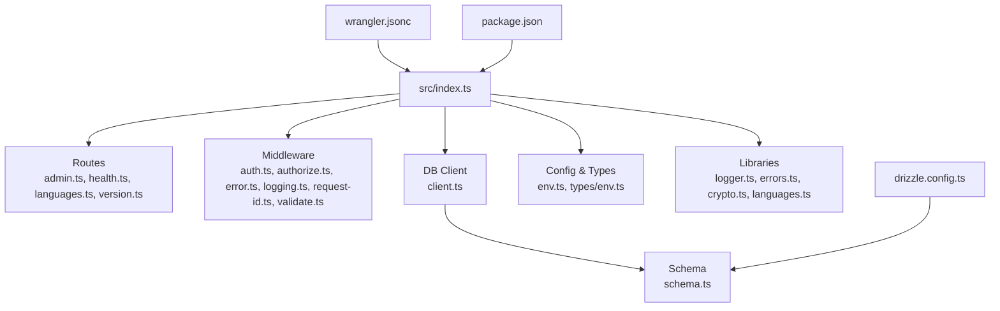
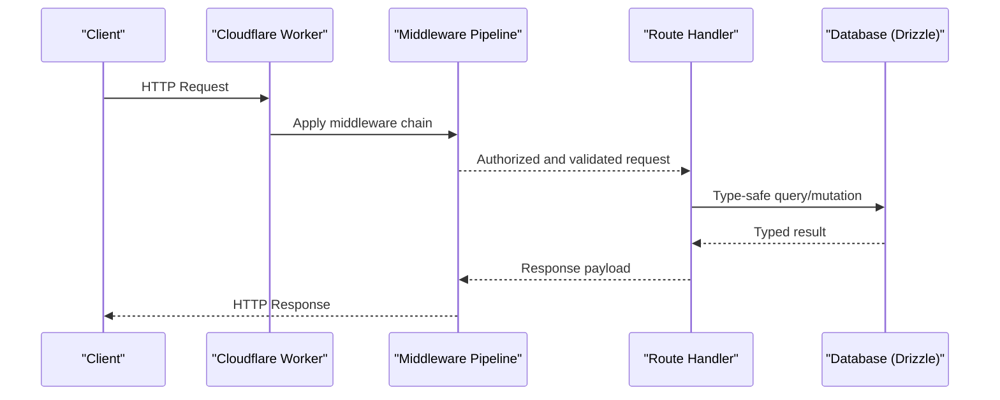
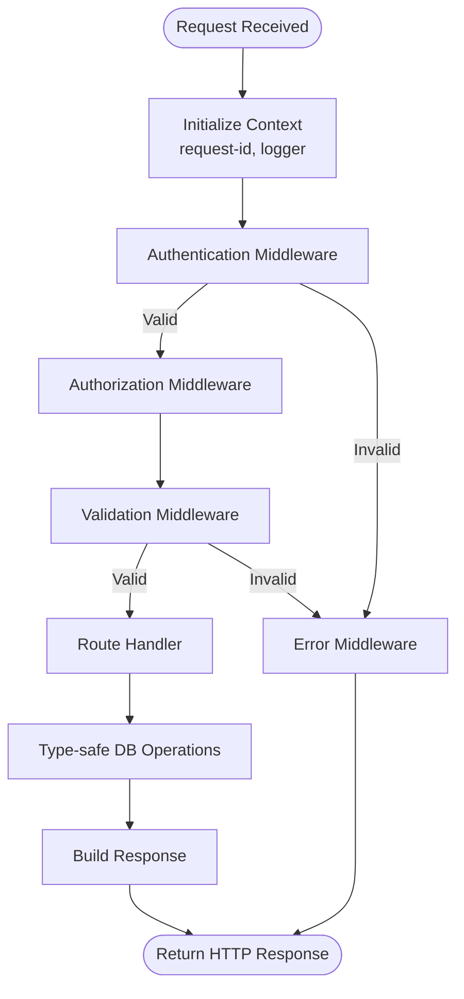
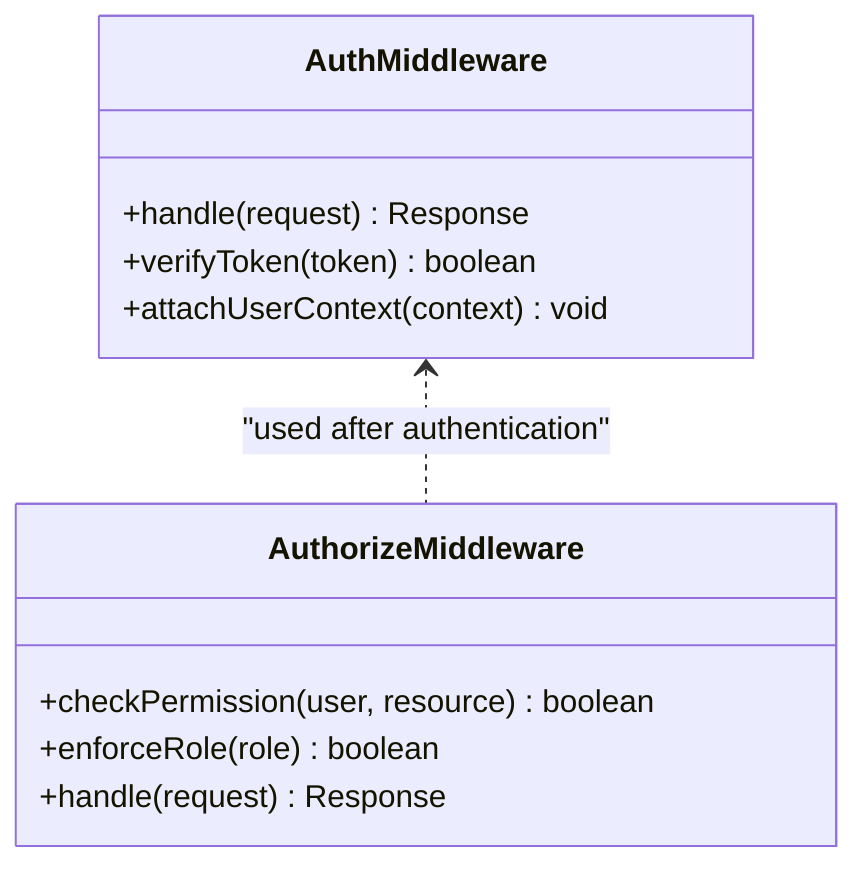
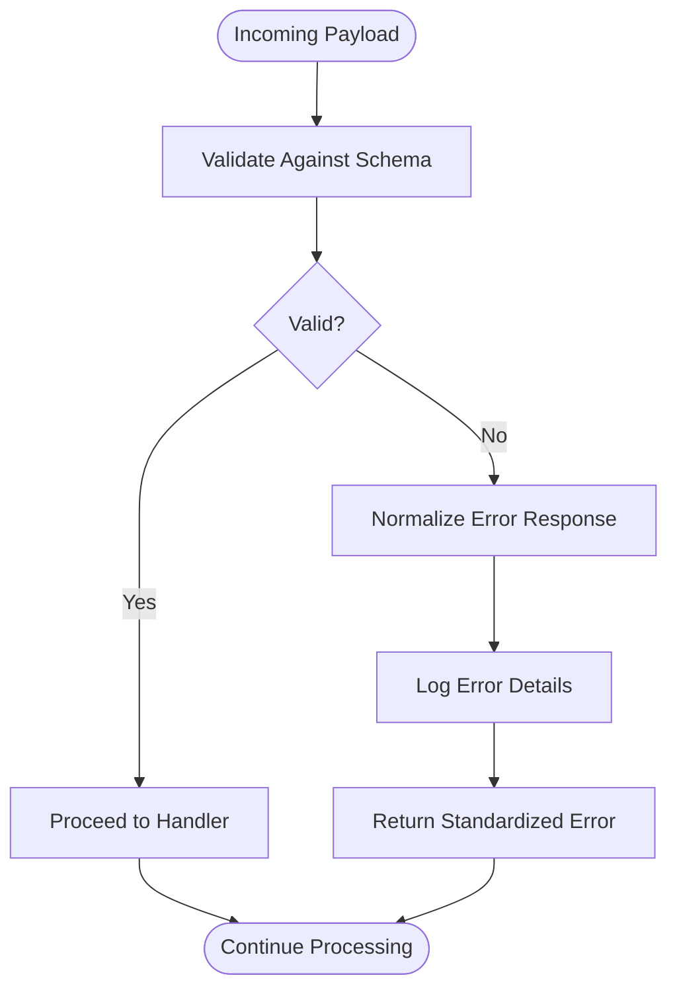
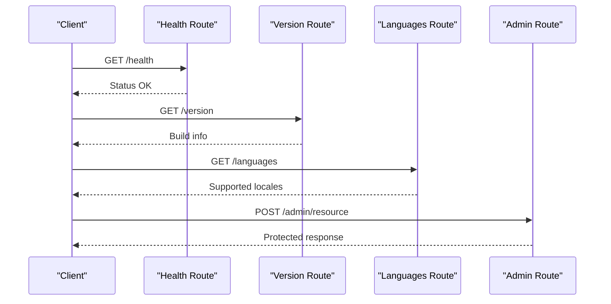
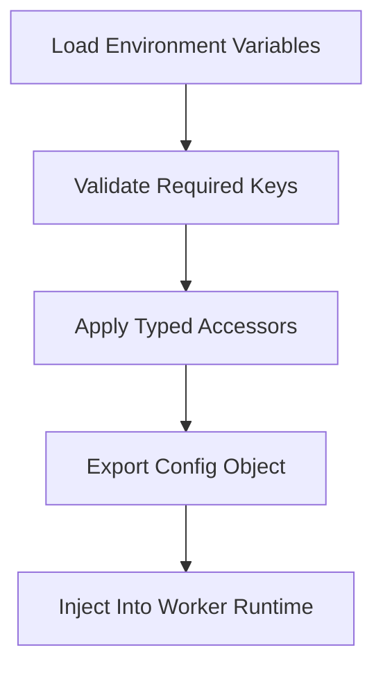
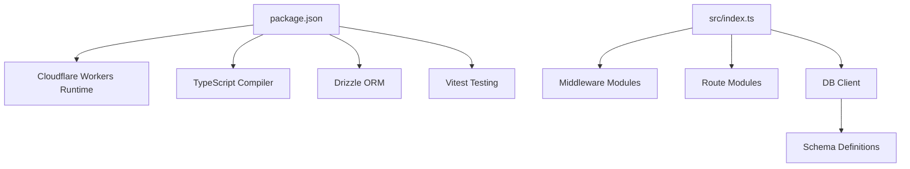

# Project Overview

<cite>
**Referenced Files in This Document**
- [README.md](file://README.md)
- [package.json](file://package.json)
- [wrangler.jsonc](file://wrangler.jsonc)
- [src/index.ts](file://src/index.ts)
- [drizzle.config.ts](file://drizzle.config.ts)
- [src/db/client.ts](file://src/db/client.ts)
- [src/db/schema.ts](file://src/db/schema.ts)
- [src/middleware/auth.ts](file://src/middleware/auth.ts)
- [src/middleware/authorize.ts](file://src/middleware/authorize.ts)
- [src/middleware/error.ts](file://src/middleware/error.ts)
- [src/middleware/logging.ts](file://src/middleware/logging.ts)
- [src/middleware/request-id.ts](file://src/middleware/request-id.ts)
- [src/middleware/validate.ts](file://src/middleware/validate.ts)
- [src/routes/admin.ts](file://src/routes/admin.ts)
- [src/routes/health.ts](file://src/routes/health.ts)
- [src/routes/languages.ts](file://src/routes/languages.ts)
- [src/routes/version.ts](file://src/routes/version.ts)
- [src/config/env.ts](file://src/config/env.ts)
- [src/types/env.ts](file://src/types/env.ts)
- [src/lib/logger.ts](file://src/lib/logger.ts)
- [src/lib/errors.ts](file://src/lib/errors.ts)
- [src/lib/crypto.ts](file://src/lib/crypto.ts)
- [src/lib/languages.ts](file://src/lib/languages.ts)
- [src/auth/index.ts](file://src/auth/index.ts)
- [src/auth/provision.ts](file://src/auth/provision.ts)
</cite>

## Table of Contents
1. [Introduction](#introduction)
2. [Project Structure](#project-structure)
3. [Core Components](#core-components)
4. [Architecture Overview](#architecture-overview)
5. [Detailed Component Analysis](#detailed-component-analysis)
6. [Dependency Analysis](#dependency-analysis)
7. [Performance Considerations](#performance-considerations)
8. [Troubleshooting Guide](#troubleshooting-guide)
9. [Conclusion](#conclusion)

## Introduction
TrackDub is a lightweight tracking and analytics serverless API designed for modern, cloud-native deployments on Cloudflare Workers. It provides a minimal yet powerful surface area to collect events, manage configuration, and expose operational endpoints while keeping the runtime small, fast, and cost-efficient. The project emphasizes type safety from request boundaries through database operations, consistent error handling, and observability via structured logging and request tracing.

Key goals:
- Deliver a simple, secure, and scalable serverless API for tracking/analytics use cases.
- Enforce type-safe database operations using Drizzle ORM with schema-driven migrations.
- Provide a robust middleware pattern for authentication, authorization, validation, logging, and error handling.
- Enable rapid iteration and reliable deployments via Cloudflare Workers and Wrangler.

Target use cases:
- Lightweight event ingestion and analytics pipelines where low latency and high concurrency are important.
- Configuration and feature toggles served from the edge.
- Health and version endpoints for service discovery and monitoring.
- Admin endpoints for managing resources behind authentication and authorization.

How it fits into modern API development:
- Serverless-first design aligns with edge computing and zero-infrastructure management.
- TypeScript throughout ensures compile-time guarantees and better developer experience.
- Drizzle ORM brings type-safe queries and migrations that integrate well with relational databases.
- Middleware-based routing promotes separation of concerns and reusable cross-cutting logic.

[No sources needed since this section doesn't analyze specific files]

## Project Structure
The repository follows a clear, modular layout:
- src: Application code including routes, middleware, database client, configuration, and utilities.
- drizzle: Database migration definitions and metadata.
- test: Unit and integration tests covering middleware, health, sessions, and CORS behavior.
- wrangler.jsonc: Cloudflare Workers configuration for deployment.
- package.json: Dependencies and scripts for development, testing, and building.
- README.md: Project documentation and usage guidance.



**Diagram sources**
- [src/index.ts](file://src/index.ts)
- [src/routes/admin.ts](file://src/routes/admin.ts)
- [src/routes/health.ts](file://src/routes/health.ts)
- [src/routes/languages.ts](file://src/routes/languages.ts)
- [src/routes/version.ts](file://src/routes/version.ts)
- [src/middleware/auth.ts](file://src/middleware/auth.ts)
- [src/middleware/authorize.ts](file://src/middleware/authorize.ts)
- [src/middleware/error.ts](file://src/middleware/error.ts)
- [src/middleware/logging.ts](file://src/middleware/logging.ts)
- [src/middleware/request-id.ts](file://src/middleware/request-id.ts)
- [src/middleware/validate.ts](file://src/middleware/validate.ts)
- [src/db/client.ts](file://src/db/client.ts)
- [src/db/schema.ts](file://src/db/schema.ts)
- [src/config/env.ts](file://src/config/env.ts)
- [src/types/env.ts](file://src/types/env.ts)
- [src/lib/logger.ts](file://src/lib/logger.ts)
- [src/lib/errors.ts](file://src/lib/errors.ts)
- [src/lib/crypto.ts](file://src/lib/crypto.ts)
- [src/lib/languages.ts](file://src/lib/languages.ts)
- [drizzle.config.ts](file://drizzle.config.ts)
- [wrangler.jsonc](file://wrangler.jsonc)
- [package.json](file://package.json)

**Section sources**
- [README.md](file://README.md)
- [package.json](file://package.json)
- [wrangler.jsonc](file://wrangler.jsonc)
- [src/index.ts](file://src/index.ts)
- [drizzle.config.ts](file://drizzle.config.ts)

## Core Components
TrackDub’s core components are organized around a serverless API entry point, middleware pipeline, typed routes, and a type-safe database layer.

- Entry point and routing:
  - Centralized request handling and route registration.
  - Consistent application of middleware across all endpoints.

- Middleware pattern:
  - Authentication and authorization guards.
  - Validation, logging, request ID propagation, and centralized error handling.

- Database layer:
  - Drizzle ORM client initialization and schema definitions.
  - Type-safe queries and migrations managed via Drizzle CLI.

- Configuration and environment:
  - Environment variable validation and typed accessors.
  - Secrets and runtime settings isolated per environment.

- Utilities:
  - Structured logging, error modeling, cryptographic helpers, and language utilities.

Practical examples of capabilities:
- Health check endpoint returns service status for load balancers and orchestrators.
- Version endpoint exposes build metadata for traceability.
- Languages endpoint serves supported locales or feature flags.
- Admin endpoints provide protected resource management behind auth and authorization.

**Section sources**
- [src/index.ts](file://src/index.ts)
- [src/middleware/auth.ts](file://src/middleware/auth.ts)
- [src/middleware/authorize.ts](file://src/middleware/authorize.ts)
- [src/middleware/validate.ts](file://src/middleware/validate.ts)
- [src/middleware/logging.ts](file://src/middleware/logging.ts)
- [src/middleware/request-id.ts](file://src/middleware/request-id.ts)
- [src/middleware/error.ts](file://src/middleware/error.ts)
- [src/db/client.ts](file://src/db/client.ts)
- [src/db/schema.ts](file://src/db/schema.ts)
- [src/config/env.ts](file://src/config/env.ts)
- [src/types/env.ts](file://src/types/env.ts)
- [src/lib/logger.ts](file://src/lib/logger.ts)
- [src/lib/errors.ts](file://src/lib/errors.ts)
- [src/lib/crypto.ts](file://src/lib/crypto.ts)
- [src/lib/languages.ts](file://src/lib/languages.ts)
- [src/routes/health.ts](file://src/routes/health.ts)
- [src/routes/version.ts](file://src/routes/version.ts)
- [src/routes/languages.ts](file://src/routes/languages.ts)
- [src/routes/admin.ts](file://src/routes/admin.ts)

## Architecture Overview
TrackDub implements a serverless API architecture optimized for Cloudflare Workers. Requests flow through a middleware pipeline before reaching route handlers, which interact with a type-safe database layer. Configuration and secrets are injected at runtime, and logs are emitted consistently for observability.



**Diagram sources**
- [src/index.ts](file://src/index.ts)
- [src/middleware/auth.ts](file://src/middleware/auth.ts)
- [src/middleware/authorize.ts](file://src/middleware/authorize.ts)
- [src/middleware/validate.ts](file://src/middleware/validate.ts)
- [src/middleware/logging.ts](file://src/middleware/logging.ts)
- [src/middleware/request-id.ts](file://src/middleware/request-id.ts)
- [src/middleware/error.ts](file://src/middleware/error.ts)
- [src/db/client.ts](file://src/db/client.ts)
- [src/db/schema.ts](file://src/db/schema.ts)

**Section sources**
- [wrangler.jsonc](file://wrangler.jsonc)
- [src/index.ts](file://src/index.ts)
- [src/db/client.ts](file://src/db/client.ts)
- [src/db/schema.ts](file://src/db/schema.ts)

## Detailed Component Analysis

### Serverless API Entry Point
The entry point wires up the middleware pipeline and registers routes. It ensures consistent behavior across all endpoints, including logging, request IDs, validation, and error normalization.



**Diagram sources**
- [src/index.ts](file://src/index.ts)
- [src/middleware/auth.ts](file://src/middleware/auth.ts)
- [src/middleware/authorize.ts](file://src/middleware/authorize.ts)
- [src/middleware/validate.ts](file://src/middleware/validate.ts)
- [src/middleware/logging.ts](file://src/middleware/logging.ts)
- [src/middleware/request-id.ts](file://src/middleware/request-id.ts)
- [src/middleware/error.ts](file://src/middleware/error.ts)
- [src/db/client.ts](file://src/db/client.ts)

**Section sources**
- [src/index.ts](file://src/index.ts)
- [src/middleware/logging.ts](file://src/middleware/logging.ts)
- [src/middleware/request-id.ts](file://src/middleware/request-id.ts)
- [src/middleware/error.ts](file://src/middleware/error.ts)

### Authentication and Authorization
Authentication validates identity tokens or session state, while authorization enforces role-based or resource-based permissions. These middlewares ensure only legitimate and permitted requests reach route handlers.



**Diagram sources**
- [src/middleware/auth.ts](file://src/middleware/auth.ts)
- [src/middleware/authorize.ts](file://src/middleware/authorize.ts)

**Section sources**
- [src/middleware/auth.ts](file://src/middleware/auth.ts)
- [src/middleware/authorize.ts](file://src/middleware/authorize.ts)

### Validation and Error Handling
Validation ensures incoming payloads conform to expected schemas, reducing downstream errors. Centralized error handling normalizes responses and preserves context for debugging.



**Diagram sources**
- [src/middleware/validate.ts](file://src/middleware/validate.ts)
- [src/middleware/error.ts](file://src/middleware/error.ts)
- [src/lib/errors.ts](file://src/lib/errors.ts)

**Section sources**
- [src/middleware/validate.ts](file://src/middleware/validate.ts)
- [src/middleware/error.ts](file://src/middleware/error.ts)
- [src/lib/errors.ts](file://src/lib/errors.ts)

### Database Layer with Drizzle ORM
The database layer uses Drizzle ORM for schema definition and type-safe queries. Migrations are defined in SQL and managed via Drizzle CLI, ensuring consistency between schema and runtime types.

```mermaid
erDiagram
TABLES {
string name
string description
}
SCHEMA {
table users
table sessions
table events
}
CLIENT {
method connect()
method query(sql)
method migrate()
}
SCHEMA ||--o{ TABLES : "defines"
CLIENT --> SCHEMA : "uses"
```

**Diagram sources**
- [src/db/client.ts](file://src/db/client.ts)
- [src/db/schema.ts](file://src/db/schema.ts)
- [drizzle.config.ts](file://drizzle.config.ts)

**Section sources**
- [src/db/client.ts](file://src/db/client.ts)
- [src/db/schema.ts](file://src/db/schema.ts)
- [drizzle.config.ts](file://drizzle.config.ts)

### Routes and Use Cases
Routes expose the service’s capabilities:
- Health: Returns readiness and liveness information.
- Version: Provides build metadata and versioning details.
- Languages: Serves supported locales or feature flags.
- Admin: Protected endpoints for resource management.



**Diagram sources**
- [src/routes/health.ts](file://src/routes/health.ts)
- [src/routes/version.ts](file://src/routes/version.ts)
- [src/routes/languages.ts](file://src/routes/languages.ts)
- [src/routes/admin.ts](file://src/routes/admin.ts)

**Section sources**
- [src/routes/health.ts](file://src/routes/health.ts)
- [src/routes/version.ts](file://src/routes/version.ts)
- [src/routes/languages.ts](file://src/routes/languages.ts)
- [src/routes/admin.ts](file://src/routes/admin.ts)

### Configuration and Environment
Environment variables are validated and typed to prevent runtime misconfiguration. Secrets and runtime settings are isolated per environment and injected into the worker at startup.



**Diagram sources**
- [src/config/env.ts](file://src/config/env.ts)
- [src/types/env.ts](file://src/types/env.ts)

**Section sources**
- [src/config/env.ts](file://src/config/env.ts)
- [src/types/env.ts](file://src/types/env.ts)

### Utilities and Libraries
Shared libraries encapsulate cross-cutting concerns:
- Logger: Structured logging for consistent observability.
- Errors: Standardized error models and codes.
- Crypto: Cryptographic helpers for secure operations.
- Languages: Language/locale utilities.

**Section sources**
- [src/lib/logger.ts](file://src/lib/logger.ts)
- [src/lib/errors.ts](file://src/lib/errors.ts)
- [src/lib/crypto.ts](file://src/lib/crypto.ts)
- [src/lib/languages.ts](file://src/lib/languages.ts)

### Authentication Provisioning
Authentication provisioning manages user setup and session lifecycle within the serverless context.

**Section sources**
- [src/auth/index.ts](file://src/auth/index.ts)
- [src/auth/provision.ts](file://src/auth/provision.ts)

## Dependency Analysis
TrackDub’s dependencies are centered around Cloudflare Workers runtime, TypeScript tooling, Drizzle ORM for database interactions, and testing utilities.



**Diagram sources**
- [package.json](file://package.json)
- [src/index.ts](file://src/index.ts)
- [src/db/client.ts](file://src/db/client.ts)
- [src/db/schema.ts](file://src/db/schema.ts)

**Section sources**
- [package.json](file://package.json)
- [wrangler.jsonc](file://wrangler.jsonc)

## Performance Considerations
- Edge deployment minimizes latency by running close to users.
- Middleware overhead is minimized through early validation and short-circuiting.
- Database queries are type-safe and optimized via Drizzle ORM.
- Logging is structured and sampled to reduce I/O overhead.
- Cold starts are mitigated by keeping the bundle small and dependencies minimal.

[No sources needed since this section provides general guidance]

## Troubleshooting Guide
Common issues and resolutions:
- Authentication failures: Verify token format and expiration; check middleware logs for detailed errors.
- Authorization denials: Ensure roles and permissions match resource requirements.
- Validation errors: Inspect payload schemas and required fields; review normalized error responses.
- Database connectivity: Confirm environment variables and connection parameters; run migrations if schema drift occurs.
- Logging gaps: Ensure request IDs are propagated and log levels are configured appropriately.

**Section sources**
- [src/middleware/auth.ts](file://src/middleware/auth.ts)
- [src/middleware/authorize.ts](file://src/middleware/authorize.ts)
- [src/middleware/validate.ts](file://src/middleware/validate.ts)
- [src/middleware/error.ts](file://src/middleware/error.ts)
- [src/lib/logger.ts](file://src/lib/logger.ts)
- [src/db/client.ts](file://src/db/client.ts)

## Conclusion
TrackDub delivers a concise, type-safe, and observable serverless API tailored for tracking and analytics workloads on Cloudflare Workers. Its middleware pattern, Drizzle ORM integration, and strict configuration management make it suitable for modern, cloud-native deployments. By focusing on simplicity, security, and performance, TrackDub enables teams to iterate quickly while maintaining reliability and clarity across the stack.

[No sources needed since this section summarizes without analyzing specific files]