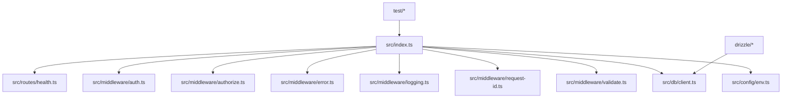
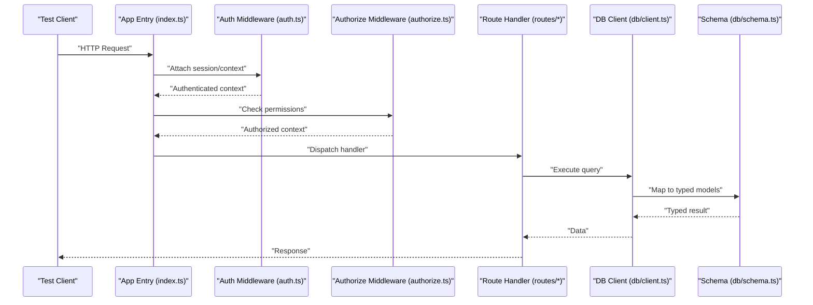
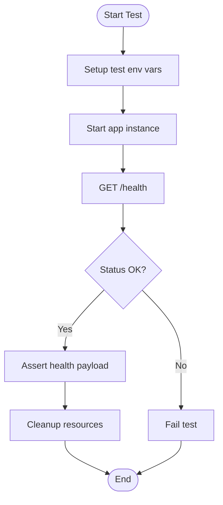
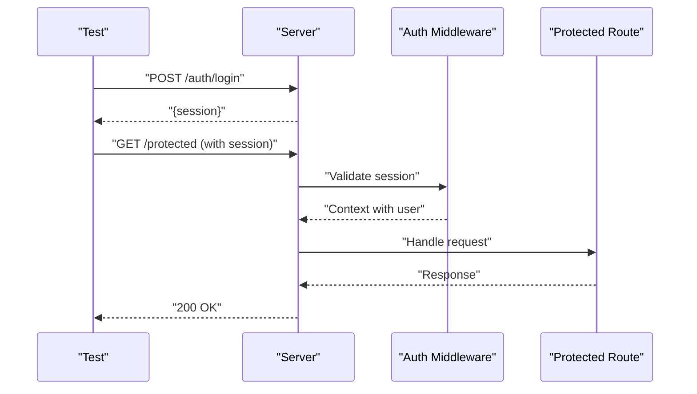
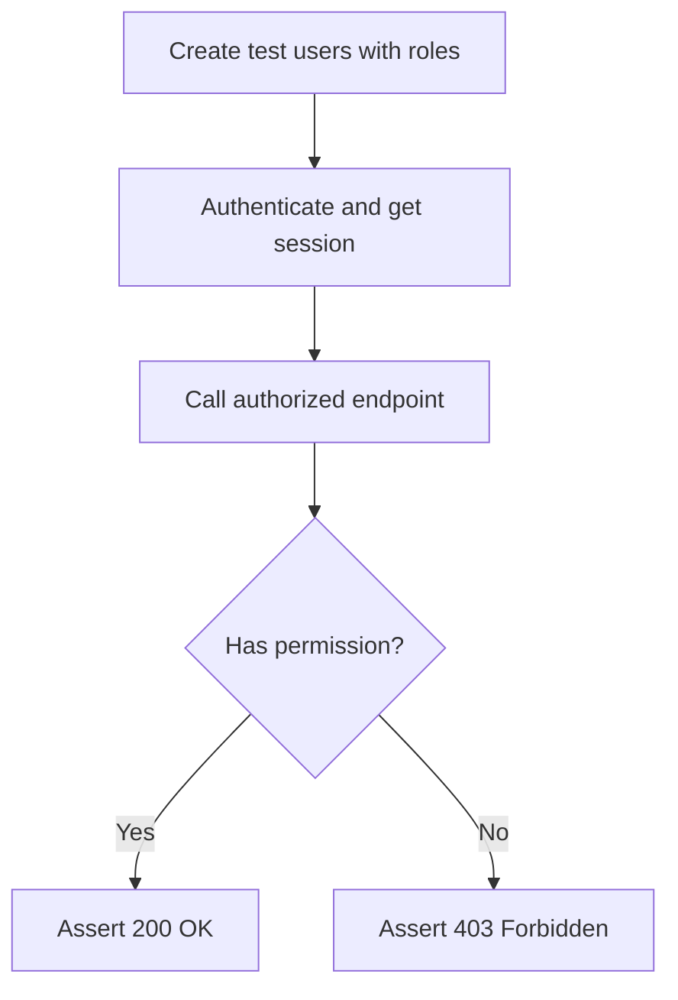
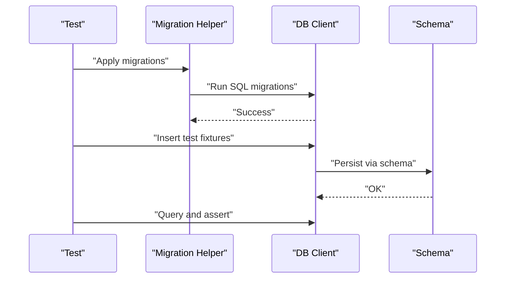
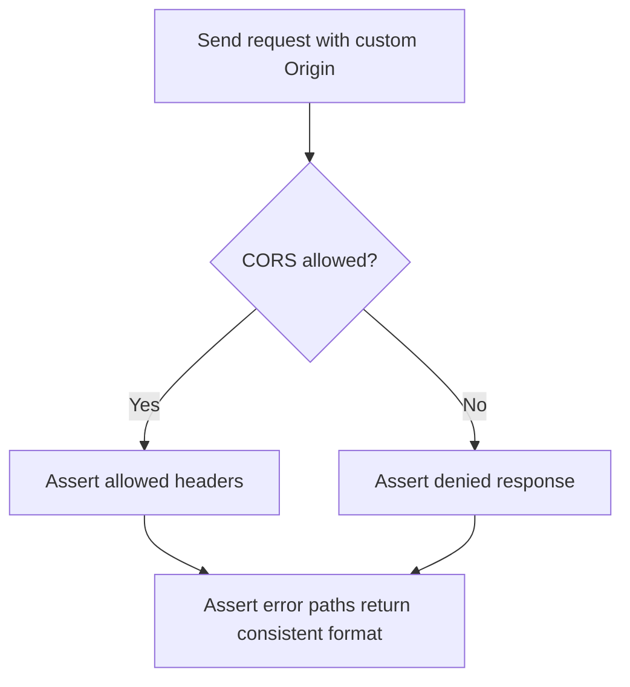
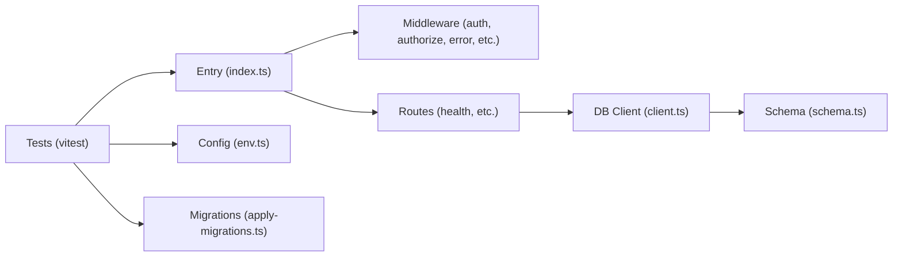

# Integration Testing

<cite>
**Referenced Files in This Document**
- [index.ts](file://src/index.ts)
- [health.ts](file://src/routes/health.ts)
- [auth.ts](file://src/middleware/auth.ts)
- [authorize.ts](file://src/middleware/authorize.ts)
- [client.ts](file://src/db/client.ts)
- [schema.ts](file://src/db/schema.ts)
- [env.ts](file://src/config/env.ts)
- [apply-migrations.ts](file://test/apply-migrations.ts)
- [health.test.ts](file://test/health.test.ts)
- [session.test.ts](file://test/session.test.ts)
- [auth-middleware.test.ts](file://test/auth-middleware.test.ts)
- [cors.test.ts](file://test/cors.test.ts)
- [error.test.ts](file://test/error.test.ts)
- [vitest.config.ts](file://vitest.config.ts)
- [drizzle.config.ts](file://drizzle.config.ts)
- [0000_better_auth_init.sql](file://drizzle/0000_better_auth_init.sql)
</cite>

## Table of Contents
1. [Introduction](#introduction)
2. [Project Structure](#project-structure)
3. [Core Components](#core-components)
4. [Architecture Overview](#architecture-overview)
5. [Detailed Component Analysis](#detailed-component-analysis)
6. [Dependency Analysis](#dependency-analysis)
7. [Performance Considerations](#performance-considerations)
8. [Troubleshooting Guide](#troubleshooting-guide)
9. [Conclusion](#conclusion)
10. [Appendices](#appendices)

## Introduction
This document provides comprehensive integration testing guidance for the TrackDub API. It explains how to validate end-to-end request flows, database interactions, and session management using the existing test suite and infrastructure. You will learn strategies for testing health endpoints, authentication sessions, and database migrations, along with patterns for mocking external services, managing transactions in tests, handling asynchronous operations, and curating test data.

## Project Structure
The project follows a modular layout:
- Application entry point and server setup live under src/.
- Routes define HTTP endpoints (e.g., health).
- Middleware implements auth, authorization, validation, error handling, logging, and request ID generation.
- Database client and schema are defined under src/db/.
- Configuration is centralized under src/config/.
- Tests reside under test/, including migration helpers and Vitest-based specs.
- Drizzle ORM configuration and SQL migrations are under drizzle/.

**Diagram sources**
- [index.ts](file://src/index.ts)
- [health.ts](file://src/routes/health.ts)
- [auth.ts](file://src/middleware/auth.ts)
- [authorize.ts](file://src/middleware/authorize.ts)
- [client.ts](file://src/db/client.ts)
- [env.ts](file://src/config/env.ts)
- [apply-migrations.ts](file://test/apply-migrations.ts)

**Section sources**
- [index.ts](file://src/index.ts)
- [health.ts](file://src/routes/health.ts)
- [auth.ts](file://src/middleware/auth.ts)
- [authorize.ts](file://src/middleware/authorize.ts)
- [client.ts](file://src/db/client.ts)
- [env.ts](file://src/config/env.ts)
- [apply-migrations.ts](file://test/apply-migrations.ts)

## Core Components
Key components relevant to integration testing:
- Health endpoint: validates service readiness and dependencies.
- Auth middleware: enforces authentication and session state.
- Authorize middleware: enforces role-based or resource-based access.
- DB client: manages connections and queries via Drizzle ORM.
- Schema: defines tables and relationships used by migrations and queries.
- Environment config: centralizes runtime configuration for tests and production.

Testing focuses on:
- End-to-end HTTP requests through the application entry point.
- Database state changes verified after migrations and queries.
- Session lifecycle across authenticated requests.
- Error paths and middleware behavior.

**Section sources**
- [health.ts](file://src/routes/health.ts)
- [auth.ts](file://src/middleware/auth.ts)
- [authorize.ts](file://src/middleware/authorize.ts)
- [client.ts](file://src/db/client.ts)
- [schema.ts](file://src/db/schema.ts)
- [env.ts](file://src/config/env.ts)

## Architecture Overview
Integration tests exercise the full stack from HTTP entry points down to the database layer. The following sequence shows a typical authenticated request flow, which is what your integration tests should cover.

**Diagram sources**
- [index.ts](file://src/index.ts)
- [auth.ts](file://src/middleware/auth.ts)
- [authorize.ts](file://src/middleware/authorize.ts)
- [health.ts](file://src/routes/health.ts)
- [client.ts](file://src/db/client.ts)
- [schema.ts](file://src/db/schema.ts)

## Detailed Component Analysis

### Health Endpoint Integration
Goal: Verify that the health endpoint returns expected status and dependency checks pass.

Recommended approach:
- Start the app in a test environment with isolated configuration.
- Send an HTTP GET to the health route.
- Assert response status and body fields indicating system readiness.
- Optionally verify that underlying dependencies (e.g., DB connectivity) are reflected in the response.

**Diagram sources**
- [health.ts](file://src/routes/health.ts)
- [env.ts](file://src/config/env.ts)

**Section sources**
- [health.test.ts](file://test/health.test.ts)
- [health.ts](file://src/routes/health.ts)
- [env.ts](file://src/config/env.ts)

### Authentication Sessions Integration
Goal: Validate session creation, persistence, and enforcement across requests.

Recommended approach:
- Use the test harness to create a session (e.g., via login endpoint if available).
- Store the session cookie/token returned by the server.
- Subsequent requests include the session identifier.
- Assert that protected routes respond correctly when authorized and reject unauthorized attempts.

**Diagram sources**
- [auth.ts](file://src/middleware/auth.ts)
- [session.test.ts](file://test/session.test.ts)

**Section sources**
- [session.test.ts](file://test/session.test.ts)
- [auth.ts](file://src/middleware/auth.ts)

### Authorization Middleware Integration
Goal: Ensure that role/resource checks work end-to-end.

Recommended approach:
- Create users with different roles or permissions.
- Issue requests with appropriate sessions.
- Assert allowed/denied responses based on authorization rules.

**Diagram sources**
- [authorize.ts](file://src/middleware/authorize.ts)

**Section sources**
- [auth-middleware.test.ts](file://test/auth-middleware.test.ts)
- [authorize.ts](file://src/middleware/authorize.ts)

### Database Interactions and Migrations
Goal: Validate that migrations apply correctly and queries operate against real or mocked DB state.

Recommended approach:
- Use the provided migration helper to apply migrations before each test or test suite.
- Isolate test data per test using transactions or separate test databases.
- Assert DB state changes after operations.

**Diagram sources**
- [apply-migrations.ts](file://test/apply-migrations.ts)
- [client.ts](file://src/db/client.ts)
- [schema.ts](file://src/db/schema.ts)
- [0000_better_auth_init.sql](file://drizzle/0000_better_auth_init.sql)

**Section sources**
- [apply-migrations.ts](file://test/apply-migrations.ts)
- [client.ts](file://src/db/client.ts)
- [schema.ts](file://src/db/schema.ts)
- [0000_better_auth_init.sql](file://drizzle/0000_better_auth_init.sql)

### CORS and Error Handling Integration
Goal: Confirm that cross-origin policies and error responses behave as expected.

Recommended approach:
- Send requests with various origins and headers.
- Assert correct Access-Control-* headers and error payloads.

**Diagram sources**
- [cors.test.ts](file://test/cors.test.ts)
- [error.test.ts](file://test/error.test.ts)

**Section sources**
- [cors.test.ts](file://test/cors.test.ts)
- [error.test.ts](file://test/error.test.ts)

## Dependency Analysis
Integration tests depend on:
- The application entry point to serve routes and middleware.
- Database client and schema for data operations.
- Environment configuration for test-specific settings.
- Migration scripts to set up the DB state.

**Diagram sources**
- [vitest.config.ts](file://vitest.config.ts)
- [index.ts](file://src/index.ts)
- [env.ts](file://src/config/env.ts)
- [auth.ts](file://src/middleware/auth.ts)
- [authorize.ts](file://src/middleware/authorize.ts)
- [health.ts](file://src/routes/health.ts)
- [client.ts](file://src/db/client.ts)
- [schema.ts](file://src/db/schema.ts)
- [apply-migrations.ts](file://test/apply-migrations.ts)

**Section sources**
- [vitest.config.ts](file://vitest.config.ts)
- [index.ts](file://src/index.ts)
- [env.ts](file://src/config/env.ts)
- [apply-migrations.ts](file://test/apply-migrations.ts)

## Performance Considerations
- Prefer lightweight fixtures and minimal DB writes in tests.
- Reuse a single DB connection where possible; reset state between tests instead of recreating the DB.
- Avoid heavy external calls; mock or stub them to keep tests fast and deterministic.
- Run parallelizable tests in isolation to avoid contention.

[No sources needed since this section provides general guidance]

## Troubleshooting Guide
Common issues and resolutions:
- Migrations fail: ensure the correct DB URL and credentials are set in test environment variables; confirm migration files exist and are valid.
- Session tests flaky: verify that cookies/tokens are persisted and included in subsequent requests; check clock skew if tokens are time-bound.
- Health endpoint fails: inspect dependency checks (e.g., DB connectivity) and ensure test DB is reachable.
- CORS errors: validate allowed origins and methods in both test and server configuration.

**Section sources**
- [apply-migrations.ts](file://test/apply-migrations.ts)
- [session.test.ts](file://test/session.test.ts)
- [health.test.ts](file://test/health.test.ts)
- [cors.test.ts](file://test/cors.test.ts)

## Conclusion
By exercising the full request pipeline—from HTTP entry points through middleware, routes, and the database—you can confidently validate the correctness, resilience, and security posture of the TrackDub API. Use the patterns described here to build robust integration tests that cover health checks, authentication sessions, authorization, database migrations, and error handling.

[No sources needed since this section summarizes without analyzing specific files]

## Appendices

### End-to-End Testing Patterns
- Use a shared test harness to start the server with test configuration.
- Wrap each test in a transaction or use a clean DB snapshot to isolate state.
- Assert both HTTP-level outcomes and DB-level side effects.

### Database Mocking Techniques
- For unit-style tests, replace the DB client with a mock that returns controlled results.
- For integration tests, prefer a real or ephemeral DB and rely on migrations and fixtures.

### Transaction Management for Tests
- Begin a transaction before each test and roll it back afterward to maintain isolation.
- Alternatively, truncate tables or drop/recreate schemas between suites.

### Testing Async Operations
- Await all async operations explicitly in tests.
- Use timeouts judiciously and ensure proper cleanup even on failures.

### External Service Simulation
- Stub network calls to third-party APIs using mocks or local servers.
- Validate error paths by simulating failures and timeouts.

### Test Data Management
- Seed minimal, deterministic fixtures required for assertions.
- Avoid coupling tests to global state; generate unique identifiers per test.

**Section sources**
- [vitest.config.ts](file://vitest.config.ts)
- [apply-migrations.ts](file://test/apply-migrations.ts)
- [client.ts](file://src/db/client.ts)
- [schema.ts](file://src/db/schema.ts)