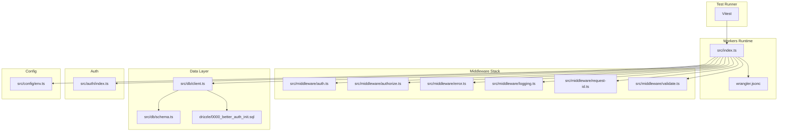
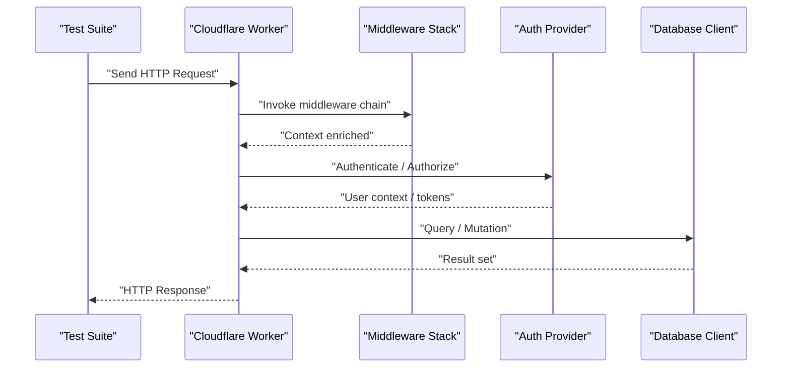
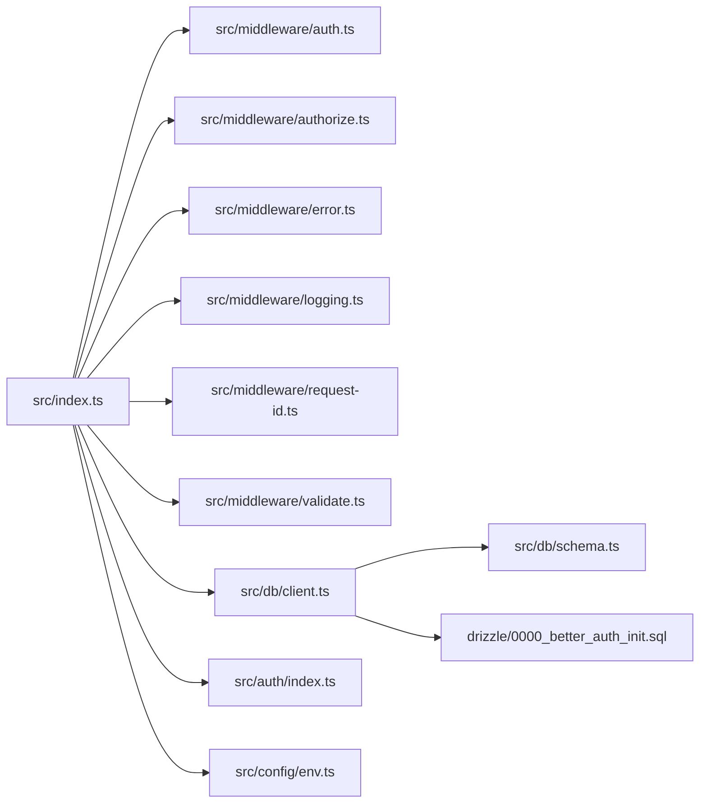

# Mocking Strategies

<cite>
**Referenced Files in This Document**
- [src/index.ts](file://src/index.ts)
- [wrangler.jsonc](file://wrangler.jsonc)
- [vitest.config.ts](file://vitest.config.ts)
- [package.json](file://package.json)
- [src/config/env.ts](file://src/config/env.ts)
- [src/db/client.ts](file://src/db/client.ts)
- [src/db/schema.ts](file://src/db/schema.ts)
- [drizzle/0000_better_auth_init.sql](file://drizzle/0000_better_auth_init.sql)
- [src/auth/index.ts](file://src/auth/index.ts)
- [src/middleware/auth.ts](file://src/middleware/auth.ts)
- [src/middleware/authorize.ts](file://src/middleware/authorize.ts)
- [src/middleware/error.ts](file://src/middleware/error.ts)
- [src/middleware/logging.ts](file://src/middleware/logging.ts)
- [src/middleware/request-id.ts](file://src/middleware/request-id.ts)
- [src/middleware/validate.ts](file://src/middleware/validate.ts)
- [test/auth-middleware.test.ts](file://test/auth-middleware.test.ts)
- [test/cors.test.ts](file://test/cors.test.ts)
- [test/error.test.ts](file://test/error.test.ts)
- [test/health.test.ts](file://test/health.test.ts)
- [test/session.test.ts](file://test/session.test.ts)
</cite>

## Table of Contents
1. [Introduction](#introduction)
2. [Project Structure](#project-structure)
3. [Core Components](#core-components)
4. [Architecture Overview](#architecture-overview)
5. [Detailed Component Analysis](#detailed-component-analysis)
6. [Dependency Analysis](#dependency-analysis)
7. [Performance Considerations](#performance-considerations)
8. [Troubleshooting Guide](#troubleshooting-guide)
9. [Conclusion](#conclusion)
10. [Appendices](#appendices)

## Introduction
This document provides comprehensive mocking strategies for testing the TrackDub API, focusing on Cloudflare Workers APIs, database connections, external services, authentication providers, session storage, and middleware dependencies. It includes practical examples for mocking async functions, handling promises, and simulating network requests, along with best practices to maintain mock consistency and avoid test flakiness.

## Project Structure
TrackDub is a Cloudflare Workers-based API using Drizzle ORM for database access and a modular middleware stack. Tests are written with Vitest and run against a local or in-memory setup where appropriate. The project structure separates configuration, routes, middleware, data layer, and tests into clear directories.

**Diagram sources**
- [src/index.ts](file://src/index.ts)
- [wrangler.jsonc](file://wrangler.jsonc)
- [src/middleware/auth.ts](file://src/middleware/auth.ts)
- [src/middleware/authorize.ts](file://src/middleware/authorize.ts)
- [src/middleware/error.ts](file://src/middleware/error.ts)
- [src/middleware/logging.ts](file://src/middleware/logging.ts)
- [src/middleware/request-id.ts](file://src/middleware/request-id.ts)
- [src/middleware/validate.ts](file://src/middleware/validate.ts)
- [src/db/client.ts](file://src/db/client.ts)
- [src/db/schema.ts](file://src/db/schema.ts)
- [drizzle/0000_better_auth_init.sql](file://drizzle/0000_better_auth_init.sql)
- [src/auth/index.ts](file://src/auth/index.ts)
- [src/config/env.ts](file://src/config/env.ts)

**Section sources**
- [src/index.ts](file://src/index.ts)
- [wrangler.jsonc](file://wrangler.jsonc)
- [vitest.config.ts](file://vitest.config.ts)
- [package.json](file://package.json)

## Core Components
Key components that require mocking during tests:
- Cloudflare Workers runtime APIs (fetch, KV, R2, Durable Objects, Cache, etc.)
- Database client and schema (Drizzle ORM)
- Authentication provider integration
- Session storage mechanisms
- Middleware dependencies (request context, logging, validation)

Mocking targets should be isolated per test to ensure deterministic behavior and fast execution.

**Section sources**
- [src/db/client.ts](file://src/db/client.ts)
- [src/db/schema.ts](file://src/db/schema.ts)
- [src/auth/index.ts](file://src/auth/index.ts)
- [src/middleware/auth.ts](file://src/middleware/auth.ts)
- [src/middleware/authorize.ts](file://src/middleware/authorize.ts)
- [src/middleware/error.ts](file://src/middleware/error.ts)
- [src/middleware/logging.ts](file://src/middleware/logging.ts)
- [src/middleware/request-id.ts](file://src/middleware/request-id.ts)
- [src/middleware/validate.ts](file://src/middleware/validate.ts)

## Architecture Overview
The API follows a request lifecycle through middleware, then route handlers, interacting with auth and data layers. For testing, we intercept these interactions via mocks to simulate responses and failures without hitting real infrastructure.

**Diagram sources**
- [src/index.ts](file://src/index.ts)
- [src/middleware/auth.ts](file://src/middleware/auth.ts)
- [src/middleware/authorize.ts](file://src/middleware/authorize.ts)
- [src/auth/index.ts](file://src/auth/index.ts)
- [src/db/client.ts](file://src/db/client.ts)

## Detailed Component Analysis

### Cloudflare Workers API Mocking
Strategy:
- Use a test harness that wraps fetch-like calls and replaces them with controlled responses.
- For environment-specific globals (e.g., KV, R2), provide stubs or in-memory implementations.
- Ensure consistent headers and status codes across tests.

Practical patterns:
- Intercept network requests by replacing global fetch or module-level wrappers.
- Simulate latency and errors to validate error paths.
- Validate request/response shapes and headers.

Best practices:
- Keep mocks minimal and focused on the contract being tested.
- Centralize common response factories to reduce duplication.
- Avoid relying on wall-clock time; use timers if needed.

**Section sources**
- [wrangler.jsonc](file://wrangler.jsonc)
- [vitest.config.ts](file://vitest.config.ts)
- [package.json](file://package.json)

### Database Connection Mocking
Strategy:
- Replace the database client with an in-memory store or a lightweight mock that implements the same interface used by the application.
- Seed data deterministically before each test.
- Assert queries and mutations by inspecting calls or state changes.

Practical patterns:
- Provide a mock client that returns predefined rows or throws expected errors.
- Use transactional boundaries within tests to isolate side effects.
- Validate schema usage by asserting query parameters.

Best practices:
- Keep schema definitions stable; avoid frequent migrations in tests.
- Reset state between tests to prevent cross-test contamination.
- Prefer explicit assertions over implicit behaviors.

**Section sources**
- [src/db/client.ts](file://src/db/client.ts)
- [src/db/schema.ts](file://src/db/schema.ts)
- [drizzle/0000_better_auth_init.sql](file://drizzle/0000_better_auth_init.sql)

### External Services Mocking
Strategy:
- Wrap external service clients behind interfaces or modules that can be swapped in tests.
- Use request interception to simulate network responses and failures.
- Record and replay responses only when necessary; prefer deterministic mocks.

Practical patterns:
- Create a thin adapter around HTTP calls to centralize mocking.
- Simulate timeouts, rate limits, and partial failures.
- Validate retry logic and backoff strategies.

Best practices:
- Isolate external dependencies from business logic.
- Use fixtures for complex payloads.
- Fail fast on unexpected network calls in unit tests.

**Section sources**
- [src/config/env.ts](file://src/config/env.ts)

### Authentication Providers Mocking
Strategy:
- Mock token issuance, user lookup, and authorization checks.
- Provide both valid and invalid credentials scenarios.
- Simulate provider outages and slow responses.

Practical patterns:
- Replace provider SDK calls with in-memory stores.
- Inject user context into request scope for downstream middleware.
- Assert authorization decisions based on roles or scopes.

Best practices:
- Separate identity verification from authorization logic.
- Keep token formats stable in tests.
- Validate edge cases like expired tokens and missing claims.

**Section sources**
- [src/auth/index.ts](file://src/auth/index.ts)
- [src/middleware/auth.ts](file://src/middleware/auth.ts)
- [src/middleware/authorize.ts](file://src/middleware/authorize.ts)

### Session Storage Mocking
Strategy:
- Replace persistent session stores with an in-memory map keyed by session ID.
- Support expiration and invalidation semantics.
- Verify session creation, update, and deletion flows.

Practical patterns:
- Implement a simple store that mirrors the production interface.
- Seed sessions for authenticated flows.
- Assert cookie headers and session IDs in responses.

Best practices:
- Ensure thread-safety is not required in single-process tests.
- Clear sessions between tests to avoid leakage.
- Validate security properties like secure flags and SameSite.

**Section sources**
- [src/middleware/auth.ts](file://src/middleware/auth.ts)

### Middleware Dependencies Mocking
Strategy:
- Mock request context enrichment, logging, validation, and error handling.
- Provide deterministic inputs and assert outputs.
- Simulate malformed requests and unexpected headers.

Practical patterns:
- Replace logger calls with no-op or captured logs.
- Stub validators to accept or reject specific payloads.
- Inject custom request IDs and trace contexts.

Best practices:
- Keep middleware pure where possible.
- Assert side effects explicitly (headers, status codes).
- Use shared fixtures for common request shapes.

**Section sources**
- [src/middleware/logging.ts](file://src/middleware/logging.ts)
- [src/middleware/request-id.ts](file://src/middleware/request-id.ts)
- [src/middleware/validate.ts](file://src/middleware/validate.ts)
- [src/middleware/error.ts](file://src/middleware/error.ts)

### Async Functions and Promises
Strategy:
- Use controlled promises to resolve or reject with expected values.
- Simulate delays and concurrency patterns.
- Assert promise chains and error propagation.

Practical patterns:
- Create helper utilities to build resolved/rejected promises.
- Use timer controls to avoid real waits.
- Validate that async operations complete in correct order.

Best practices:
- Avoid sleeping in tests; use timers or event-driven assertions.
- Handle unhandled rejections explicitly.
- Keep async code testable by separating IO from computation.

**Section sources**
- [vitest.config.ts](file://vitest.config.ts)
- [package.json](file://package.json)

### Network Requests Simulation
Strategy:
- Intercept fetch or HTTP client calls to return predefined responses.
- Simulate various network conditions (latency, errors, partial responses).
- Validate request construction and response parsing.

Practical patterns:
- Wrap fetch calls in a module that can be replaced in tests.
- Use request factories for consistent payloads.
- Assert headers, methods, and bodies sent.

Best practices:
- Fail tests when unexpected network calls occur.
- Keep network contracts stable and versioned.
- Use fixtures for large payloads.

**Section sources**
- [wrangler.jsonc](file://wrangler.jsonc)
- [vitest.config.ts](file://vitest.config.ts)

## Dependency Analysis
Understanding how components depend on each other helps target mocks effectively.

**Diagram sources**
- [src/index.ts](file://src/index.ts)
- [src/middleware/auth.ts](file://src/middleware/auth.ts)
- [src/middleware/authorize.ts](file://src/middleware/authorize.ts)
- [src/middleware/error.ts](file://src/middleware/error.ts)
- [src/middleware/logging.ts](file://src/middleware/logging.ts)
- [src/middleware/request-id.ts](file://src/middleware/request-id.ts)
- [src/middleware/validate.ts](file://src/middleware/validate.ts)
- [src/db/client.ts](file://src/db/client.ts)
- [src/db/schema.ts](file://src/db/schema.ts)
- [drizzle/0000_better_auth_init.sql](file://drizzle/0000_better_auth_init.sql)
- [src/auth/index.ts](file://src/auth/index.ts)
- [src/config/env.ts](file://src/config/env.ts)

**Section sources**
- [src/index.ts](file://src/index.ts)
- [src/db/client.ts](file://src/db/client.ts)
- [src/auth/index.ts](file://src/auth/index.ts)

## Performance Considerations
- Prefer in-memory mocks over real IO to keep tests fast.
- Reuse expensive setup across tests via shared fixtures.
- Avoid heavy serialization or large payloads unless necessary.
- Parallelize independent tests to reduce total runtime.
- Measure and monitor test execution times to identify bottlenecks.

[No sources needed since this section provides general guidance]

## Troubleshooting Guide
Common issues and resolutions:
- Flaky tests due to shared state: reset or isolate state per test.
- Unexpected network calls: add assertions to fail fast on real IO.
- Inconsistent timestamps: control time or normalize values in assertions.
- Missing environment variables: provide defaults or explicit configs in tests.
- Middleware ordering problems: verify chain order and context propagation.

**Section sources**
- [test/auth-middleware.test.ts](file://test/auth-middleware.test.ts)
- [test/cors.test.ts](file://test/cors.test.ts)
- [test/error.test.ts](file://test/error.test.ts)
- [test/health.test.ts](file://test/health.test.ts)
- [test/session.test.ts](file://test/session.test.ts)

## Conclusion
Effective mocking for TrackDub involves isolating Cloudflare Workers APIs, database interactions, authentication, sessions, and middleware. By adopting consistent strategies—centralized mocks, deterministic fixtures, and explicit assertions—you can achieve reliable, fast, and maintainable tests. Focus on contracts, minimize side effects, and validate both happy paths and error scenarios.

[No sources needed since this section summarizes without analyzing specific files]

## Appendices

### Example Test Scenarios
- Authenticate with valid and invalid credentials, asserting token presence and error responses.
- Query database records with mocked client, verifying result shapes and pagination.
- Simulate external service failures and validate retry/backoff behavior.
- Validate middleware behavior including request ID injection, logging output, and validation errors.

[No sources needed since this section provides conceptual examples]