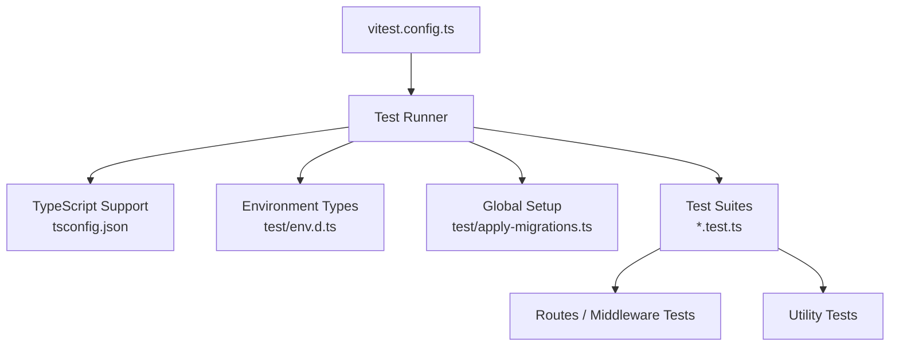
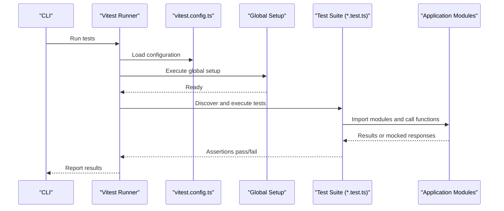
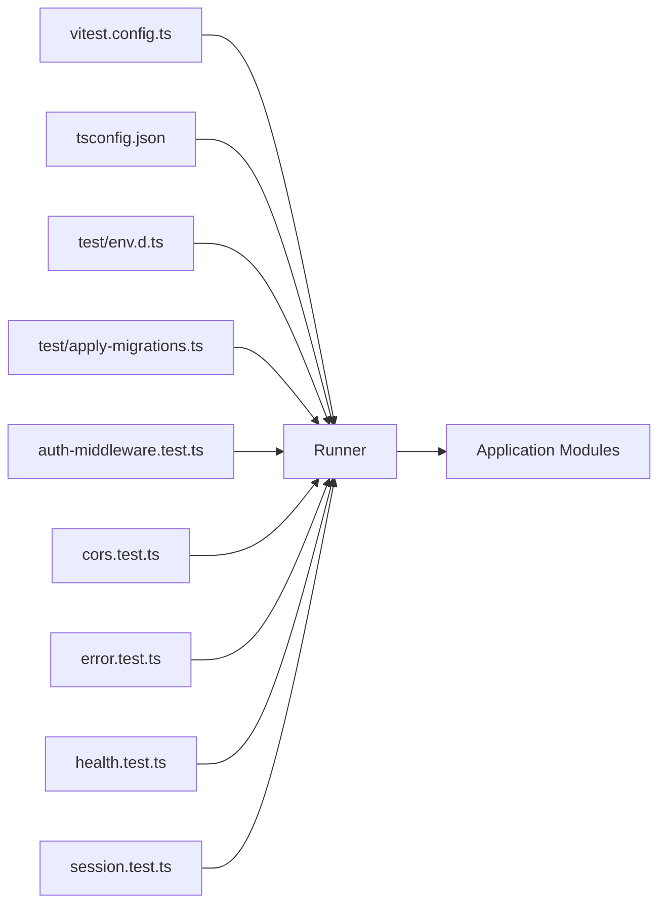

# Testing Framework Setup

<cite>
**Referenced Files in This Document**
- [vitest.config.ts](file://vitest.config.ts)
- [package.json](file://package.json)
- [tsconfig.json](file://tsconfig.json)
- [test/env.d.ts](file://test/env.d.ts)
- [test/apply-migrations.ts](file://test/apply-migrations.ts)
- [test/auth-middleware.test.ts](file://test/auth-middleware.test.ts)
- [test/cors.test.ts](file://test/cors.test.ts)
- [test/error.test.ts](file://test/error.test.ts)
- [test/health.test.ts](file://test/health.test.ts)
- [test/session.test.ts](file://test/session.test.ts)
</cite>

## Table of Contents
1. [Introduction](#introduction)
2. [Project Structure](#project-structure)
3. [Core Components](#core-components)
4. [Architecture Overview](#architecture-overview)
5. [Detailed Component Analysis](#detailed-component-analysis)
6. [Dependency Analysis](#dependency-analysis)
7. [Performance Considerations](#performance-considerations)
8. [Troubleshooting Guide](#troubleshooting-guide)
9. [Conclusion](#conclusion)

## Introduction
This document explains how the testing framework is set up for the TrackDub API using Vitest. It covers configuration, environment setup, TypeScript support, Cloudflare Workers mocking, and test file organization patterns. You will also find examples of basic test structure, common setup patterns, and guidance on extending the suite with new tests.

## Project Structure
The testing setup lives primarily under the test directory and a central Vitest configuration file:
- vitest.config.ts defines the runner, environment, and global setup.
- package.json contains scripts to run tests and related tooling.
- tsconfig.json provides TypeScript compilation settings used by the test runner.
- test/env.d.ts declares ambient types for environment variables consumed by tests.
- test/apply-migrations.ts is a helper to apply database migrations before running integration-style tests.
- Individual *.test.ts files implement unit and integration tests for routes, middleware, and utilities.

**Diagram sources**
- [vitest.config.ts](file://vitest.config.ts)
- [tsconfig.json](file://tsconfig.json)
- [test/env.d.ts](file://test/env.d.ts)
- [test/apply-migrations.ts](file://test/apply-migrations.ts)
- [test/auth-middleware.test.ts](file://test/auth-middleware.test.ts)
- [test/cors.test.ts](file://test/cors.test.ts)
- [test/error.test.ts](file://test/error.test.ts)
- [test/health.test.ts](file://test/health.test.ts)
- [test/session.test.ts](file://test/session.test.ts)

**Section sources**
- [vitest.config.ts](file://vitest.config.ts)
- [package.json](file://package.json)
- [tsconfig.json](file://tsconfig.json)
- [test/env.d.ts](file://test/env.d.ts)
- [test/apply-migrations.ts](file://test/apply-migrations.ts)
- [test/auth-middleware.test.ts](file://test/auth-middleware.test.ts)
- [test/cors.test.ts](file://test/cors.test.ts)
- [test/error.test.ts](file://test/error.test.ts)
- [test/health.test.ts](file://test/health.test.ts)
- [test/session.test.ts](file://test/session.test.ts)

## Core Components
- Vitest configuration: Centralizes runner options, environment mode, globals, and setup hooks.
- TypeScript configuration: Ensures type checking and module resolution for tests.
- Environment declarations: Provides ambient types for environment variables used across tests.
- Migration helper: Applies schema changes before tests that interact with the database.
- Test suites: Organized per feature (routes, middleware, errors), each as a separate .test.ts file.

Key responsibilities:
- Configure the test environment to emulate Cloudflare Workers where needed.
- Provide consistent assertions and utilities via Vitest’s built-in APIs.
- Isolate side effects between tests using per-test setup and teardown.

**Section sources**
- [vitest.config.ts](file://vitest.config.ts)
- [tsconfig.json](file://tsconfig.json)
- [test/env.d.ts](file://test/env.d.ts)
- [test/apply-migrations.ts](file://test/apply-migrations.ts)

## Architecture Overview
The testing architecture follows a layered approach:
- The test runner loads configuration from vitest.config.ts.
- Global setup applies migrations and prepares shared state.
- Each test file imports application modules and uses mocks/stubs to isolate behavior.
- Environment variables are typed via env.d.ts to ensure consistency.

**Diagram sources**
- [vitest.config.ts](file://vitest.config.ts)
- [test/apply-migrations.ts](file://test/apply-migrations.ts)
- [test/auth-middleware.test.ts](file://test/auth-middleware.test.ts)
- [test/cors.test.ts](file://test/cors.test.ts)
- [test/error.test.ts](file://test/error.test.ts)
- [test/health.test.ts](file://test/health.test.ts)
- [test/session.test.ts](file://test/session.test.ts)

## Detailed Component Analysis

### Vitest Configuration
- Purpose: Define runner behavior, environment, globals, and setup hooks.
- Typical options include environment mode, global setup file path, and test match patterns.
- For Cloudflare Workers, configure the environment to provide required APIs and polyfills.

Best practices:
- Keep configuration centralized and explicit.
- Use a dedicated global setup file for one-time initialization like migrations.
- Limit test discovery scope to avoid slow runs.

**Section sources**
- [vitest.config.ts](file://vitest.config.ts)

### TypeScript Support
- Ensure tsconfig.json includes paths and module resolution compatible with Vitest.
- Include declaration files for environment variables in test/env.d.ts.
- Enable strict mode for better type safety in tests.

Common pitfalls:
- Missing type definitions for environment variables cause runtime/type errors.
- Incorrect module resolution leads to import failures in tests.

**Section sources**
- [tsconfig.json](file://tsconfig.json)
- [test/env.d.ts](file://test/env.d.ts)

### Cloudflare Workers Mocking
- Use an environment that exposes Workers APIs (fetch, Request, Response, etc.).
- If necessary, add custom mocks for platform-specific features not available in Node.
- Keep mocks minimal and focused on what your tests require.

Guidelines:
- Prefer real implementations when possible; mock only when unavoidable.
- Validate that mocks reflect expected behavior of the production environment.

**Section sources**
- [vitest.config.ts](file://vitest.config.ts)

### Test Utilities and Helpers
- Centralize reusable helpers in the test directory if needed.
- Use a migration helper to prepare the database state before tests.
- Encapsulate request/response creation for route tests to reduce duplication.

Example patterns:
- Per-test setup/teardown for isolated state.
- Shared fixtures for common data payloads.

**Section sources**
- [test/apply-migrations.ts](file://test/apply-migrations.ts)

### Test File Organization Patterns
- One test file per feature/module (e.g., auth-middleware.test.ts, cors.test.ts).
- Group related tests within describe blocks and use it for individual cases.
- Keep assertions clear and descriptive to aid debugging.

Structure recommendations:
- Arrange tests by user flows: happy path, error paths, edge cases.
- Separate unit tests (pure logic) from integration tests (DB/network interactions).

**Section sources**
- [test/auth-middleware.test.ts](file://test/auth-middleware.test.ts)
- [test/cors.test.ts](file://test/cors.test.ts)
- [test/error.test.ts](file://test/error.test.ts)
- [test/health.test.ts](file://test/health.test.ts)
- [test/session.test.ts](file://test/session.test.ts)

### Basic Test Structure Example
A typical test file:
- Imports the module under test.
- Uses describe to group related tests.
- Uses it to define individual test cases.
- Asserts expected outcomes using Vitest’s assertion methods.

Patterns:
- Setup shared state once per suite.
- Reset or reinitialize state per test to ensure isolation.

**Section sources**
- [test/auth-middleware.test.ts](file://test/auth-middleware.test.ts)
- [test/cors.test.ts](file://test/cors.test.ts)
- [test/error.test.ts](file://test/error.test.ts)
- [test/health.test.ts](file://test/health.test.ts)
- [test/session.test.ts](file://test/session.test.ts)

## Dependency Analysis
The test suite depends on:
- Vitest runner and its configuration.
- TypeScript compiler and type definitions.
- Application modules being tested.
- Optional Cloudflare Workers environment or mocks.

**Diagram sources**
- [vitest.config.ts](file://vitest.config.ts)
- [tsconfig.json](file://tsconfig.json)
- [test/env.d.ts](file://test/env.d.ts)
- [test/apply-migrations.ts](file://test/apply-migrations.ts)
- [test/auth-middleware.test.ts](file://test/auth-middleware.test.ts)
- [test/cors.test.ts](file://test/cors.test.ts)
- [test/error.test.ts](file://test/error.test.ts)
- [test/health.test.ts](file://test/health.test.ts)
- [test/session.test.ts](file://test/session.test.ts)

**Section sources**
- [vitest.config.ts](file://vitest.config.ts)
- [tsconfig.json](file://tsconfig.json)
- [test/env.d.ts](file://test/env.d.ts)
- [test/apply-migrations.ts](file://test/apply-migrations.ts)
- [test/auth-middleware.test.ts](file://test/auth-middleware.test.ts)
- [test/cors.test.ts](file://test/cors.test.ts)
- [test/error.test.ts](file://test/error.test.ts)
- [test/health.test.ts](file://test/health.test.ts)
- [test/session.test.ts](file://test/session.test.ts)

## Performance Considerations
- Keep test discovery scoped to relevant directories to speed up runs.
- Avoid heavy global setup; prefer per-test initialization when possible.
- Use mocks judiciously to reduce overhead and flakiness.
- Parallelize independent tests where safe.

[No sources needed since this section provides general guidance]

## Troubleshooting Guide
Common issues and resolutions:
- Type errors for environment variables: Ensure test/env.d.ts declares all required variables.
- Missing Workers APIs: Verify the configured environment supports required APIs or add mocks.
- Slow test execution: Review global setup and reduce unnecessary work.
- Flaky tests: Isolate state per test and avoid shared mutable globals.

Checklist:
- Confirm vitest.config.ts points to correct setup files.
- Validate tsconfig.json includes necessary paths and types.
- Ensure migrations are applied before DB-dependent tests.

**Section sources**
- [vitest.config.ts](file://vitest.config.ts)
- [tsconfig.json](file://tsconfig.json)
- [test/env.d.ts](file://test/env.d.ts)
- [test/apply-migrations.ts](file://test/apply-migrations.ts)

## Conclusion
The TrackDub API testing framework leverages Vitest with TypeScript and optional Cloudflare Workers environment support. By centralizing configuration, typing environment variables, applying migrations globally, and organizing tests per feature, the suite remains maintainable and fast. Extend the suite by following established patterns and keeping mocks minimal and purposeful.

[No sources needed since this section summarizes without analyzing specific files]