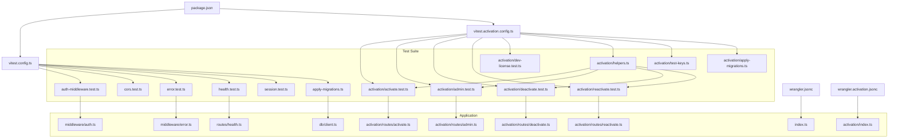
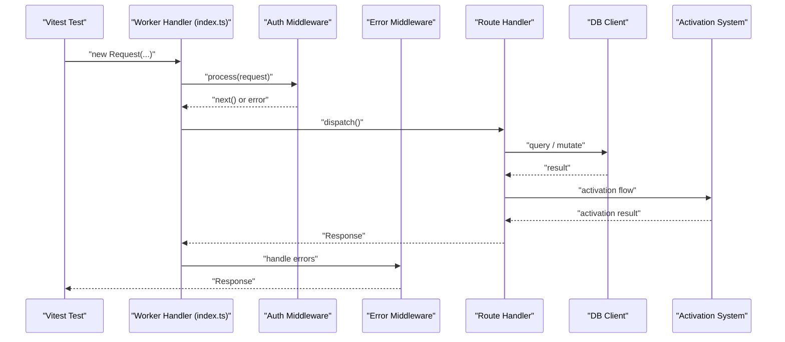
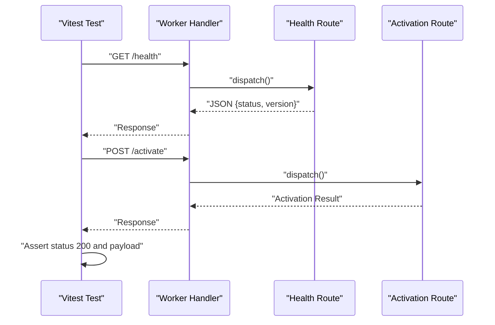
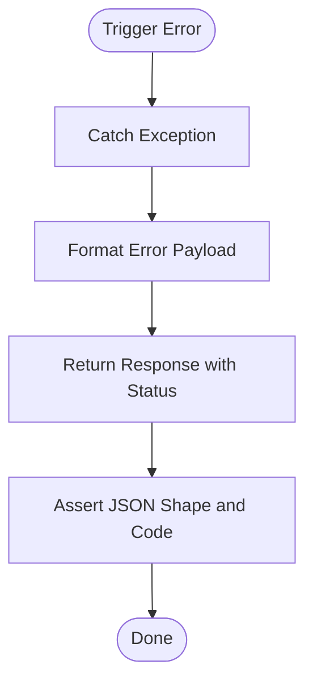
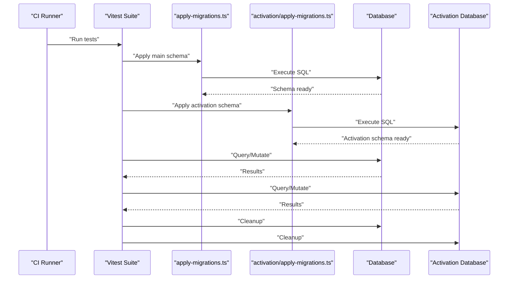
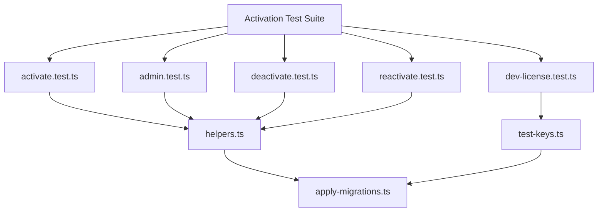
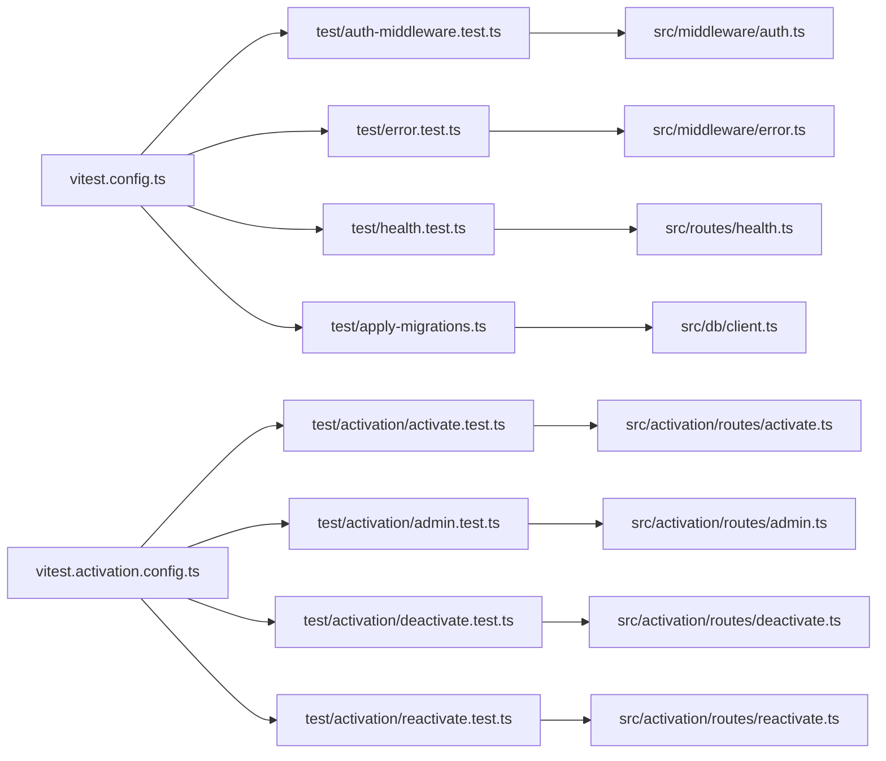

# Testing Guide

<cite>
**Referenced Files in This Document**
- [vitest.config.ts](file://vitest.config.ts)
- [vitest.activation.config.ts](file://vitest.activation.config.ts)
- [package.json](file://package.json)
- [wrangler.jsonc](file://wrangler.jsonc)
- [wrangler.activation.jsonc](file://wrangler.activation.jsonc)
- [src/index.ts](file://src/index.ts)
- [test/auth-middleware.test.ts](file://test/auth-middleware.test.ts)
- [test/cors.test.ts](file://test/cors.test.ts)
- [test/error.test.ts](file://test/error.test.ts)
- [test/health.test.ts](file://test/health.test.ts)
- [test/session.test.ts](file://test/session.test.ts)
- [test/apply-migrations.ts](file://test/apply-migrations.ts)
- [test/activation/activate.test.ts](file://test/activation/activate.test.ts)
- [test/activation/admin.test.ts](file://test/activation/admin.test.ts)
- [test/activation/deactivate.test.ts](file://test/activation/deactivate.test.ts)
- [test/activation/reactivate.test.ts](file://test/activation/reactivate.test.ts)
- [test/activation/dev-license.test.ts](file://test/activation/dev-license.test.ts)
- [test/activation/helpers.ts](file://test/activation/helpers.ts)
- [test/activation/test-keys.ts](file://test/activation/test-keys.ts)
- [test/activation/apply-migrations.ts](file://test/activation/apply-migrations.ts)
- [src/middleware/auth.ts](file://src/middleware/auth.ts)
- [src/middleware/error.ts](file://src/middleware/error.ts)
- [src/routes/health.ts](file://src/routes/health.ts)
- [src/db/client.ts](file://src/db/client.ts)
- [src/activation/index.ts](file://src/activation/index.ts)
- [src/activation/routes/activate.ts](file://src/activation/routes/activate.ts)
- [src/activation/routes/admin.ts](file://src/activation/routes/admin.ts)
- [src/activation/routes/deactivate.ts](file://src/activation/routes/deactivate.ts)
- [src/activation/routes/reactivate.ts](file://src/activation/routes/reactivate.ts)
</cite>

## Update Summary
**Changes Made**
- Added comprehensive activation system test suite documentation
- Updated Vitest configuration section to include activation-specific configuration
- Added new section covering activation flow testing patterns
- Enhanced project structure diagram to include activation test files
- Updated dependency analysis to reflect activation test coverage

## Table of Contents
1. [Introduction](#introduction)
2. [Project Structure](#project-structure)
3. [Core Components](#core-components)
4. [Architecture Overview](#architecture-overview)
5. [Detailed Component Analysis](#detailed-component-analysis)
6. [Activation System Testing](#activation-system-testing)
7. [Dependency Analysis](#dependency-analysis)
8. [Performance Considerations](#performance-considerations)
9. [Troubleshooting Guide](#troubleshooting-guide)
10. [Conclusion](#conclusion)

## Introduction
This guide explains how to test the TrackDub API using Vitest, with a focus on Cloudflare Workers compatibility. It covers test organization, mocking strategies for the Workers runtime, unit testing middleware and route handlers, integration patterns for database operations and authentication flows, and best practices for reliability and performance in serverless environments. The guide now includes comprehensive coverage of the activation system testing framework.

## Project Structure
The repository follows a clear separation between application code under src and tests under test. Configuration files define the testing runtime (Vitest), environment variables, and Wrangler settings for Cloudflare Workers. The activation system has its own dedicated test suite with specialized configuration.

**Diagram sources**
- [vitest.config.ts](file://vitest.config.ts)
- [vitest.activation.config.ts](file://vitest.activation.config.ts)
- [wrangler.jsonc](file://wrangler.jsonc)
- [wrangler.activation.jsonc](file://wrangler.activation.jsonc)
- [package.json](file://package.json)
- [src/index.ts](file://src/index.ts)
- [src/middleware/auth.ts](file://src/middleware/auth.ts)
- [src/middleware/error.ts](file://src/middleware/error.ts)
- [src/routes/health.ts](file://src/routes/health.ts)
- [src/db/client.ts](file://src/db/client.ts)
- [src/activation/index.ts](file://src/activation/index.ts)
- [src/activation/routes/activate.ts](file://src/activation/routes/activate.ts)
- [src/activation/routes/admin.ts](file://src/activation/routes/admin.ts)
- [src/activation/routes/deactivate.ts](file://src/activation/routes/deactivate.ts)
- [src/activation/routes/reactivate.ts](file://src/activation/routes/reactivate.ts)
- [test/auth-middleware.test.ts](file://test/auth-middleware.test.ts)
- [test/cors.test.ts](file://test/cors.test.ts)
- [test/error.test.ts](file://test/error.test.ts)
- [test/health.test.ts](file://test/health.test.ts)
- [test/session.test.ts](file://test/session.test.ts)
- [test/apply-migrations.ts](file://test/apply-migrations.ts)
- [test/activation/activate.test.ts](file://test/activation/activate.test.ts)
- [test/activation/admin.test.ts](file://test/activation/admin.test.ts)
- [test/activation/deactivate.test.ts](file://test/activation/deactivate.test.ts)
- [test/activation/reactivate.test.ts](file://test/activation/reactivate.test.ts)
- [test/activation/dev-license.test.ts](file://test/activation/dev-license.test.ts)
- [test/activation/helpers.ts](file://test/activation/helpers.ts)
- [test/activation/test-keys.ts](file://test/activation/test-keys.ts)
- [test/activation/apply-migrations.ts](file://test/activation/apply-migrations.ts)

**Section sources**
- [vitest.config.ts](file://vitest.config.ts)
- [vitest.activation.config.ts](file://vitest.activation.config.ts)
- [wrangler.jsonc](file://wrangler.jsonc)
- [wrangler.activation.jsonc](file://wrangler.activation.jsonc)
- [package.json](file://package.json)

## Core Components
- Test runner: Vitest configured via vitest.config.ts and vitest.activation.config.ts, invoked through npm scripts in package.json.
- Workers context: Tests run against a Cloudflare Workers-compatible environment defined by wrangler.jsonc and wrangler.activation.jsonc with specific mocks provided by the test harness.
- Application entry: The main worker is exported from src/index.ts and used as the target for request/response assertions in tests.
- Middleware and routes: Unit tests validate behavior of auth middleware, error handling, health endpoints, session logic, and activation flows.
- Database integration: Integration tests use apply-migrations.ts to prepare test database schemas before running queries, including separate activation database setup.

Key responsibilities:
- Ensure requests are constructed and sent to the worker handler consistently across tests.
- Mock or stub external dependencies such as KV, Durable Objects, R2, and third-party APIs.
- Provide deterministic environment variables for each test run.
- Isolate activation system tests with dedicated configuration and test keys.

**Section sources**
- [src/index.ts](file://src/index.ts)
- [test/auth-middleware.test.ts](file://test/auth-middleware.test.ts)
- [test/cors.test.ts](file://test/cors.test.ts)
- [test/error.test.ts](file://test/error.test.ts)
- [test/health.test.ts](file://test/health.test.ts)
- [test/session.test.ts](file://test/session.test.ts)
- [test/apply-migrations.ts](file://test/apply-migrations.ts)
- [test/activation/helpers.ts](file://test/activation/helpers.ts)
- [test/activation/test-keys.ts](file://test/activation/test-keys.ts)

## Architecture Overview
The testing architecture layers unit tests over middleware and routes, with optional integration tests that interact with a real or mocked database. Requests flow through the same middleware pipeline as production, ensuring parity between test and runtime behavior. The activation system maintains separate test isolation while following the same architectural patterns.

**Diagram sources**
- [src/index.ts](file://src/index.ts)
- [src/middleware/auth.ts](file://src/middleware/auth.ts)
- [src/middleware/error.ts](file://src/middleware/error.ts)
- [src/routes/health.ts](file://src/routes/health.ts)
- [src/db/client.ts](file://src/db/client.ts)
- [src/activation/index.ts](file://src/activation/index.ts)

## Detailed Component Analysis

### Vitest Setup and Environment
- Configuration file defines test globals, environment, and reporters.
- Use Node or Workers-compatible environment depending on whether you need full CF runtime features.
- Set up environment variables via .dev.vars.example and load them in tests.
- Activation system uses separate configuration file for isolated testing environment.

Best practices:
- Keep test-specific env vars isolated per test suite.
- Avoid relying on mutable globals; reset state between tests.
- Use separate configurations for different test domains (main API vs activation system).

**Updated** Added activation-specific Vitest configuration for isolated testing environment.

**Section sources**
- [vitest.config.ts](file://vitest.config.ts)
- [vitest.activation.config.ts](file://vitest.activation.config.ts)
- [package.json](file://package.json)

### Middleware Unit Testing
Focus areas:
- Authentication middleware validates tokens, sets user context, and short-circuits unauthorized requests.
- Error middleware formats responses and ensures consistent status codes.

Testing approach:
- Construct minimal Request objects with required headers.
- Assert Response status, body shape, and side effects (e.g., headers).
- Stub external calls if middleware depends on KV or secrets.

**Diagram sources**
- [src/middleware/auth.ts](file://src/middleware/auth.ts)
- [test/auth-middleware.test.ts](file://test/auth-middleware.test.ts)

**Section sources**
- [src/middleware/auth.ts](file://src/middleware/auth.ts)
- [test/auth-middleware.test.ts](file://test/auth-middleware.test.ts)

### Route Handlers Unit Testing
Focus areas:
- Health endpoint returns service status and metadata.
- Other routes may depend on DB or external services.
- Activation routes handle license key validation, seat management, and admin operations.

Testing approach:
- Send HTTP-like requests directly to the worker handler.
- Validate response status, JSON structure, and headers.
- For DB-dependent routes, mock the DB client or use an integration setup.
- Use activation-specific helpers for license key generation and validation.

**Diagram sources**
- [src/routes/health.ts](file://src/routes/health.ts)
- [src/activation/routes/activate.ts](file://src/activation/routes/activate.ts)
- [test/health.test.ts](file://test/health.test.ts)
- [test/activation/activate.test.ts](file://test/activation/activate.test.ts)

**Section sources**
- [src/routes/health.ts](file://src/routes/health.ts)
- [src/activation/routes/activate.ts](file://src/activation/routes/activate.ts)
- [test/health.test.ts](file://test/health.test.ts)
- [test/activation/activate.test.ts](file://test/activation/activate.test.ts)

### Error Handling Testing
Focus areas:
- Centralized error middleware normalizes error responses.
- Tests should cover expected error shapes and status codes.
- Activation-specific error handling for license validation failures.

Testing approach:
- Trigger known error conditions in route handlers or middleware.
- Assert that error middleware returns consistent JSON and status.
- Test activation-specific error scenarios like invalid license keys.

**Diagram sources**
- [src/middleware/error.ts](file://src/middleware/error.ts)
- [test/error.test.ts](file://test/error.test.ts)

**Section sources**
- [src/middleware/error.ts](file://src/middleware/error.ts)
- [test/error.test.ts](file://test/error.test.ts)

### Session and CORS Testing
Focus areas:
- Session middleware manages cookies and token storage.
- CORS middleware configures allowed origins, methods, and headers.

Testing approach:
- Verify cookie presence and attributes.
- Validate Access-Control-* headers for various origin/method combinations.

**Section sources**
- [test/session.test.ts](file://test/session.test.ts)
- [test/cors.test.ts](file://test/cors.test.ts)

### Database Integration Testing
Focus areas:
- Apply migrations before running tests that query the database.
- Isolate test data per test run to avoid flakiness.
- Separate activation database schema and migration process.

Testing approach:
- Use apply-migrations.ts to set up schema.
- Wrap tests in transactions or use a dedicated test database.
- Clean up after tests to keep runs deterministic.
- Activation tests use separate migration process for activation-specific tables.

**Diagram sources**
- [test/apply-migrations.ts](file://test/apply-migrations.ts)
- [test/activation/apply-migrations.ts](file://test/activation/apply-migrations.ts)
- [src/db/client.ts](file://src/db/client.ts)

**Section sources**
- [test/apply-migrations.ts](file://test/apply-migrations.ts)
- [test/activation/apply-migrations.ts](file://test/activation/apply-migrations.ts)
- [src/db/client.ts](file://src/db/client.ts)

### Mocking Strategies for Cloudflare Workers
Common needs:
- Mock KV, Durable Objects, R2, and fetch-based APIs.
- Simulate authenticated contexts without real tokens.
- Mock activation-specific dependencies like license key validation.

Recommended patterns:
- Replace module-level dependencies with spies or stubs.
- Provide minimal Request/Response objects with necessary headers and bodies.
- Use environment variable overrides for secrets and feature flags.
- Use activation test helpers for generating valid license keys and test data.

Tips:
- Keep mocks close to the tested component to reduce coupling.
- Assert both inputs and outputs of mocks to ensure correctness.
- Leverage activation-specific test utilities for consistent mock data.

**Updated** Added activation-specific mocking strategies using test helpers and test keys.

[No sources needed since this section provides general guidance]

### Asynchronous Operations Testing
Guidelines:
- Await all promises in tests to prevent unhandled rejections.
- Use timeouts judiciously and prefer deterministic waits where possible.
- For retries/backoff, assert final outcomes rather than internal timing.
- Handle activation flow async operations like license validation and seat updates.

[No sources needed since this section provides general guidance]

## Activation System Testing
The activation system has a comprehensive test suite that covers all activation flows, admin operations, and edge cases. The tests are organized under test/activation with dedicated configuration and helper utilities.

### Activation Flow Testing
The activation tests cover the complete lifecycle of license key activation:
- Initial activation with license key validation
- Seat assignment and management
- License key verification and validation
- Error handling for invalid or expired licenses

Testing approach:
- Use activation-specific helpers for generating test license keys
- Mock external license validation services
- Test both successful and failure scenarios
- Validate database state changes after activation

### Admin Operations Testing
Admin functionality includes:
- License key lookup and management
- Seat count validation and updates
- Administrative overrides and controls

Testing approach:
- Use admin-specific test endpoints
- Validate permission checks and authorization
- Test bulk operations and batch processing

### Edge Case Testing
Comprehensive coverage of edge cases:
- Invalid license key formats
- Expired licenses
- Seat limit exceeded scenarios
- Network failures and timeouts
- Concurrent activation attempts

### Test Utilities and Helpers
The activation test suite includes specialized utilities:
- License key generation helpers
- Test data factories
- Mock implementations for external services
- Database setup and cleanup utilities

**Diagram sources**
- [test/activation/activate.test.ts](file://test/activation/activate.test.ts)
- [test/activation/admin.test.ts](file://test/activation/admin.test.ts)
- [test/activation/deactivate.test.ts](file://test/activation/deactivate.test.ts)
- [test/activation/reactivate.test.ts](file://test/activation/reactivate.test.ts)
- [test/activation/dev-license.test.ts](file://test/activation/dev-license.test.ts)
- [test/activation/helpers.ts](file://test/activation/helpers.ts)
- [test/activation/test-keys.ts](file://test/activation/test-keys.ts)
- [test/activation/apply-migrations.ts](file://test/activation/apply-migrations.ts)

**Section sources**
- [test/activation/activate.test.ts](file://test/activation/activate.test.ts)
- [test/activation/admin.test.ts](file://test/activation/admin.test.ts)
- [test/activation/deactivate.test.ts](file://test/activation/deactivate.test.ts)
- [test/activation/reactivate.test.ts](file://test/activation/reactivate.test.ts)
- [test/activation/dev-license.test.ts](file://test/activation/dev-license.test.ts)
- [test/activation/helpers.ts](file://test/activation/helpers.ts)
- [test/activation/test-keys.ts](file://test/activation/test-keys.ts)
- [test/activation/apply-migrations.ts](file://test/activation/apply-migrations.ts)

## Dependency Analysis
Tests depend on the application modules they exercise. Understanding these relationships helps isolate failures and design focused mocks. The activation system maintains separate dependencies while following the same patterns.

**Diagram sources**
- [test/auth-middleware.test.ts](file://test/auth-middleware.test.ts)
- [test/error.test.ts](file://test/error.test.ts)
- [test/health.test.ts](file://test/health.test.ts)
- [test/apply-migrations.ts](file://test/apply-migrations.ts)
- [test/activation/activate.test.ts](file://test/activation/activate.test.ts)
- [test/activation/admin.test.ts](file://test/activation/admin.test.ts)
- [test/activation/deactivate.test.ts](file://test/activation/deactivate.test.ts)
- [test/activation/reactivate.test.ts](file://test/activation/reactivate.test.ts)
- [src/middleware/auth.ts](file://src/middleware/auth.ts)
- [src/middleware/error.ts](file://src/middleware/error.ts)
- [src/routes/health.ts](file://src/routes/health.ts)
- [src/db/client.ts](file://src/db/client.ts)
- [src/activation/routes/activate.ts](file://src/activation/routes/activate.ts)
- [src/activation/routes/admin.ts](file://src/activation/routes/admin.ts)
- [src/activation/routes/deactivate.ts](file://src/activation/routes/deactivate.ts)
- [src/activation/routes/reactivate.ts](file://src/activation/routes/reactivate.ts)
- [vitest.config.ts](file://vitest.config.ts)
- [vitest.activation.config.ts](file://vitest.activation.config.ts)

**Section sources**
- [vitest.config.ts](file://vitest.config.ts)
- [vitest.activation.config.ts](file://vitest.activation.config.ts)
- [test/auth-middleware.test.ts](file://test/auth-middleware.test.ts)
- [test/error.test.ts](file://test/error.test.ts)
- [test/health.test.ts](file://test/health.test.ts)
- [test/apply-migrations.ts](file://test/apply-migrations.ts)
- [test/activation/activate.test.ts](file://test/activation/activate.test.ts)
- [test/activation/admin.test.ts](file://test/activation/admin.test.ts)
- [test/activation/deactivate.test.ts](file://test/activation/deactivate.test.ts)
- [test/activation/reactivate.test.ts](file://test/activation/reactivate.test.ts)

## Performance Considerations
- Prefer unit tests over integration tests for fast feedback loops.
- Batch database operations in integration tests and reuse connections when safe.
- Avoid heavy mocks that serialize large payloads; keep fixtures minimal.
- Use parallel test execution cautiously; ensure isolation to prevent shared-state collisions.
- Activation tests are isolated with separate configuration to prevent interference with main API tests.
- Use efficient test data generation and cleanup strategies for activation flows.

**Updated** Added considerations for activation system test performance and isolation.

[No sources needed since this section provides general guidance]

## Troubleshooting Guide
Common issues and resolutions:
- Missing environment variables: Ensure .dev.vars.example values are loaded in tests.
- Unhandled promise rejections: Always await async operations in tests.
- Flaky database tests: Use transactional isolation and clean up after each test.
- Workers context not available: Configure Vitest to run in a Workers-compatible environment or provide explicit mocks.
- Activation test failures: Check activation-specific configuration and test keys validity.

Debugging techniques:
- Use structured logging in middleware and routes to trace request flow.
- Print minimal context around assertions to pinpoint failures quickly.
- Run a single failing test in watch mode to iterate faster.
- Use activation test helpers to generate valid test data for debugging.

**Updated** Added activation-specific troubleshooting guidance.

**Section sources**
- [src/middleware/logging.ts](file://src/middleware/logging.ts)
- [test/error.test.ts](file://test/error.test.ts)
- [test/activation/helpers.ts](file://test/activation/helpers.ts)

## Conclusion
By organizing tests around middleware, routes, and utilities, and by carefully mocking Cloudflare Workers dependencies, you can achieve reliable coverage for the TrackDub API. The addition of the comprehensive activation system test suite provides extensive coverage for license key management, seat operations, and administrative functions. Combine fast unit tests with targeted integration tests for database and auth flows, and enforce consistent error handling and logging to simplify debugging. Adopt CI-friendly practices and performance-conscious test design to maintain speed and stability as the API evolves. The activation system's isolated test configuration ensures reliable testing without interfering with main API test suites.

**Updated** Enhanced conclusion to reflect the comprehensive activation system testing capabilities.