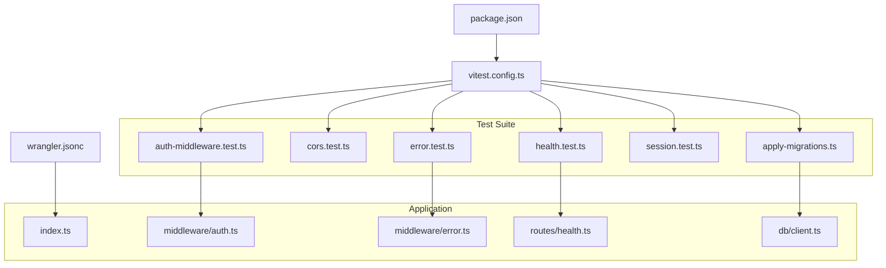
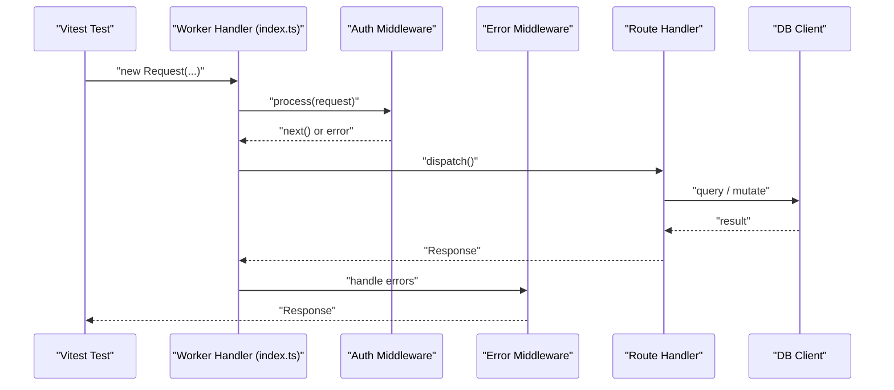
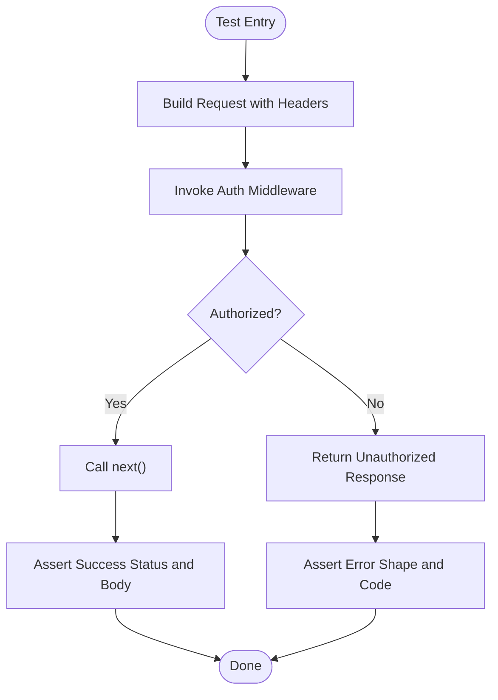
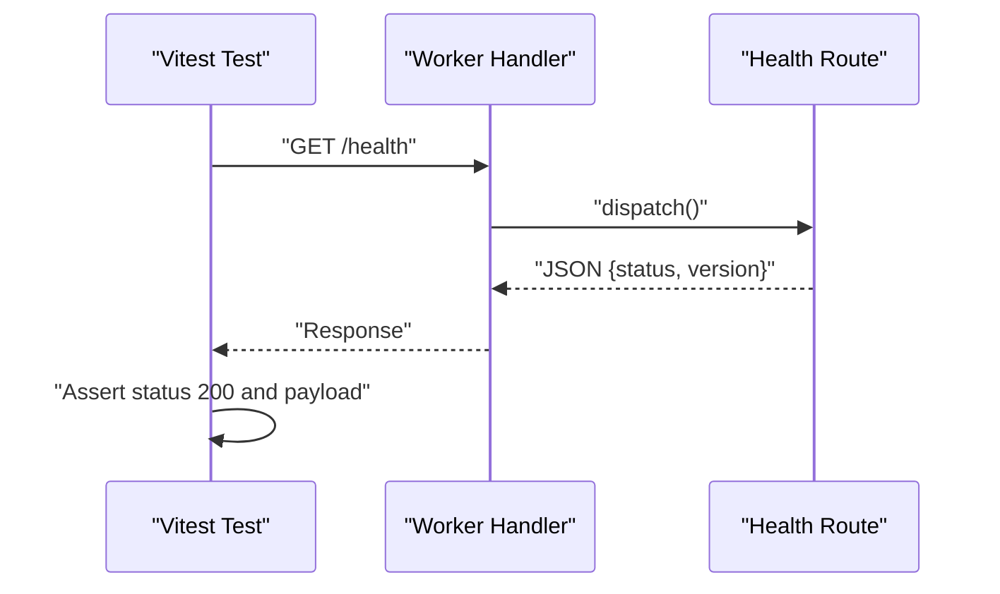
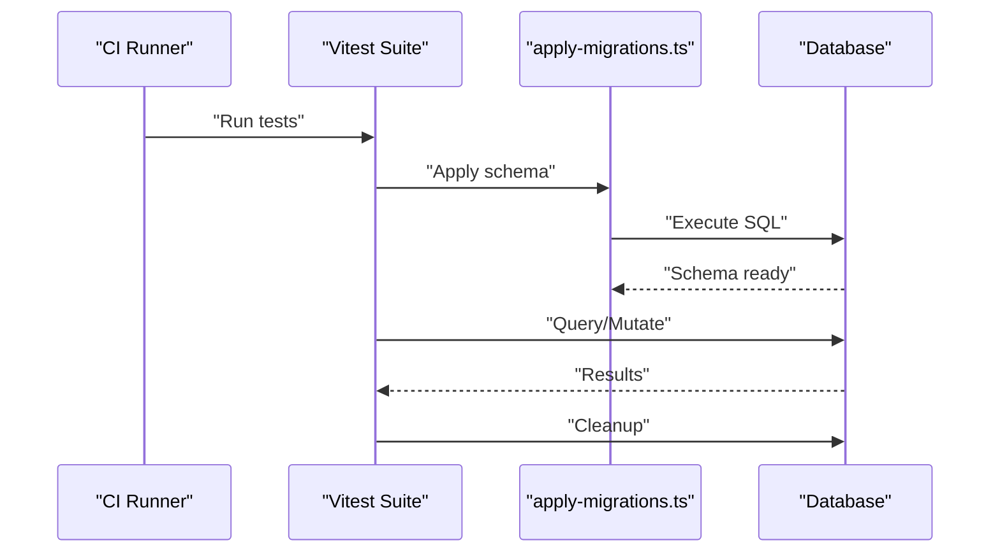
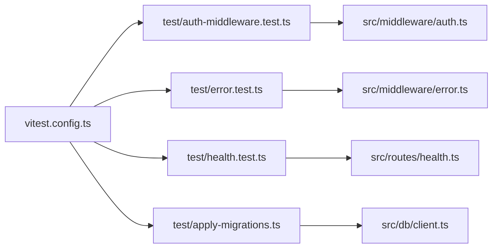

# Testing Guide

<cite>
**Referenced Files in This Document**
- [vitest.config.ts](file://vitest.config.ts)
- [package.json](file://package.json)
- [wrangler.jsonc](file://wrangler.jsonc)
- [src/index.ts](file://src/index.ts)
- [test/auth-middleware.test.ts](file://test/auth-middleware.test.ts)
- [test/cors.test.ts](file://test/cors.test.ts)
- [test/error.test.ts](file://test/error.test.ts)
- [test/health.test.ts](file://test/health.test.ts)
- [test/session.test.ts](file://test/session.test.ts)
- [test/apply-migrations.ts](file://test/apply-migrations.ts)
- [src/middleware/auth.ts](file://src/middleware/auth.ts)
- [src/middleware/error.ts](file://src/middleware/error.ts)
- [src/routes/health.ts](file://src/routes/health.ts)
- [src/db/client.ts](file://src/db/client.ts)
</cite>

## Table of Contents
1. [Introduction](#introduction)
2. [Project Structure](#project-structure)
3. [Core Components](#core-components)
4. [Architecture Overview](#architecture-overview)
5. [Detailed Component Analysis](#detailed-component-analysis)
6. [Dependency Analysis](#dependency-analysis)
7. [Performance Considerations](#performance-considerations)
8. [Troubleshooting Guide](#troubleshooting-guide)
9. [Conclusion](#conclusion)

## Introduction
This guide explains how to test the TrackDub API using Vitest, with a focus on Cloudflare Workers compatibility. It covers test organization, mocking strategies for the Workers runtime, unit testing middleware and route handlers, integration patterns for database operations and authentication flows, and best practices for reliability and performance in serverless environments.

## Project Structure
The repository follows a clear separation between application code under src and tests under test. Configuration files define the testing runtime (Vitest), environment variables, and Wrangler settings for Cloudflare Workers.

**Diagram sources**
- [vitest.config.ts](file://vitest.config.ts)
- [wrangler.jsonc](file://wrangler.jsonc)
- [package.json](file://package.json)
- [src/index.ts](file://src/index.ts)
- [src/middleware/auth.ts](file://src/middleware/auth.ts)
- [src/middleware/error.ts](file://src/middleware/error.ts)
- [src/routes/health.ts](file://src/routes/health.ts)
- [src/db/client.ts](file://src/db/client.ts)
- [test/auth-middleware.test.ts](file://test/auth-middleware.test.ts)
- [test/cors.test.ts](file://test/cors.test.ts)
- [test/error.test.ts](file://test/error.test.ts)
- [test/health.test.ts](file://test/health.test.ts)
- [test/session.test.ts](file://test/session.test.ts)
- [test/apply-migrations.ts](file://test/apply-migrations.ts)

**Section sources**
- [vitest.config.ts](file://vitest.config.ts)
- [wrangler.jsonc](file://wrangler.jsonc)
- [package.json](file://package.json)

## Core Components
- Test runner: Vitest configured via vitest.config.ts and invoked through npm scripts in package.json.
- Workers context: Tests run against a Cloudflare Workers-compatible environment defined by wrangler.jsonc and any global mocks provided by the test harness.
- Application entry: The main worker is exported from src/index.ts and used as the target for request/response assertions in tests.
- Middleware and routes: Unit tests validate behavior of auth middleware, error handling, health endpoints, and session logic.
- Database integration: Integration tests use apply-migrations.ts to prepare a test database schema before running queries.

Key responsibilities:
- Ensure requests are constructed and sent to the worker handler consistently across tests.
- Mock or stub external dependencies such as KV, Durable Objects, R2, and third-party APIs.
- Provide deterministic environment variables for each test run.

**Section sources**
- [src/index.ts](file://src/index.ts)
- [test/auth-middleware.test.ts](file://test/auth-middleware.test.ts)
- [test/cors.test.ts](file://test/cors.test.ts)
- [test/error.test.ts](file://test/error.test.ts)
- [test/health.test.ts](file://test/health.test.ts)
- [test/session.test.ts](file://test/session.test.ts)
- [test/apply-migrations.ts](file://test/apply-migrations.ts)

## Architecture Overview
The testing architecture layers unit tests over middleware and routes, with optional integration tests that interact with a real or mocked database. Requests flow through the same middleware pipeline as production, ensuring parity between test and runtime behavior.

**Diagram sources**
- [src/index.ts](file://src/index.ts)
- [src/middleware/auth.ts](file://src/middleware/auth.ts)
- [src/middleware/error.ts](file://src/middleware/error.ts)
- [src/routes/health.ts](file://src/routes/health.ts)
- [src/db/client.ts](file://src/db/client.ts)

## Detailed Component Analysis

### Vitest Setup and Environment
- Configuration file defines test globals, environment, and reporters.
- Use Node or Workers-compatible environment depending on whether you need full CF runtime features.
- Set up environment variables via .dev.vars.example and load them in tests.

Best practices:
- Keep test-specific env vars isolated per test suite.
- Avoid relying on mutable globals; reset state between tests.

**Section sources**
- [vitest.config.ts](file://vitest.config.ts)
- [package.json](file://package.json)

### Middleware Unit Testing
Focus areas:
- Authentication middleware validates tokens, sets user context, and short-circuits unauthorized requests.
- Error middleware formats responses and ensures consistent status codes.

Testing approach:
- Construct minimal Request objects with required headers.
- Assert Response status, body shape, and side effects (e.g., headers).
- Stub external calls if middleware depends on KV or secrets.

**Diagram sources**
- [src/middleware/auth.ts](file://src/middleware/auth.ts)
- [test/auth-middleware.test.ts](file://test/auth-middleware.test.ts)

**Section sources**
- [src/middleware/auth.ts](file://src/middleware/auth.ts)
- [test/auth-middleware.test.ts](file://test/auth-middleware.test.ts)

### Route Handlers Unit Testing
Focus areas:
- Health endpoint returns service status and metadata.
- Other routes may depend on DB or external services.

Testing approach:
- Send HTTP-like requests directly to the worker handler.
- Validate response status, JSON structure, and headers.
- For DB-dependent routes, mock the DB client or use an integration setup.

**Diagram sources**
- [src/routes/health.ts](file://src/routes/health.ts)
- [test/health.test.ts](file://test/health.test.ts)

**Section sources**
- [src/routes/health.ts](file://src/routes/health.ts)
- [test/health.test.ts](file://test/health.test.ts)

### Error Handling Testing
Focus areas:
- Centralized error middleware normalizes error responses.
- Tests should cover expected error shapes and status codes.

Testing approach:
- Trigger known error conditions in route handlers or middleware.
- Assert that error middleware returns consistent JSON and status.

**Diagram sources**
- [src/middleware/error.ts](file://src/middleware/error.ts)
- [test/error.test.ts](file://test/error.test.ts)

**Section sources**
- [src/middleware/error.ts](file://src/middleware/error.ts)
- [test/error.test.ts](file://test/error.test.ts)

### Session and CORS Testing
Focus areas:
- Session middleware manages cookies and token storage.
- CORS middleware configures allowed origins, methods, and headers.

Testing approach:
- Verify cookie presence and attributes.
- Validate Access-Control-* headers for various origin/method combinations.

**Section sources**
- [test/session.test.ts](file://test/session.test.ts)
- [test/cors.test.ts](file://test/cors.test.ts)

### Database Integration Testing
Focus areas:
- Apply migrations before running tests that query the database.
- Isolate test data per test run to avoid flakiness.

Testing approach:
- Use apply-migrations.ts to set up schema.
- Wrap tests in transactions or use a dedicated test database.
- Clean up after tests to keep runs deterministic.

**Diagram sources**
- [test/apply-migrations.ts](file://test/apply-migrations.ts)
- [src/db/client.ts](file://src/db/client.ts)

**Section sources**
- [test/apply-migrations.ts](file://test/apply-migrations.ts)
- [src/db/client.ts](file://src/db/client.ts)

### Mocking Strategies for Cloudflare Workers
Common needs:
- Mock KV, Durable Objects, R2, and fetch-based APIs.
- Simulate authenticated contexts without real tokens.

Recommended patterns:
- Replace module-level dependencies with spies or stubs.
- Provide minimal Request/Response objects with necessary headers and bodies.
- Use environment variable overrides for secrets and feature flags.

Tips:
- Keep mocks close to the tested component to reduce coupling.
- Assert both inputs and outputs of mocks to ensure correctness.

[No sources needed since this section provides general guidance]

### Asynchronous Operations Testing
Guidelines:
- Await all promises in tests to prevent unhandled rejections.
- Use timeouts judiciously and prefer deterministic waits where possible.
- For retries/backoff, assert final outcomes rather than internal timing.

[No sources needed since this section provides general guidance]

## Dependency Analysis
Tests depend on the application modules they exercise. Understanding these relationships helps isolate failures and design focused mocks.

**Diagram sources**
- [test/auth-middleware.test.ts](file://test/auth-middleware.test.ts)
- [test/error.test.ts](file://test/error.test.ts)
- [test/health.test.ts](file://test/health.test.ts)
- [test/apply-migrations.ts](file://test/apply-migrations.ts)
- [src/middleware/auth.ts](file://src/middleware/auth.ts)
- [src/middleware/error.ts](file://src/middleware/error.ts)
- [src/routes/health.ts](file://src/routes/health.ts)
- [src/db/client.ts](file://src/db/client.ts)
- [vitest.config.ts](file://vitest.config.ts)

**Section sources**
- [vitest.config.ts](file://vitest.config.ts)
- [test/auth-middleware.test.ts](file://test/auth-middleware.test.ts)
- [test/error.test.ts](file://test/error.test.ts)
- [test/health.test.ts](file://test/health.test.ts)
- [test/apply-migrations.ts](file://test/apply-migrations.ts)

## Performance Considerations
- Prefer unit tests over integration tests for fast feedback loops.
- Batch database operations in integration tests and reuse connections when safe.
- Avoid heavy mocks that serialize large payloads; keep fixtures minimal.
- Use parallel test execution cautiously; ensure isolation to prevent shared-state collisions.

[No sources needed since this section provides general guidance]

## Troubleshooting Guide
Common issues and resolutions:
- Missing environment variables: Ensure .dev.vars.example values are loaded in tests.
- Unhandled promise rejections: Always await async operations in tests.
- Flaky database tests: Use transactional isolation and clean up after each test.
- Workers context not available: Configure Vitest to run in a Workers-compatible environment or provide explicit mocks.

Debugging techniques:
- Use structured logging in middleware and routes to trace request flow.
- Print minimal context around assertions to pinpoint failures quickly.
- Run a single failing test in watch mode to iterate faster.

**Section sources**
- [src/middleware/logging.ts](file://src/middleware/logging.ts)
- [test/error.test.ts](file://test/error.test.ts)

## Conclusion
By organizing tests around middleware, routes, and utilities, and by carefully mocking Cloudflare Workers dependencies, you can achieve reliable coverage for the TrackDub API. Combine fast unit tests with targeted integration tests for database and auth flows, and enforce consistent error handling and logging to simplify debugging. Adopt CI-friendly practices and performance-conscious test design to maintain speed and stability as the API evolves.