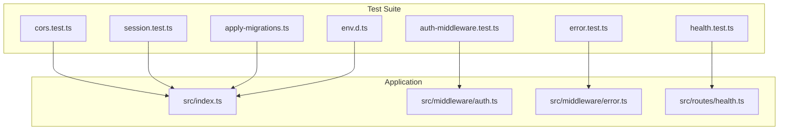
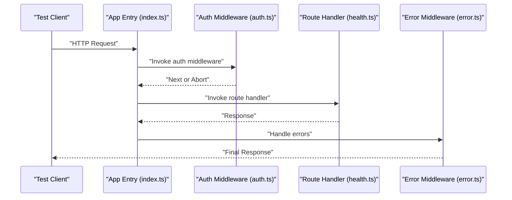
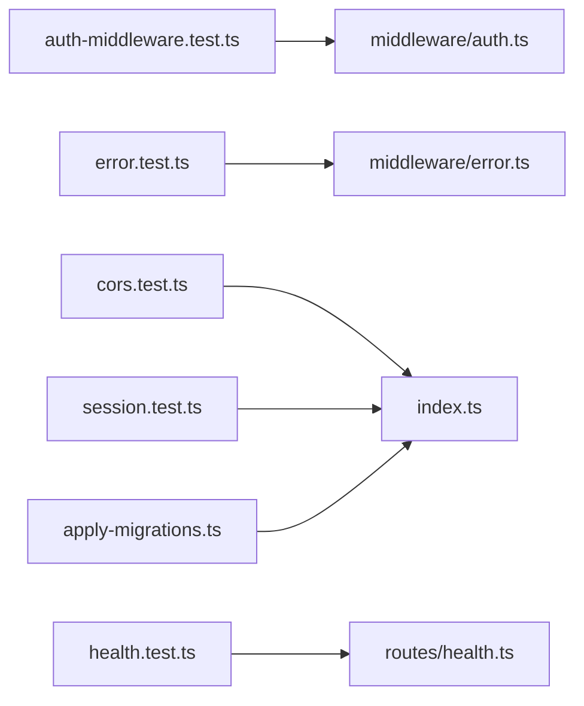

# Unit Testing Patterns

<cite>
**Referenced Files in This Document**
- [package.json](file://package.json)
- [vitest.config.ts](file://vitest.config.ts)
- [auth-middleware.test.ts](file://test/auth-middleware.test.ts)
- [error.test.ts](file://test/error.test.ts)
- [cors.test.ts](file://test/cors.test.ts)
- [health.test.ts](file://test/health.test.ts)
- [session.test.ts](file://test/session.test.ts)
- [apply-migrations.ts](file://test/apply-migrations.ts)
- [env.d.ts](file://test/env.d.ts)
- [middleware/auth.ts](file://src/middleware/auth.ts)
- [middleware/error.ts](file://src/middleware/error.ts)
- [routes/health.ts](file://src/routes/health.ts)
- [index.ts](file://src/index.ts)
</cite>

## Table of Contents
1. [Introduction](#introduction)
2. [Project Structure](#project-structure)
3. [Core Components](#core-components)
4. [Architecture Overview](#architecture-overview)
5. [Detailed Component Analysis](#detailed-component-analysis)
6. [Dependency Analysis](#dependency-analysis)
7. [Performance Considerations](#performance-considerations)
8. [Troubleshooting Guide](#troubleshooting-guide)
9. [Conclusion](#conclusion)
10. [Appendices](#appendices)

## Introduction
This document provides comprehensive unit testing guidance for TrackDub API components with a focus on middleware functions, error handlers, and utility modules. It explains how to mock dependencies, test asynchronous operations, and validate request/response handling. Concrete examples are drawn from the auth-middleware tests, error handling tests, and CORS configuration tests included in the repository. Best practices for isolating units, creating test fixtures, and ensuring test reliability are also covered.

## Project Structure
The project uses Vitest as the test runner and is configured via a dedicated config file. Tests live under the test directory and cover middleware, routes, environment setup, and migrations. The application entry point wires up middleware and routes, which can be exercised through integration-style tests that simulate HTTP requests.

**Diagram sources**
- [vitest.config.ts](file://vitest.config.ts)
- [auth-middleware.test.ts](file://test/auth-middleware.test.ts)
- [error.test.ts](file://test/error.test.ts)
- [cors.test.ts](file://test/cors.test.ts)
- [health.test.ts](file://test/health.test.ts)
- [session.test.ts](file://test/session.test.ts)
- [apply-migrations.ts](file://test/apply-migrations.ts)
- [env.d.ts](file://test/env.d.ts)
- [index.ts](file://src/index.ts)
- [middleware/auth.ts](file://src/middleware/auth.ts)
- [middleware/error.ts](file://src/middleware/error.ts)
- [routes/health.ts](file://src/routes/health.ts)

**Section sources**
- [vitest.config.ts](file://vitest.config.ts)
- [package.json](file://package.json)

## Core Components
- Test runner and configuration: Vitest is used to discover and run tests. The configuration file sets up environments and any global settings required by tests.
- Middleware under test: Authentication middleware validates tokens and attaches user context; error middleware centralizes error responses; logging and validation middleware support consistent behavior across routes.
- Routes under test: Health endpoint returns service status; other routes exercise authentication and authorization flows.
- Test utilities: Environment type declarations ensure type safety; migration helpers prepare the database state when needed.

Key responsibilities:
- Isolate each unit by mocking external services (e.g., databases, third-party APIs).
- Validate both success and failure paths for middleware and route handlers.
- Assert response status codes, headers, and body shapes.

**Section sources**
- [vitest.config.ts](file://vitest.config.ts)
- [middleware/auth.ts](file://src/middleware/auth.ts)
- [middleware/error.ts](file://src/middleware/error.ts)
- [routes/health.ts](file://src/routes/health.ts)
- [env.d.ts](file://test/env.d.ts)

## Architecture Overview
The application exposes an HTTP interface where middleware intercepts requests before reaching route handlers. Error middleware ensures consistent error responses. Tests simulate HTTP requests against the app instance or individual middleware functions to validate behavior.

**Diagram sources**
- [index.ts](file://src/index.ts)
- [middleware/auth.ts](file://src/middleware/auth.ts)
- [routes/health.ts](file://src/routes/health.ts)
- [middleware/error.ts](file://src/middleware/error.ts)

## Detailed Component Analysis

### Authentication Middleware Testing
Focus areas:
- Token extraction and validation
- User context attachment
- Rejection of invalid or missing tokens
- Interaction with external auth services (mocked)

Testing strategies:
- Mock dependency calls to avoid real network or database access.
- Use request fixtures with valid and invalid tokens to assert correct branching.
- Verify that user context is attached on success and that unauthorized responses are returned otherwise.

Example references:
- See [auth-middleware.test.ts](file://test/auth-middleware.test.ts) for concrete scenarios covering token validation and error cases.
- Refer to [middleware/auth.ts](file://src/middleware/auth.ts) for the implementation details being tested.

Best practices:
- Keep fixtures minimal and explicit.
- Separate happy-path and error-path tests.
- Assert both status codes and response bodies.

**Section sources**
- [auth-middleware.test.ts](file://test/auth-middleware.test.ts)
- [middleware/auth.ts](file://src/middleware/auth.ts)

### Error Handling Middleware Testing
Focus areas:
- Centralized error formatting
- Status code mapping
- Logging side effects
- Graceful fallbacks

Testing strategies:
- Inject synthetic errors into the pipeline and assert normalized responses.
- Ensure sensitive information is not leaked in error payloads.
- Validate that logging occurs without blocking request flow.

Example references:
- See [error.test.ts](file://test/error.test.ts) for assertions on error normalization and response structure.
- Refer to [middleware/error.ts](file://src/middleware/error.ts) for the error-handling logic.

Best practices:
- Create a small set of representative error objects.
- Assert only what is necessary to prevent brittle tests.
- Avoid asserting internal stack traces in production-like responses.

**Section sources**
- [error.test.ts](file://test/error.test.ts)
- [middleware/error.ts](file://src/middleware/error.ts)

### CORS Configuration Testing
Focus areas:
- Allowed origins, methods, and headers
- Preflight request handling
- Credentials policy
- Environment-driven configuration

Testing strategies:
- Simulate preflight and actual requests with varied headers.
- Assert presence of correct CORS headers in responses.
- Validate that disallowed origins are rejected.

Example references:
- See [cors.test.ts](file://test/cors.test.ts) for coverage of allowed origins and preflight behavior.
- Review [index.ts](file://src/index.ts) for how CORS is wired into the application.

Best practices:
- Parameterize tests over different origin/method/header combinations.
- Keep environment variables isolated per test run.

**Section sources**
- [cors.test.ts](file://test/cors.test.ts)
- [index.ts](file://src/index.ts)

### Health Endpoint Testing
Focus areas:
- Service readiness checks
- Dependency health probes (optional)
- Stable response shape

Testing strategies:
- Send GET requests and assert 200 OK with expected body fields.
- Optionally mock downstream dependencies to simulate failures and verify degraded responses if applicable.

Example references:
- See [health.test.ts](file://test/health.test.ts) for basic health check assertions.
- Refer to [routes/health.ts](file://src/routes/health.ts) for the handler implementation.

Best practices:
- Keep health endpoint tests fast and deterministic.
- Avoid flaky assertions based on timestamps unless normalized.

**Section sources**
- [health.test.ts](file://test/health.test.ts)
- [routes/health.ts](file://src/routes/health.ts)

### Session Testing
Focus areas:
- Session creation, update, and expiration
- Secure cookie attributes
- Storage backend interactions (mocked)

Testing strategies:
- Mock session storage to control read/write behavior.
- Assert cookie headers and payload contents.
- Cover edge cases like expired sessions and malformed cookies.

Example references:
- See [session.test.ts](file://test/session.test.ts) for session lifecycle scenarios.
- Review application wiring in [index.ts](file://src/index.ts) for session middleware integration.

Best practices:
- Use deterministic session IDs in tests.
- Reset session store between tests to avoid cross-test contamination.

**Section sources**
- [session.test.ts](file://test/session.test.ts)
- [index.ts](file://src/index.ts)

### Database Migration Helper
Purpose:
- Apply schema changes before running tests that require DB state.

Usage:
- Import and execute the helper in test setup to ensure consistent schema across runs.

Example references:
- See [apply-migrations.ts](file://test/apply-migrations.ts) for migration execution logic.

Best practices:
- Run migrations once per test suite initialization.
- Roll back or reset state after tests if needed.

**Section sources**
- [apply-migrations.ts](file://test/apply-migrations.ts)

## Dependency Analysis
Tests rely on the application’s entry point and middleware chain. External dependencies such as databases and third-party services should be mocked to keep tests fast and reliable.

**Diagram sources**
- [auth-middleware.test.ts](file://test/auth-middleware.test.ts)
- [error.test.ts](file://test/error.test.ts)
- [cors.test.ts](file://test/cors.test.ts)
- [health.test.ts](file://test/health.test.ts)
- [session.test.ts](file://test/session.test.ts)
- [apply-migrations.ts](file://test/apply-migrations.ts)
- [middleware/auth.ts](file://src/middleware/auth.ts)
- [middleware/error.ts](file://src/middleware/error.ts)
- [index.ts](file://src/index.ts)
- [routes/health.ts](file://src/routes/health.ts)

**Section sources**
- [vitest.config.ts](file://vitest.config.ts)
- [package.json](file://package.json)

## Performance Considerations
- Prefer unit tests over integration tests where possible to reduce runtime.
- Mock slow dependencies (DB, network) to keep suites fast.
- Parallelize independent tests using Vitest’s built-in capabilities.
- Minimize heavy setup in beforeEach hooks; reuse shared fixtures judiciously.

[No sources needed since this section provides general guidance]

## Troubleshooting Guide
Common issues and resolutions:
- Flaky tests due to shared state: isolate state per test and reset between runs.
- Timeouts in async tests: increase timeouts only when necessary; prefer mocking delays.
- Environment variable mismatches: use env.d.ts and explicit test configs to pin values.
- Migration conflicts: ensure apply-migrations.ts runs once and resets state afterward.

Practical tips:
- Log minimal context around failing assertions.
- Reproduce failures locally with the same environment variables.
- Pin dependency versions to avoid unexpected changes.

**Section sources**
- [env.d.ts](file://test/env.d.ts)
- [apply-migrations.ts](file://test/apply-migrations.ts)

## Conclusion
By following the patterns outlined here—mocking dependencies, validating request/response contracts, and isolating units—you can build a robust test suite for TrackDub API components. The provided examples from auth-middleware, error handling, and CORS tests demonstrate effective strategies for middleware and route testing. Adhering to best practices for fixtures, isolation, and reliability will keep your tests maintainable and fast.

[No sources needed since this section summarizes without analyzing specific files]

## Appendices

### How to Mock Dependencies
- Replace external services with lightweight mocks that return predictable results.
- Use function spies to assert calls were made with expected arguments.
- For DB interactions, consider in-memory stores or transactional rollback.

### How to Test Asynchronous Operations
- Await promises and handle rejections explicitly.
- Use timers or mocks to control time-dependent behavior.
- Assert final state rather than intermediate steps.

### How to Validate Request/Response Handling
- Construct realistic request fixtures.
- Assert status codes, headers, and body schemas.
- Cover edge cases like malformed inputs and rate limiting.

### Creating Reliable Test Fixtures
- Define fixtures close to the tests they serve.
- Keep fixtures immutable within a test.
- Derive variations from base fixtures to reduce duplication.

[No sources needed since this section provides general guidance]