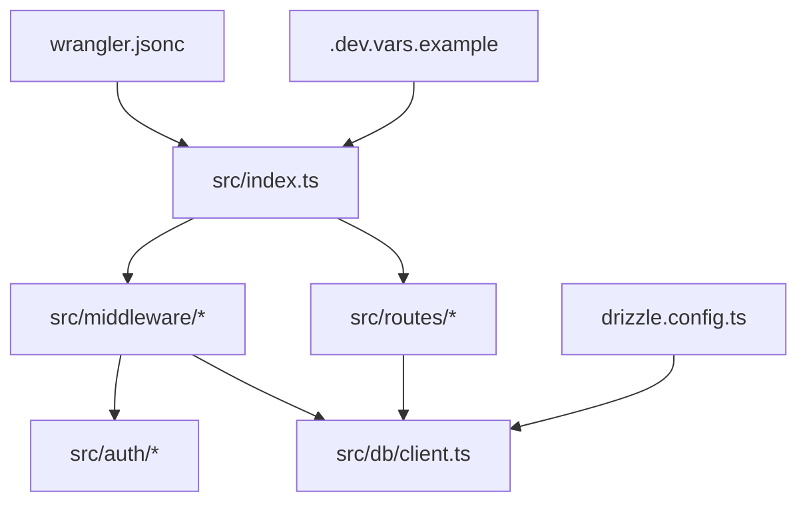
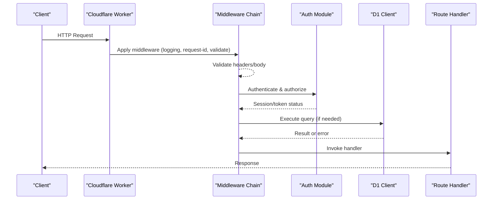
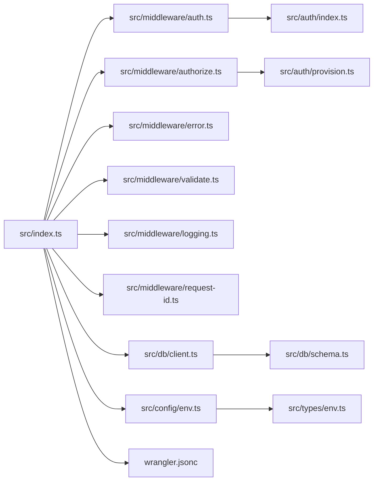

# Common Issues and Solutions

<cite>
**Referenced Files in This Document**
- [src/index.ts](file://src/index.ts)
- [src/config/env.ts](file://src/config/env.ts)
- [src/types/env.ts](file://src/types/env.ts)
- [src/auth/index.ts](file://src/auth/index.ts)
- [src/auth/provision.ts](file://src/auth/provision.ts)
- [src/middleware/auth.ts](file://src/middleware/auth.ts)
- [src/middleware/authorize.ts](file://src/middleware/authorize.ts)
- [src/middleware/error.ts](file://src/middleware/error.ts)
- [src/middleware/logging.ts](file://src/middleware/logging.ts)
- [src/middleware/request-id.ts](file://src/middleware/request-id.ts)
- [src/middleware/validate.ts](file://src/middleware/validate.ts)
- [src/db/client.ts](file://src/db/client.ts)
- [src/db/schema.ts](file://src/db/schema.ts)
- [drizzle.config.ts](file://drizzle.config.ts)
- [wrangler.jsonc](file://wrangler.jsonc)
- [.dev.vars.example](file://.dev.vars.example)
- [test/cors.test.ts](file://test/cors.test.ts)
- [test/session.test.ts](file://test/session.test.ts)
- [test/error.test.ts](file://test/error.test.ts)
- [test/apply-migrations.ts](file://test/apply-migrations.ts)
</cite>

## Table of Contents
1. [Introduction](#introduction)
2. [Project Structure](#project-structure)
3. [Core Components](#core-components)
4. [Architecture Overview](#architecture-overview)
5. [Detailed Component Analysis](#detailed-component-analysis)
6. [Dependency Analysis](#dependency-analysis)
7. [Performance Considerations](#performance-considerations)
8. [Troubleshooting Guide](#troubleshooting-guide)
9. [Conclusion](#conclusion)
10. [Appendices](#appendices)

## Introduction
This document consolidates common issues encountered when working with the TrackDub API, focusing on authentication failures, database connectivity problems, middleware misconfigurations, environment variable setup, Cloudflare Workers deployment errors, and development server issues. For each category, you will find typical error messages, root causes, step-by-step resolutions, and preventive best practices to avoid recurring pitfalls.

## Project Structure
The project is a Cloudflare Workers-based API with:
- Authentication and authorization middleware
- Database client and schema definitions using Drizzle ORM
- Environment configuration and type guards
- Middleware for logging, request ID generation, validation, and error handling
- Tests covering CORS, sessions, errors, and migrations

**Diagram sources**
- [src/index.ts](file://src/index.ts)
- [src/middleware/auth.ts](file://src/middleware/auth.ts)
- [src/middleware/authorize.ts](file://src/middleware/authorize.ts)
- [src/middleware/error.ts](file://src/middleware/error.ts)
- [src/middleware/logging.ts](file://src/middleware/logging.ts)
- [src/middleware/request-id.ts](file://src/middleware/request-id.ts)
- [src/middleware/validate.ts](file://src/middleware/validate.ts)
- [src/auth/index.ts](file://src/auth/index.ts)
- [src/auth/provision.ts](file://src/auth/provision.ts)
- [src/db/client.ts](file://src/db/client.ts)
- [drizzle.config.ts](file://drizzle.config.ts)
- [wrangler.jsonc](file://wrangler.jsonc)
- [.dev.vars.example](file://.dev.vars.example)

**Section sources**
- [src/index.ts](file://src/index.ts)
- [wrangler.jsonc](file://wrangler.jsonc)
- [drizzle.config.ts](file://drizzle.config.ts)

## Core Components
- Authentication and session management: token validation, session creation/retrieval, and permission checks are implemented in auth modules and middleware.
- Database layer: Drizzle ORM client and schema definitions manage D1 connectivity and queries.
- Middleware pipeline: request validation, logging, request ID propagation, authorization, and centralized error handling.
- Configuration: typed environment variables and runtime checks ensure required settings are present.

Key files:
- Authentication: [src/auth/index.ts](file://src/auth/index.ts), [src/auth/provision.ts](file://src/auth/provision.ts)
- Middleware: [src/middleware/auth.ts](file://src/middleware/auth.ts), [src/middleware/authorize.ts](file://src/middleware/authorize.ts), [src/middleware/error.ts](file://src/middleware/error.ts), [src/middleware/logging.ts](file://src/middleware/logging.ts), [src/middleware/request-id.ts](file://src/middleware/request-id.ts), [src/middleware/validate.ts](file://src/middleware/validate.ts)
- Database: [src/db/client.ts](file://src/db/client.ts), [src/db/schema.ts](file://src/db/schema.ts)
- Configuration: [src/config/env.ts](file://src/config/env.ts), [src/types/env.ts](file://src/types/env.ts)

**Section sources**
- [src/auth/index.ts](file://src/auth/index.ts)
- [src/auth/provision.ts](file://src/auth/provision.ts)
- [src/middleware/auth.ts](file://src/middleware/auth.ts)
- [src/middleware/authorize.ts](file://src/middleware/authorize.ts)
- [src/middleware/error.ts](file://src/middleware/error.ts)
- [src/middleware/logging.ts](file://src/middleware/logging.ts)
- [src/middleware/request-id.ts](file://src/middleware/request-id.ts)
- [src/middleware/validate.ts](file://src/middleware/validate.ts)
- [src/db/client.ts](file://src/db/client.ts)
- [src/db/schema.ts](file://src/db/schema.ts)
- [src/config/env.ts](file://src/config/env.ts)
- [src/types/env.ts](file://src/types/env.ts)

## Architecture Overview
The API follows a layered architecture:
- Entry point initializes middleware and routes.
- Middleware chain validates requests, enforces authentication and authorization, logs activity, and handles errors.
- Routes interact with the database via the Drizzle client.
- Environment variables are validated at startup.

**Diagram sources**
- [src/index.ts](file://src/index.ts)
- [src/middleware/logging.ts](file://src/middleware/logging.ts)
- [src/middleware/request-id.ts](file://src/middleware/request-id.ts)
- [src/middleware/validate.ts](file://src/middleware/validate.ts)
- [src/middleware/auth.ts](file://src/middleware/auth.ts)
- [src/middleware/authorize.ts](file://src/middleware/authorize.ts)
- [src/db/client.ts](file://src/db/client.ts)

## Detailed Component Analysis

### Authentication Failures
Common symptoms:
- Token validation errors (invalid/expired tokens)
- Session management problems (missing or invalid session cookies)
- Permission denied scenarios (insufficient roles/scopes)

Typical error messages:
- “Invalid token” or “Token expired”
- “Session not found” or “Session expired”
- “Permission denied” or “Insufficient privileges”

Root causes:
- Missing or malformed Authorization header
- Incorrect secret/key configuration for signing/verifying tokens
- Session store misconfiguration or missing cookie attributes
- Role/permission mismatch between user claims and route requirements

Resolutions:
- Ensure Authorization header contains a valid bearer token; verify token signing keys match server configuration.
- Confirm session cookie domain, path, secure, and httpOnly flags align with your deployment environment.
- Check role/permission mappings in authorization middleware against user claims.
- Use consistent time synchronization and clock skew tolerance if relying on token expiration.

Preventive measures:
- Centralize token verification logic and add explicit error types for different failure modes.
- Add tests for token and session edge cases (expired, malformed, missing).
- Log detailed but safe diagnostics without exposing secrets.

**Section sources**
- [src/auth/index.ts](file://src/auth/index.ts)
- [src/auth/provision.ts](file://src/auth/provision.ts)
- [src/middleware/auth.ts](file://src/middleware/auth.ts)
- [src/middleware/authorize.ts](file://src/middleware/authorize.ts)

### Database Connection Issues (D1)
Common symptoms:
- D1 connection errors during startup or first request
- Migration failures (schema drift, syntax errors)
- Query execution errors (type mismatches, constraint violations)

Typical error messages:
- “D1 connection failed” or “Database unavailable”
- “Migration failed” or “Schema mismatch”
- “Query execution error” or “Constraint violation”

Root causes:
- Missing or incorrect D1 binding name in Wrangler config
- Unapplied or conflicting migrations
- Incorrect column types or nullability constraints
- Network or quota limits in development vs production

Resolutions:
- Verify D1 binding name matches the worker’s wrangler configuration.
- Run migrations explicitly and confirm success before deploying.
- Align schema definitions with actual database state; use versioned migrations.
- Inspect query parameters and result shapes to prevent type errors.

Preventive measures:
- Enforce migration checks in CI pipelines.
- Wrap DB calls with retry and timeout policies where appropriate.
- Add integration tests that exercise critical queries against a test D1 instance.

**Section sources**
- [src/db/client.ts](file://src/db/client.ts)
- [src/db/schema.ts](file://src/db/schema.ts)
- [drizzle.config.ts](file://drizzle.config.ts)
- [wrangler.jsonc](file://wrangler.jsonc)
- [test/apply-migrations.ts](file://test/apply-migrations.ts)

### Middleware Problems
Common symptoms:
- Request validation failures (missing fields, wrong types)
- CORS configuration issues (preflight failures, blocked origins)
- Error handling misconfigurations (unhandled exceptions, inconsistent responses)

Typical error messages:
- “Validation failed” or “Missing required field”
- “CORS policy blocked” or “Origin not allowed”
- “Unhandled exception” or “Unexpected response format”

Root causes:
- Strict validation schemas not aligned with client payloads
- CORS allowlist missing or misconfigured for dev/prod environments
- Error middleware not catching all paths or returning non-standard formats

Resolutions:
- Update validation schemas to match client expectations; provide clear error details.
- Configure CORS origins, methods, and headers appropriately per environment.
- Ensure error middleware is last in the chain and returns consistent JSON error structures.

Preventive measures:
- Centralize validation schemas and reuse across routes.
- Add tests for CORS preflight and error responses.
- Standardize error codes and messages across the API.

**Section sources**
- [src/middleware/validate.ts](file://src/middleware/validate.ts)
- [src/middleware/error.ts](file://src/middleware/error.ts)
- [test/cors.test.ts](file://test/cors.test.ts)

### Environment Variable Setup Problems
Common symptoms:
- Startup crashes due to missing env vars
- Runtime errors from undefined configuration values
- Development server failing to connect to services

Typical error messages:
- “Missing required environment variable”
- “Configuration error” or “Env validation failed”

Root causes:
- Missing .dev.vars file or incorrect key names
- Type mismatches in environment variable definitions
- Secrets not injected into Wrangler bindings

Resolutions:
- Copy example env file and fill in required values.
- Validate env at startup with strict checks and helpful error messages.
- Ensure Wrangler bindings include all necessary secrets and D1 databases.

Preventive measures:
- Provide a comprehensive example env file with comments.
- Add runtime checks and fail-fast behavior for critical configuration.
- Document required env vars in README and CI checks.

**Section sources**
- [src/config/env.ts](file://src/config/env.ts)
- [src/types/env.ts](file://src/types/env.ts)
- [.dev.vars.example](file://.dev.vars.example)
- [wrangler.jsonc](file://wrangler.jsonc)

### Cloudflare Workers Deployment Errors
Common symptoms:
- Build failures due to missing dependencies or TypeScript errors
- Runtime errors because of missing bindings or incorrect wrangler config
- Unexpected behavior in production vs local dev

Typical error messages:
- “Build failed” or “TypeScript compilation error”
- “Binding not found” or “Wrangler config error”
- “Runtime error” or “Uncaught exception”

Root causes:
- Inconsistent dependency versions or missing build steps
- Mismatch between wrangler bindings and runtime environment
- Environment-specific code paths not guarded by feature flags

Resolutions:
- Fix TypeScript errors and ensure all dependencies are installed.
- Align wrangler.jsonc bindings with actual Cloudflare resources.
- Use environment-specific configurations and guard sensitive code paths.

Preventive measures:
- Add linting and type checks in CI.
- Pin dependency versions and lockfiles.
- Use separate wrangler configs for dev/staging/prod.

**Section sources**
- [wrangler.jsonc](file://wrangler.jsonc)
- [src/index.ts](file://src/index.ts)

### Development Server Issues
Common symptoms:
- Local dev server cannot reach D1 or external services
- CORS errors during local testing
- Hot reload or watch mode instability

Typical error messages:
- “Connection refused” or “Service unavailable”
- “CORS error” or “Preflight failed”
- “Watch mode error” or “Reload failed”

Root causes:
- Missing local bindings or incorrect .dev.vars contents
- CORS settings not allowing localhost origins
- Node/Workers compatibility issues in dev environment

Resolutions:
- Populate .dev.vars with correct local bindings and secrets.
- Configure CORS to allow localhost and common dev origins.
- Ensure compatible Node/Workers versions and update tooling.

Preventive measures:
- Provide a ready-to-use .dev.vars.example.
- Include a health check endpoint to verify local setup.
- Document known dev quirks and workarounds.

**Section sources**
- [.dev.vars.example](file://.dev.vars.example)
- [test/cors.test.ts](file://test/cors.test.ts)
- [src/index.ts](file://src/index.ts)

## Dependency Analysis
The following diagram shows how core modules depend on each other:

**Diagram sources**
- [src/index.ts](file://src/index.ts)
- [src/middleware/auth.ts](file://src/middleware/auth.ts)
- [src/middleware/authorize.ts](file://src/middleware/authorize.ts)
- [src/middleware/error.ts](file://src/middleware/error.ts)
- [src/middleware/validate.ts](file://src/middleware/validate.ts)
- [src/middleware/logging.ts](file://src/middleware/logging.ts)
- [src/middleware/request-id.ts](file://src/middleware/request-id.ts)
- [src/auth/index.ts](file://src/auth/index.ts)
- [src/auth/provision.ts](file://src/auth/provision.ts)
- [src/db/client.ts](file://src/db/client.ts)
- [src/db/schema.ts](file://src/db/schema.ts)
- [src/config/env.ts](file://src/config/env.ts)
- [src/types/env.ts](file://src/types/env.ts)
- [wrangler.jsonc](file://wrangler.jsonc)

**Section sources**
- [src/index.ts](file://src/index.ts)
- [wrangler.jsonc](file://wrangler.jsonc)

## Performance Considerations
- Minimize middleware overhead by avoiding heavy computations in hot paths.
- Cache frequently accessed data where appropriate and respect cache invalidation strategies.
- Use efficient queries and avoid N+1 patterns in database interactions.
- Monitor request latency and error rates to identify bottlenecks.

[No sources needed since this section provides general guidance]

## Troubleshooting Guide

### Authentication Failures
- Symptom: “Invalid token” or “Token expired”
  - Root cause: Malformed or expired Authorization header; mismatched signing keys.
  - Resolution: Regenerate token with correct payload; verify server-side secret configuration.
- Symptom: “Session not found” or “Session expired”
  - Root cause: Missing or invalid session cookie; incorrect cookie attributes.
  - Resolution: Ensure cookie domain/path/secure/httpOnly match deployment; refresh session.
- Symptom: “Permission denied”
  - Root cause: User lacks required role/scope for the endpoint.
  - Resolution: Update user claims or adjust authorization rules.

**Section sources**
- [src/auth/index.ts](file://src/auth/index.ts)
- [src/middleware/auth.ts](file://src/middleware/auth.ts)
- [src/middleware/authorize.ts](file://src/middleware/authorize.ts)

### Database Connection Issues
- Symptom: “D1 connection failed”
  - Root cause: Missing or incorrect D1 binding in Wrangler config.
  - Resolution: Align binding name with wrangler.jsonc; verify resource exists.
- Symptom: “Migration failed”
  - Root cause: Schema drift or syntax errors in migrations.
  - Resolution: Re-run migrations locally; fix schema; re-deploy.
- Symptom: “Query execution error”
  - Root cause: Type mismatch or constraint violation.
  - Resolution: Adjust query parameters; enforce schema constraints.

**Section sources**
- [src/db/client.ts](file://src/db/client.ts)
- [src/db/schema.ts](file://src/db/schema.ts)
- [drizzle.config.ts](file://drizzle.config.ts)
- [wrangler.jsonc](file://wrangler.jsonc)
- [test/apply-migrations.ts](file://test/apply-migrations.ts)

### Middleware Problems
- Symptom: “Validation failed”
  - Root cause: Payload does not match expected schema.
  - Resolution: Update client payload or validation schema; return clear error details.
- Symptom: “CORS policy blocked”
  - Root cause: Origin not allowed or preflight misconfiguration.
  - Resolution: Add origin to allowlist; configure methods/headers correctly.
- Symptom: “Unhandled exception”
  - Root cause: Error middleware not invoked or non-JSON error response.
  - Resolution: Ensure error middleware is last; standardize error format.

**Section sources**
- [src/middleware/validate.ts](file://src/middleware/validate.ts)
- [src/middleware/error.ts](file://src/middleware/error.ts)
- [test/cors.test.ts](file://test/cors.test.ts)

### Environment Variables
- Symptom: “Missing required environment variable”
  - Root cause: .dev.vars incomplete or wrong key names.
  - Resolution: Populate .dev.vars from example; validate at startup.
- Symptom: “Configuration error”
  - Root cause: Type mismatch in env definitions.
  - Resolution: Align types with actual values; add runtime checks.

**Section sources**
- [src/config/env.ts](file://src/config/env.ts)
- [src/types/env.ts](file://src/types/env.ts)
- [.dev.vars.example](file://.dev.vars.example)

### Cloudflare Workers Deployment
- Symptom: “Build failed”
  - Root cause: TypeScript errors or missing dependencies.
  - Resolution: Install dependencies; fix type errors; run linters.
- Symptom: “Binding not found”
  - Root cause: Wrangler bindings mismatch.
  - Resolution: Update wrangler.jsonc to reflect actual bindings.
- Symptom: “Runtime error”
  - Root cause: Environment-specific code paths not guarded.
  - Resolution: Add feature flags; isolate sensitive logic behind checks.

**Section sources**
- [wrangler.jsonc](file://wrangler.jsonc)
- [src/index.ts](file://src/index.ts)

### Development Server
- Symptom: “Connection refused”
  - Root cause: Local bindings missing or incorrect.
  - Resolution: Fill .dev.vars; verify service endpoints.
- Symptom: “CORS error”
  - Root cause: Localhost not allowed.
  - Resolution: Add localhost to CORS allowlist.
- Symptom: “Watch mode error”
  - Root cause: Tooling incompatibility.
  - Resolution: Update Workers tooling; restart dev server.

**Section sources**
- [.dev.vars.example](file://.dev.vars.example)
- [test/cors.test.ts](file://test/cors.test.ts)
- [src/index.ts](file://src/index.ts)

## Conclusion
By understanding common authentication, database, middleware, environment, and deployment issues—and applying the resolutions and best practices outlined here—you can significantly reduce downtime and improve reliability. Adopting standardized error handling, robust configuration validation, and thorough testing will help prevent many of these pitfalls in both development and production.

[No sources needed since this section summarizes without analyzing specific files]

## Appendices

### Quick Reference: Error Test Coverage
- CORS tests validate preflight and allowed origins.
- Session tests cover creation, retrieval, and expiration behaviors.
- Error tests ensure consistent error responses and middleware ordering.

**Section sources**
- [test/cors.test.ts](file://test/cors.test.ts)
- [test/session.test.ts](file://test/session.test.ts)
- [test/error.test.ts](file://test/error.test.ts)