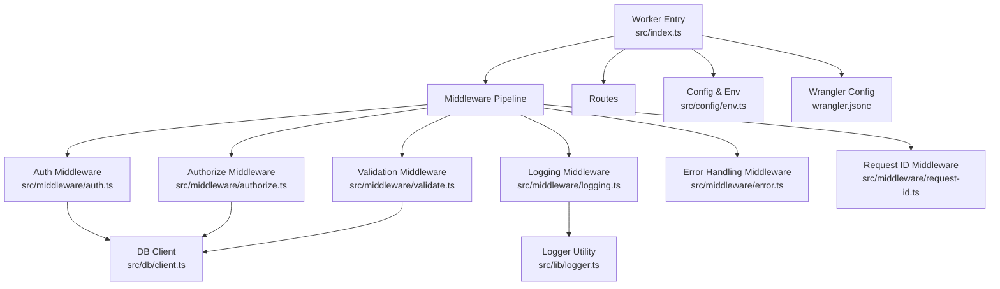
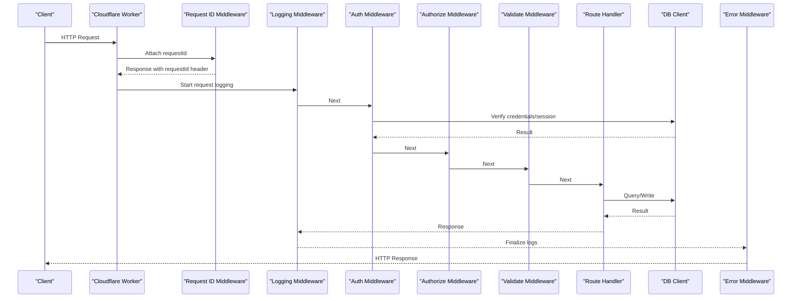
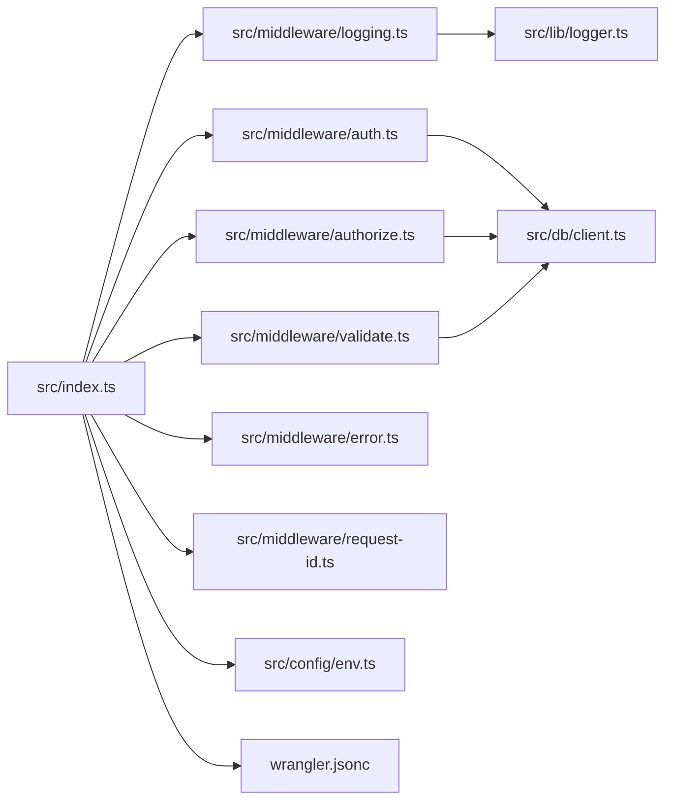

# Debugging Guide

<cite>
**Referenced Files in This Document**
- [src/index.ts](file://src/index.ts)
- [src/lib/logger.ts](file://src/lib/logger.ts)
- [src/middleware/logging.ts](file://src/middleware/logging.ts)
- [src/middleware/error.ts](file://src/middleware/error.ts)
- [src/middleware/auth.ts](file://src/middleware/auth.ts)
- [src/middleware/authorize.ts](file://src/middleware/authorize.ts)
- [src/middleware/request-id.ts](file://src/middleware/request-id.ts)
- [src/middleware/validate.ts](file://src/middleware/validate.ts)
- [src/db/client.ts](file://src/db/client.ts)
- [src/config/env.ts](file://src/config/env.ts)
- [wrangler.jsonc](file://wrangler.jsonc)
- [.dev.vars.example](file://.dev.vars.example)
- [package.json](file://package.json)
- [drizzle.config.ts](file://drizzle.config.ts)
</cite>

## Table of Contents
1. [Introduction](#introduction)
2. [Project Structure](#project-structure)
3. [Core Components](#core-components)
4. [Architecture Overview](#architecture-overview)
5. [Detailed Component Analysis](#detailed-component-analysis)
6. [Dependency Analysis](#dependency-analysis)
7. [Performance Considerations](#performance-considerations)
8. [Troubleshooting Guide](#troubleshooting-guide)
9. [Conclusion](#conclusion)
10. [Appendices](#appendices)

## Introduction
This guide provides a comprehensive debugging strategy for the TrackDub API running on Cloudflare Workers. It covers enabling and configuring logging at different levels, inspecting middleware chains, analyzing requests and responses, profiling performance, local development with Wrangler CLI, log analysis strategies, remote debugging via Cloudflare Dashboard, and troubleshooting authentication flows, database queries, and asynchronous operations. It also includes guidance on using browser developer tools, network tab analysis, and addressing serverless-specific issues such as cold starts, memory usage, and timeouts.

## Project Structure
TrackDub is organized into modular layers:
- Entry point and worker initialization
- Middleware pipeline (logging, auth, authorization, validation, error handling, request ID)
- Data access layer (database client and schema)
- Configuration and environment management
- Logging utilities
- Routes and handlers
- Tests and migrations

**Diagram sources**
- [src/index.ts](file://src/index.ts)
- [src/middleware/logging.ts](file://src/middleware/logging.ts)
- [src/middleware/auth.ts](file://src/middleware/auth.ts)
- [src/middleware/authorize.ts](file://src/middleware/authorize.ts)
- [src/middleware/validate.ts](file://src/middleware/validate.ts)
- [src/middleware/error.ts](file://src/middleware/error.ts)
- [src/middleware/request-id.ts](file://src/middleware/request-id.ts)
- [src/db/client.ts](file://src/db/client.ts)
- [src/lib/logger.ts](file://src/lib/logger.ts)
- [src/config/env.ts](file://src/config/env.ts)
- [wrangler.jsonc](file://wrangler.jsonc)

**Section sources**
- [src/index.ts](file://src/index.ts)
- [wrangler.jsonc](file://wrangler.jsonc)
- [package.json](file://package.json)

## Core Components
Key components that enable effective debugging:
- Logger utility for structured logs and level control
- Logging middleware to capture request/response lifecycle events
- Error middleware to standardize error responses and logs
- Auth and authorize middleware for authentication flow inspection
- Request ID middleware for tracing across logs
- DB client for query-level diagnostics
- Environment configuration for toggling debug modes

Practical tips:
- Use structured logs with consistent fields (timestamp, level, message, requestId, method, path, status).
- Centralize log level configuration via environment variables.
- Correlate logs using requestId across middleware and DB calls.

**Section sources**
- [src/lib/logger.ts](file://src/lib/logger.ts)
- [src/middleware/logging.ts](file://src/middleware/logging.ts)
- [src/middleware/error.ts](file://src/middleware/error.ts)
- [src/middleware/auth.ts](file://src/middleware/auth.ts)
- [src/middleware/authorize.ts](file://src/middleware/authorize.ts)
- [src/middleware/request-id.ts](file://src/middleware/request-id.ts)
- [src/db/client.ts](file://src/db/client.ts)
- [src/config/env.ts](file://src/config/env.ts)

## Architecture Overview
The Worker processes incoming requests through a middleware chain before reaching route handlers. Each middleware can log, validate, authenticate, or transform data. Errors are caught by the error middleware and returned consistently.

**Diagram sources**
- [src/index.ts](file://src/index.ts)
- [src/middleware/request-id.ts](file://src/middleware/request-id.ts)
- [src/middleware/logging.ts](file://src/middleware/logging.ts)
- [src/middleware/auth.ts](file://src/middleware/auth.ts)
- [src/middleware/authorize.ts](file://src/middleware/authorize.ts)
- [src/middleware/validate.ts](file://src/middleware/validate.ts)
- [src/db/client.ts](file://src/db/client.ts)
- [src/middleware/error.ts](file://src/middleware/error.ts)

## Detailed Component Analysis

### Logging and Levels
- Configure log levels via environment variables to control output verbosity (debug, info, warn, error).
- Use the logger utility to emit structured logs with consistent fields.
- Enable request-level logging in middleware to capture timing, headers, and payloads safely.

Recommended practices:
- Avoid logging sensitive data; redact tokens and secrets.
- Include requestId in all logs for correlation.
- Use appropriate levels: debug for detailed traces, info for key events, warn for recoverable issues, error for failures.

**Section sources**
- [src/lib/logger.ts](file://src/lib/logger.ts)
- [src/middleware/logging.ts](file://src/middleware/logging.ts)
- [src/config/env.ts](file://src/config/env.ts)

### Middleware Chain Analysis
- Inspect each middleware’s entry and exit points to measure latency and identify bottlenecks.
- Add timing logs around critical sections (auth checks, DB calls, validations).
- Use requestId to trace a single request across multiple logs.

Common patterns:
- Log method, path, and requestId at start.
- Log status code and duration at end.
- Capture errors with stack traces only in debug mode.

**Section sources**
- [src/middleware/logging.ts](file://src/middleware/logging.ts)
- [src/middleware/request-id.ts](file://src/middleware/request-id.ts)

### Request/Response Inspection
- Log essential request metadata: method, path, headers (sanitized), body size.
- Log response metadata: status, duration, content type.
- For debugging payloads, use safe serialization and avoid large bodies in production logs.

Tips:
- Use sampling for high-volume endpoints.
- Mask PII and secrets.
- Prefer structured logs over raw strings.

**Section sources**
- [src/middleware/logging.ts](file://src/middleware/logging.ts)

### Error Handling and Diagnostics
- Centralize error handling to ensure consistent responses and logs.
- Map domain errors to HTTP status codes.
- Include requestId and context in error logs.

Best practices:
- Separate user-facing messages from internal details.
- Log stack traces only when enabled by environment.
- Wrap async operations with try/catch and propagate errors to the error middleware.

**Section sources**
- [src/middleware/error.ts](file://src/middleware/error.ts)

### Authentication Flow Debugging
- Log successful and failed authentication attempts with sanitized details.
- Trace session creation and validation steps.
- Correlate auth logs with DB queries and token operations.

Guidelines:
- Never log passwords or tokens.
- Record failure reasons for security monitoring.
- Use requestId to connect auth events with downstream requests.

**Section sources**
- [src/middleware/auth.ts](file://src/middleware/auth.ts)
- [src/db/client.ts](file://src/db/client.ts)

### Database Query Debugging
- Instrument DB client to log query execution time and parameters (sanitized).
- Identify slow queries and missing indexes via timing logs.
- Use requestId to correlate DB logs with request logs.

Recommendations:
- Redact sensitive values in query parameters.
- Log query count per request to detect N+1 problems.
- Monitor connection pool metrics if available.

**Section sources**
- [src/db/client.ts](file://src/db/client.ts)

### Asynchronous Operations Debugging
- Wrap async tasks with timing logs and error boundaries.
- Ensure promises are awaited and errors are caught.
- Use requestId to track long-running operations.

Patterns:
- Log start/end of async blocks.
- Capture exceptions with context.
- Debounce or throttle heavy operations.

**Section sources**
- [src/middleware/logging.ts](file://src/middleware/logging.ts)
- [src/db/client.ts](file://src/db/client.ts)

### Local Development with Wrangler CLI
- Run the worker locally with Wrangler to simulate Cloudflare runtime.
- Use .dev.vars to supply environment variables for local testing.
- Enable verbose logging during development.

Steps:
- Install dependencies and set up local env vars.
- Start the dev server and observe logs in the terminal.
- Test routes and middleware behavior interactively.

**Section sources**
- [wrangler.jsonc](file://wrangler.jsonc)
- [.dev.vars.example](file://.dev.vars.example)
- [package.json](file://package.json)

### Log Analysis Strategies
- Filter logs by level, requestId, and endpoint.
- Aggregate logs to a central system for querying and alerting.
- Create dashboards for error rates, latency percentiles, and auth failures.

Tools:
- Cloudflare Logs and Observability integrations.
- External log aggregators (e.g., Loki, Datadog, Splunk).

**Section sources**
- [src/lib/logger.ts](file://src/lib/logger.ts)
- [wrangler.jsonc](file://wrangler.jsonc)

### Remote Debugging with Cloudflare Dashboard
- Use Cloudflare Logs to view real-time and historical logs.
- Apply filters for requestId, status codes, and endpoints.
- Set up alerts for error spikes and performance regressions.

Tips:
- Tag logs with environment and version metadata.
- Use custom fields for business context.
- Export logs for deeper analysis.

**Section sources**
- [wrangler.jsonc](file://wrangler.jsonc)

### Browser Developer Tools and Network Tab
- Inspect request headers, cookies, and payloads.
- Check response status codes and timing.
- Validate CORS settings and preflight responses.

Checklist:
- Confirm Authorization headers are present.
- Verify Content-Type and Accept headers.
- Review error responses for meaningful messages.

**Section sources**
- [src/middleware/logging.ts](file://src/middleware/logging.ts)

### Structured Log Formats and Aggregation
- Define a consistent schema for logs: timestamp, level, message, requestId, method, path, status, duration.
- Serialize objects safely and avoid circular references.
- Route logs to aggregation pipelines for search and analytics.

Example fields:
- timestamp: ISO string
- level: debug|info|warn|error
- requestId: unique identifier
- method: HTTP method
- path: URL path
- status: HTTP status code
- durationMs: request duration

**Section sources**
- [src/lib/logger.ts](file://src/lib/logger.ts)

### Debugging Cold Starts, Memory Usage, and Timeouts
- Cold starts: Minimize initialization work; defer non-critical setup.
- Memory usage: Avoid large global objects; free resources after use.
- Timeouts: Keep handlers fast; offload heavy tasks to background jobs.

Monitoring:
- Track first-request latency.
- Watch memory snapshots and heap usage.
- Alert on timeout errors and slow endpoints.

**Section sources**
- [src/index.ts](file://src/index.ts)
- [wrangler.jsonc](file://wrangler.jsonc)

## Dependency Analysis
Understanding how modules depend on each other helps isolate issues quickly.

**Diagram sources**
- [src/index.ts](file://src/index.ts)
- [src/middleware/logging.ts](file://src/middleware/logging.ts)
- [src/middleware/auth.ts](file://src/middleware/auth.ts)
- [src/middleware/authorize.ts](file://src/middleware/authorize.ts)
- [src/middleware/validate.ts](file://src/middleware/validate.ts)
- [src/middleware/error.ts](file://src/middleware/error.ts)
- [src/middleware/request-id.ts](file://src/middleware/request-id.ts)
- [src/db/client.ts](file://src/db/client.ts)
- [src/lib/logger.ts](file://src/lib/logger.ts)
- [src/config/env.ts](file://src/config/env.ts)
- [wrangler.jsonc](file://wrangler.jsonc)

**Section sources**
- [src/index.ts](file://src/index.ts)
- [wrangler.jsonc](file://wrangler.jsonc)

## Performance Considerations
- Profile middleware execution times to find bottlenecks.
- Reduce payload sizes and avoid unnecessary computations.
- Cache frequently accessed data where appropriate.
- Monitor p95/p99 latencies and error rates.
- Use efficient DB queries and indexes.

[No sources needed since this section provides general guidance]

## Troubleshooting Guide
Common issues and resolutions:
- Missing environment variables: Ensure .dev.vars and production secrets are configured.
- Authentication failures: Check token validity, session state, and DB records.
- Slow DB queries: Analyze query plans and add indexes.
- High memory usage: Identify leaks and reduce global allocations.
- Timeouts: Optimize handlers and offload heavy tasks.

Debugging steps:
- Reproduce locally with Wrangler and verbose logs.
- Filter logs by requestId to trace a single request.
- Inspect network tab for malformed requests/responses.
- Use Cloudflare Logs to confirm behavior in production.

**Section sources**
- [src/config/env.ts](file://src/config/env.ts)
- [src/middleware/auth.ts](file://src/middleware/auth.ts)
- [src/db/client.ts](file://src/db/client.ts)
- [src/middleware/logging.ts](file://src/middleware/logging.ts)
- [wrangler.jsonc](file://wrangler.jsonc)

## Conclusion
Effective debugging of the TrackDub API relies on structured logging, consistent request tracing, and systematic inspection of middleware and DB interactions. Combine local development with Wrangler, browser tools, and Cloudflare Logs to diagnose issues quickly. Adopt best practices for log formats, error handling, and performance monitoring to maintain reliability in serverless environments.

[No sources needed since this section summarizes without analyzing specific files]

## Appendices

### Environment Variables and Configuration
- Use .dev.vars for local development and secure secret management.
- Configure log levels and feature flags via environment variables.
- Align wrangler.jsonc settings with deployment targets.

**Section sources**
- [.dev.vars.example](file://.dev.vars.example)
- [wrangler.jsonc](file://wrangler.jsonc)
- [src/config/env.ts](file://src/config/env.ts)

### Migration and Schema Notes
- Use Drizzle for schema management and migrations.
- Verify schema changes do not break existing queries.
- Test migrations locally before deploying.

**Section sources**
- [drizzle.config.ts](file://drizzle.config.ts)