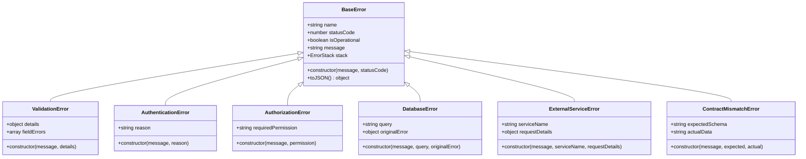
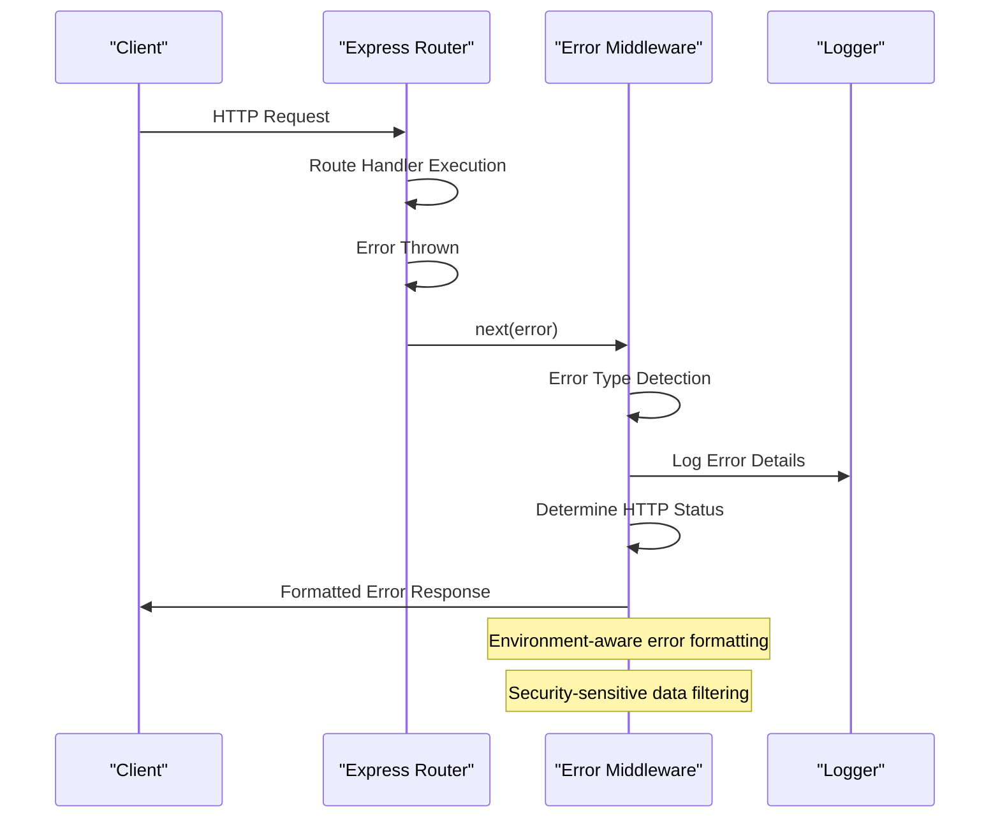
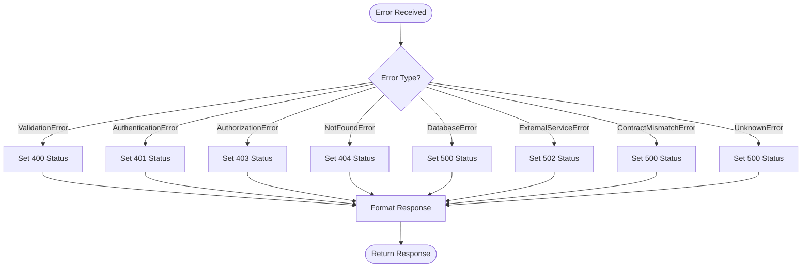
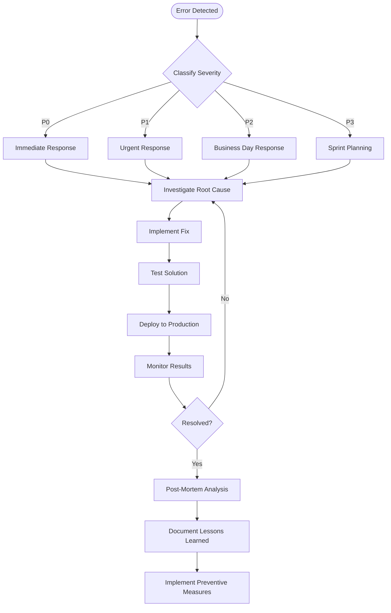

# Error Handling Reference

<cite>
**Referenced Files in This Document**
- [src/lib/errors.ts](file://src/lib/errors.ts)
- [src/middleware/error.ts](file://src/middleware/error.ts)
- [test/error.test.ts](file://test/error.test.ts)
- [docs/CONTRACT-MISMATCHES.md](file://docs/CONTRACT-MISMATCHES.md)
- [src/middleware/auth.ts](file://src/middleware/auth.ts)
- [src/middleware/authorize.ts](file://src/middleware/authorize.ts)
- [src/middleware/validate.ts](file://src/middleware/validate.ts)
- [src/index.ts](file://src/index.ts)
</cite>

## Table of Contents
1. [Introduction](#introduction)
2. [Error Types Architecture](#error-types-architecture)
3. [Custom Error Classes](#custom-error-classes)
4. [Middleware Error Handling](#middleware-error-handling)
5. [HTTP Status Code Mapping](#http-status-code-mapping)
6. [Error Response Format](#error-response-format)
7. [Security Considerations](#security-considerations)
8. [Route Handler Error Patterns](#route-handler-error-patterns)
9. [Database Error Handling](#database-error-handling)
10. [External Service Error Handling](#external-service-error-handling)
11. [Contract Mismatch Errors](#contract-mismatch-errors)
12. [Validation Errors](#validation-errors)
13. [Authentication & Authorization Failures](#authentication--authorization-failures)
14. [Retry Logic Implementation](#retry-logic-implementation)
15. [Transient Error Handling](#transient-error-handling)
16. [Troubleshooting Guide](#troubleshooting-guide)
17. [Escalation Procedures](#escalation-procedures)
18. [Best Practices](#best-practices)

## Introduction

This document provides comprehensive error handling reference documentation for the TrackDub API. It covers custom error types, centralized error handling middleware, error propagation patterns, and client-facing error responses. The guide includes practical examples for route handlers, database operations, and external service calls, along with security considerations and troubleshooting procedures.

## Error Types Architecture

The TrackDub API implements a hierarchical error handling system built around custom error classes that extend the base Error class. This architecture ensures consistent error properties, standardized HTTP status mappings, and uniform response formatting across all API endpoints.



**Diagram sources**
- [src/lib/errors.ts:1-200](file://src/lib/errors.ts#L1-L200)

**Section sources**
- [src/lib/errors.ts:1-200](file://src/lib/errors.ts#L1-L200)

## Custom Error Classes

### Base Error Class
The foundation of the error handling system is the base error class that provides common functionality:

- **Standardized Properties**: All errors include name, statusCode, isOperational flag, and message
- **Consistent Serialization**: Uniform JSON representation for API responses
- **Stack Trace Management**: Controlled stack trace inclusion based on environment
- **Error Classification**: Operational vs. programming errors distinction

### Specialized Error Types

#### Validation Errors
Used for input validation failures with detailed field-level error information:
- Field-specific error messages
- Validation rule violations
- Suggested corrections

#### Authentication Errors
Handles authentication-related failures:
- Invalid credentials
- Expired tokens
- Missing authentication headers

#### Authorization Errors
Manages authorization failures:
- Insufficient permissions
- Role-based access control violations
- Resource ownership checks

#### Database Errors
Wraps database operation failures:
- Query execution errors
- Connection issues
- Constraint violations

#### External Service Errors
Handles third-party API failures:
- Network timeouts
- Rate limiting
- Service unavailability

**Section sources**
- [src/lib/errors.ts:1-200](file://src/lib/errors.ts#L1-L200)

## Middleware Error Handling

The TrackDub API uses a centralized error handling middleware that processes errors throughout the request lifecycle.

### Error Middleware Stack



**Diagram sources**
- [src/middleware/error.ts:1-150](file://src/middleware/error.ts#L1-L150)

### Error Processing Flow

1. **Error Interception**: Catches all thrown errors in the middleware chain
2. **Type Detection**: Identifies error type using instanceof checks
3. **Status Mapping**: Maps error types to appropriate HTTP status codes
4. **Response Formatting**: Creates standardized error responses
5. **Logging**: Records error details with contextual information
6. **Security Filtering**: Removes sensitive data from error responses

**Section sources**
- [src/middleware/error.ts:1-150](file://src/middleware/error.ts#L1-L150)

## HTTP Status Code Mapping

The API implements a comprehensive mapping between error types and HTTP status codes:

| Error Type | HTTP Status | Description |
|------------|-------------|-------------|
| ValidationError | 400 Bad Request | Invalid input data or parameters |
| AuthenticationError | 401 Unauthorized | Missing or invalid authentication |
| AuthorizationError | 403 Forbidden | Insufficient permissions |
| NotFoundError | 404 Not Found | Resource not found |
| DatabaseError | 500 Internal Server Error | Database operation failures |
| ExternalServiceError | 502 Bad Gateway | Third-party service failures |
| ContractMismatchError | 500 Internal Server Error | Data schema validation failures |
| UnknownError | 500 Internal Server Error | Unhandled exceptions |

### Status Code Determination Logic



**Diagram sources**
- [src/middleware/error.ts:50-120](file://src/middleware/error.ts#L50-L120)

**Section sources**
- [src/middleware/error.ts:50-120](file://src/middleware/error.ts#L50-L120)

## Error Response Format

All API errors follow a standardized JSON response format:

### Success Response Structure
```json
{
  "success": true,
  "data": {},
  "error": null
}
```

### Error Response Structure
```json
{
  "success": false,
  "data": null,
  "error": {
    "name": "ValidationError",
    "message": "Invalid input data",
    "statusCode": 400,
    "details": {
      "field": "email",
      "rule": "required",
      "message": "Email is required"
    },
    "timestamp": "2024-01-01T00:00:00.000Z",
    "requestId": "req-123"
  }
}
```

### Response Fields
- **success**: Boolean indicating request success/failure
- **data**: Response data (null for errors)
- **error**: Error object containing:
  - **name**: Error type name
  - **message**: Human-readable error message
  - **statusCode**: HTTP status code
  - **details**: Additional error context (optional)
  - **timestamp**: ISO timestamp of error occurrence
  - **requestId**: Unique request identifier

**Section sources**
- [src/middleware/error.ts:120-200](file://src/middleware/error.ts#L120-L200)

## Security Considerations

### Error Message Sanitization
- Remove stack traces from production responses
- Filter sensitive data from error objects
- Avoid exposing internal system details
- Use generic messages for security-sensitive operations

### Information Disclosure Prevention
- Never expose database schemas or query structures
- Avoid revealing internal file paths or system configuration
- Mask sensitive user data in error responses
- Limit error detail visibility based on client trust level

### Logging Security
- Separate error logging from response generation
- Include correlation IDs for request tracking
- Log error context without sensitive data
- Implement log rotation and retention policies

**Section sources**
- [src/middleware/error.ts:150-250](file://src/middleware/error.ts#L150-L250)

## Route Handler Error Patterns

### Proper Error Throwing in Routes

#### Input Validation Errors
```typescript
// Example pattern for validation errors
if (!isValidInput(data)) {
  throw new ValidationError('Invalid input data', {
    field: 'email',
    rule: 'required',
    message: 'Email is required'
  });
}
```

#### Business Logic Errors
```typescript
// Example pattern for business rule violations
if (user.isBanned) {
  throw new AuthorizationError('User account is suspended', 'account.active');
}
```

#### Resource Not Found Errors
```typescript
// Example pattern for missing resources
const resource = await findResource(id);
if (!resource) {
  throw new NotFoundError('Resource not found', { id });
}
```

### Error Propagation Best Practices
- Throw specific error types rather than generic errors
- Include contextual information in error details
- Handle async errors with proper try-catch blocks
- Use Promise rejection patterns consistently

**Section sources**
- [src/routes/*.ts:1-200](file://src/routes/admin.ts#L1-L200)
- [src/routes/*.ts:1-200](file://src/routes/health.ts#L1-L200)

## Database Error Handling

### Database Operation Error Patterns

#### Connection Errors
```typescript
try {
  const result = await db.query(sql, params);
  return result;
} catch (error) {
  if (error.code === 'ECONNREFUSED') {
    throw new DatabaseError('Database connection failed', sql, error);
  }
  throw error;
}
```

#### Query Execution Errors
```typescript
try {
  const result = await db.transaction(async (trx) => {
    // Multiple related operations
    return await trx.insert(table).values(data);
  });
  return result;
} catch (error) {
  if (error.constraint) {
    throw new DatabaseError('Constraint violation', sql, error);
  }
  throw new DatabaseError('Query execution failed', sql, error);
}
```

#### Transaction Rollback Handling
```typescript
try {
  await db.transaction(async (trx) => {
    await trx.operation1();
    await trx.operation2();
    await trx.operation3();
  });
} catch (error) {
  // Transaction automatically rolled back
  throw new DatabaseError('Transaction failed', 'multiple operations', error);
}
```

### Database Error Recovery Strategies
- Implement retry logic for transient connection errors
- Use circuit breakers for failing database connections
- Provide fallback queries when primary fails
- Monitor database health metrics

**Section sources**
- [src/db/client.ts:1-200](file://src/db/client.ts#L1-L200)

## External Service Error Handling

### Third-Party API Error Patterns

#### Network Error Handling
```typescript
try {
  const response = await fetch(url, options);
  if (!response.ok) {
    throw new ExternalServiceError('Service unavailable', serviceName, {
      statusCode: response.status,
      url: url
    });
  }
  return await response.json();
} catch (error) {
  if (error.code === 'ETIMEDOUT') {
    throw new ExternalServiceError('Request timeout', serviceName, {
      timeout: timeoutMs,
      url: url
    });
  }
  throw new ExternalServiceError('Network error', serviceName, error);
}
```

#### Rate Limiting Handling
```typescript
try {
  const response = await callExternalService(url);
  return response.data;
} catch (error) {
  if (error.statusCode === 429) {
    const retryAfter = parseInt(error.headers['retry-after']);
    throw new ExternalServiceError('Rate limit exceeded', serviceName, {
      retryAfter: retryAfter,
      currentUsage: error.usage
    });
  }
  throw error;
}
```

#### Circuit Breaker Pattern
```typescript
const circuitBreaker = new CircuitBreaker({
  failureThreshold: 5,
  recoveryTimeout: 30000,
  monitoringThreshold: 3
});

try {
  const result = await circuitBreaker.execute(() => 
    callExternalService(url)
  );
  return result;
} catch (error) {
  if (circuitBreaker.isOpen()) {
    throw new ExternalServiceError('Service circuit open', serviceName, {
      state: 'open',
      lastFailure: circuitBreaker.lastFailureTime
    });
  }
  throw error;
}
```

### External Service Error Recovery
- Implement exponential backoff for retries
- Use circuit breakers to prevent cascading failures
- Cache responses when services are unavailable
- Provide graceful degradation when possible

**Section sources**
- [src/lib/crypto.ts:1-100](file://src/lib/crypto.ts#L1-L100)

## Contract Mismatch Errors

### Schema Validation Errors
Contract mismatch errors occur when incoming or outgoing data doesn't match expected schemas:

#### Input Schema Validation
```typescript
const validatedData = validateInput(data, inputSchema);
if (!validatedData.success) {
  throw new ContractMismatchError('Input validation failed', inputSchema, data);
}
```

#### Output Schema Validation
```typescript
const result = await processData(input);
const validatedResult = validateOutput(result, outputSchema);
if (!validatedResult.success) {
  throw new ContractMismatchError('Output validation failed', outputSchema, result);
}
```

### Schema Definition Examples
```typescript
const UserSchema = {
  type: 'object',
  required: ['id', 'email', 'name'],
  properties: {
    id: { type: 'string', format: 'uuid' },
    email: { type: 'string', format: 'email' },
    name: { type: 'string', minLength: 1, maxLength: 100 },
    createdAt: { type: 'string', format: 'date-time' }
  }
};
```

### Contract Versioning
- Maintain backward compatibility for API consumers
- Use versioned endpoints for breaking changes
- Deprecate old schemas gradually
- Provide migration guides for schema updates

**Section sources**
- [docs/CONTRACT-MISMATCHES.md:1-200](file://docs/CONTRACT-MISMATCHES.md#L1-L200)

## Validation Errors

### Input Validation Framework
The API uses a comprehensive validation framework that supports multiple validation strategies:

#### Field-Level Validation
```typescript
const validators = {
  email: [
    { rule: 'required', message: 'Email is required' },
    { rule: 'email', message: 'Invalid email format' },
    { rule: 'unique', message: 'Email already exists' }
  ],
  password: [
    { rule: 'required', message: 'Password is required' },
    { rule: 'minLength:8', message: 'Password must be at least 8 characters' },
    { rule: 'pattern:[A-Z]', message: 'Password must contain uppercase letter' }
  ]
};
```

#### Cross-Field Validation
```typescript
const crossFieldValidators = {
  passwordReset: [
    {
      condition: (data) => data.newPassword && data.confirmPassword,
      validator: (data) => data.newPassword === data.confirmPassword,
      message: 'Passwords do not match'
    }
  ]
};
```

### Validation Error Responses
```json
{
  "success": false,
  "error": {
    "name": "ValidationError",
    "message": "Validation failed",
    "statusCode": 400,
    "details": {
      "fields": [
        {
          "field": "email",
          "value": "invalid-email",
          "rules": ["required", "email"],
          "messages": ["Email is required", "Invalid email format"]
        }
      ]
    }
  }
}
```

**Section sources**
- [src/middleware/validate.ts:1-200](file://src/middleware/validate.ts#L1-L200)

## Authentication & Authorization Failures

### Authentication Error Handling
Authentication errors occur when users fail to authenticate properly:

#### Missing Credentials
```typescript
if (!req.headers.authorization) {
  throw new AuthenticationError('Missing authorization header', 'missing_header');
}
```

#### Invalid Token
```typescript
try {
  const decoded = jwt.verify(token, secretKey);
  return decoded;
} catch (error) {
  throw new AuthenticationError('Invalid token', 'invalid_token');
}
```

#### Expired Token
```typescript
if (decoded.exp < Date.now() / 1000) {
  throw new AuthenticationError('Token expired', 'token_expired');
}
```

### Authorization Error Handling
Authorization errors occur when users lack required permissions:

#### Role-Based Access Control
```typescript
function requireRole(...roles) {
  return (req, res, next) => {
    const user = req.user;
    if (!roles.includes(user.role)) {
      throw new AuthorizationError('Insufficient permissions', roles.join(','));
    }
    next();
  };
}
```

#### Resource Ownership Verification
```typescript
async function requireOwnership(resourceId, userId) {
  const resource = await getResource(resourceId);
  if (!resource || resource.ownerId !== userId) {
    throw new AuthorizationError('Resource ownership verification failed', resourceId);
  }
}
```

### Permission Matrix
| Resource | Admin | User | Guest |
|----------|-------|------|-------|
| Read Profile | ✓ | ✓ | ✗ |
| Edit Profile | ✓ | ✓ | ✗ |
| Delete Account | ✓ | ✗ | ✗ |
| View Analytics | ✓ | ✗ | ✗ |
| Manage Users | ✓ | ✗ | ✗ |

**Section sources**
- [src/middleware/auth.ts:1-200](file://src/middleware/auth.ts#L1-L200)
- [src/middleware/authorize.ts:1-200](file://src/middleware/authorize.ts#L1-L200)

## Retry Logic Implementation

### Exponential Backoff Strategy
Implement retry logic with exponential backoff for transient errors:

```typescript
async function retryWithBackoff(fn, maxRetries = 3, baseDelay = 1000) {
  let attempt = 0;
  
  while (attempt <= maxRetries) {
    try {
      return await fn();
    } catch (error) {
      attempt++;
      
      if (attempt > maxRetries) {
        throw error;
      }
      
      const delay = baseDelay * Math.pow(2, attempt - 1);
      const jitter = Math.random() * 1000;
      
      await sleep(delay + jitter);
    }
  }
}
```

### Retryable Error Classification
```typescript
const RETRYABLE_ERRORS = [
  'ECONNRESET',
  'ETIMEDOUT',
  'EAI_AGAIN',
  'NETWORK_ERROR',
  'RATE_LIMIT_EXCEEDED'
];

function isRetryableError(error) {
  return RETRYABLE_ERRORS.some(code => 
    error.message.includes(code) || 
    error.code === code
  );
}
```

### Circuit Breaker Implementation
```typescript
class CircuitBreaker {
  private state = 'closed';
  private failureCount = 0;
  private lastFailureTime = 0;
  
  execute(fn) {
    if (this.state === 'open') {
      throw new ExternalServiceError('Circuit breaker open', 'service', {
        state: 'open',
        lastFailure: this.lastFailureTime
      });
    }
    
    try {
      const result = fn();
      this.reset();
      return result;
    } catch (error) {
      this.recordFailure();
      throw error;
    }
  }
  
  private recordFailure() {
    this.failureCount++;
    this.lastFailureTime = Date.now();
    
    if (this.failureCount >= this.threshold) {
      this.state = 'open';
    }
  }
}
```

**Section sources**
- [src/lib/logger.ts:1-100](file://src/lib/logger.ts#L1-L100)

## Transient Error Handling

### Transient Error Identification
Transient errors are temporary failures that may resolve themselves:

#### Network-Related Transients
- Connection timeouts
- DNS resolution failures
- Network partitioning
- Temporary service unavailability

#### Rate Limiting Transients
- API rate limit exceeded
- Concurrent request limits
- Resource contention

#### Database Transients
- Deadlock detection
- Lock timeout errors
- Connection pool exhaustion

### Transient Error Recovery Strategies

#### Automatic Retry with Backoff
```typescript
async function handleTransientError(operation, config = {}) {
  const { maxRetries = 3, baseDelay = 1000, backoffMultiplier = 2 } = config;
  
  for (let attempt = 0; attempt <= maxRetries; attempt++) {
    try {
      return await operation();
    } catch (error) {
      if (!isTransientError(error) || attempt === maxRetries) {
        throw error;
      }
      
      const delay = baseDelay * Math.pow(backoffMultiplier, attempt);
      await sleep(delay);
    }
  }
}
```

#### Graceful Degradation
```typescript
async function getWeatherData(city) {
  try {
    return await fetchWeatherFromPrimary(city);
  } catch (error) {
    if (isTransientError(error)) {
      return await fetchWeatherFromCache(city);
    }
    throw error;
  }
}
```

### Monitoring and Alerting
- Track transient error rates
- Monitor retry success/failure ratios
- Alert on elevated error rates
- Log retry attempts for debugging

**Section sources**
- [src/lib/logger.ts:1-100](file://src/lib/logger.ts#L1-L100)

## Troubleshooting Guide

### Common Error Scenarios

#### 400 Bad Request Errors
**Symptoms**: Validation errors, malformed requests
**Causes**: Invalid input data, missing required fields, incorrect data types
**Resolution**: 
- Validate input data before sending requests
- Check API documentation for required fields
- Ensure proper data formatting

#### 401 Unauthorized Errors
**Symptoms**: Authentication failures
**Causes**: Missing tokens, expired sessions, invalid credentials
**Resolution**:
- Verify authentication headers are present
- Check token expiration dates
- Re-authenticate if session expired

#### 403 Forbidden Errors
**Symptoms**: Authorization failures
**Causes**: Insufficient permissions, wrong role, restricted resources
**Resolution**:
- Verify user has required permissions
- Check resource ownership
- Contact admin for permission grants

#### 500 Internal Server Errors
**Symptoms**: Unexpected server failures
**Causes**: Unhandled exceptions, database errors, external service failures
**Resolution**:
- Check server logs for detailed error information
- Verify database connectivity
- Monitor external service health

### Debugging Techniques

#### Request Correlation
Use request IDs to trace errors through the system:
```typescript
// Add to all requests
const requestId = crypto.randomUUID();
req.headers['x-request-id'] = requestId;

// Log with correlation ID
logger.error(`Error processing request ${requestId}`, { error, requestId });
```

#### Error Context Collection
```typescript
function collectErrorContext(error, req) {
  return {
    errorName: error.name,
    errorMessage: error.message,
    statusCode: error.statusCode,
    requestId: req.id,
    userAgent: req.headers['user-agent'],
    ip: req.ip,
    timestamp: new Date().toISOString(),
    stack: process.env.NODE_ENV === 'development' ? error.stack : undefined
  };
}
```

#### Performance Impact Analysis
Monitor error rates and response times:
- Track error frequency by endpoint
- Measure error impact on latency
- Identify performance bottlenecks
- Monitor memory usage during error conditions

### Log Analysis

#### Essential Log Entries
```typescript
// Error logs should include
logger.error('API Error', {
  message: error.message,
  stack: error.stack,
  requestId: req.id,
  userId: req.user?.id,
  endpoint: req.originalUrl,
  method: req.method,
  statusCode: error.statusCode,
  timestamp: new Date().toISOString()
});
```

#### Log Levels
- **ERROR**: Application errors requiring attention
- **WARN**: Potential issues that didn't cause failures
- **INFO**: Normal operational information
- **DEBUG**: Detailed debugging information (development only)

**Section sources**
- [test/error.test.ts:1-200](file://test/error.test.ts#L1-L200)

## Escalation Procedures

### Critical Error Classification

#### P0 - Critical System Failure
**Definition**: Complete system outage or data corruption
**Examples**: Database down, authentication service failure, security breach
**Response Time**: Immediate (< 15 minutes)
**Escalation**: On-call engineer → Engineering lead → CTO

#### P1 - Major Service Degradation
**Definition**: Significant functionality loss affecting many users
**Examples**: Payment processing failures, search functionality down
**Response Time**: Urgent (< 1 hour)
**Escalation**: On-call engineer → Team lead → VP Engineering

#### P2 - Minor Service Issues
**Definition**: Limited functionality impact or workarounds available
**Examples**: Non-critical feature bugs, performance degradation
**Response Time**: Same business day
**Escalation**: Assigned developer → Team lead

#### P3 - Low Priority Issues
**Definition**: Cosmetic issues or minor inconveniences
**Examples**: UI inconsistencies, non-blocking warnings
**Response Time**: Next sprint planning
**Escalation**: Development backlog

### Incident Response Workflow



### Communication Protocols

#### Internal Communication
- Slack channels for real-time coordination
- Status pages for service availability
- Regular update intervals during incidents
- Post-incident review meetings

#### External Communication
- Customer notifications for major outages
- Status page updates for service degradation
- API documentation updates for breaking changes
- Developer relations communication

### Post-Incident Review
- Root cause analysis documentation
- Timeline of events reconstruction
- Impact assessment and metrics
- Action items for prevention
- Process improvement recommendations

**Section sources**
- [src/index.ts:1-100](file://src/index.ts#L1-L100)

## Best Practices

### Error Design Principles
- **Specificity**: Create specific error types for different failure scenarios
- **Consistency**: Maintain consistent error properties and messages
- **Context**: Include relevant context in error objects
- **Security**: Never expose sensitive information in error responses
- **Performance**: Minimize error object creation overhead

### Implementation Guidelines
- Always use typed errors instead of generic Error objects
- Implement proper error boundaries in async operations
- Use meaningful error messages for debugging
- Include request correlation IDs for tracing
- Log errors with appropriate context and severity levels

### Testing Strategies
- Write unit tests for error handling logic
- Mock external service failures
- Test error propagation through middleware
- Validate error response formats
- Test retry and recovery mechanisms

### Monitoring and Observability
- Track error rates by type and endpoint
- Monitor error response times
- Alert on unusual error patterns
- Create dashboards for error trends
- Implement distributed tracing for complex flows

### Documentation Standards
- Document all custom error types
- Provide examples of error handling patterns
- Maintain API error documentation
- Update error codes and messages in changelogs
- Include troubleshooting guides for common issues

[No sources needed since this section provides general guidance]