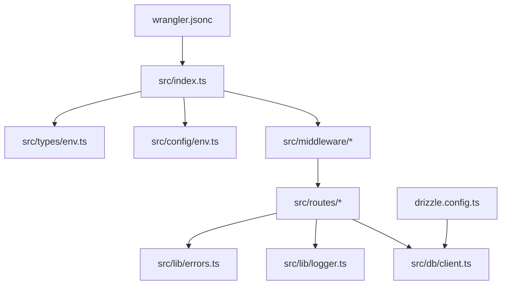
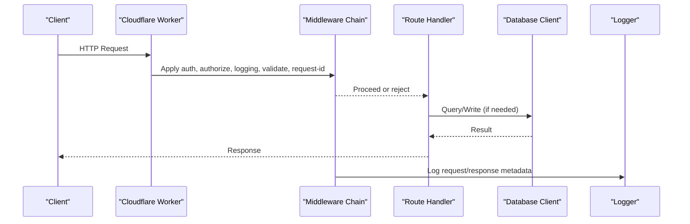
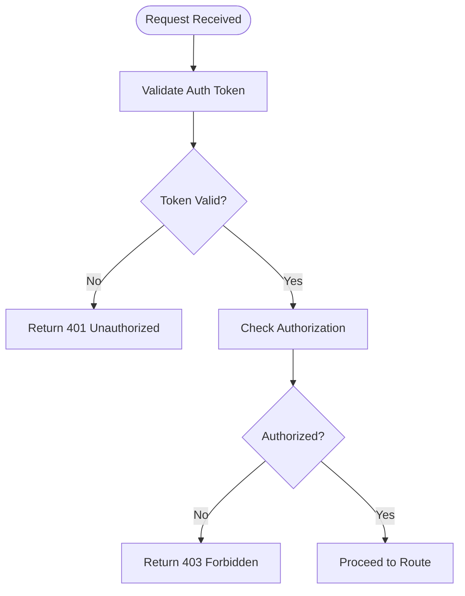
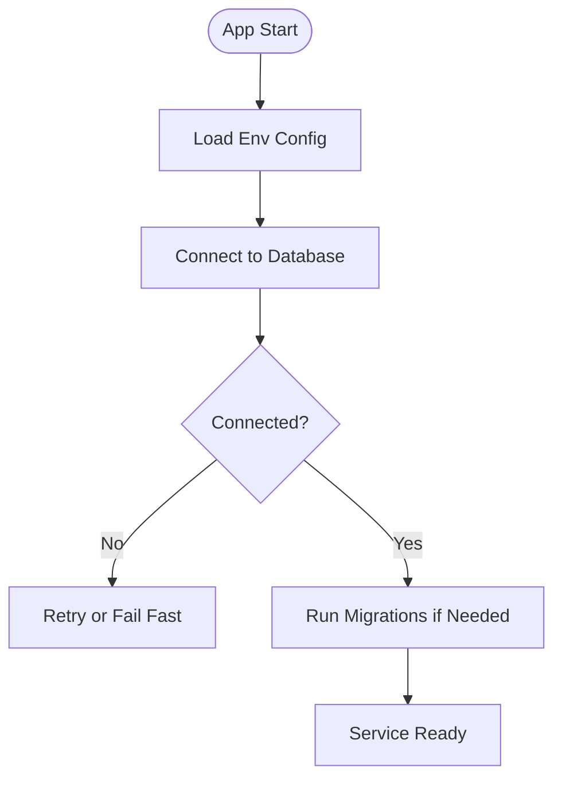
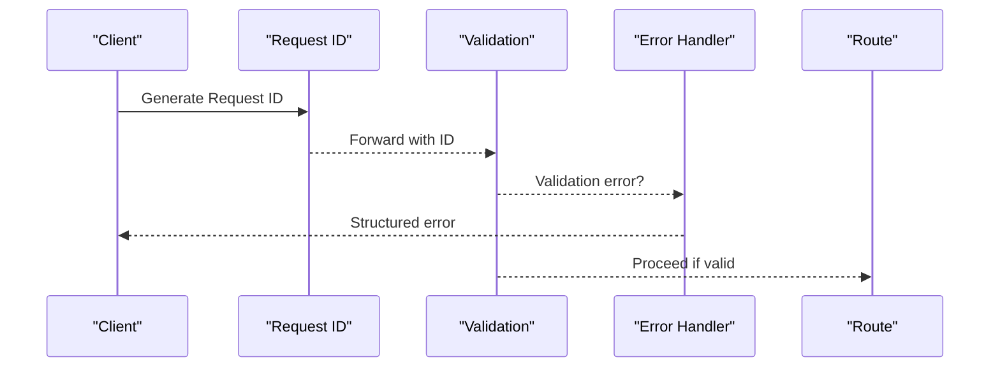
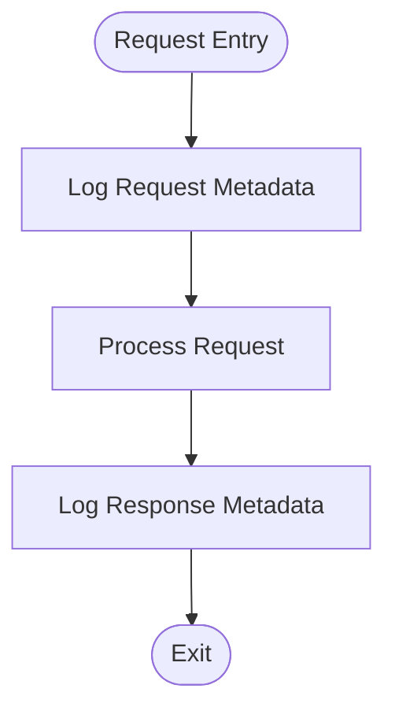
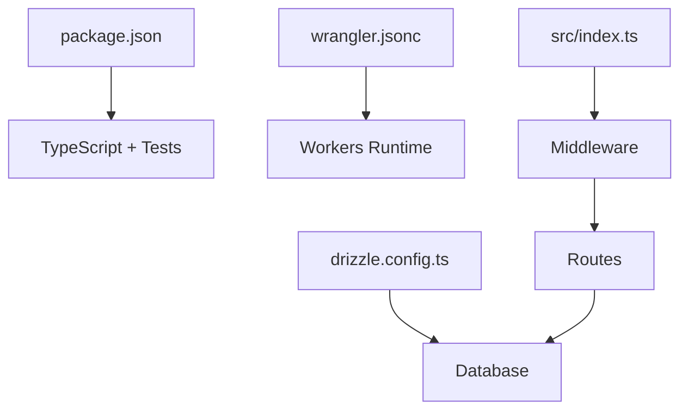

# Troubleshooting Guide

<cite>
**Referenced Files in This Document**
- [README.md](file://README.md)
- [AGENTS.md](file://AGENTS.md)
- [package.json](file://package.json)
- [wrangler.jsonc](file://wrangler.jsonc)
- [drizzle.config.ts](file://drizzle.config.ts)
- [src/index.ts](file://src/index.ts)
- [src/config/env.ts](file://src/config/env.ts)
- [src/types/env.ts](file://src/types/env.ts)
- [src/db/client.ts](file://src/db/client.ts)
- [src/db/schema.ts](file://src/db/schema.ts)
- [src/lib/logger.ts](file://src/lib/logger.ts)
- [src/lib/errors.ts](file://src/lib/errors.ts)
- [src/middleware/auth.ts](file://src/middleware/auth.ts)
- [src/middleware/authorize.ts](file://src/middleware/authorize.ts)
- [src/middleware/error.ts](file://src/middleware/error.ts)
- [src/middleware/logging.ts](file://src/middleware/logging.ts)
- [src/middleware/request-id.ts](file://src/middleware/request-id.ts)
- [src/middleware/validate.ts](file://src/middleware/validate.ts)
- [src/routes/admin.ts](file://src/routes/admin.ts)
- [src/routes/health.ts](file://src/routes/health.ts)
- [src/routes/languages.ts](file://src/routes/languages.ts)
- [src/routes/version.ts](file://src/routes/version.ts)
- [test/auth-middleware.test.ts](file://test/auth-middleware.test.ts)
- [test/cors.test.ts](file://test/cors.test.ts)
- [test/error.test.ts](file://test/error.test.ts)
- [test/health.test.ts](file://test/health.test.ts)
- [test/session.test.ts](file://test/session.test.ts)
</cite>

## Table of Contents
1. Introduction
2. Project Structure
3. Core Components
4. Architecture Overview
5. Detailed Component Analysis
6. Dependency Analysis
7. Performance Considerations
8. Troubleshooting Guide
9. Conclusion
10. Appendices

## Introduction
This guide provides comprehensive troubleshooting for the TrackDub API running on Cloudflare Workers. It focuses on debugging techniques, log analysis strategies, performance profiling, and solutions for common issues such as authentication failures, database connection problems, middleware errors, and deployment issues. It also covers interpreting error messages, using debugging tools effectively, identifying bottlenecks, and addressing serverless-specific constraints like memory limits, timeouts, and cold starts.

## Project Structure
The project is organized into modular TypeScript files under src with clear separation of concerns: configuration, database client and schema, logging and error utilities, middleware pipeline, routes, and types. Tests are located under test to validate behavior. Configuration for the build and runtime environment includes wrangler.jsonc for Cloudflare Workers and drizzle.config.ts for database migrations.

**Diagram sources**
- [src/index.ts](file://src/index.ts)
- [src/middleware/auth.ts](file://src/middleware/auth.ts)
- [src/middleware/authorize.ts](file://src/middleware/authorize.ts)
- [src/middleware/error.ts](file://src/middleware/error.ts)
- [src/middleware/logging.ts](file://src/middleware/logging.ts)
- [src/middleware/request-id.ts](file://src/middleware/request-id.ts)
- [src/middleware/validate.ts](file://src/middleware/validate.ts)
- [src/routes/admin.ts](file://src/routes/admin.ts)
- [src/routes/health.ts](file://src/routes/health.ts)
- [src/routes/languages.ts](file://src/routes/languages.ts)
- [src/routes/version.ts](file://src/routes/version.ts)
- [src/db/client.ts](file://src/db/client.ts)
- [src/lib/logger.ts](file://src/lib/logger.ts)
- [src/lib/errors.ts](file://src/lib/errors.ts)
- [src/config/env.ts](file://src/config/env.ts)
- [src/types/env.ts](file://src/types/env.ts)
- [wrangler.jsonc](file://wrangler.jsonc)
- [drizzle.config.ts](file://drizzle.config.ts)

**Section sources**
- [README.md](file://README.md)
- [package.json](file://package.json)
- [wrangler.jsonc](file://wrangler.jsonc)
- [drizzle.config.ts](file://drizzle.config.ts)
- [src/index.ts](file://src/index.ts)

## Core Components
- Environment configuration: Centralized loading and validation of environment variables used across the app.
- Database client: Connection setup and query execution for Drizzle ORM.
- Logging: Structured logging utility for consistent logs.
- Error handling: Centralized error formatting and propagation.
- Middleware pipeline: Authentication, authorization, request ID generation, validation, logging, and error handling.
- Routes: Health check, admin endpoints, language management, and version info.

Key areas to inspect when troubleshooting:
- Environment variable presence and correctness
- Database connectivity and migration status
- Middleware ordering and failure points
- Route-level logic and response shapes
- Logs and error payloads for diagnostics

**Section sources**
- [src/config/env.ts](file://src/config/env.ts)
- [src/types/env.ts](file://src/types/env.ts)
- [src/db/client.ts](file://src/db/client.ts)
- [src/db/schema.ts](file://src/db/schema.ts)
- [src/lib/logger.ts](file://src/lib/logger.ts)
- [src/lib/errors.ts](file://src/lib/errors.ts)
- [src/middleware/auth.ts](file://src/middleware/auth.ts)
- [src/middleware/authorize.ts](file://src/middleware/authorize.ts)
- [src/middleware/error.ts](file://src/middleware/error.ts)
- [src/middleware/logging.ts](file://src/middleware/logging.ts)
- [src/middleware/request-id.ts](file://src/middleware/request-id.ts)
- [src/middleware/validate.ts](file://src/middleware/validate.ts)
- [src/routes/health.ts](file://src/routes/health.ts)
- [src/routes/admin.ts](file://src/routes/admin.ts)
- [src/routes/languages.ts](file://src/routes/languages.ts)
- [src/routes/version.ts](file://src/routes/version.ts)

## Architecture Overview
The API follows a standard middleware-based architecture where requests pass through a chain of middlewares before reaching route handlers. The health endpoint provides a quick service readiness check. Database operations are encapsulated via a dedicated client module.

**Diagram sources**
- [src/index.ts](file://src/index.ts)
- [src/middleware/auth.ts](file://src/middleware/auth.ts)
- [src/middleware/authorize.ts](file://src/middleware/authorize.ts)
- [src/middleware/logging.ts](file://src/middleware/logging.ts)
- [src/middleware/request-id.ts](file://src/middleware/request-id.ts)
- [src/middleware/validate.ts](file://src/middleware/validate.ts)
- [src/routes/health.ts](file://src/routes/health.ts)
- [src/db/client.ts](file://src/db/client.ts)
- [src/lib/logger.ts](file://src/lib/logger.ts)

## Detailed Component Analysis

### Authentication and Authorization
Common symptoms:
- 401 Unauthorized responses
- Missing or invalid tokens
- Session-related failures

Debugging steps:
- Verify environment variables for secrets and keys.
- Inspect token parsing and validation flow in the auth middleware.
- Confirm that authorization checks allow intended roles/scopes.
- Use request IDs to correlate logs across the pipeline.

**Diagram sources**
- [src/middleware/auth.ts](file://src/middleware/auth.ts)
- [src/middleware/authorize.ts](file://src/middleware/authorize.ts)

**Section sources**
- [src/middleware/auth.ts](file://src/middleware/auth.ts)
- [src/middleware/authorize.ts](file://src/middleware/authorize.ts)
- [test/auth-middleware.test.ts](file://test/auth-middleware.test.ts)
- [test/session.test.ts](file://test/session.test.ts)

### Database Connectivity and Migrations
Common symptoms:
- Connection timeouts or refused connections
- Schema mismatch errors
- Migration failures

Debugging steps:
- Validate database credentials and host settings.
- Ensure migrations are applied before starting the worker.
- Check network egress rules and DNS resolution from the Workers environment.
- Inspect the database client initialization and error handling.

**Diagram sources**
- [src/db/client.ts](file://src/db/client.ts)
- [drizzle.config.ts](file://drizzle.config.ts)

**Section sources**
- [src/db/client.ts](file://src/db/client.ts)
- [src/db/schema.ts](file://src/db/schema.ts)
- [drizzle.config.ts](file://drizzle.config.ts)

### Middleware Errors and Validation
Common symptoms:
- Unexpected 4xx/5xx responses
- Missing fields or malformed payloads
- Inconsistent request IDs

Debugging steps:
- Review validation middleware for strictness and error messages.
- Ensure request ID middleware runs early to tag all logs.
- Inspect error middleware to confirm structured error responses.

**Diagram sources**
- [src/middleware/request-id.ts](file://src/middleware/request-id.ts)
- [src/middleware/validate.ts](file://src/middleware/validate.ts)
- [src/middleware/error.ts](file://src/middleware/error.ts)

**Section sources**
- [src/middleware/validate.ts](file://src/middleware/validate.ts)
- [src/middleware/error.ts](file://src/middleware/error.ts)
- [src/middleware/request-id.ts](file://src/middleware/request-id.ts)
- [test/error.test.ts](file://test/error.test.ts)

### Logging and Observability
Common symptoms:
- Missing logs
- Unstructured or noisy logs
- Hard-to-correlate requests

Debugging steps:
- Use structured logging with request IDs.
- Filter logs by level and correlation IDs.
- Ensure logging middleware captures both request and response metadata.

**Diagram sources**
- [src/lib/logger.ts](file://src/lib/logger.ts)
- [src/middleware/logging.ts](file://src/middleware/logging.ts)

**Section sources**
- [src/lib/logger.ts](file://src/lib/logger.ts)
- [src/middleware/logging.ts](file://src/middleware/logging.ts)

### Health and Readiness Checks
Common symptoms:
- Health endpoint returns unhealthy
- Latency spikes on health checks

Debugging steps:
- Inspect health route for dependency checks.
- Monitor latency and error rates.
- Use health checks to detect cold start effects.

**Section sources**
- [src/routes/health.ts](file://src/routes/health.ts)
- [test/health.test.ts](file://test/health.test.ts)

### Version and Admin Endpoints
Common symptoms:
- Unauthorized access to admin routes
- Incorrect version information

Debugging steps:
- Verify admin authorization middleware.
- Ensure version endpoint reflects current build metadata.

**Section sources**
- [src/routes/admin.ts](file://src/routes/admin.ts)
- [src/routes/version.ts](file://src/routes/version.ts)

## Dependency Analysis
The application depends on:
- Cloudflare Workers runtime configured via wrangler.jsonc
- Drizzle ORM for database interactions
- TypeScript tooling and tests via package.json scripts

**Diagram sources**
- [package.json](file://package.json)
- [wrangler.jsonc](file://wrangler.jsonc)
- [drizzle.config.ts](file://drizzle.config.ts)
- [src/index.ts](file://src/index.ts)

**Section sources**
- [package.json](file://package.json)
- [wrangler.jsonc](file://wrangler.jsonc)
- [drizzle.config.ts](file://drizzle.config.ts)

## Performance Considerations
- Cold starts: Minimize initialization work; defer heavy tasks to first use.
- Memory limits: Avoid large in-memory objects; stream data where possible.
- Timeouts: Keep request processing within Workers time limits; offload long-running jobs.
- Network calls: Reduce external dependencies; cache frequently accessed data.
- Database queries: Optimize queries and avoid N+1 patterns.

[No sources needed since this section provides general guidance]

## Troubleshooting Guide

### Authentication Failures
Symptoms:
- 401 Unauthorized
- Invalid token errors
- Session not found

Steps:
- Verify environment variables for secrets and keys.
- Inspect token format and expiration.
- Check middleware order and ensure auth runs before authorization.
- Correlate logs using request IDs.

Commands and checks:
- Validate env variables locally and in production.
- Test token issuance and refresh flows.
- Review auth middleware logs for parse/validation errors.

**Section sources**
- [src/config/env.ts](file://src/config/env.ts)
- [src/middleware/auth.ts](file://src/middleware/auth.ts)
- [src/middleware/authorize.ts](file://src/middleware/authorize.ts)
- [test/auth-middleware.test.ts](file://test/auth-middleware.test.ts)

### Database Connection Issues
Symptoms:
- Connection timeout
- Host unreachable
- Schema mismatch

Steps:
- Confirm database credentials and network access from Workers.
- Ensure migrations are applied.
- Inspect database client initialization and retry logic.

Commands and checks:
- Run migrations against the target database.
- Ping database host from a similar environment.
- Check DNS resolution and firewall rules.

**Section sources**
- [src/db/client.ts](file://src/db/client.ts)
- [drizzle.config.ts](file://drizzle.config.ts)
- [src/db/schema.ts](file://src/db/schema.ts)

### Middleware Errors
Symptoms:
- 400 Bad Request
- 403 Forbidden
- Missing request IDs

Steps:
- Validate input payloads against expected schemas.
- Ensure request ID middleware runs early.
- Inspect error middleware for structured error responses.

Commands and checks:
- Send sample requests with known-good payloads.
- Enable verbose logging temporarily.
- Trace request ID across logs.

**Section sources**
- [src/middleware/validate.ts](file://src/middleware/validate.ts)
- [src/middleware/request-id.ts](file://src/middleware/request-id.ts)
- [src/middleware/error.ts](file://src/middleware/error.ts)
- [test/error.test.ts](file://test/error.test.ts)

### Deployment Problems
Symptoms:
- Build failures
- Runtime errors after deploy
- Missing environment variables

Steps:
- Validate wrangler configuration and secrets.
- Ensure correct build output and entry point.
- Check for platform-specific limitations.

Commands and checks:
- Run local dev server to reproduce issues.
- Compare deployed vs local environments.
- Inspect deployment logs for stack traces.

**Section sources**
- [wrangler.jsonc](file://wrangler.jsonc)
- [package.json](file://package.json)

### Interpreting Error Messages
Guidelines:
- Look for structured error fields and request IDs.
- Map error codes to middleware or route origins.
- Use correlation IDs to trace full request lifecycle.

**Section sources**
- [src/lib/errors.ts](file://src/lib/errors.ts)
- [src/middleware/error.ts](file://src/middleware/error.ts)

### Using Debugging Tools Effectively
Techniques:
- Enable detailed logging in development.
- Use request IDs to filter logs.
- Reproduce issues locally with wrangler dev.
- Add temporary instrumentation around critical paths.

**Section sources**
- [src/lib/logger.ts](file://src/lib/logger.ts)
- [src/middleware/logging.ts](file://src/middleware/logging.ts)

### Identifying Bottlenecks in the Request Pipeline
Approach:
- Measure latency per middleware and route.
- Profile database query times.
- Identify slow external calls.

Tools:
- Structured logs with timing fields.
- Local benchmarking scripts.
- Cloudflare analytics and metrics.

**Section sources**
- [src/middleware/logging.ts](file://src/middleware/logging.ts)
- [src/db/client.ts](file://src/db/client.ts)

### Memory Limitations
Guidelines:
- Avoid large static assets in memory.
- Stream large responses.
- Reuse connections and minimize allocations.

**Section sources**
- [src/lib/logger.ts](file://src/lib/logger.ts)

### Timeout Issues
Guidelines:
- Keep handlers short; offload long tasks.
- Implement retries with backoff for transient failures.
- Monitor end-to-end latency.

**Section sources**
- [src/middleware/logging.ts](file://src/middleware/logging.ts)

### Cold Start Problems
Guidelines:
- Defer heavy initialization.
- Warm endpoints periodically.
- Cache frequently used data.

**Section sources**
- [src/routes/health.ts](file://src/routes/health.ts)

### Diagnostic Commands and Patterns
- Local development: run the dev server and hit health endpoint.
- Validate environment variables locally and in CI.
- Run tests to catch regressions quickly.
- Inspect logs for request IDs and error stacks.

**Section sources**
- [package.json](file://package.json)
- [test/health.test.ts](file://test/health.test.ts)
- [test/cors.test.ts](file://test/cors.test.ts)

### Escalation Procedures
When to escalate:
- Persistent 5xx errors after local reproduction.
- Database connectivity issues across regions.
- Security-related authentication anomalies.

What to include:
- Request ID, timestamp, and endpoint.
- Full error payload and stack trace.
- Steps to reproduce and environment details.

**Section sources**
- [src/lib/errors.ts](file://src/lib/errors.ts)
- [src/middleware/error.ts](file://src/middleware/error.ts)

### Community Resources and Support Channels
- Refer to repository documentation and contribution guidelines for reporting bugs and requesting features.
- Use issue trackers and discussions as appropriate.

**Section sources**
- [README.md](file://README.md)
- [AGENTS.md](file://AGENTS.md)

## Conclusion
This guide consolidates practical troubleshooting strategies for the TrackDub API on Cloudflare Workers. By focusing on environment validation, middleware inspection, database connectivity, and structured logging, most issues can be diagnosed and resolved efficiently. For complex cases, follow escalation procedures and provide complete diagnostic context to expedite support.

## Appendices

### Quick Reference: Common Symptoms and Fixes
- 401 Unauthorized: Check tokens and auth middleware.
- 403 Forbidden: Review authorization rules.
- 400 Bad Request: Validate payloads and error messages.
- Connection timeout: Verify DB credentials and network access.
- Deployment failure: Validate wrangler config and secrets.

**Section sources**
- [src/middleware/auth.ts](file://src/middleware/auth.ts)
- [src/middleware/authorize.ts](file://src/middleware/authorize.ts)
- [src/middleware/validate.ts](file://src/middleware/validate.ts)
- [src/db/client.ts](file://src/db/client.ts)
- [wrangler.jsonc](file://wrangler.jsonc)